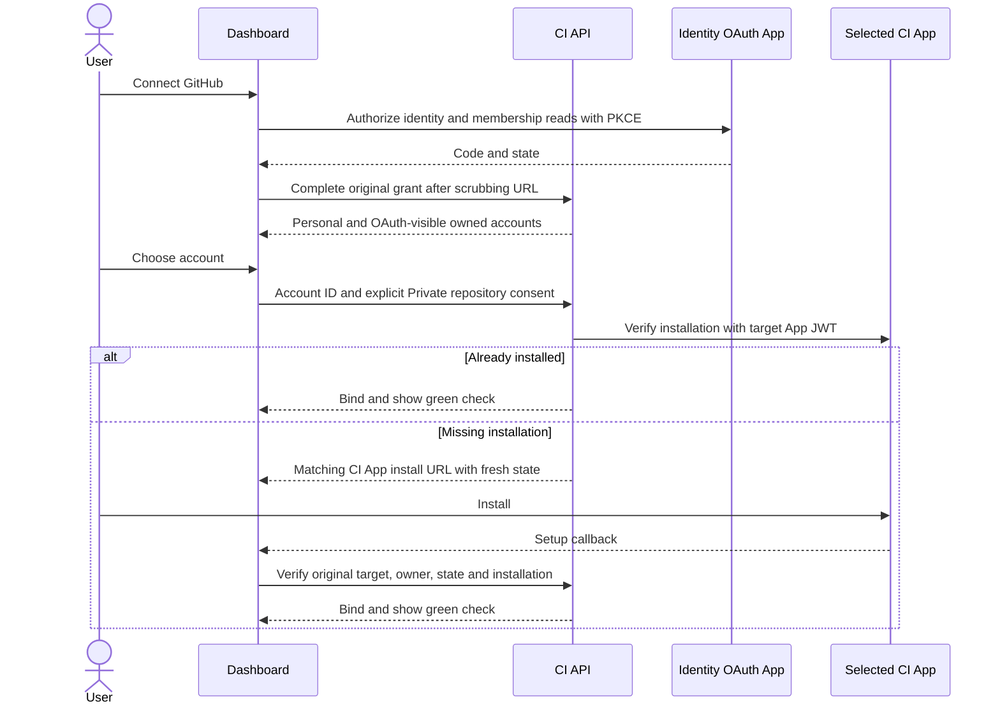

# API

The NestJS control-plane service. See the
[hosted platform](../../docs/contributing/architecture/platform/README.md) for how it fits with
the other services and [service interfaces](../../docs/contributing/architecture/platform/api.md)
for its interfaces.

## Development runtime

API development and tests require Node.js 22.14+ within the 22.x line, or 24.10+,
as declared in [`../package.json`](../package.json).
Use Node.js 24 locally to match the production image:

```bash
nvm install 24
nvm use 24
corepack enable
```

The disposable-email dependency requires this runtime range. The Jest adapter uses
Node's native loader to exercise the published ESM package and its bundled domain list.
The API test configuration repeats the shared CI Listener aliases alongside that
dependency's type mapping because TypeScript replaces inherited `paths` as a whole.

Account-link flow tests load the Auth0 Action template with every deployment placeholder filled.
Their SPA fixtures leave the optional MCP resource URL empty, matching the deployment default.

### Listener configuration tests

`BOXLITE_LISTEN_HOST` selects the API listener address; unset or empty retains
`0.0.0.0`, while the managed local E2E launcher supplies `127.0.0.1`.
`make test:apps:api TEST_FILES=main.spec.ts` exercises the real bootstrap entry
with infrastructure dependencies mocked and checks the address passed to Nest's
listener for all three cases. It does not start PostgreSQL or a VM.

### Hosted CI lease storage

The hosted listener stores scheduler identity and epoch in `@owner`, and its
renewable deadline in `@lease`. Execution checks lock the stable identity row;
renewal validates that identity and updates only the deadline. A snapshot created
before renewal can therefore lock the same owner without a renewal-induced
serialization failure. There is no automatic transaction retry; actual takeover
or other database failures still propagate.

Initialization atomically upgrades existing combined owner records while
preserving their identity, epoch, deadline and execution journal. Old binaries
reject the upgraded owner schema and stop renewing, so rollout can pause
scheduling until the preserved lease expires. This is a forward state-format
upgrade: do not revert to an older binary or delete the journal to roll back.
See [shared lease semantics](../libs/ci-listener/README.md#execution-lease-storage)
for locking, expiry and migration rules.

`make test:apps:api TEST_FILES=ci-native-state.spec.ts` exercises concurrent
renewal without snapshot restarts, takeover fencing and error propagation against
PostgreSQL. Supply `DB_HOST`, `DB_PORT`, `DB_USERNAME`, `DB_PASSWORD` if needed,
and `DB_DATABASE` for a disposable local database; without `DB_HOST`, it skips.
The suite creates and drops its own schema and accepts only loopback database hosts.

### Production entity metadata checks

`make build:apps:api` and the API Docker build validate PostgreSQL entity metadata
from the compiled production `main.js`. The check stops before Nest initializes
services and rejects unsupported column types without database or Redis access.
It covers compiled mappings, not full application startup or deployed schema compatibility.
Enum-backed varchar columns need an explicit SQL type: `Checkpoint.sourceState`
uses `@Column('varchar')` because production compilation can emit `Object` metadata
for the imported `BoxState` enum even when source-level Jest tests pass.

## Registration configuration

Turnstile registration protection is opt-in. Leave `TURNSTILE_SITEKEY` unset or
blank to create local users automatically after OIDC authentication, without a
widget or Cloudflare credentials. A nonempty sitekey enables protection and then
requires `TURNSTILE_SECRET_KEY` and `TURNSTILE_EXPECTED_HOSTNAMES`. Hostnames are a
comma-separated list without schemes, ports or paths. `TURNSTILE_TIMEOUT_MS`
defaults to 5000 and must be a positive integer when enabled. Invalid enabled
settings stop startup and identify the setting without printing its value.
Hostname matching ignores DNS letter case and requires an exact allowlist entry;
subdomains and suffixes are not implicitly trusted.

`GET /api/config` omits `turnstile` when protection is disabled. When enabled, it
publishes only `turnstile.sitekey` and `turnstile.action` (`signup`).
The secret, allowed hostnames and verification timeout remain server-side. Restart
the API to change a widget configuration; the dashboard reads it at runtime.
The generated TypeScript and Go configuration models accept an absent `turnstile`.

## Registration email policy

With protection enabled, new OIDC identities register through `POST /api/auth/register`,
using an API-audience Access Token and a `turnstileToken` string of 1–2048 characters.
Ordinary JWT-authenticated requests then return `403 registration_required` until that
account exists. Database-account email verification remains an Auth0 Action responsibility.
The API's registration email policy requires an email address for a new local user.
`UserService.create` trims and lowercases each non-empty email, validates its syntax,
then rejects disposable domains before generating keys, persisting the user or creating a default organization.
This covers database, social and enterprise OIDC identities, CLI authentication and administrator-created users.

| Rejection                          | HTTP status | Error code         |
| ---------------------------------- | ----------- | ------------------ |
| New OIDC identity has no email     | 403         | `email_required`   |
| Provided email has invalid syntax  | 400         | `invalid_email`    |
| Disposable domain or its subdomain | 403         | `disposable_email` |

Existing users can still log in, update their email and link identities; the email-free bootstrap administrator is preserved.
Auth0 signup and verification emails are unchanged: this policy rejects local BoxLite account creation after authentication.
The API uses the bundled list from `@visulima/disposable-email-domains/edge`, pinned to version `2.0.20`.
The list includes `drtall.com` and `emailkeep.com` and matches their subdomains.
Deploy the API after upgrading the package to apply the new list.

Run `make test:apps:api TEST_FILES='user.service.registration-email|jwt.strategy'` for the registration checks,
and `make build:apps:api` to validate the production bundle and dependency imports.

## Background lifecycle requests

Automated stop requests use `BoxService.stop` with a platform operation context.
A stable `started` Box moves to `pending=true`, `desiredState=stopped`, and emits
the normal Stop event. The existing manager and Runner complete the transition.
Conditional repository updates serialize competing lifecycle requests and reject
a Stop if the Box's organization changed after lookup.

The worker processes candidates sequentially within a 30-second submission
window. It waits for each submitted operation and saves the last attempted
creation timestamp and ID in a shared Redis checkpoint before releasing its lease.
The next run starts after that position and wraps around, including when a different
worker acquires the lease or the previous Box no longer appears in the candidates.
Only the current lease owner may save progress. Failed attempts advance it too.
The checkpoint uses the lease key as a Redis hash tag, preserving the lease key
while keeping both keys in one slot. Lease acquisition waits at most one second;
cancellation releases any lease returned after that wait ends.

Background Stop lookups and updates limit each database lock wait to 500 ms. A lock
timeout rolls back the transaction before processing the next candidate; a later
run can retry that Box. The setting ends with the transaction and does not affect
ordinary user Stop requests. Bounded lookups bypass the query cache and retain
ID-first lookup with name fallback. Candidate reads use a separate transaction with the
same lock wait bound, so a table lock cannot keep the scan waiting indefinitely.

The automatic stop worker cancels pending work in `beforeApplicationShutdown` and
awaits submitted operations before releasing its lease. This finishes before HTTP
connections drain, so a long request cannot keep a worker submitting new stops.
Cancellation does not undo an accepted Stop intent. Integration tests check
persisted intent and lifecycle events; physical Runner shutdown requires
end-to-end verification.

Use `make coverage:api TEST_FILES='<spec pattern>'` for focused coverage checks.
This selects test files while retaining the configured coverage sources and exclusions.
A pattern matching no test files fails. PostgreSQL/Redis integration suites require
`DB_HOST`, `REDIS_HOST`, and the corresponding connection settings; they skip when
either host is unset.
The `api:test` cache includes PostgreSQL and Redis hosts, ports, usernames, passwords,
and the database name, so changing connection settings invalidates cached results.
Coverage runs bypass the cache.

## Checkpoint capture

`POST /api/v1/checkpoints` accepts `source_box_id` and an optional `name`.
`GET /api/v1/checkpoints` and `GET /api/v1/checkpoints/{id-or-name}` read the
organization's records. The routes also accept the existing organization path
prefix. Capture requires Box write permission; reads require organization
membership, following the existing Box read policy. List/detail responses omit stored environment values and
internal object locations.

Checkpoint operations stay outside the MCP OAuth allowlist, like export/import.
The `checkpoints` collection name is reserved and cannot be claimed as an application subdomain.

A source must be stopped and idle on a ready v2 runner, without volumes or secrets.
Stop the Box and wait for `stopped` before capture; other states return `409`.
Checkpoint capture never stops the source automatically or uses hot export.
Creating a checkpoint takes the source's `BOX` job slot
until native export completes. The completion transaction clears its checkpoint
ownership marker and creates an `UPLOAD_CHECKPOINT` job under `CHECKPOINT`;
the source can then start while upload runs. Only a matching successful upload
makes the checkpoint `ready`. Runner failures or invalid archive metadata make
it `failed`; they do not recreate or destroy the source.

The checkpoint persists its captured execution settings and immutable archive
identity. It has no source Box foreign key: deleting the source after export
does not delete the checkpoint. Duplicate or stale callbacks cannot advance a
newer operation. A reconciliation task replays durable terminal jobs after a
lost callback or API restart.

`POST /api/v1/boxes` accepts `checkpoint_id` and an optional `name` to create a
new Box from a ready checkpoint. It returns `201` with the Box and requires Box
write permission. `checkpoint_id` is mutually exclusive with `image` and
`rootfs_path`. The Box inherits the checkpoint's saved settings, so any other
field returns `400`. Requests without `checkpoint_id` are unchanged.
The existing scheduler selects a compatible ready v2 runner; creation skips the
warm pool. Box admission, the import operation and its job commit together, so
quota, name conflicts or a checkpoint deleted during admission leave no job.

`DELETE /api/v1/checkpoints/{id-or-name}` requires Box write permission and
returns 204 after object and metadata deletion. It refuses active capture and
pending or failed import use. `force=true` ignores absence only. Object deletion
runs outside the database transaction after persisting `deleting`; failures
retain that state and quota for retry. Checkpoints also protect their referenced
organization image and matching registry credential after source deletion.

Capture source selectors and checkpoint selectors resolve an exact ID before
falling back to a name within the organization. An existing name cannot shadow
an ID during capture, Box creation or deletion. Checkpoint creation rejects names that
match an existing checkpoint ID in that organization.

Creating a Box from a checkpoint emits the ordinary `BoxEvents.CREATED`
notification after the Box, import job and operation commit. Failed admission
does not emit it; listener failures are logged without repeating creation.

The import completion transaction verifies operation ID, target sequence and
current job ownership, then marks the Box `stopped` and clears its checkpoint
ownership. The desired state `started` then starts it. Late or replayed callbacks cannot commit
an older attempt. If that commit fails after native import, reconciliation
replays the durable success receipt without scheduling another import.

A failed import, including a terminal runner job whose success receipt is
missing or invalid, leaves the Box in `error` and keeps its checkpoint use.
There is no in-place retry or replacement: delete the Box, then create another
from the checkpoint. The HTTP state wait is bounded to 30 seconds and does not
cancel accepted runner work. Every post-admission wait failure includes the
`boxId` error field, even when a terminal failure occurs before timeout.
Clients must query that identity before submitting another create.
The REST SDK includes the admitted identity in its error message as
`(boxId: ID)`, including terminal import failures, so callers can find the Box.

Checkpoint-created Boxes record the ordinary `box.create` requested event after
admission, followed by success or exception when the import outcome commits.
Invalid success receipts record exceptions. Replayed callbacks do not duplicate
outcomes; a process crash after commit can still lose the in-process log.

`POST /api/v1/boxes/import` is not routed on the cloud API; binary archive
upload stays unavailable there.

Explicit target deletion cancels its import operation and advances the target
sequence before scheduling native destruction. Late callbacks cannot commit
configuration; the runner also durably retires that public target before native
destruction, preventing delayed imports from recreating it. An already absent
native target counts as successful destruction.
Cancelled checkpoint targets remain eligible for destruction retries even in
`error`; retention cleanup keeps their rows until native deletion is confirmed.
Checkpoint deletion, including force, rejects cancelled targets that have not
reached `destroyed`, before deleting any archive or operation marker. This keeps
both periodic destruction retries and retention protection active.
Export completion commits the upload job before notifying the runner's Redis
queue. If notification fails, the durable job remains available to polling.

| Boundary                  | Job owner               | Source busy    | Archive ownership and retry                                                          |
| ------------------------- | ----------------------- | -------------- | ------------------------------------------------------------------------------------ |
| Export pending or running | Source `BOX`            | Yes            | Runner retains its private export directory.                                         |
| Export receipt accepted   | `CHECKPOINT` upload job | No             | Checkpoint owns the immutable archive; upload retries reuse it.                      |
| Upload receipt accepted   | No active capture job   | No             | Object storage holds the archive; runner staging can be reclaimed.                   |
| Import pending or failed  | New `BOX`               | Not applicable | Operation retains checkpoint use and Box ownership until completion or Box deletion. |

Run the transaction and HTTP admission checks with
`make test:apps:api TEST_FILES='checkpoint|job-state-handler'`, providing
`DB_HOST`, `DB_PORT`, `DB_USERNAME`, `DB_PASSWORD` and `DB_DATABASE` for a test
PostgreSQL instance. Without `DB_HOST`, the database suites are skipped.
Checkpoint ownership lives in `box_checkpoint_state`, an optional one-to-one
record keyed by `boxId`. Ordinary Box queries do not load this table. Lifecycle
synchronization and deletion explicitly read Box and checkpoint ownership in
one query; callback transactions lock the checkpoint, Box, coordination record,
then operation in that order. The Box lock also serializes first use before a
coordination record exists.

Export releases `activeJobId` after the native export finishes. Import failure
retains ownership until the Box is deleted; success clears it while retaining
`sequence`. Deleting a Box with an unfinished import advances `sequence`, so
receipts from the cancelled import are rejected. Soft deletion
retains the coordination row; physical Box deletion cascades only that row,
leaving independent archives and operation history intact.

New Box creation validates and locks its checkpoint before insertion, then
writes checkpoint coordination after the Box exists, all in the same admission
transaction. The checkpoint migration creates these separate tables without
adding columns to `box`; unrelated Box-only fixtures do not need that migration.
Fixtures exercising lifecycle synchronization or deletion must register
`BoxCheckpointState` and create its table, even when no checkpoint is active.
The transaction tests inject a failure after the Box write and before operation
completion; they verify rollback and concurrent replay against PostgreSQL.

Provision `CHECKPOINT_ARCHIVE_PREFIX=gs://<bucket>/checkpoints/` and grant the
API/runner identities object access. Storage alone does not enable admission.
After compatible runners are deployed, set `CHECKPOINTS_ENABLED=true` to allow
capture and checkpoint import; it defaults to false, including mdeploy stacks.
Disabling admission keeps existing records readable and lets accepted jobs finish. The optional
`CHECKPOINT_MAX_PER_ORGANIZATION` defaults to 10; creating, ready, failed and
deleting records all count. Quota and name checks run in the transaction that
creates the export job. An unset prefix returns 503 before source mutation.

Apply the checkpoint pre-deploy migration before API instances that map its
archive, operation and coordination tables. Enable capture after compatible runners are
available. Rollback refuses while checkpoints or incomplete checkpoint jobs
remain; it retains the additive, unused PostgreSQL job-resource enum value.

## User creation transactions

User creation inserts a new row and reads database defaults in the same transaction
that emits the creation event and creates the default organization and owner. An
organization failure rolls back the user. Creating a duplicate user ID returns
`409 user_already_exists` without replacing data; other database errors retain their
original behavior. Concurrent attempts can commit only one user and default organization.
Both the current `user_id_pk` and legacy `PK_cace4a159ff9f2512dd42373760` user
primary-key constraints receive this duplicate-ID handling.

## First local registration

When protection is enabled, registration verifies the challenge server-side, including its hostname and `signup`
action, before inserting the user and creating their default organization in one
transaction. A new account returns `201 UserDto`; an existing identity returns `200`
without validating the challenge again. Both require a valid JWT and request body.

Challenge rejection returns `403 turnstile_verification_failed`; verification service
failure returns `503 turnstile_unavailable`. Neither creates a local account. The
internal registration endpoint is excluded from public Swagger and MCP tools.
Existing users, including MCP tokens without profile claims, keep their local profile
and existing permissions. When protection is enabled, new MCP users first register in Dashboard.
Notification connections check local user existence before joining rooms.
A failed user lookup closes the transport before room admission so Socket.IO can
retry after recovery. Unknown users and invalid credentials are rejected.

## Box startup timeouts

REST creation persists the Box before waiting up to 30 seconds for `STARTED`.
If the wait expires, HTTP 408 includes the existing Box's public `boxId` in the
flat error body. The Box continues starting; clients can read its state with
their existing organization-scoped credentials instead of repeating creation.
The same identity accompanies other Box state-wait timeouts.

Image-preparation timeouts retain `progress` and `Retry-After`. The ID remains
available even if the best-effort progress lookup fails. HTTP status, message,
and synchronous SDK behavior are unchanged; a timeout is not a running Box.

## Registry credential rotation

`PUT /api/images/registries/{id}` replaces a stored username and password/token with `write:registries` permission.
Both fields are required, with the same validation limits as creation; other fields are refused.
The credential ID, registry host, repository prefix, creator and creation time remain unchanged, even while Boxes depend on it.

Deletion still refuses credentials selected by non-destroyed Boxes.

Rotation checks organization-scoped existence, then writes a fresh secret outside any database transaction.
A short PostgreSQL transaction locks and rechecks the credential, reads its current secret version, and updates the login and pointer.
After acknowledged commit, rotation retires the version read under lock; no secret-store call holds the update transaction open.
This reuses Secret Manager and exclusive local files without a migration or new IAM permissions.
Lock contention returns 409 for retry; another organization's credential returns 404 before any secret write.

Deletion or another rotation can finish while the replacement is being written.
A credential deleted before the locked recheck returns 404 and cleans up the replacement; a concurrent rotation retires the version current at the lock.
Transaction-start, lock and pre-commit update failures clean up the replacement after the transaction rejects, preserving the original failure.
An uncertain COMMIT outcome retains both secrets and emits an `update outcome is unknown` warning; reconcile the stored pointer before retiring either version.
A failed old-secret retirement emits `Could not destroy unused registry secret`; the committed update remains successful and cleanup needs retrying.

The warning identifies a version and the cleanup error cause, never its password; the API cannot read registry passwords or validate them upstream.

Before reusing a private bearer, each proxy queries the current credential metadata and compares its secret version with the cached token's version.
After update commits, newly started pulls reject old-version bearers even if old-secret retirement fails.
Secret payloads are read only on authentication challenges; unchanged credentials still reuse their bearer token.

Normally, each private manifest/blob request adds one control-plane lookup; lookup failures reject the pull even when a bearer is warm.
If a secret read races retirement, the proxy refreshes authorized metadata and retries that read once before failing the pull.
Requests whose lookup preceded update may finish; another rotation during the retry can still require a caller retry.
The upstream token itself is not revoked, and anonymous lookup caching keeps its existing TTL.

Deploy the API and proxy before the dashboard; older proxies retain the prior five-minute cache delay until upgraded.
This operation is additive to the control-plane API and does not add portable SDK methods.

Run `make test:apps:api TEST_FILES='registry/'`; set the normal `DB_*` variables to include the real-PostgreSQL mutation tests.
These cover live/stopped Boxes, organization isolation, rollback, concurrent mutations and lost COMMIT acknowledgment with real secret files.
Design: [registry credential updates](https://github.com/boxlite-ai/boxlite/issues/2304).

## Account deletion tests

`src/user/user-deletion-memberships.spec.ts` exercises account deletion through the real services
and event handlers. Its database double runs nested transaction callbacks with the same manager
and supports deletion by ID or field criteria; only the outer transaction records a commit.
The assertions check domain cleanup, preservation of shared organizations and their domains,
and membership revocation after the outer commit. Run it from the repository root with
`make test:apps:api TEST_FILES=user-deletion-memberships.spec.ts`.
The double checks callback execution and row selection; the real-Postgres organization-domain
lifecycle tests cover database rollback.

## Guest Docker privilege

REST creation accepts `advanced.privileged` (default false) and advertises
`privileged_enabled` in `/v1/config`. The option is stored on the Box and
forwarded by both runner adapters on creation and by v0 recovery. Subsequent
starts reuse the runtime's persisted guest settings. The
pre-deploy migration initializes existing Boxes to false. Privileged requests
require fresh Boxes, so a warm-pool Box cannot silently discard the requested
guest policy.

Runner v0 info and v2 health reports advertise `supportsPrivileged`. The API
stores it with a false default and clears it when a report omits it or sends
false. A failed v0 info read leaves the capability column untouched; a successful
report with the field omitted still clears it. Timed-out checks recheck cancellation
after reading the runner and before submitting a health update, so a delayed read
cannot resume and overwrite a retry's report or emit a stale state event.
Privileged creation and migration
select only runners reporting support; create and v0 recovery also reject an
unsupported target before dispatch.
Ordinary Boxes retain the existing scheduling rules. `/v1/config` describes API
support independently of current runner capacity. Run the pre-deploy migration
before updating the API; each upgraded runner becomes eligible after reporting
its capability.

This enables guest capabilities and writable kernel mounts. Runner host sandbox
settings remain independent; REST rejects host security options and explicit
capability policies. Operators must supply a Docker-capable guest kernel as
described in the [DinD guide](../../docs/guides/docker-in-docker.md).

Migration-backed integration suites that query `Box`, including usage accounting,
run `AddGuestPrivileged1792540800000` so their schema includes the persisted field.
The organization nesting migration adds only the Admin allowlist switch; nesting
is selected only at Cloud create; restart uses the existing runtime BoxConfig,
without a new Cloud Box field. See
[the rollout contract](../../docs/contributing/architecture/platform/api.md#organization-nested-virtualization-allowlist-rc).

## GitHub CI installation connect (in development)

The CI controller implements `POST /api/v1/{prefix}/ci/connect`,
`POST /api/v1/{prefix}/ci/connect/{id}/poll`, and
`DELETE /api/v1/{prefix}/ci/connect/{id}`. Browser connect adds
`GET /api/v1/{prefix}/ci/connect/configuration`,
`POST /api/v1/{prefix}/ci/connect/web`, and
`POST /api/v1/{prefix}/ci/connect/{id}/complete`,
`POST /api/v1/{prefix}/ci/connect/{id}/select`, and
`POST /api/v1/{prefix}/ci/connect/{id}/installation`. Routes without `{prefix}` use the existing
authenticated organization. These experimental routes are excluded from generated clients.

Start accepts `github_account`, `follow_installation: true`, and
`allow_private_repositories`. Existing platform authentication and organization guards
require an owner or the explicit platform-admin exception; API keys additionally need
`write:boxes` and `delete:boxes`. Transactions remain scoped to the initiating user and
organization. GitHub device authorization proves personal-account ownership or active
organization-admin membership and cross-checks the installation through App authentication.

The Dashboard uses a dedicated GitHub **OAuth App** for identity discovery. It
requests exactly `read:user read:org` with independent state and S256 PKCE; it
rejects missing or excess granted scopes. The two **CI GitHub Apps** supply runner
permissions separately. CLI Device Flow keeps its existing App-specific contract.
New browser starts accept `follow_installation: true`,
`allow_private_repositories: false`, and optional `select_account: true` to force
GitHub's account picker. The optional legacy `account_type` field does not choose
the identity client. The original OAuth client remains pinned to each attempt.

Set `CI_GITHUB_OAUTH_CLIENT_ID` as a plain API setting and
`CI_GITHUB_OAUTH_CLIENT_SECRET` as a workload secret reference. They must be distinct
from the CI Apps. Without both, new browser connect is unavailable; scheduling and
running installed CI workloads remain independent. CLI connect uses the Login OAuth
App's server credentials to look up the account type before starting the selected
CI App's Device Flow. Credentials stay on the server; account discovery does not
require additional user scopes. Existing `CI_GITHUB_APP_CLIENT_SECRET` and
`CI_GITHUB_ORG_APP_CLIENT_SECRET` settings only support legacy web grants during
transition, rather than new Dashboard sign-in. No Auth0 identity-provider tokens
are needed, and switching the CI GitHub identity does not switch the BoxLite login.

The OAuth App callback is `${DASHBOARD_URL}/settings/ci/callback`; use an exact
HTTPS origin, or explicit localhost HTTP for local development. Both CI Apps use
that URL as their **Setup URL**, with automatic OAuth during installation disabled.
The bootstrap removes callback parameters before loading app/telemetry code.
Only attempt ID, original BoxLite organization ID and expiry enter tab-scoped
session storage; codes/state stay in memory and verifiers/tokens stay on the API.
An uncertain code exchange is terminal and never retried. An authenticated
`GET /api/v1/{prefix}/ci/connect/{id}` resumes the same grant after reload.

After login, the API reads the personal identity and paginated active organization
memberships. Only owner (`admin`) memberships become choices. It checks each
choice using the corresponding CI App JWT, independently of the OAuth client's
installation inventory. A verified installation offers **Connect**; an actual
installation lookup 404 offers **Install**. Other upstream errors remain failures.
`POST /api/v1/{prefix}/ci/connect/{id}/accounts` accepts only numeric `account_id`
and boolean `allow_private_repositories`. Existing connection policy is preserved;
use Update to change it. Legacy `/select` still accepts installation IDs and
consumes its original App-specific grant once.

Transient upstream failures leave the grant retryable without extending its expiry.
Clear a newly saved target after failure so it does not produce an Install prompt.
Preserve an earlier pending target if verification failed before replacement.

OAuth-visible memberships are not a complete organization inventory. Organization
OAuth approval or an active SAML session may be required even if the CI App is
installed. The picker retains a **Missing organization?** recovery action linking
to GitHub access settings/help and fresh authorization. Never infer “uninstalled”
from an omitted membership or claim the user owns no organizations.

For Install, persist the selected account, CI App and fresh installation state in
an encrypted target context. The install URL uses that CI App; returning to the
picker never automatically repeats the redirect. `/installation` verifies state,
current owner membership, target App/account and the returned installation ID
before binding. A naked callback cannot claim an account. Successful account-based
connections return refreshed choices with green checks and retain the encrypted
user token for additional choices only within the original five-minute deadline.
The deadline is never extended. Close/Switch clears the unfinished grant while
preserving committed bindings. Expiry blocks authorization immediately; abandoned
ciphertext/context is physically cleared on the next start or authenticated read,
without a promised five-minute background deletion job. Refresh tokens are discarded.

Delete cancels all unfinished browser grants in the original BoxLite organization,
including grants issued by a separate OAuth client, plus matching-App Device Flow
attempts. It clears temporary credentials, target context and leases before
locking/disabling the binding. Finalization uses the same attempt-before-binding
lock order and rechecks cancellation/deadlines before commit. If Delete wins,
an old callback cannot reactivate or wake inventory; a new verified grant may
reconnect. Independent completed bindings and original worker cleanup remain.

Apply `1794000000000-add-ci-web-target-migration` after the existing connect/web/
selection migrations before deploying this flow. New OAuth fields are optional
in the mstage API catalog; the secret belongs to both API and secret groups.



Design: [Account-first CI connect](https://linear.app/polygala/issue/BUI-1511/github-ci-account-first-connect-flow).

## GitHub CI webhook ingress (in development)

`POST /api/v1/ci/github/webhook` (Personal App) and
`POST /api/v1/ci/github/webhook/organization` (Organization App) accept GitHub's signed notifications without a
BoxLite API Key. Only this route uses raw bytes, capped at 1 MiB; compressed bodies
and non-JSON content types are rejected. `CI_GITHUB_WEBHOOK_SECRET` is injected by
the deployment platform from a secret reference. Its trimmed UTF-8 value must be
32–256 bytes; raw configuration is capped at 64 KiB. Configure the same trimmed
value as the GitHub App webhook secret, separately from the App private key.

HMAC-SHA256 verification precedes JSON parsing and database access. The shared
`Listener.receive` and `ListenerInbox` store receipts, notices and wakes in
`ci_listener_state`. Each ingress read/write transaction rechecks the configured
App, live installation binding and original actor's current owner/admin authority.
Unbound or revoked workflow notifications return 503 without storing a receipt.
An unconnected installation does not enqueue inventory: connect itself commits
the authoritative binding and wake together. Job notifications cannot create or
claim a connection, and revoked authority or known account mismatches store no inbox work.
Signed installation changes may record discovery hints even after a binding is
removed; those hints grant no execution authority.

Delivery UUID and body/event digest prevent conflicting replay. Distinct deliveries
update opaque record versions; settlement matches the captured version so an older
observation cannot erase newer work. Repository/run/job identity conflicts return
409 and roll back all inbox writes. A notice is demand to verify through GitHub,
not an exclusive job assignment or executable instructions.

HTTP 204 follows durable commit, duplicate recognition or a valid ignored event.
HTTP 503 retains unsettled work on database failure or capacity exhaustion. Requests,
secret reads and unsettled persistence operations are bounded; a response timeout
does not free a still-running operation. A late commit remains idempotent on retry.
Receipts are currently retained; automatic retention pruning is not implemented.

GitHub does not automatically retry failed webhook deliveries. The shared controller
uses App-wide delivery recovery when the webhook secret is configured, alongside
bounded compensation scans. The shared controller saves exact delivery IDs, GUIDs,
scan checkpoints and retry intents in PostgreSQL, then rechecks the current connect
binding and owner before requesting replay. Missing or revoked bindings cannot send
a replay or obtain execution authority. POST 202 only confirms a request; a local
receipt or later successful delivery observation stops transport retries. Recovery
metadata expires after the available history window; business receipts and unknown
resource allocations are not pruned by that cleanup.
A normal queued-job webhook supplies its exact job ID; it does not trigger short
polling of every repository. Apply the
connect and shared-state migrations before enabling this receiver. Real hosted App
CI and recovery acceptance are still pending.

### JIT Box deletion and capacity recovery

Hosted worker recovery checks the recorded Box ID and organization before
interpreting its lifecycle state. Platform soft deletion renames the Box; a
confirmed `DESTROYED` record for that original ID releases its physical capacity
even after the rename. Pending deletion retains capacity until confirmation.
Unknown IDs, conflicting ledgers, foreign organizations and renamed live Boxes
remain denied. Confirmed Box absence makes its physical capacity available; the
allocation remains recorded until the original runner cleanup also finishes.
A successful CI job alone does not prove that cleanup finished.

## Admin Box image

`GET /api/admin/boxes` and `GET /api/admin/boxes/{id}` include `image`, the stored
Box image reference, or null when none is recorded. Both select the existing
column in their current queries and use the same response projection; no extra
lookup or migration is required. For example, a Box created from `python:3.13`
returns `"image": "python:3.13"` in both responses. Upgrade strict consumers to
accept this field before rolling out the added response property.

## Business events

`recordBusinessEvent` (`src/common/utils/business-event.util.ts`) writes one structured log record
per business event; the attributes reach OTLP through nestjs-pino, where alerts query them.
The same sanitized attributes reach PostHog through the client shared with HTTP metrics.
Activity does not require the optional logging ClickHouse instance.

| Event                                               | Recorded by                                                                                                                                                                                                        | Outcomes                                                    |
| --------------------------------------------------- | ------------------------------------------------------------------------------------------------------------------------------------------------------------------------------------------------------------------ | ----------------------------------------------------------- |
| `user.registration`                                 | `UserService.create`, through `recordOutcomes`                                                                                                                                                                     | requested, success, exception                               |
| `user.login`                                        | `LoginEventRecorder`                                                                                                                                                                                               | success                                                     |
| `org.active`                                        | `OrganizationActivityInterceptor`, best effort on a person's first request in an organization each UTC hour; a process exit or lost Redis acknowledgment after claiming the key can suppress the rest of that hour | success                                                     |
| `box.create`, `box.start`, `box.stop`, `box.delete` | `BoxService`, the auto-stop and auto-delete crons                                                                                                                                                                  | requested                                                   |
| `box.create`, `box.start`, `box.stop`, `box.delete` | `JobStateHandler`, when the runner job finishes                                                                                                                                                                    | success, exception                                          |
| `box.exec`, `box.file_upload`                       | `BoxliteProxyController`, for `POST …/exec` and `PUT …/files`                                                                                                                                                      | requested, then success or exception by the response status |
| `tunnel.create`                                     | `BoxliteProxyController`, through `recordOutcomes`                                                                                                                                                                 | requested, success, exception                               |
| `api_key.create`                                    | `ApiKeyService`, including platform bootstrap                                                                                                                                                                      | requested, success, exception                               |
| `volume.create`, `volume.delete`                    | `VolumeService`, shared by REST and Dashboard                                                                                                                                                                      | requested, success, exception                               |
| `box.open`                                          | Authenticated preview proxy through the last-activity endpoint                                                                                                                                                     | success (sampled anonymous presence)                        |

Volume success means the command entered the lifecycle queue, not that backing storage is ready or deleted.
Force-deleting a missing or already-deleting volume is a no-op and emits no event. Mutation failures carry fixed
categories, never resource names, key material or database error messages. API-key correlation is a fresh UUID
for the attempt; volume correlation is the volume ID.

Browser presence requires an admitted GET with `Sec-Fetch-Mode: navigate` and `Sec-Fetch-Dest: document`.
The proxy sends `X-BoxLite-Preview-Open: 1` to the existing last-activity route; only the proxy role may trigger
an observation. The API derives organization from the stored box and leaves user/actor unknown. Assets, iframes,
polls and denied requests do not emit it; admission does not prove the guest rendered successfully.
Per-box proxy singleflight and a separate 60-second cooldown bound attempts (including failed delivery), with a
two-second request timeout. API Redis NX/EX 60 deduplicates across replicas; Redis failure suppresses the event.
The API waits at most 1.5 seconds for the complete preview sequence, including the activity
lock, buffered timestamp, deduplication and box lookup. A deadline suppresses the event and
subsequent steps; ordinary heartbeat waits and errors keep their existing behavior. Already
submitted shared Redis commands cannot be cancelled: a late lock can consume its throttle
TTL without buffering activity, and an in-flight timestamp or expiring NX marker may still
land. This deadline bounds handler waiting, not the shared Redis queue.
Forwarding continues on telemetry failure. Reloads collapse and delivery is best effort: this is neither a
navigation count nor a visitor count, and it does not add to requested-operation totals.

API/proxy warnings identify the box and failing observation stage; proxy HTTP failures also
identify the status, and transport failures distinguish timeouts. Raw database, Redis and URL
error strings are excluded because they may contain credentials or user data.

The preview marker is internal to the proxy/API exchange and is absent from the public OpenAPI parameters;
ordinary heartbeat clients keep their existing signature and need no new header.

At most 1,440 preview events per continuously active box/day reach PostHog. Include these sampled
observations when reviewing the project's ingestion budget and retention settings.

For v2 runners, JobStateHandler records a `box.start` success or exception after persisting
the START_BOX job result. Accepted start requests retain their organization and caller context.
Activity adds no database column or migration and remains best-effort telemetry, not an
exactly-once outbox. Legacy v0 runners retain request events; terminal start outcomes are
outside this contract, including instance recreation across synchronization cycles.

Caller-attribution tests cover JWT and API-key administrators and both proxied exec/upload
error categories without changing authentication policy.

Box events go through `src/box/utils/box-business-event.util.ts`: the request and the outcome are
recorded in different places, so one call cannot cover both. A proxied call that fails with an
HTTP status records `http_<status>`; a client that disconnects first records `client_closed`.
An already finished/closed response is accounted for after the box lookup, and outcome
listeners are removed once recorded. Organization-presence Redis warnings use fixed categories,
not raw error strings.

An event names its entity by `correlation.id`: the user id for `user.*` and `org.active`, the box
id for box and tunnel events (volume ID or an API-key attempt UUID for those mutations). It also carries `organization.id`, so an organization's activity
can be counted from the log alone. `user.login` has none, since a login spans organizations, and a
registration carries its default organization on success only.

### Querying Activity in PostHog

The producer uses the existing `POSTHOG_API_KEY`, `POSTHOG_HOST` and `POSTHOG_ENVIRONMENT` settings.
Cloud deployments set `POSTHOG_ENVIRONMENT` to the deployed stage name on both AWS and GCP.
Without the key or host, analytics is disabled while business operations and operational logs continue.
AnalyticsService owns disabled-source and capture-error handling; the interceptor skips request extraction
when analytics is disabled.
Delivery is queued and best effort; application shutdown waits up to five seconds for the shared client.
SDK diagnostics are separate from the sanitized business-event payload. Retention follows the PostHog
project; BoxLite does not provision a second store or guarantee 400 days of history.

An Activity consumer needs the PostHog **API origin** (for example `https://us.posthog.com`, distinct
from an ingestion origin such as `https://us.i.posthog.com`), project ID and a backend-only personal
API key scoped to that project with **Query Read** permission. The producer's project capture key
cannot authorize reads. Keep the query key out of browser code.

Send a `POST /api/projects/<project-id>/query/` request with `Authorization: Bearer <query-read-key>`
and `Content-Type: application/json`. For example, this illustrative HogQL query counts requested
operations and failures in a half-open UTC window, grouped into Shanghai days:

```json
{
  "name": "customer_activity_days",
  "query": {
    "kind": "HogQLQuery",
    "query": "SELECT toString(toDate(toTimeZone(timestamp, 'Asia/Shanghai'))) AS day, countIf(properties['event.outcome'] = 'requested') AS operations, countIf(properties['event.outcome'] = 'exception') AS failures FROM events WHERE properties.activity_schema = '1' AND properties.environment = '<producer-environment>' AND properties['organization.id'] = '<organization-id>' AND timestamp >= fromUnixTimestamp64Milli(1793030400000) AND timestamp < fromUnixTimestamp64Milli(1793203200000) GROUP BY day ORDER BY day DESC LIMIT 32"
  }
}
```

Replace the example organization/environment and bounds with validated values; never interpolate raw
request text into SQL. Use explicit limits, bounded requests and strict response validation. PostHog
returns `columns` and positional `results` arrays, unlike ClickHouse's JSON object rows. See the
[Query API](https://posthog.com/docs/api/queries) and [supported SQL functions](https://posthog.com/docs/sql/clickhouse-functions).
The example documents the contract; it has not been executed against a live PostHog project.

| Activity field       | PostHog value                                                                            |
| -------------------- | ---------------------------------------------------------------------------------------- |
| Event/time           | `event`, `timestamp` (the original event emission time)                                  |
| Outcome/entity       | `properties['event.outcome']`, `properties['correlation.id']`                            |
| Organization/person  | `properties['organization.id']`, optional `properties['user.id']`                        |
| Actor/reason/failure | `properties['actor.kind']`, `properties['event.reason']`, `properties['exception.type']` |
| Client/auth          | `properties['client.source']`, `properties['sdk.version']`, `properties['auth.method']`  |

Always filter `properties.activity_schema = '1'` and the exact configured producer environment, including
nested queries. Legacy `api_*` events remain available for existing analytics but are not Activity rows.
Organization-scoped events also carry the existing `organization` group. Unknown people use namespaced
anonymous/platform distinct IDs with person profiles disabled; do not treat those IDs as people.
`user.login` has no organization: associate it only with users observed in the requested organization
and time window. Registration has an organization only on success.

For steps, select the fields above, group equal steps per minute, and request the UI limit plus one
to report truncation. Include requested/exception outcomes plus successes for `org.active`, `box.open`,
`user.login` and `user.registration`; ordinary success records confirm requests already listed.
Only requested outcomes contribute to operation totals. Preview presence remains anonymous and sampled.

### Who asked: the operation context

A service that records an event takes a required `ctx: Context` (`src/common/context/`) from its
caller. The compiler rejects a call that omits it.

```ts
return this.userService.create(createUserDto, Context.admin())
await this.stop(event.boxId, undefined, Context.platform(PlatformReason.ORG_SUSPENSION))
```

| Context                    | `actor.kind` | `event.reason`                                             |
| -------------------------- | ------------ | ---------------------------------------------------------- |
| `Context.user(actor?)`     | `user`       | —                                                          |
| `Context.admin(actor?)`    | `admin`      | —                                                          |
| `Context.platform(reason)` | `platform`   | the `PlatformReason`, such as `auto_stop` or `auto_resume` |

- Only the platform gives a reason; user and admin contexts have none.
- A request handler names its caller with `@UserContext() ctx`, or `requestContext(req)` where it
  already holds the request: `user.id`, `auth.method` (`api_key` or `jwt`) and, when the client
  sends `X-BoxLite-Source` or `X-BoxLite-SDK-Version`, `client.source` and `sdk.version`. Values must be 1–64 ASCII
  characters using letters, digits, `_`, `.`, `+`, `/`, space or `-`; invalid values are omitted.
- The Dashboard sends source `dashboard`. The shared native REST transport sends source
  `sdk` and its compiled BoxLite version on HTTP and API WebSocket requests, including file
  operations. Rust, Python, Node, C, Go and the CLI use that transport; the label identifies
  the SDK transport, not a particular language or a verified caller. Guest tunnel traffic
  is not labeled. Older or third-party clients may still omit these optional headers.
  HTTP test servers with explicit CORS allowlists must also permit `X-BoxLite-Source`.
- The boot-time admin seed registers as `Context.platform(PlatformReason.BOOTSTRAP)`.
- Job outcome events carry no context: the runner reports after the request has ended.
- Admin box recovery and user creation retain the authenticated administrator in `Context.admin(actor)`.
- The shared request context selects admin/user from the authenticated role, including tunnels,
  proxied exec/uploads and decorated mutation handlers. Client headers cannot choose actor kind;
  requested and terminal events retain the same caller identity. Service callers with no person
  keep their existing user context without an actor; explicit admin/platform decisions stay separate.
- Add caller-decided fields to `Context`, not new service parameters.

### Maintaining Activity coverage

Test both the Dashboard volume controller and the REST controller: each must forward the
caller's context to the shared service. API-key tests should exercise generated keys and
`ensureApiKeyValue` with a missing configured key, preserving platform bootstrap attribution
and keeping key material out of events. Ordinary heartbeats must update activity without
writing a preview cooldown or emitting `box.open`.

Include administrator and member principals in HTTP tests of the shared request decorator.
With authentication guards stubbed, these tests establish caller attribution, not access policy.
The HTTP suite mounts both Dashboard and REST volume routes for create/delete, preserving the
ID generated by the service through readiness lookup and response conversion. The marker test
instead runs the real organization/resource guards: an authorized member heartbeat must return
201 while ignoring a client-supplied preview marker. Recorder-failure and per-box cooldown
isolation cases protect the best-effort observation contract. If cancellation arrives during throttle-lock acquisition,
release only the acquired owner before skipping the timestamp write, so the next heartbeat is not
throttled by a cancelled observation. Successful writes retain the normal throttle TTL.
With `REDIS_HOST` set, the throttle suite exercises cancellation and ownership replacement against real Redis.

Run `make coverage:api` from the repository root to include these paths in the API LCOV
report at `target/coverage/api/lcov.info`. The patch coverage requirement remains 90%; a
passing test suite alone does not establish coverage of these caller boundaries.

Run `make test:apps:dashboard FILTER='sends the dashboard activity source'` to check the Dashboard's
source header on authenticated requests. This target filters test names;
omit `FILTER` to run all Dashboard unit tests.

## Admin organization metadata

System administrators read registration fields on the existing organization routes.
Authenticate with `Authorization: Bearer <admin-api-key>` or an administrator JWT;
an ordinary organization's API key does not grant system-wide access.

Upgrade every producer instance before enabling the updated consumer. Old list cursors
must be discarded because the default ordering now uses creation time and ID. Existing
callers needing current-month usage must explicitly select `include=usage`. Roll back
consumers before producers; mixed-version traffic is not supported during activation.

- `GET /api/admin/organizations` returns a bounded page with `createdAt`,
  stored `createdBy`, nullable current `creator`, member/Box counts and impact.
  `q` searches name or exact ID. `createdFrom` is inclusive and `createdTo` exclusive;
  timestamps require an offset and at most millisecond precision. `limit` is 1–200 (default 50).
  `boxCountScope=all` counts every retained state, including destroyed and archived,
  while impact considers only non-destroyed, non-archived Boxes. Omitting this parameter
  excludes destroyed and archived Boxes from the count.
  `organizationId=<UUID>` selects an exact primary key; it cannot combine with `q`.
  Registration collectors use the same full page with `boxCountScope=all` and date bounds.
  Creator lookup and inventory aggregation are restricted to the page's organization IDs;
  no separate per-organization inventory call is needed for the first observation.
  The list always returns `AdminOrganizationOverviewPage`, including counts and impact.
- `GET /api/admin/organizations/{organizationId}` returns flat organization
  details with registration, member/Box pages and impact. A missing organization returns 404.
  `memberCursor`, `boxCursor` and `sectionLimit` page each section. Explicit `include=usage`
  adds existing UTC month-to-date usage; `include=activation` adds retained activation
  evidence. Comma-separated `include=usage,activation` selects both. Omitting `include`
  reads neither section.

Admin detail also returns the stored `suspended` boolean from the same organization
lookup. This flag does not evaluate `suspendedUntil` or establish whether Boxes have
stopped. The response property is optional and read-only in generated clients for
older-server compatibility; an absent flag means unknown, never false. No schema
migration or additional query is needed.

`createdAt` is organization creation time, not user signup or first Box creation. `createdBy`
is the stored creator association, independent of current membership. Account linking
rewrites it to the primary user ID, so it is not an immutable historical identity.
When a creator no longer exists and the organization survives, `creator` is null; an existing
user without an email has `creator.email:null`. Names and email describe current identity.
The list response includes `creator.emailVerified` when the account's
current verification state is available. The organization detail response includes
creator fields (`userId`, `email`, `displayName`) and does not query verification state.
Pages read live data and exclude deleted organizations.
All-state counts cover only retained rows, not lifetime successful creations: cleanup can
remove destroyed rows and pending/failed rows can remain. `observedAt` remains the last
business modification; consumers must measure successful-read freshness separately.

List order and cursor seek both use creation time truncated to milliseconds plus
UUID, ascending. Cursors bind `q`, date filters and count scope and exact organization ID; changing them returns 400. Default-read cursors retain their prior encoding. Unknown
parameters, invalid dates, UUIDs, and incompatible
cursors return `400 invalid_organization_query`. Invalid credentials return 401;
non-admin access returns 403. Consumers may ignore additive fields but must validate
required fields and project their own allowed response fields.

For organizations created on October 20 in UTC+08:00, use this half-open UTC interval:

```bash
curl --get "$BOXLITE_API_URL/api/admin/organizations" \
  --header "Authorization: Bearer $BOXLITE_API_KEY" \
  --data-urlencode "createdFrom=2026-10-19T16:00:00Z" \
  --data-urlencode "createdTo=2026-10-20T16:00:00Z" \
  --data-urlencode "limit=50"
```

Keep the same filters while following `nextCursor` until null. Continue member
and Box cursors independently on detail. Responses use `Cache-Control: private, no-store`.

### Generated clients

The TypeScript organization-list method accepts Axios request options in the original
sixth position or after the new filters in the eighth position. This applies to the class,
factory, functional interface and request creator. For an initialized `admin` client:

```typescript
const options = { headers: { Authorization: `Bearer ${adminApiKey}` }, timeout: 5000 }
// Existing callers keep their headers and other Axios options.
await admin.adminListOrganizationsOverview(undefined, undefined, 50, undefined, undefined, options)
// New callers can select all retained Box states and an exact organization.
await admin.adminListOrganizationsOverview(
  undefined,
  undefined,
  50,
  undefined,
  undefined,
  'all',
  organizationId,
  options,
)
```

Request options remain outside URL query parameters. The TypeScript generation
postprocessor preserves both forms and fails if the expected generated signatures change.

The Go client uses `AdminOrganizationCreator` and `NullableAdminOrganizationCreator`
for both organization-list and detail models. Existing constructor and getter/setter
signatures remain compatible. For example, a value from `NewAdminOrganizationCreator`
can be passed directly to the overview's `SetCreator`.
The optional `EmailVerified` field carries verification from list responses;
`GetEmailVerifiedOk` distinguishes an absent state from `false`.
The Go generation postprocessor preserves these model names and signatures while
the HTTP schemas retain their separate list and detail fields.

Existing organization operation IDs and top-level response models are retained. Registration fields
are required; usage and activation remain optional, present only when selected. Query
parameters have explicit Swagger string types; runtime validation still applies. Regenerate the committed
clients from `apps/` with the pinned generator in `openapitools.json`:

```bash
yarn nx run api-client:generate:api-client
yarn nx run api-client-go:generate:api-client
yarn nx run analytics-api-client:generate:api-client
```

Use the example API environment and a local Redis for offline export, as in the API client
drift workflow. Commit generated methods, models, OpenAPI and generator indexes together;
a second uncached generation must leave them unchanged.

## Admin recorded resource usage

### Design and reuse

`GET /api/admin/usage` integrates recorded allocation periods over a half-open time window.
It uses the existing administrator guards, ledger tables, and Redis connection. Historical
organization, region and Box dimensions come from each period, without joining current Boxes;
deleted Boxes and reassigned resources therefore retain their recorded attribution.
The period writer records CPU in vCPU and memory/disk in GiB (`usage/usage-event.ts`).
Stopped Boxes can have storage-only periods.

The archive worker moves closed periods in one transaction and assigns new archive row IDs.
One SQL statement reads live and archive with `UNION ALL`, under PostgreSQL's statement snapshot,
so the move cannot duplicate or lose a period between reads. Allocations are cast to `numeric`
before integration; decimal strings avoid further JavaScript floating-point loss. This cannot
recover precision already lost in the ledger's floating-point columns.
See [PostgreSQL statement snapshots](https://www.postgresql.org/docs/18/transaction-iso.html#XACT-READ-COMMITTED)
and [exact numeric types](https://www.postgresql.org/docs/18/datatype-numeric.html#DATATYPE-NUMERIC-DECIMAL).

Event handling can fail, and reconciliation starts a correction at the current time rather
than backfilling the gap (`usage/services/usage.service.ts`). Every response therefore reports
`coverage: {status: "unknown", reason: "usage_events_not_backfilled"}`. Empty items mean no
recorded periods, not zero actual usage. Even a recorded value of `"0"` cannot establish a
complete zero total. `sourcePeriodCount` counts participating periods, not completeness.
No historical retention watermark is inferred from the oldest remaining row.

### Query and response

Authenticate with an Admin API key or administrator JWT. All pages reapply the normal guards.
Required `from` and `to` are RFC 3339 instants with an explicit timezone and at most milliseconds;
`to` cannot be in the future. `granularity` defaults to `window`; `hour` permits up to 7 days,
and `day`/`window` up to 90 days. Fixed hour/day buckets start at `from`, with the final bucket
clipped at `to`; they are not calendar/DST buckets.

`metrics` is a unique comma-separated selection of `computeVcpuSeconds,storageByteSeconds,
memoryGibSeconds`, defaulting to the first two. Values integrate allocation times overlap
seconds; storage converts GiB to bytes. They describe allocated resources, not utilization
or money. `groupBy` selects one or two of `organizationId,regionId,boxId`, defaulting to
`organizationId`. Optional filters use these same names. Organization IDs are UUIDs; Region
and Box filters allow 1–128 ASCII letters, digits, `.`, `_`, `:`, `-`, starting with a letter
or digit. The ledger stores string IDs, including historical IDs. Warm-pool unassigned
organization periods are excluded. Lists are normalized in the order shown above.

`limit` is 1–200 (default 50). Repeat all query conditions with `cursor` (maximum 2048 characters)
for subsequent pages. The response contains `queryId`, `generatedAt`, `expiresAt`,
`definitionVersion: "resource-usage-v1"`, normalized `query`, `coverage`, `items`, and
nullable `nextCursor`. Query excludes pagination and identity. Each item contains bucket
`from/to`, only selected `dimensions` and decimal-string `values`, and `sourcePeriodCount`
(1–200000). Only groups with recorded periods are returned.

```bash
curl --get "$BOXLITE_API_URL/api/admin/usage" \
  --header "Authorization: Bearer $BOXLITE_API_KEY" \
  --data-urlencode "from=2026-10-18T16:00:00Z" \
  --data-urlencode "to=2026-10-19T16:00:00Z" \
  --data-urlencode "groupBy=organizationId,regionId" \
  --data-urlencode "metrics=computeVcpuSeconds,memoryGibSeconds"
```

### Limits, pagination and verification

A first page calculates a fixed result, limited to 200000 candidate periods, 5000 result
rows, 2 MiB serialized cache data, and a 5-second database statement timeout. Limits fail
the whole query; there is no successful truncation. General ledger time-window indexes
support storage-only periods that the existing CPU-positive concurrency indexes omit.
The indexes build concurrently outside a transaction so ledger writes can continue.
CLI and application migration runners use `each`; other migrations remain transactional.
Retries preserve valid indexes and rebuild invalid leftovers from interrupted builds.
See [migration rollback](src/migrations/README.md#reverting-migrations) for the explicit
nontransactional revert required by these indexes. Builds still consume I/O and wait for
older transactions, so deployment planning must account for ledger size and transaction age.
These are protective bounds; production capacity requires workload testing before deployment.

Redis stores the result for 15 minutes without renewing expiration, using
[SET with expiration](https://redis.io/docs/latest/commands/set/). All pages share the same
query identity, timestamps and data; no database transaction spans requests. The cache binds
the normalized query, definition version and authenticated user. Any valid credential of that
user may continue, because Admin access belongs to the user rather than to one API key; the
binding omits key material so no credential digest is rehashed.
Optional `X-Usage-Snapshot-Owner` is exactly 64 lowercase hex characters and adds a caller
partition to that binding. It is not authentication and grants no access. Do not expose
that partition or use it as a substitute for authorization. Cursors are opaque and have no
independent authority.

Known errors are `400 invalid_usage_query`, `410 usage_query_expired`,
`422 usage_query_too_large`, and `503 usage_source_unavailable`. Expiration requires restarting
the complete query; oversize requires a narrower window or filters. Database/Redis failures
and malformed source data must not become empty success. Responses use `Cache-Control:
private, no-store`.

Verification covers real PostgreSQL integration/clipping, historic dimensions, sparse zeros,
open/archive rows, precision and budget limits; real Redis checks cover stable pagination,
identity/query binding, expiration and failure. HTTP checks cover validation, guards and
exported DTO schemas. Regenerate the clients together with other API DTO changes and require
a second uncached generation to produce no changes. These checks do not establish production
load capacity or historical completeness.

## Organization activation evidence

`GET /api/admin/organizations/{organizationId}?include=activation`
adds an optional `activation` section to the existing flat detail. A missing organization
returns 404. Omitting this selection avoids the facts query and field.

```json
{
  "activation": {
    "organizationId": "de80ad96-daa5-48a6-ad18-fb58aff3bbbf",
    "lastBoxCreatedAt": "2026-10-20T01:00:00.000Z",
    "lastBoxModifiedAt": "2026-10-20T01:00:01.000Z",
    "observedAt": "2026-10-20T02:00:00.000Z"
  }
}
```

`lastBoxCreatedAt` is the maximum retained Box creation or warm-pool claim time.
`lastBoxModifiedAt` is the maximum observed successful-start or accepted-deletion
time. Start means entering `started`; delete means the first request setting
`desiredState=destroyed`. Stops, label changes, retries, deletion completion and
delayed physical cleanup do not advance them. Use current Box state to identify
running Boxes; timestamps do not measure ongoing execution or user interaction.
Automatic lifecycle actions also count.

`BoxRepository` records these times after the Box write commits, with one
upsert that only moves a time forward. Box transactions never wait
on the facts row, and the follow-up waits at most one second for it before giving
up. The update is best effort: a failure, or a process exit right
after the commit, loses that advance and only logs it. A later event of the same
kind repairs it. Writes that bypass `BoxRepository`, such as raw SQL, are not recorded.

Facts survive Box deletion and are removed with the organization; a deleted
organization's foreign key rejects new writes. Preexisting organizations only
backfill maximum retained creation time; past start/delete history is unavailable
and remains null. Null therefore means none was recorded, not proof of inactivity:
compare the organization's `createdAt` with the tracking start, which is when the
facts migration ran in that environment. Box transfers
between real organizations do not move times to the destination.

The pre-deploy migration creates the facts table and backfills retained Box
creation evidence; it installs no triggers. It requires a transaction, limits lock
waits to five seconds and individual statements to sixty seconds, and rolls back
if either limit is exceeded; organization writes wait until the backfill commits.
During a rolling deploy, instances on the previous revision write no facts; the
next recorded creation, start or deletion request creates any missing row. Production migration
duration is unmeasured. Metadata validation rules and administrator authorization
apply to this selection. See the [activation design](../../docs/contributing/investigations/organization-activation-facts.md#review-follow-up-optimistic-updates-outside-box-transactions)
for the source evidence, concurrency model and verification boundaries.

## Onboarding persistence

See [organization onboarding](onboarding.md) for the profile, personal prompt
draft and idempotent handoff API contracts, migration order, and frontend integration behavior.

## Retention-policy reads and login activity

Retention-policy workers reuse the existing Backoffice Admin credential for
`GET /api/admin/organizations`. The endpoint retains its existing Admin authorization;
no policy-specific key or role is required. Registration reads use `createdFrom`, `createdTo`
and `boxCountScope=all`. Exact-org reads use `organizationId=<UUID>&boxCountScope=all`.

R2 reuses successful `user.login` records from `LoginEventRecorder`, with the user ID in
`correlation.id` and the observation time in `event.timestamp`. The existing recorder logs
first API use of each newly issued token, including refreshed tokens. R2 therefore treats a
qualifying token-use record as return activity; it does not require a new interactive login.
No additional event or issuer-claim configuration is required. Redis/log failures can omit records.

## Toolbox rollout compatibility

Box responses retain deprecated `toolboxProxyUrl: ""` for old Runner decoders;
the field no longer supplies a URL or performs Region/cache lookups. New Go clients
accept its absence. The nullable `region.toolboxProxyUrl` column and existing values
remain, although the new API no longer maps it. This release has no column-drop migration.
Remove the response field and column in a later release only after all dependent
Runners/API instances have upgraded and the rollback window is resolved.
Startup loads migrations recursively: naming a directory `post-deploy` does not defer execution.

Run `make test:apps:api TEST_FILES='box-toolbox-compat|toolbox-retention'` with `DB_*`
set for PostgreSQL coverage. To include actual old/new Go decoder checks, install Go 1.23+
and set `LEGACY_API_CLIENT_ROOT` to an exported pre-change `apps/libs/api-client-go` directory.

## Mutation auditing

Business writes use `@Audit` to insert a pending `audit_log` row before the handler runs.
If insertion fails, the mutation is refused. Completion failures leave a pending row
for reconciliation; audit status is the HTTP outcome, not an execution's exit code.

The portable REST aliases share auditing for volume creation/deletion, image deletion,
domain claim/bind/unbind, execution start/signal/termination, file upload, SSH
configuration/enable/disable, and tunnel creation/revocation. Organization experimental
configuration and attach-ticket issuance are audited too. Resource names resolved by
handlers become canonical target IDs without another lookup. Domain unbind records an
update to the normalized hostname because the organization still owns the domain.

`GET /api/object-storage/push-access` audits temporary storage credential issuance
against the authenticated organization, despite using GET. Audit insertion must succeed
before STS is called. Audit records omit returned credentials and use a fixed failure
description without changing the API's error response.

Box creation, startup, recovery and volume creation retain the resolved target ID before subsequent
conversion or waiting can fail. Failures before a Box is returned or resolved retain
the original request identifier, or no target for creation. Recovery still returns its
current DTO on timeout; a reported error remains a failed operation.
Startup uses the first resolved Box ID for its mutation, with an ID-only lookup and
organization check, so reusing the original name cannot redirect the operation.
Leaving an organization targets that organization; linking or unlinking an account
targets the secondary `provider|userId`. Invalid identity fields leave the target empty.

Proxy operations use response completion: `finish` records the response status;
`close` before completion or a response error records unknown (`0`). Completion is
claimed once before persisting, and its listeners are removed. A client disconnect
while the initial insert is pending prevents forwarding once that insert returns.
`finish` confirms server-side transmission, not client receipt.

Before forwarding, response-completion audits acquire a five-minute database lease,
renewed every minute. Active uploads and streaming responses remain pending beyond
30 minutes. A failed renewal closes the response; a crashed owner's expired lease
allows the usual age-based reconciliation. Completion stops renewal and conditionally
updates only the still-pending, unexpired row, so a late response cannot overwrite an
unknown result or recreate a published record. Lease writes have five-second deadlines.
Deploy the additive lease-column migration before the API; all reconcilers must be
upgraded before this protection applies. Remove new API writers before rolling back
the column.

Audit metadata excludes command arguments, including the entire `cmd` and `entrypoint`
fields on Box creation, as well as file contents, SSH secrets, tunnel tokens,
attach tickets, and raw configuration bodies. Terminal resize, file download, metrics,
runner/box/job callbacks, preview readiness and access exchanges, and onboarding helpers
receive no new audit. Webhook portal access remains unchanged.
MCP calls inherit the target REST operation's audit without a second MCP record.
Attach-ticket metadata accepts only string execution IDs; invalid objects and arrays
are excluded before request validation runs.

WebSocket attach upgrades create a pending `attach` row after authorization and
Box/Runner resolution, before forwarding. An insert failure refuses the connection.
Runner acceptance completes it with `101`, without waiting for disconnect; this
observes the upstream handshake, not proof of client receipt. A refused handshake
records the upstream HTTP status; failure or an observed disconnect before acceptance
records unknown (`0`) and produces no `detach`.

The first observed socket close after acceptance inserts a separate `detach` row.
For example, `attach(connectionId=X, status=101)` pairs with
`detach(connectionId=X, status=200, durationMs=...)`. Both retain the verified actor,
organization, canonical Box ID and execution ID. Metadata contains `connectionId`,
`connectedAt`, and, on detach, `disconnectedAt`, monotonic `durationMs` and `hadError`.
Detach status `200` means the close event was observed; it is neither an HTTP response
nor a WebSocket close code. `hadError` only describes transport errors observed before
the first close, not the user's intent or the WebSocket close-frame reason.

The proxy does not inspect terminal frames for auditing. Successful long connections
are already finalized and do not enter the 30-minute pending-log reconciliation.
Completion or detach persistence failures emit a fixed diagnostic without interrupting
an established connection; a failed completion remains eligible for reconciliation.
Process termination can leave no detach record; this does not infer a disconnect time.
API Key, JWT and one-time ticket authentication share this lifecycle and retain their
existing authorization policy. Completed detach inserts also honor `audit.consoleLogEnabled`.

Each attach audit write has a five-second deadline, including pool acquisition and
transaction cleanup. A timeout refuses an initial upgrade or emits a diagnostic for
completion/detach. Active database connections are closed on expiry; transaction-local
SQL timeouts bound server work. A timed-out commit can have an uncertain result and
is not retried. Completion logs are emitted only after a successful commit.
At most eight bounded audit writes per API instance may remain unfinished, including
timed-out callers still waiting for a pool connection. Excess writes fail immediately.
Late pool acquisitions are released without executing SQL. If pool acquisition never
settles, those slots remain occupied; this bounds retention rather than guaranteeing
pool recovery. Closed attach sessions remove their listeners and socket/request references
without waiting for persistence. Handler-completion HTTP audits retain their existing
write behavior; response-completion audits use the bounded lease writes described above.

Account-link adoption audits only after signature and identity validation. It records
the primary/secondary IDs and the local ownership migration result, without an arbitrary
organization association. Local success does not claim that subsequent Auth0 linking
succeeded. Retry attempts are recorded even when adoption is already complete.

Run `make test:apps:api TEST_FILES='audit-refine.spec|audit-targets.spec|audit-special-writes.spec|audit-backfill.integration.spec|audit-response-lease.spec|audit-response-lifetime.integration.spec|1794196800000'`;
set the normal `DB_*` variables to include PostgreSQL concurrency and migration tests.
Run `make test:apps:api TEST_FILES='attach-audit.*spec|audit-write-deadline.*spec|audit-backfill.*spec|boxlite-ws-proxy.service.spec'`
for real local WebSocket lifecycle and authentication tests.
See the [audit schema](../../docs/contributing/architecture/platform/schema.md#audit_log)
for backfill limits and index details.

## Box creation and readiness

`POST /v1/{prefix}/boxes` returns the persisted Box identity with HTTP 201 without
waiting for runner startup. A new Box can report `configured`; an already running
warm Box reports `running`. Cloud startup continues in the background.

Callers retain `box_id` and observe that same Box until it is ready. The explicit
start endpoint retains its existing startup wait; the Listener observes the original
ID and registers a JIT runner only after `running`. A lost creation response remains
an uncertain outcome and must not trigger a blind retry or adoption by name.

## Native hosted CI Listener (in development)

`CiListenerService` imports the shared TypeScript `Listener` directly. Every API
replica can receive signed webhooks; a PostgreSQL execution lease selects one
scheduler. Each replica also runs two independent repository scan lanes;
PostgreSQL task leases serialize scans per GitHub installation across replicas.
Scans write missed jobs into the existing queue and never occupy runner cap.
Publication rechecks the original connection generation and owner in its write
transaction, so deleting a connection prevents late scan results from returning.
No CI process, private RPC channel or API-container state volume is required. The shared journal retains original execution identities across restarts.

The host modules divide responsibilities:

| Module                   | Responsibility                                                                              |
| ------------------------ | ------------------------------------------------------------------------------------------- |
| `ci-native-state.ts`     | Existing PostgreSQL pool, fixed App namespace, original binding and current owner authority |
| `ci-native-host.ts`      | Connected installation discovery, scoped GitHub credentials and binding-authorized inbox    |
| `ci-native-workers.ts`   | Internal BoxService creation/lifecycle and one-attempt JIT delivery                         |
| `ci-listener.service.ts` | API lifecycle, shared controller startup, ingress and shutdown                              |

Connect fixes the BoxLite organization/actor and GitHub installation. Jobs cannot
select another tenant. Discovery publishes catalog scopes before marking that binding
ready; readiness describes initialization, not available execution capacity.
Reconnecting the same verified installation refreshes a renamed GitHub account
without changing its binding ID or private-repository policy. A rename advances
the generation and schedules catalog initialization again. Connect serializes
admission across tenants and refuses a new or reactivated binding beyond the
hosted Apps' 10,000 active-binding discovery limit; an existing active reconnect
does not consume another slot.
Personal accounts use one runner pool per repository; organizations use the configured
selected, non-inherited runner group with the exact eligible repository inventory.
BoxLite creates or synchronizes its dedicated group automatically. Public repositories authorized for the App are always eligible. The Private
option additionally permits installed private repositories when enabled; by default
private repositories are excluded. Each write requires a current
binding generation, owner and execution lease, with a durable intent recorded
before the GitHub request. Policy and repository membership are read back before
readiness. Default and inherited groups cannot be adopted; other groups are not
modified. An UPDATE saves desired policy and wakes this asynchronous synchronization.
The shared installation directory publishes successful catalogs independently.
An installation failure withholds that installation's new admissions and retains
its hints; other initialized accounts continue. Catalog requests run outside the
scheduler tick, with per-installation retry deadlines. A failed complete binding
index withholds admission until index recovery. This has local integration checks;
deployed dev acceptance is still pending.

### Original-resource and execution fencing

The shared journal keeps historical scopes, active allocations, quotas and external
operation intents. The native ledger uses `box-native/<allocation-id>` in the same
state table. BoxService's `onPersist` callback checks the current execution epoch,
original binding and owner, and records the actual Box ID in the Box transaction.
A denied or stale callback rolls back both rows. Commerce limits still apply;
providing the callback forces fresh Box creation.

Cleanup uses the known original Box ID and scope, even after admission is revoked.
A missing ownership record is an error. Only absence of the known original Box row
or a confirmed destroyed state permits the shared controller to mark it absent;
failed destruction does not. Physical capacity returns after original Box absence
is confirmed. Runner cleanup debt and its original allocation identity remain until
GitHub runner absence is confirmed. An elapsed timeout or a completed notice does not prove
a running Box is idle.

The shared [label-capacity scheduler](../libs/ci-listener/README.md#label-capacity-scheduling)
counts queued demand and compatible starting/idle supply. Busy runners retain Box
quota but no longer exclusively cover their trigger jobs. Actual job observations
support recovery, while new reservations use independent allocation identities.
Hosted PostgreSQL and standalone SQLite use this shared implementation.

The controller recovers historical allocations alongside new capacity demand.
Transient journal initialization failures retry through the existing session
loop. An unexpectedly stopped hosted scheduler rejects new webhook ingress
instead of acknowledging work that this replica cannot schedule.
One ordinary cleanup failure does not skip other workers; an absent Box's pending
runner cleanup does not hold physical capacity. Query failures retain capacity
until the original outcome is known. Lease loss, corrupt/conflicting state, abort
and pending credential retirement stop further work. These rules match standalone
Listener Boxes and recover from the existing PostgreSQL journal after restart.

The CI state migration refuses rollback while its table contains any records.
Stop the Listener and reconcile retained resource and credential state before
attempting rollback; the migration never silently discards the cleanup ledger.

API logs receive shared worker events with original binding, tenant, Box/runner,
trigger repository/run/job, state phases and effect. Clean exit 0 is informational;
unknown stop, error, unexpected deletion and deferred cleanup warn. Logs exclude
credentials and upstream error messages. They do not cancel CI, modify GitHub job
logs or infer a job's final status. See the
[event contract](../libs/ci-listener/README.md#worker-recovery-and-logs).

JIT configuration remains in memory until one delivery attempt. A durable claim in
the native ledger precedes private `.boxlite-jitconfig` content and its `.ready`
marker. Each upload rechecks the lease, original binding/owner, Box ID and runner
assignment after asynchronous resource lookup. Closing allocations reject admission.
Failed, cancelled and uncertain delivery attempts retain their claim. Requests reject
redirects and have a 30-second deadline. Runner credentials stay inside the API;
execution Boxes receive neither the App private key nor a BoxLite API Key.

### Personal and Organization Apps

`CiGitHubApp` shares authentication, connect verification and credential issuance
between both hosts. Hosted `CiGitHubService` selects a CI App by verified account type for binding and by persisted CI client
ID for existing work. Browser identity discovery uses the separate OAuth client. The Personal
App requests repository Administration: Write and Actions: Read. The Organization
App requests organization Self-hosted runners: Write and Actions: Read, without
repository Administration. Both retain GitHub's default Metadata: Read and
subscribe to Workflow job events; neither needs Members: Read.

Both Apps share one PostgreSQL namespace, scheduling lease and BoxLite account
quota. Adding the Organization App does not double concurrency. Each scope has an
immutable original App association; missing or conflicting associations deny
execution. Original scopes are assigned to the original CI App once before the
association protocol activates. Do not replace that App or remove its credentials
while original cleanup work remains. New-connect role restrictions do not prevent
cleanup using the original App. Delivery recovery keeps separate App checkpoints.

### Hosted configuration and deployment

| Setting                                                          | Hosted API behavior                                                                                                            |
| ---------------------------------------------------------------- | ------------------------------------------------------------------------------------------------------------------------------ |
| `CI_GITHUB_OAUTH_CLIENT_ID`                                      | Separate OAuth App identity for new Dashboard connect; plain API setting                                                       |
| `CI_GITHUB_OAUTH_CLIENT_SECRET`                                  | OAuth App client secret reference; required with the identity client ID                                                        |
| `CI_GITHUB_APP_CLIENT_ID` / `CI_GITHUB_APP_SLUG`                 | Personal App identity; required storage anchor when hosted CI is enabled                                                       |
| `CI_GITHUB_APP_CLIENT_SECRET`                                    | Optional secret reference for legacy browser grants; opaque single-line OAuth client secret, distinct from the RSA private key |
| `CI_GITHUB_APP_PRIVATE_KEY`                                      | Secret reference resolving to a private RSA PEM, at most 64 KiB; held in API memory                                            |
| `CI_GITHUB_WEBHOOK_SECRET`                                       | Secret reference resolving to the HMAC value described above; also enables delivery recovery                                   |
| `CI_GITHUB_ORG_APP_CLIENT_ID` / `CI_GITHUB_ORG_APP_SLUG`         | Optional Organization App identity, distinct from the Personal App                                                             |
| `CI_GITHUB_ORG_APP_PRIVATE_KEY` / `CI_GITHUB_ORG_WEBHOOK_SECRET` | Organization App private-key and HMAC secret references; required together when that App is configured                         |
| `CI_GITHUB_ORG_APP_CLIENT_SECRET`                                | Optional Organization App OAuth secret reference for legacy browser grants                                                     |
| `CI_SECRET_ENCRYPTION_KEY`                                       | Secret reference resolving to a canonical base64 encoding of 32 bytes for temporary connect state                              |
| `CI_WORKER_CPUS` / `CI_WORKER_MEMORY_GB`                         | Defaults 2 CPUs / 2 GB; 1 GB = 1024 MiB                                                                                        |
| `CI_WORKER_IMAGE` / `CI_WORKER_GROUP_NAME`                       | Defaults `ghcr.io/actions/actions-runner:latest` / `boxlite-ci-runner`                                                         |

Hosted execution requires neither `BOXLITE_API_KEY` nor `CI_STATE_DIR`. Use the
`boxlite` workflow label for configured defaults, or
`boxlite-2vcpu-4gbmem-10gbdisk` to request 2 vCPU, 4 GiB RAM and 10 GiB disk.
Organization resource ceilings and Commerce creation quota still apply at Box
creation; labels do not grant quota. See the shared [resource-label contract](../libs/ci-listener/README.md#resource-labels)
for bounds, conflicts and recovery. Runner-group names remain independent of labels;
existing BoxLite authentication remains on
connect and Box APIs. Shared scheduling state uses the existing DataSource and
migration `1793700000000-add-ci-listener-state-migration.ts`, alongside the connect
migration `1793664000000`.

The committed mstage catalog declares these CI fields as optional API inputs.
When CI is configured, App identity and slug must be plain settings; all three
credentials must use mstage secret references. The deployment platform resolves
them into the API environment. Standalone Listener Boxes use their own private-file
configuration; the hosted API does not load secret files or accept their file inputs.
See [mdeploy CI configuration](../infra/mdeploy/README.md#hosted-github-ci-listener)
for reference syntax and deployment behavior.

Run Node 24 and use `make build:apps:api`. On GCP Cloud Run, background scheduling
requires CPU allocation while idle and at least one minimum instance. mdeploy adds
`cpuIdle: false` and a service-level minimum of one instance when hosted CI is configured;
unconfigured API deployments retain their existing defaults. This incurs idle instance
costs. The database lease handles restarts and overlapping replicas; minimum instances
do not guarantee that a process never restarts. These settings and formal hosted-App CI
still require dev deployment acceptance.

Apply `1793786400000-add-ci-web-connect-migration` and
`1793894400000-add-ci-account-selection-migration` before deploying the browser
connect endpoints, in addition to the existing connect/state migrations. The new
columns expand the same attempt table; Device Flow rows default to `device`.
Build both API and Dashboard artifacts for browser connect. On GCP, the API
Dockerfile bundles and serves both, so deploying that image updates the API and
Dashboard in one Cloud Run revision. The optional
`CI_GITHUB_OAUTH_CLIENT_SECRET` reference enables the Dashboard grant and authenticated
account discovery for CLI connect; both require the Login OAuth App credentials.
GCP dev acceptance still needs the real
browser authorization, webhook and CI workflow checks after deployment.

### Hosted CI capacity

`GET/PATCH /api/v1/{organization-prefix}/ci/settings` uses the existing owner identity
and, for API keys, both Box write/delete permissions. Set `max_concurrent_jobs` to
`null` to inherit Commerce, `0` to pause new workers, or a nonnegative integer no
greater than the account allowance. A later plan downgrade clamps the configured
value. One BoxLite account shares this total across every connected installation
and repository; hosted capacity does not read `CI_WORKER_MAX`. Ordinary Boxes also
consume Commerce capacity, and the native Box creation transaction enforces that
final limit. Existing workers continue and recover after the limit is lowered.

The hosted `CiSettingsService` implements `CapacityProvider.resolve()`, while standalone
uses its fixed environment adapter. Policy versions and the execution index are
checked in the reservation transaction. Dashboard → CI → Runners shows and edits
this account total; Connects shows connected-account setup state.
Repository-specific limits are not available yet.

If another Box consumes the last Commerce slot after CI admission, the native
adapter records a definitive refusal for `BoxCreationLimitExceededError`
before `onPersist` starts. It also fences revocation before dispatch or a rejected
native persistence transaction. The durable original-operation fact shares the Box-ID
ledger key, preventing conflicting outcomes. The shared kernel can return the CI
reservation while keeping its queued notice, including after restart. A failed
proof write, generic HTTP error or uncertain persistence outcome keeps the
reservation for recovery. See the shared [worker recovery contract](../libs/ci-listener/README.md#worker-recovery-and-logs).

### Hosted CI management

`GET /api/v1/{organization-prefix}/ci/runners` uses existing organization Box-read
access: membership permits reading without a separate Box-read permission enum.
It accepts `page` (default 1) and `limit` (default 25, maximum 200), returns
`items`, `total`, `page`, `totalPages`, and `capacity`, and reuses the safe Box DTO conversion.
Optional `name` is a string of at most 128 characters. It trims outer whitespace
and matches a case-insensitive literal substring before count and pagination;
SQL wildcard characters have no special meaning. Capacity remains unfiltered.
Original native CI ledger IDs establish JIT identity; matching names do not.
Both original scope and current Box organization must match. Destroyed Boxes are
excluded; stopped/error/transitional Boxes remain visible until cleanup completes.

`capacity` contains `available`, `used`, `max_concurrent_jobs`, `commerce_limit`,
and `effective_limit`. Members may read this aggregate without owner settings access.
It contains no connection identities or credentials. `used` counts catalog-referenced
active allocations in this hosted namespace and original organization whose Box
phase is not `absent`, including reserved creation and cleanup. It is independent
of inventory pagination and Box row existence. The read-only repeatable-read
transaction validates scope and allocation records without borrowing a leader lease;
broken references or provider failures return errors rather than a zero/unlimited guess.
Owner writes retain the existing PATCH settings endpoint and authority checks.

`PATCH /api/v1/{organization-prefix}/ci/connections/{bindingId}` accepts only
`{ "allow_private_repositories": boolean }`, with the same owner and Box write/delete
key authorization as settings. It returns 204; a changed policy advances generation,
sets provisioning and writes the existing durable inventory wake in one transaction.
An identical value preserves state and generation but still rechecks key expiry.
Unknown/foreign bindings return 404; disabled connections return 409. Binding,
verified GitHub identity, original actor, quota, authorization attempts and workers
remain intact. Delivered jobs continue through original-resource recovery and
cleanup; workers not yet given JIT may retire when old admission is rejected.
The inventory wake asynchronously synchronizes BoxLite's dedicated Organization
runner group with the saved private-repository policy. The connection remains
provisioning until GitHub policy and repository membership pass readback; remote
failures retry without discarding the desired policy.
See the [update design](../../docs/contributing/investigations/2026-11-06-ci-connection-update.md).

`DELETE /api/v1/{organization-prefix}/ci/connections/{bindingId}` requires the
current owner and both Box write/delete key scopes. Unknown or foreign bindings
return 404. Success returns 204, disables the binding, and advances its generation
once; repeated deletion is idempotent. Settings omit disabled connections.
The transaction cancels all unfinished browser attempts for the organization and matching-App Device Flow attempts
and clears temporary credentials, locking attempts before the binding to match
finalization. A subsequent verified request may reactivate that same organization's
binding with a fresh generation; another tenant cannot claim it.

Admission already holding its binding lock may finish before deletion commits.
Later admissions fail; original workers retain cleanup authority and the shared
quota remains unchanged. Deletion does not uninstall the GitHub App or cancel a
GitHub workflow. These management routes also support `/api/v1/ci/...` with the
authenticated organization. Design: [CI Dashboard navigation and connection lifecycle](https://linear.app/polygala/issue/BUI-1471/ci-dashboard-navigation-and-connection-lifecycle).

### CI repository metadata and visibility cutover

Owner-authorized `GET /v1/{org}/ci/connections/{id}/repositories` and
`GET /v1/{org}/ci/connect/{id}/accounts/{account}/repositories` return one page
(default 25, maximum 100) of the original installation's authorized repositories.
The browser supplies a binding or active grant/account, never an App or arbitrary
installation identity. Both routes recheck current BoxLite ownership and captured
authority after GitHub returns, before disclosing metadata. Results include
visibility, total, selection mode, next page and the installation settings URL.

Hosted Public eligibility is always enabled; `allow_private_repositories` explicitly
opts into Private jobs. Catalog filtering, job reads, pre-Box creation and JIT
delivery enforce the same decision. Managed runner groups permit Public and
select only eligible authorized repositories. A policy update advances generation;
already delivered workers keep their original cleanup identities.

The initial CI schema creates `allow_private` with a false default; there is no
Public-to-Private conversion migration because CI has not shipped. Existing
dev installations must follow [Resetting development CI state](#resetting-development-ci-state).
Clearing rows alone does not update the old column layout.

Standalone users
also need old-resource cleanup followed by a fresh journal because scope hashes
now include Private eligibility; their existing Public environment setting retains
its meaning and Private remains allowed. No cleanup across a discarded journal is
promised. Deployment and dev data reset remain operator actions.

### Resetting development CI state

1. Use the old version to finish worker and GitHub runner cleanup, then stop all
   hosted API replicas and standalone Listeners that write the state being reset.
2. For hosted state, use the API's configured database and schema to recreate only
   the CI tables and remove their exact entries from TypeORM's `migrations` table:

   ```sql
   BEGIN;
   DROP TABLE IF EXISTS ci_connect_attempt;
   DROP TABLE IF EXISTS ci_installation_binding;
   DROP TABLE IF EXISTS ci_listener_state;
   DELETE FROM migrations WHERE name IN (
     'AddCiConnect1793664000000',
     'AddCiListenerState1793700000000',
     'AddCiWebConnect1793786400000',
     'AddCiAccountSelection1793894400000',
     'AddCiWebTarget1794000000000'
   );
   COMMIT;
   ```

3. Before starting the new API, run the complete
   [pre-deploy migration set](src/migrations/README.md#migration-scripts) with the same `DB_*` settings.
   The five entries above restore the connection tables, Listener journal, web OAuth
   fields, account-selection state and web target, respectively.
   Other tables and migration records remain intact; retained CI history would
   incorrectly make these migrations appear already applied.
   Match exact names, since unrelated migrations can share a timestamp.
4. For standalone state, move the cleaned old `CI_STATE_DIR` aside and start with
   an empty private state directory; PostgreSQL reset steps do not apply to SQLite.
5. Restart the configured hosts and reconnect the GitHub installations.
