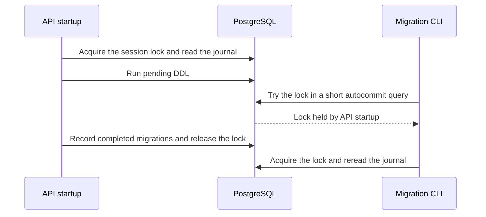

# Database Migrations

This project uses the **Expand and Contract** pattern for database migrations to support zero-downtime deployments.

## Pre-launch Baseline

Because BoxLite has not launched yet, the historical migration chain has been squashed into
the root baseline `1741087887225-migration.ts`. Fresh databases should run this single baseline first.
Future schema changes should use the expand-and-contract workflow below.

### Deprecated objects no entity maps

These objects are still in the database, but no entity maps them any more. They are inert —
nothing reads or writes them — and a post-deploy `DROP` migration should retire them once every
deployed environment runs code that no longer maps them.

| Object                                               | Present in                                       | Left behind by                                                                 |
| ---------------------------------------------------- | ------------------------------------------------ | ------------------------------------------------------------------------------ |
| table `ssh_access`                                   | databases created before the SSH gateway removal | that removal, which edited the baseline instead of adding a contract migration |
| `region.sshGatewayUrl`                               | same                                             | same                                                                           |
| `region.sshGatewayApiKeyHash` (+ its unique index)   | same                                             | same                                                                           |
| `organization.template_deactivation_timeout_minutes` | every database                                   | the image catalog, which unmapped it and deferred the drop                     |

The SSH objects are absent from fresh databases, so their drop needs `IF EXISTS`. The
organization column is still created by the baseline, so a plain `DROP COLUMN` retires it
everywhere; it is `NOT NULL DEFAULT 20160`, which is why inserts that omit it keep working until
then.

## Overview

The expand and contract pattern splits database changes into two phases:

- **Pre-deploy (Expand)**: Additive, non-breaking changes that are backwards compatible with the current API version
- **Post-deploy (Contract)**: Breaking changes that require the new API version to be deployed first

This allows the database and API to be updated independently while maintaining compatibility during the deployment window.

## Migration Folders

- `pre-deploy/` - Migrations that run **before** the API is deployed
- `post-deploy/` - Migrations that run **after** the API is deployed

Note: the root folder is reserved for the pre-launch baseline only. Do not add new root migrations;
use `pre-deploy/` or `post-deploy/` for new changes.

Use `<timestamp>-<description>-migration.ts` so the API build and migration commands both discover the file.
TypeORM records the migration class name and timestamp in its journal, so a filename correction keeps the existing history.

## Developer Workflow

### 1. Make Changes to Database Entities

Modify the TypeORM entity files in `src/**/*.entity.ts` as needed.

### 2. Generate Migrations

Run the migration generator:

```bash
npm run migration:generate
```

This creates the **same autogenerated migration in both** `pre-deploy/` and `post-deploy/` folders with a timestamp prefix.

### 3. Analyze and Adjust Migrations

**This is the critical step.** You MUST analyze the generated migrations and determine:

- Which changes are safe to run before the API deployment (pre-deploy)
- Which changes require the new API to be running first (post-deploy)
- Whether manual adjustments are needed for zero-downtime compatibility

#### Example Scenarios

**Adding a new field (Pre-deploy only)**

When adding a new nullable column or a column with a default value:

```typescript
// pre-deploy/migration.ts
public async up(queryRunner: QueryRunner): Promise<void> {
  await queryRunner.query(`ALTER TABLE "workspace" ADD "description" varchar NULL`);
}
```

```typescript
// post-deploy/migration.ts
// DELETE the generated migration - no post-deploy changes needed
```

The new column can be added before the API deployment since the old API will simply ignore it.

---

**Dropping a field (Post-deploy only)**

When removing a column:

```typescript
// pre-deploy/migration.ts
// DELETE the generated migration - no pre-deploy changes needed
```

```typescript
// post-deploy/migration.ts
public async up(queryRunner: QueryRunner): Promise<void> {
  await queryRunner.query(`ALTER TABLE "workspace" DROP COLUMN "legacy_field"`);
}
```

The column must only be dropped after the new API is deployed, since the old API may still be reading from it.

---

**Renaming a field (Expand then Contract)**

Renaming requires both phases to maintain zero-downtime. Use a **database trigger** to keep columns synchronized automatically:

```typescript
// pre-deploy/migration.ts (Expand)
public async up(queryRunner: QueryRunner): Promise<void> {
  // Add new column
  await queryRunner.query(`ALTER TABLE "workspace" ADD "display_name" varchar NULL`);
  // Copy existing data
  await queryRunner.query(`UPDATE "workspace" SET "display_name" = "name"`);
  // Create trigger to keep columns in sync during transition
  await queryRunner.query(`
    CREATE OR REPLACE FUNCTION sync_workspace_name()
    RETURNS TRIGGER AS $$
    BEGIN
      IF NEW.display_name IS NOT NULL THEN
        NEW.name := NEW.display_name;
      ELSIF NEW.name IS NOT NULL THEN
        NEW.display_name := NEW.name;
      END IF;
      RETURN NEW;
    END;
    $$ LANGUAGE plpgsql;
  `);
  await queryRunner.query(`
    CREATE TRIGGER workspace_name_sync
    BEFORE INSERT OR UPDATE ON "workspace"
    FOR EACH ROW EXECUTE FUNCTION sync_workspace_name();
  `);
}
```

```typescript
// post-deploy/migration.ts (Contract)
public async up(queryRunner: QueryRunner): Promise<void> {
  // Remove trigger and old column
  await queryRunner.query(`DROP TRIGGER workspace_name_sync ON "workspace"`);
  await queryRunner.query(`DROP FUNCTION sync_workspace_name()`);
  await queryRunner.query(`ALTER TABLE "workspace" DROP COLUMN "name"`);
}
```

**How the trigger works:**

The trigger intercepts every INSERT and UPDATE on the table and automatically copies the value between columns:

| API Version | Writes to      | Trigger copies to | Result                      |
| ----------- | -------------- | ----------------- | --------------------------- |
| Old API     | `name`         | `display_name`    | Both columns have the value |
| New API     | `display_name` | `name`            | Both columns have the value |

**Deployment timeline:**

1. **Pre-deploy migration runs** → Trigger is active, both columns exist
2. **Rolling deployment begins** → Mix of old and new API instances, trigger keeps data in sync
3. **Rolling deployment completes** → All instances are new API
4. **Post-deploy migration runs** → Trigger and old column are removed

**New API code changes:**

The new API should read from and write to `display_name` only. The trigger handles backward compatibility with old API instances—no dual-write logic needed in application code.

## Migration Scripts

API startup with `RUN_MIGRATIONS=true` and the migration CLI share the PostgreSQL
session lock named `boxlite:typeorm:migrations`. A migrator holds one primary
connection from acquiring the lock through the final journal write. A waiting
migrator reads the journal only after acquiring the lock.



Lock acquisition waits up to five minutes. Each lock query has a five-second client
and server limit.

The migrator closes its connection when it cannot confirm acquiring or releasing the
lock. After the migration commits, a release failure emits a warning and preserves
the successful result so a caller does not retry a completed revert.
Use a direct or session-pooled PostgreSQL connection.

Automatic startup migration is the deployment default. For a release with a pending
post-deploy migration, deploy with `mdeploy` and set the stage's `RUN_MIGRATIONS`
to `false` before rollout. The legacy SST stack always enables startup migrations.

### Rolling deployments from the production image

For a rollout with pending post-deploy migrations, pin the migration jobs to the new API release image. Set `RUN_MIGRATIONS=false` before rollout and verify both running API generations inherit it on restart.

The deployment owner runs expansion before launching the new API revision. After switching traffic, verify that the old replicas have stopped and cannot restart before supplying `--old-replicas-retired` to the contraction job.

```text
Deployment  expand -> launch new -> retire old -> verify -> contract
Old API     =========================X
New API                 ============================================
```

The build records phase membership from each source path before Webpack flattens the migration filenames.
With the job's database environment, run these commands from the image's working directory using its Node entrypoint.

```bash
node dist/apps/api/migrate.js list pre-deploy
node dist/apps/api/migrate.js run pre-deploy
node dist/apps/api/migrate.js list post-deploy
node dist/apps/api/migrate.js run post-deploy --old-replicas-retired
```

Compare each list to the release's migration identities. The phase-specific commands apply pending migrations from that phase only.

The [F1 schema transition paper](https://research.google/pubs/online-asynchronous-schema-change-in-f1/) and [Strong Migrations](https://github.com/ankane/strong_migrations#removing-a-column) inform transition ordering.
BoxLite's CLI owns the phase jobs described here.

Run the phase commands from the release's `apps` workspace with the target database
configuration. Apply the post-deploy phase after the old API replicas retire.

### `npm run migration:run:init`

Runs **all migrations** from both pre-deploy and post-deploy folders. Use this for:

- Initial database setup
- Development environments
- Fresh database instances

### `npm run migration:run:pre-deploy`

Runs only migrations in the `pre-deploy/` folder. Use this:

- **Before** deploying a new API version
- As part of your CI/CD pipeline, before the rolling update begins

### `npm run migration:run:post-deploy`

Runs only migrations in the `post-deploy/` folder. Use this:

- **After** the new API version is fully deployed
- As part of your CI/CD pipeline, after the rolling update completes

## Member Scopes and Invitation Retries

The historical tenant-scope migration remains in the chain. The Admin migration
renames both enum labels to `read:members` and `write:members` for API keys and
organization roles, preserving existing grants without adding permissions to
unscoped keys. Rollback restores the old labels. The unmerged Tenant HTTP API is
replaced directly; no compatibility deployment with that API is required.

API-key validation retains the existing Redis cache namespace. Old cached scope
labels translate on read, so membership removal, key revocation, and identity
linking continue to invalidate the same entries across deployment versions.

A separate pre-deploy migration adds `organization_invitation_request`. Creating
an invite and saving its replay snapshot share a transaction and an advisory lock
scoped to organization, user, and idempotency key. Replay records expire after
24 hours; subsequent keyed requests clean expired records for their organization.
Deleting an organization cascades to its replay records. Rollback drops this table
and loses retry history, so coordinate rollback with stopping Admin writes.

The integration tests run actual PostgreSQL migrations and services. Set
`DB_HOST`, `DB_PORT`, `DB_USERNAME`, `DB_PASSWORD`, and `DB_DATABASE`; the migration
suite needs permission to create temporary databases. Run
`make coverage:api FILTER='AddTenantScopes1792497600000|Admin organization storage'`.
The suites clean their temporary databases or schemas and run in API CI.

## Outbound control metadata

`AddOutboundControl1794888000000` adds the nullable private `box.outboundControl` JSONB column before API deployment.
Existing policies remain unchanged and acquire the documented `initial` revision when read by versioned coordination.

Pending candidates and assigned Runner ownership survive coordinator restarts in the same row.
Reverting drops this recovery evidence; stop versioned outbound writers and resolve pending attempts before rollback.
See the [outbound durability contract](../../../../docs/contributing/architecture/outbound-contract.md#cloud-durable-intent).

## Reverting Migrations

CLI and application startup run pending migrations in `each` mode: each ordinary
migration has its own transaction, while an explicit `transaction = false` allows
operations such as concurrent index builds. A later failure leaves earlier completed
migrations recorded; fix the failure and rerun to resume. The activation facts migration
still creates its table and backfill atomically.

```bash
npm run migration:revert
```

This reverts the **last executed migration** from either folder (based on the combined migration history in the database).

When that last migration is `AddAdminUsageWindowIndexes1792470000000`, use:

```bash
npm run migration:revert -- --transaction none
```

The production image has the same nontransactional option for concurrent index drops.

```bash
node dist/apps/api/migrate.js revert all --transaction none
```

TypeORM `0.3.31` starts a transaction for `undoLastMigration` in `each` mode even
when the migration declares `transaction = false`. Concurrent index drops require
`none`. Use the default transactional command for other migrations.

Rerun interrupted concurrent index builds or drops. A rerun retains valid indexes,
rebuilds invalid indexes, and skips dropping indexes that are already absent.

The migration lock serializes migration runners. Concurrent DDL can still wait for
older application transactions.

**Important behaviors:**

- Reverts one migration at a time - run multiple times to revert multiple migrations
- Uses the combined data-source that sees all migrations
- The revert order follows the execution timestamp, not the folder structure
- Always test revert scripts in development before relying on them in production

**Recommendation:** After reverting, you may need to also revert the corresponding entity changes and regenerate migrations to keep everything in sync.
