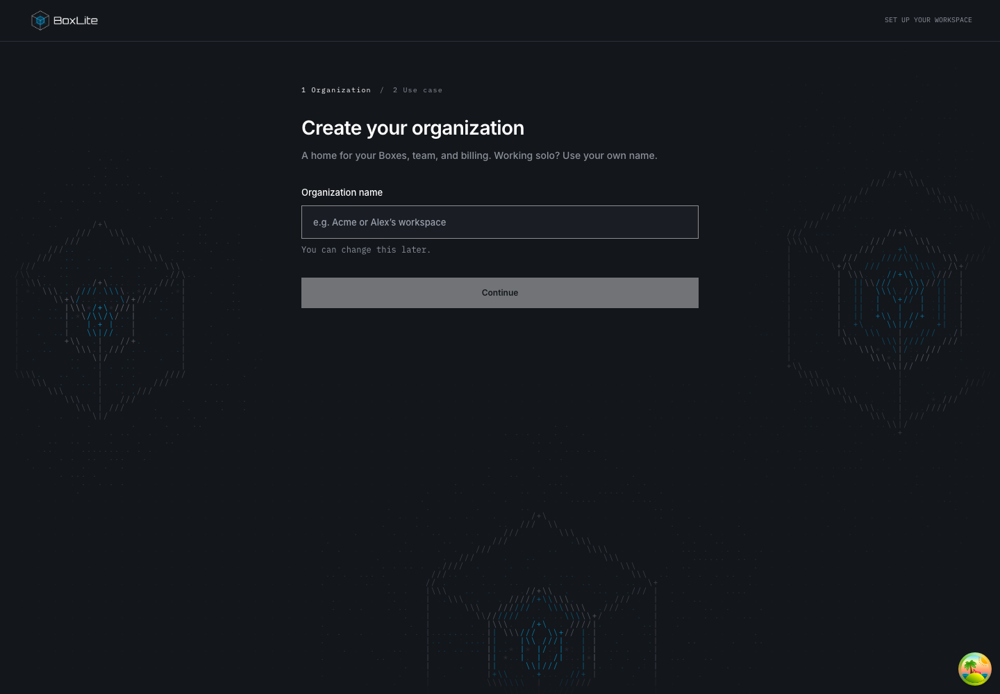
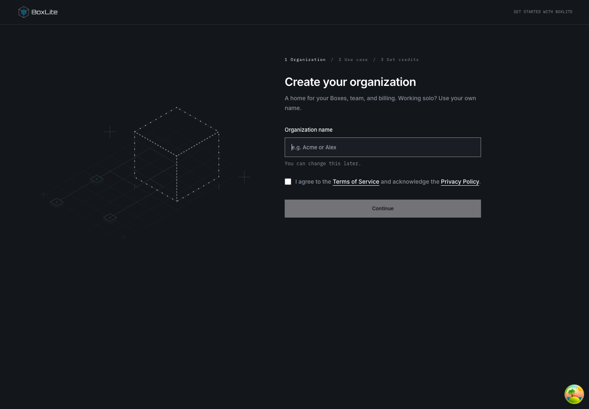
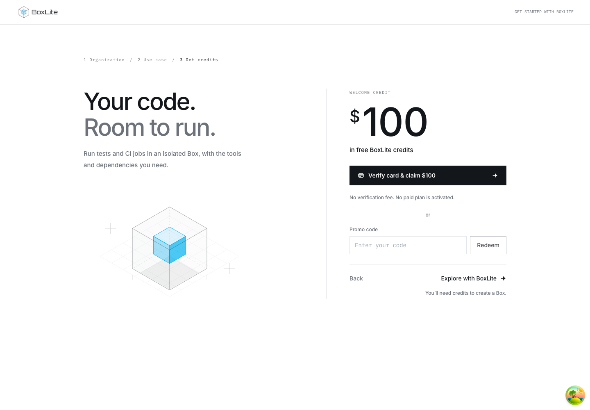
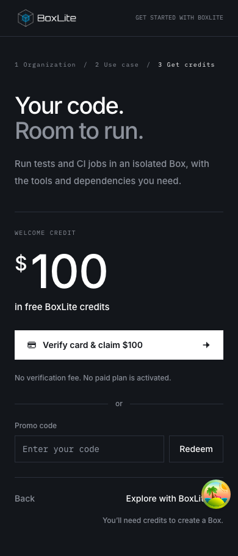

# New-user onboarding

## Design

New accounts should name their organization, state their use case, and reach one
Quickstart page with SDK/CLI, public image templates, and local-agent prompt paths.
Answers and prompt drafts belong to the backend. Welcome offers card setup,
coupon redemption, or direct entry to Quickstart after saving the use case.

Scope: welcome, Quickstart, image templates, terminal auto-connect and persistence.
Keep the existing empty Boxes page and main's network/authentication behavior. Exclude
Billing restyling, Apps prototypes, first-run simulation, and fake terminal output.

Related work: the existing OrganizationController name endpoint owns organization updates;
OrganizationActionGuard owns membership/owner checks. Reuse both. Wallet owns card setup
through its Checkout URL query and coupon redemption through `useRedeemCouponMutation`.
Welcome shares these operations and the existing billing query keys. Existing Quickstart
examples own SDK execution; render their actual programs in steps instead of maintaining
separate snippets. Existing handoff credentials
remain in client memory, while only user-authored request text is persisted.

Use a dedicated page rather than retaining two competing modal/page onboarding flows.
Draft revisions prevent out-of-order autosaves; request IDs deduplicate handoff snapshots.
A copied prompt is not evidence of successful deployment. Existing organizations without
answers are not globally redirected; only the existing first-run entry invokes welcome.

Validation: type checks, targeted component/API tests, real PostgreSQL migration/concurrency
checks, production build and UI walkthrough. Document observed results before publication.

### Card setup and optional credits

The three steps are Organization, Use case, and Get credits. One Box illustration
follows the journey; the last step presents the card offer, an inline promo form,
and Explore with BoxLite. The layout follows commits `1c35e97` and `59319dd`.
The organization form includes terms and privacy links with an explicit checkbox;
that confirmation is local form state. The organization API continues to save the name only.

Card setup shares Wallet's `useConnectCard` operation: open a tab on the click,
fetch `GET /organization/{id}/checkout-url`, and navigate that tab to Stripe.
If the browser blocks the tab, a persistent notification provides an Open Stripe
link to the returned checkout page.
An unsuccessful request closes the empty tab and shows the existing error toast.
Returning to Welcome refreshes the wallet and payment methods, including data
still inside the ordinary five-minute cache window. A connected card is confirmed
by `creditCardConnected`; opening or closing Stripe is not confirmation.
Card status and saved-card details are visible only to the current owner, even
when the query cache retains data from an earlier owner session.

Promo submission uses `useRedeemCouponMutation` with the entered code unchanged.
The shared billing client encodes the code as one URL path segment, preserving
characters such as `#`, `?`, `/`, and `%` in both Welcome and Wallet requests.
The shared mutation refreshes wallet, transactions, invoices, plan, and usage.
The response supplies a message, not a redemption amount; the success panel displays
that message and receives keyboard focus after redemption. Card-status refreshes
leave keyboard focus in place. Card success says Card connected. Neither success
state asserts reward delivery. Reward processing belongs to the billing service.

Start quickstart and Explore with BoxLite record `completedAt` under the existing
user-and-organization storage key. Completion is independent of wallet balance.
Refresh before completion resumes Get credits once the use case has been saved.
Installations without billing complete after saving the use case.

The current billing contract has no reward-delivery read. Welcome and Wallet
therefore perform no reward polling. The shared operations use the existing API;
organization name and use-case persistence keep their current contracts.

Validation covers Checkout requests and navigation, genuine connected-card state
after returning, failed and successful redemption, completion restoration, and
the absence of reward reads in both Welcome and Wallet. Animation tests verify
step-specific playback rates, responsive placement, and listener/observer cleanup;
billing tests cover blocked checkout tabs, empty or repeated promo submissions,
saved-card details, and owner-only actions. The browser walkthrough
covers all three steps; Get credits is checked at desktop and mobile widths in
light and dark themes. Query refresh follows
[TanStack Query's invalidation contract](https://tanstack.com/query/v5/docs/framework/react/guides/query-invalidation).

#### Welcome screenshots

These captures use local fixtures. Before, Welcome presents two steps:

The organization form now starts a three-step journey with the Box illustration:

Save the organization name and use case to reach Get credits. Choose Verify card
to open Stripe, submit a promo code, or select Explore with BoxLite to enter Quickstart.

The same card, promo, and Explore actions remain available on mobile:

## User flow and deployment

1. A new account names its organization using the existing organization-name endpoint.
2. Choose a use case and optionally describe it. Continue saves this answer on the organization and opens Get credits. Connect a card through Stripe, redeem a promo code, or choose Explore with BoxLite. The browser skip flag is written when entering Quickstart, and a confirmed organization rename survives a reload before intent submission.
3. Quickstart offers SDK/CLI, console templates, or a prompt for a local coding agent. Console creation uses the selected public image, resource defaults and startup command. Existing Boxes empty-state content remains unchanged.
4. Prompt text autosaves after one second and on blur, scoped to the organization and user. Refresh restores saved text. Prepare prompt saves a handoff snapshot; the following Copy prompt click writes directly to the clipboard without waiting on network requests. Editing the request requires preparation again. A failed copy acknowledgement can be retried separately from a successful copy; credentials are added only in the browser, never persisted in the snapshot. Copied status does not mean an application was deployed.

Apply the additive API migration before releasing the dashboard. The organization use case and per-user draft endpoints must be deployed together with this UI. See [API persistence contract](../api/src/organization/ONBOARDING.md) for authorization, validation, revision conflicts and retention.

Public templates are listed on Quickstart, not automatically on Images. Images
shows only organization and system images returned by its catalog API. A returned
image may reuse a matching template's icon and startup configuration; this does
not change its ownership. System images are not removable, while an
organization-owned image remains removable under the existing permissions and
box-reference checks, even if it matches a template. Public registry availability
and runner architecture can change; templates do not guarantee every future
upstream tag remains available.

## UI comparison

These screenshots use local development fixtures, not a production account. The walkthrough covered organization name, long-running-agent intent, switching all three methods, and saving/restoring prompt text after refresh.

Before: the existing modal combines the initial choice and agent handoff.

After: open Quickstart, choose Deploy from console, select Python, then Create Box.

After: choose Deploy from prompt, enter a request, wait for Saved, refresh, and return to the prompt path to restore it.

## Verification boundaries

Targeted dashboard tests cover routing, Checkout navigation, coupon redemption, template selection and image catalog membership, generated code steps, organization-save errors, and prompt autosave/revision behavior. API tests cover validation, authorization, idempotency and revision conflicts. Migration tests run against a disposable PostgreSQL database supplied through `ONBOARDING_TEST_DATABASE_URL` and create/drop their own schema. Frontend and API TypeScript checks and the dashboard production build passed locally.

The browser walkthrough used MSW fixtures. The integrated signup flow has not been deployed or accepted against the production API; complete that check after migration and backend deployment. Terminal auto-connect is included as a behavior change; a full-revert regression demonstration was not run for it.

The dashboard CI suite also checks the shared typography and square-corner design rules. Onboarding uses the named type-scale tokens. Interaction tests exercise name/intent submission, save retries, template creation and deployment-method switching; canvas tests cover reduced motion, viewport suspension and cleanup. Regenerate both cloud API clients whenever the onboarding DTOs or controller change, using the repository's pinned OpenAPI generator.

SDK guide state is keyed by authenticated user and organization. Switching either clears the displayed credential and isolates late key-creation responses. PostgreSQL + pgvector uses an automatically generated `POSTGRES_PASSWORD`, available in the Box environment.

### Resuming Welcome and prompt confirmation

Automatic Welcome navigation applies only to organization owners, who can save the organization name and intent. Members can still explicitly open Quickstart. A completed Welcome flow is restored from progress scoped to the current user and organization in the same browser, including completion through “Explore with BoxLite”; restoration does not claim that credits were granted. This browser completion timestamp is not synchronized across devices.

A prompt copy confirmation and its retries stay bound to the handoff that actually reached the clipboard. Editing the request invalidates that confirmation state, so a delayed failure from an older copy cannot expose a retry for a newly prepared prompt.

### SDK Quickstart previews

The SDK/CLI path continues from running a command to serving a small HTTP page
on port 3000. Python, Node, Go, Rust, C, CLI and REST all use the same three-part
program: create a Box with inbound networking enabled, execute a command, then
start a Python HTTP server in the guest and print its public preview URL.
The URL is public and does not require the API key. The script exits without
stopping or deleting the Box; users manage their resources in Boxes. Cloud idle
auto-stop still applies (15 minutes by default), so the URL is not guaranteed
to remain available indefinitely.

Save the three displayed parts in order in the named file, or use **Copy full
example**, then run the file once. Each section and the full example come from
the same template. The server source is included in the program, so users do
not need a second file or additional guest packages. SDK install commands pin
version 0.10.8. CLI and REST discover the organization route through `/v1/me`;
these examples require curl and jq. Piped API keys bypass terminal echo controls;
an empty CLI tunnel response fails instead of printing an unusable preview URL.

Templates live in `src/lib/quickstart/templates`. Explicit step markers delimit
creation, execution and preview. Keep the Box and server running after the
local program exits. Dev acceptance tests should check the public page after
process exit, then remove only their own test resources independently.

#### Preview walkthrough screenshots

These captures use local fixtures without a real API key. Select **Deploy from
SDK / CLI**, choose a language, then scroll to **Create a preview**. Copy the
complete example and run it locally; open the printed URL in a browser.

Before, the command example deleted its Box immediately:

The updated guide preserves the language selector and introduces three code parts:

The final part prints a public URL and leaves the Box running:

Template validation rejects unknown template references and missing step sections
before returning copyable code. Boundary tests exercise both failures using the
real registry and template assets, preventing incomplete programs from reaching users.
