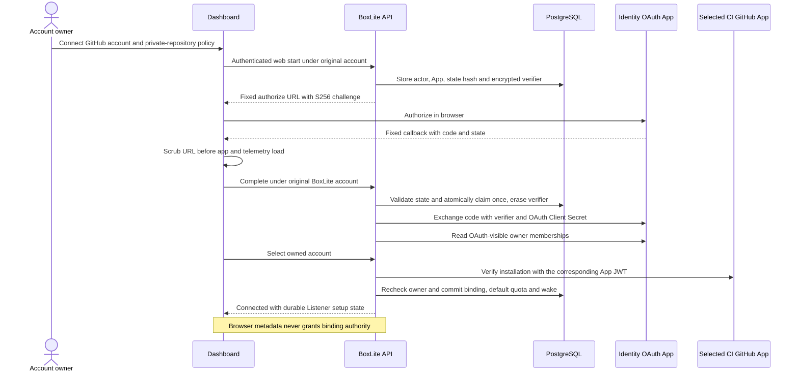

# BoxLite console

The web console at `app.boxlite.ai`. A Vite + React app, built and tested
through Nx as the `dashboard` project.

## New-account email policy

First-account verification is enabled by the API's `TURNSTILE_SITEKEY`. Without
public `turnstile` settings, the console loads business providers directly and the
API keeps automatic local registration.

With verification enabled, the console checks `GET /users/me` after OIDC sign-in,
before loading organizations or connecting notifications. A `registration_required`
response opens the first-account verification screen at the current URL. Turnstile
produces a single-use challenge;
`POST /auth/register` validates it on the server before creating the local account.
Existing accounts enter the console without a challenge. Email ownership verification
remains in the Auth0 login Action.

The console reads the public widget sitekey and `signup` action from `/config`.
Failed or expired challenges are discarded. A lost registration response triggers
another user check before a new challenge is requested. Service failures allow
retry or sign-out without restarting the Auth0 login flow.

Account creation requests time out after 30 seconds; account checks and verification
script loading time out after 10 seconds. A timed-out creation request follows the
same account check as a lost response, without automatically resending the token.
Failed script loads release their shared loader so verification can be retried.

With verification enabled, each newly mounted identity must pass a fresh account
check, even when user data is cached. Once admitted, the console stays mounted
during background revalidation and transient failures, preserving open terminals.
An explicit `registration_required`
or email rejection still blocks access and shows the relevant recovery screen.

When the API rejects account creation with `disposable_email`, `email_required`,
or `invalid_email`, the console explains the email problem and offers
**Sign out and use another email**. These responses do not restart authentication
or offer a retry with the same identity. The explicit action uses `/logout` to end
the identity-provider session and return to the existing manual sign-in screen.
Other authorization failures keep their existing error handling.

## Managed checkpoints

**Boxes → Checkpoints** lists reusable disk archives captured from eligible stopped Boxes.
The inventory shows Name, ID, Source Box, Status, Archive size, Created and Actions.
A successful identity lookup distinguishes deleted sources from lookup failures.
Saved disk capacity is not returned by the API and has no placeholder column.

**New Checkpoint** uses the shared form dialog and themed Source Box selector.
Sources must be stopped with matching desired state, without pending transitions,
mounted volumes or attached secrets. Server admission refusals remain in the dialog.
Names are optional; invalid names show their accepted format beside the field.

Ready checkpoints enable **New Box**. Restoration inherits saved execution settings;
success identifies the created Box in a toast and keeps the inventory open.
Deletion requires the exact checkpoint name; refusals retain the draft and deleting records permit cleanup retries.
Capture, restoration and deletion require Box-write permission; read-only members retain inspection.
Queries and dialogs stay scoped to the selected organization, so old results cannot affect a new selection.
API, SDK and CLI recovery remain separate. The mock preview supports capture, restoration and deletion.
See [Checkpoint controls and recovery](#checkpoint-controls-and-recovery) for request states.

## SSH access

The **Network** section shows SSH state and its switch. The switch only
enables or disables saved configuration; it does not generate keys or change
inbound. Status refreshes on click, window focus, and every 30 seconds while
visible and idle. Reads skip pending operations and preserve mutation errors.
Unknown/loading states cannot be toggled. The header and Network section share one
controller and component-scoped private keys.

**Connect via SSH**, beside start/stop, first opens an access confirmation.
Opening or cancelling it changes nothing. The confirmation explains that SSH
and inbound access will be enabled, and that missing configuration requires a
new private key. It also discloses that setup replaces SSH accounts and host
identity and disconnects existing clients.

After confirmation, the controller reads fresh SSH status, enables inbound if
needed through the existing network mutation, and enables saved SSH configuration
when disabled. Only the verified missing-configuration server response permits
initial setup. Other failures remain in the entry view with refresh/retry; they
never trigger key generation. Existing enabled SSH is reused without a setup POST.
The missing-config response is a point-in-time observation, not atomic
create-if-absent: concurrent configuration can be replaced by the existing setup API.
Partial success is retained; SSH failure does not undo an inbound change.

Setup still generates independent Ed25519 host/client keys in the browser and
configures login `box` at guest address `0.0.0.0:22`. The client private key stays
in memory and its downloaded file; only its public key is sent. The host private
key is part of the guest configuration. Browser Ed25519 support and a secure
context are required. The browser retains the generated host public key beside the
client key so a fresh server response can identify the host. This does not prove
that the client key remains authorized. An externally observed generation change
with the same host displays a reminder to check authorization. This public metadata
is not added to the SSH POST body.

Failed setup retains generated credentials. Continuing always rechecks status and
tries Enable when needed; only a new, verified missing-config response permits
resubmitting the same generated configuration. A matching host identity recovers a
configuration saved before a failed response, without another setup POST. An observed
different enabled identity discards the obsolete cached private key and path; temporary
disabled/empty identity status preserves them. Replacing existing configuration is
available only through the separate Reset confirmation, including from a failed
preparation's entry view. Reset preserves the existing key until inbound is ready
and the replacement configuration is about to be submitted.

Successful preparation opens the connection guide: CLI setup, private-key path,
and a copyable command once the path is valid. It contains no Enable controls.
CLI instructions start expanded every time the dialog is opened, regardless of SSH
status or previously stored preferences. **Hide commands** collapses them only for
the current opening; **Show commands** expands them again. Both are text actions,
and downloading a private key uses an outlined button. Background status refreshes
preserve the visibility choice. The browser does not detect local CLI installation or auth.
Download a new private key before leaving, then enter its actual path. A download
click does not establish that saving succeeded or reveal the destination.

The browser tab remembers only a validated key path and its host public key in
sessionStorage, scoped to endpoint, authenticated user, organization and box.
The saved path is bound to the observed host public key and cleared on a confirmed
identity change; disabled status with an empty identity does not clear it. Private
keys are never put in storage. Storage failures leave the connection guide usable.
Leaving or reloading the page discards generated keys; closing/reopening the dialog
keeps them in component memory. Resetting SSH is a separate explicit confirmation.
Cancelling a reset preserves the current key and path.
If Reset submission fails, the current key and the proposed replacement remain
separately downloadable. The replacement has a distinct filename and is reused
on an explicitly confirmed retry. A status exposing its host identity adopts it
and clears the previous path; seeing the old host does not discard an unresolved
replacement. Neither private key is stored beyond the mounted page. External
generation changes observed while disabled still warn about possible client-key
authorization changes after Enable.

Login and the SSH proxy explicitly select a dedicated context named
`dashboard:<normalized API endpoint>`, for example `dashboard:https://api.boxlite.ai`.
The first connection requires running the displayed login command to create that
context. Login supplies the Dashboard endpoint; the proxy supplies the organization
with `--path-prefix` and uses `ssh --proxy -- BOX`, matching
[the cloud CLI syntax](https://github.com/boxlite-ai/boxlite/pull/2327).
Both commands remove `BOXLITE_REST_URL` and `BOXLITE_API_KEY` from their child
environment, so an unrelated exported API key cannot override the credential saved
by the displayed login command. This leaves the parent shell unchanged. Their explicit
`--context` takes precedence over `BOXLITE_CONTEXT`, legacy `BOXLITE_PROFILE`, and
the saved current context. Login updates only the dedicated profile; it does not
change the current context or overwrite other profiles. Switching contexts in
another terminal therefore cannot redirect this command. Deliberately logging in
to a different endpoint under the same dedicated context name can still redirect
it; rerun the displayed login command to restore that context.

To troubleshoot the generated context, run
`env -u BOXLITE_REST_URL -u BOXLITE_API_KEY boxlite --context 'dashboard:<endpoint>' context show`
and `env -u BOXLITE_REST_URL -u BOXLITE_API_KEY boxlite --context 'dashboard:<endpoint>' context ls`,
substituting the exact name from the generated command. Check that its endpoint
matches the Dashboard. For manually written CLI commands, `BOXLITE_CONTEXT`,
`BOXLITE_PROFILE`, `BOXLITE_REST_URL`, and the saved current context still affect
selection; `env -u BOXLITE_REST_URL boxlite context show` shows the effective
context without the URL override. `boxlite context use NAME` changes the saved
current context for manual commands; explicit flags and environment context
selectors take precedence over that saved choice. For manually written commands,
`BOXLITE_API_KEY` still overrides stored bearer credentials. If login succeeds but
a manual command returns HTTP 401, check for that override; the generated SSH
commands explicitly remove it.

Empty/invalid paths hide the command. `~/`, spaces, quotes,
backslashes and literal percent signs are supported; control characters and
`${...}` expansion in user input are rejected. `~/` resolves against the terminal's
`HOME` for both chmod and SSH, including when it differs from the account home or
contains literal percent signs. Relative paths resolve in the terminal's working
directory. A relative filename equal to `none`, case-insensitively, is prefixed with
`./` so OpenSSH loads it as a key file. API credentials are loaded by the CLI, never
embedded in commands. Copy feedback belongs to the displayed command; a late copy
completion for an older path cannot mark the new command copied.
Compare the host fingerprint before accepting it. The cloud proxy requires server
tunnel support and inbound access; exiting SSH leaves the tunnel declaration open.
Setup itself opens no tunnel.

Connection preparation and command presentation require a running box and
WRITE_BOXES permission, because the SSH proxy creates a network tunnel. Read-only
members can inspect SSH status, but cannot enter the connection guide even when
SSH and inbound are already enabled. If access changes after preparation,
the guide hides the command and returns users to **Review access**. Mutations are
not automatically retried. Pending operations block overlapping actions and closing;
detail refreshes during mutations wait for the mutation to finish. Stale reads and
responses after stop, permission, account, endpoint or scope changes are ignored.
The title/close control stays fixed while the dialog body scrolls. Command lines
wrap without changing copied content. The overview remains mounted throughout.

Tests cover consent, conditional creation, request ordering, permissions, partial
success, same-key retry, stale responses, storage isolation and reset cancellation.
The local MSW preview echoes the generated host public key and fingerprint, retains
saved configuration across Disable/Enable, and hides disabled listener identity like
the real service. It exercises the real Dashboard but does not start an SSH server
or prove a live cloud SSH handshake.

## Box overview and terminal

Each Box has two pages, linked by **Overview** and **Terminal**. The existing
`/dashboard/boxes/:boxId` URL opens Overview; `/terminal` opens the dedicated
shell page. The current destination is marked for assistive technology.

Both routes keep the shared identity, lifecycle actions, SSH controls and navigation stable.
CPU, memory and disk appear inside Overview and describe provisioned capacity.
Configuration, optional mounted Volumes and Network use compact aligned fields.
Long technical values wrap within their fields. Terminal does not fetch Overview catalogs.

Terminal uses the available content height. Its toolbar includes the themed text-size
selector, Clear terminal, Scroll to bottom, Maximize and Restore controls.
Sizes are 12, 13, 14 and 16px; resizing and maximizing preserve the mounted shell buffer.
Covered application controls become inert while maximized. Escape remains terminal input.
The shared header provides Start to authorized members when the Box state permits it.
See [Terminal viewport controls](#terminal-viewport-controls) for font and restoration behavior.

Only an explicit execution-exit frame reports **Session ended**. A dropped
socket reports **Connection lost**, and connection establishment times out after
30 seconds. Failed attempts request shell deletion, including shells whose start
finishes after timeout or unmount. Cleanup is best-effort if the API refuses it.
**Reconnect** starts a fresh shell. Leaving Terminal for Overview ends its shell;
returning starts another one.

Container resize notifications coalesce into one animation-frame measurement,
skip hidden containers, and send only changed character dimensions. Font readiness
also schedules a fit. These checks bound layout work; they do not establish
producer backpressure or a throughput benchmark.

Run `make test:apps:dashboard FILTER=Box` for box page, session,
and lifecycle checks. The local UI preview may use a simulated transport and
does not prove live guest-shell connectivity.

## ASCII action buttons

Use `AsciiButton` from `components/ascii` for console actions. It delegates to
`ui/button`, which owns the shared geometry, typography, focus, and disabled
styles; raw buttons remain appropriate for tabs and custom choices. Use native
links for route navigation.

| Purpose                        | Variant / size            | Appearance                                |
| ------------------------------ | ------------------------- | ----------------------------------------- |
| Main create or submit action   | `primary` / default       | 36px high, monochrome fill                |
| Row action                     | `quiet` / `sm`            | 28px high, neutral hover                 |
| Icon action or overflow menu   | `quiet` / `icon`          | 28px square; `icon-lg` is 40px for mobile |
| Destructive row action         | `quiet-danger` / `sm` or `icon` | Red text/icon, subtle hover        |
| Final destructive confirmation | `dangerSolid`             | Solid red                                 |

Keep square corners and the shared sans-serif interface font. Secondary actions use neutral
borders and surfaces; persistent open and selected states remain stronger than hover.
Hover styles apply only to enabled controls. Keyboard focus uses a contrasting
outline in both themes. Preserve larger mobile primary targets with `h-11 sm:h-9`.

Import operation icons from `components/ui/icon`, whose aliases all use the
bundled Lucide outline collection with a default 1.3px stroke. Give icon-only actions an `aria-label`, retain helpful
titles, and forward native props/ref through wrappers used by Radix triggers.
Choose variants and sizes instead of copying hover, padding, or border classes.

## Page width and alignment

Normal dashboard pages use the `page-container` class from `src/index.css`.
It follows the Images page's full-width layout, with no maximum page width:
16px side padding on phones, 24px from `sm`, and 40px from `lg`. Large screens
keep the same side padding as the content expands to fill the available width.
The root reserves scrollbar space so short and long pages share both content edges.
When stable gutters are supported, modal scroll locks do not add another body
margin for that same space. Browsers without support retain the lock's fallback.

Apply it once to a page root, or use `PageHeader` and `PageContent`, which share
the same rule. Keep banners, tabs, tables, and Quickstart panels aligned to
those edges; do not add another page-level width or horizontal padding inside
them. Individual inputs and explanatory text can retain readable width limits.
The initial welcome form, dialogs, and dedicated fullscreen terminal have their
own sizing because they are separate surfaces.

## SDK and CLI quickstart readability

The walkthrough uses a dedicated `quickstart-code` type style: 14px monospaced
text, 24px line height, normal letter spacing and preserved indentation. The
10px tracked label style is reserved for labels. Code panes scroll horizontally
instead of wrapping commands; longer sections show up to 420px before scrolling.
File and local-terminal headers keep copy actions separate from the code.

Installation commands use the package manager's current release without fixed
version numbers. Python uses `--upgrade` to update existing installations. Rust
uses a quoted wildcard requirement followed by `cargo update -p boxlite` to
replace older dependency constraints and refresh an existing lockfile,
and the example supplies the current tunnel API's `TunnelOptions`. The
C SDK command requires curl, jq and tar, and selects the first stable release
with a matching platform archive among GitHub's 100 most recent releases,
ordered by publication time. A
new release without its C archive is skipped; no match stops the download.
Extraction completes in a temporary directory before replacing `boxlite-c-sdk`.
Failed extraction preserves the previous SDK. A failed or interrupted
replacement restores it when possible. If restoration fails, the previous SDK
is retained in the staging directory and its path is printed to stderr.
Displayed and copied
commands both come from `src/lib/quickstart/interfaces.json`.

## Quickstart catalog

Coder Universal is no longer offered as a quickstart template. Its preset
requested 30 GB of disk, which exceeds a 10 GB per-box disk ceiling. Removing
the preset avoids offering a configuration those organizations cannot create;
its disk request has not been reduced without runtime validation. Existing
boxes and custom-image support are unaffected. Old `?template=coder` links use
the picker's existing unknown-template fallback and select Python.

## Region names

The console resolves shared-region names through `GET /api/shared-regions`.
An unknown region keeps its stored ID as the display fallback. Region names do
not depend on the selected organization, so switching organizations does not
refetch this list.

## Commands

Run these from `apps/`:

| Command                                 | What it does                                                      |
| --------------------------------------- | ----------------------------------------------------------------- |
| `yarn nx run dashboard:dev`             | Dev server on `:3000`, proxying `/api` to `http://localhost:3001` |
| `yarn nx run dashboard:build`           | Production build, with a typecheck pass                           |
| `yarn nx run dashboard:test`            | Vitest suite                                                      |
| `yarn nx run dashboard:test --coverage` | Same, writing lcov to `target/coverage/dashboard`                 |

`npm run start:mock` (from `apps/`) serves the console against the MSW handlers
in `src/mocks`, with no backend and no login. Its `VITE_BASE_API_URL` must end in
`/api`: `ConfigProvider` appends routes to that base directly, while the
handlers are mounted under `VITE_API_URL`. When the two disagree, `/config`
goes unanswered and the console never leaves its loading screen.

The image catalog mock answers the way the API does, so the console can be
judged against real refusals rather than happy paths: a tenant image is listed
under the name its reference normalises to (`python` is
`docker.io/library/python`, the rule `src/lib/image-ref.ts` mirrors), removing
one is refused with 409 while any box not destroyed still references it, and
the 409 names those boxes by id, not by name. Pinning a tag refuses OCI-invalid
names and any existing name, even one bound to the same version, and an unpin
writes no history event.

Registry credentials and box creation are mocked on the same terms. A
credential is unique per registry and repository prefix, and removing one is
refused while a box pulls through it. A box created from the console shows a
first pull for a few seconds, then starts; reaching STARTED is what adds its
image to the catalog, as the API's registrar does. `localStorage
['registries-unsupported'] = '1'` answers the credential list with 501, as a
deploy without a secret store does.

`DASHBOARD_API_PROXY_TARGET` points the dev server at a remote API
(`https://dev.boxlite.ai`) through the same-origin proxy, so the browser never
makes a CORS-gated request.

The `test` target is inferred by `@nx/vite` from the `test` block in
`vite.config.mts`. Removing that block removes the target, and with it every
signal CI has about this app — see [the workflows
README](../../.github/workflows/README.md) for how its coverage is reported.

## Creation can finish before startup

Template creation and the ordinary create dialog share `useCreateBoxMutation`.
The Box API creates the resource before waiting up to 30 seconds for it to
start. A cold image pull can exceed that wait while continuing in the background.
When HTTP 408 carries `boxId`, the dashboard reads that exact Box in the selected
organization and opens its details. The details page polls transitioning Boxes
every three seconds and displays their actual state, including startup errors.

This path sends only one create request. It does not infer success from a name
or an error message. A timeout without `boxId`, another error status, or a failed
follow-up read remains an error. Deploy both API and dashboard changes for this
handoff; older APIs do not include the structured identity.

## Finding your way around

Navigation is the sidebar plus the tables. There is one route per resource, and
each resource's table is the place you act on it — filter, sort, select, and run
per-row or bulk actions from there.

Search and actions belong to their resource tables. The console has no command
palette duplicating those controls.

## Wallet history

Invoices and credit activity use separate, paginated tabs.

## Card setup and promo redemption share one billing flow

Wallet and Welcome use the same card setup operation: open a tab, request the
organization's Checkout URL, and navigate to Stripe. Returning to Welcome or
choosing Check card status refreshes the wallet and saved payment methods.
A connected card allows the user to continue without waiting for reward delivery.

Both pages redeem coupons through `useRedeemCouponMutation`. Success invalidates
wallet, transactions, invoices, plan, and usage so the next view reflects the
server's result. Welcome shows the returned message and offers Quickstart;
Explore with BoxLite is available without a card or coupon.

## A choice says what it does, and shows which one is picked

The quickstart offers two paths, so each card names its outcome ("Build an app
online — get a public URL" against "Run untrusted code — an isolated box") and
the picked one is drawn, not merely implied. The prompt it hands out carries the
endpoint the reader will actually use: `getRestApiUrl` resolves production's
origin even when the console itself is running against a mock, because the
prompt is pasted into someone's shell, not into this app.

## Selection follows the action, not the row count

A table's checkbox column exists to arm a bulk action, so a row that no bulk
action can touch is not selectable. `VolumeTable` is the worked example: delete
is its only bulk action, so `enableRowSelection` asks
`isVolumeDeletable(row.original)` and the checkbox renders disabled for volumes
already deleted or on their way out.

Gating only the count instead — leaving the row selectable and filtering later —
produces a toast that offers "Delete 0" and a confirmation for "these 0 selected
volumes". If a new bulk action arrives with a different eligibility rule, the
predicate becomes the union of them; it must never go back to a bare boolean.

## Empty-state presentation

Resource inventories retain their page header and toolbar when empty.
Creation stays in the toolbar under its existing permission guard; guidance explains the next step.
Search misses offer Clear filter. Loading and failed requests use distinct shared states.
Refresh failures preserve cached data and expose Retry.
See [Resource request feedback](#resource-request-feedback) and [Contextual documentation links](#contextual-documentation-links).

## Private registries belong to Images

Someone who needs a private image is already on the Images page, so the
credentials that let a Box pull one are its second child destination.
That is also how the API nests them (`/api/images/registries`). Each destination has its
own route, `/dashboard/images` and `/dashboard/images/registries`, so a box's
pull error can link straight to the second; the old `/dashboard/registries`
redirects there. The static `registries` segment is routed before `:idOrRef`,
as the API orders its routes, or it would read as an image named "registries".

## A list with no create says how its rows arrive

The API has no create for an image: one enters the catalog when a box first
starts from it. So the Images page has no "New image" button, which would
promise a registration step that does not exist. Each destination has a description below its title.
Private registries provides credential setup with one toolbar Connect
action, including an empty list. Images has no independent New box action; use
Boxes to start from a new reference, or a catalog row action to prefill its image.
Quota information shows custom-image count and total image size separately.
“How to add an image” opens the task-specific Use your own image guide.
Feature descriptions carry definitions, and empty states give a brief next action.
The list and usage refresh on mount and every 30 seconds in the foreground,
since image registration may finish after the Box startup notification.
Quickstart remains readable without Box write permission; its console creation
button is disabled with an explanation, and the creation handler checks permission.
Unavailable membership is distinguished from denied permission and offers a full-page
reload to retry the provider fetch without racing an organization switch.
Recovery preserves the console method, template and Box name in the Quickstart
URL; generated credentials stay ephemeral, and restored names retain validation.

Images lists only rows returned by the image catalog API: the organization's
registered images and the operator-configured system images. Quickstart's
public templates are recommendations and do not add rows, search results, or
counts to Images. An empty or failed catalog response must not insert templates
as a fallback. A template image appears here once the API returns it as an
organization or system image.

For members allowed to create boxes, every row offers "New box". If its reference
matches a Quickstart template, the action opens that template with its startup
configuration; otherwise it opens the shared create dialog with the image filled
in. Matching a template does not change an image's ownership or removability.
System images remain non-removable and do not count against the organization's
image limit; usage comes from the separate usage API, not the displayed row count.

A new organization with the default system-image configuration sees `base`,
`python`, and `node`, with zero organization image slots used. The operator may
configure additional system images, so three is not a fixed UI limit.

## A state the API records once is told in the past tense

Some fields are set once and never cleared. `upstreamMissingAt` is written the
first time a pull finds a digest gone from its registry, and nothing resets it
if the registry gets it back. The image page therefore says "Gone upstream", with the observation time and
cache-dependent startup guidance available on hover, focus, or in version
details, rather than a present-tense "Missing" that becomes false when the registry recovers.
Likewise the pin history says "unpins are not recorded", because the API
writes no event when a tag is unpinned, and a history that dropped a tag
without saying so would look like a bug.

Pinning checks what the API will refuse before sending: a name that is not OCI
tag syntax, and a name already pinned, which the API refuses even for the same
version because there is no move. Repointing a tag is an unpin and a pin, and
the Pin dialog explains this rule.

The same page lists every box that still references the image, stopped ones
included: those are exactly the boxes that block its removal. And who pinned a
tag is a member's name, or "first pull", never an identity-provider id.

## A failure carries the way to its fix

When the API's reason names something the reader can fix on another page, the
page showing the failure links there, already pointed at the fix. A box whose
private pull was refused for want of a credential shows "Connect a registry for
quay.io", which opens the credential form with that registry chosen
(`/dashboard/images/registries?connect=quay.io`). The match is on the API's
own wording, so it is tested against that wording, and an unrelated error gets
no link.

The same goes for slow states the API reports: a box creating during its
first pull says PULLING IMAGE, not STARTING, so a minute in that state reads as
work rather than a hang. And a box's image links to its catalog entry once a
start has put it there.

## Private registries say what to fetch, and what a credential covers

A credential is write-only once saved, and nothing can test it, so the form is
where it has to be right. It is built per registry: GitHub, Docker Hub, Quay
and each Container Registry host get their own steps (where to make the token,
which scope, what the username is), and the scope a credential will cover is
shown as it is typed (`ghcr.io/acme/*`), with an unterminated prefix completed
rather than refused. The registries offered are the API's default
`REGISTRY_PROXY_UPSTREAM_HOSTS`; a stack configured with others needs
`PROVIDERS` changed with it.

Refusals are named in the reader's terms: a duplicate says which scope already
has a credential, and a removal refused because boxes pull through it names
those boxes rather than their ids. A deploy with no secret store answers 501,
which is a state of the environment, not an error, so the panel says private
registries are off there and offers nothing to connect.

## Registry login tests

In Images → Registries, **UPDATE** replaces a credential's username and password/token without destroying dependent Boxes.
It requires registry write permission, preloads the username and leaves the masked secret empty.
The registry and repository prefix stay fixed; enter a replacement secret and choose **Save changes**.

The UPDATE action uses the shared small ASCII button, matching image-row actions and the adjacent removal button's height.

Closing or completing the form clears its secret; failed submissions preserve the form for retry.
Closing a pending save clears inputs and mutation state without cancelling the request.
Save and row mutation actions remain disabled until it settles; an earlier completion never closes a subsequently opened form.

New private pulls check the current credential version and stop reusing old-version tokens after update commits.
Pulls already in progress may finish; the upstream token itself is not revoked.

Registry query and mutation tests use a real QueryClient with mocked API calls.
They verify organization isolation, refusal before sending an unscoped request,
and invalidation after successful changes. Page tests cover confirmation and
failed submissions, and API client tests check that removal refusals retain
their message through the shared interceptor. Panel tests cover the masked
secret and its cleanup on close, prefix completion, the `?connect=` link,
duplicates, updates with fixed scope, write permissions, and refusals named by box.

## Console API keys include member access

The key dialog creates a key with the user's available permissions. An owner's
new key includes `read:members` and `write:members`, displayed in the Members
permission group. A non-owner's key can include assigned member read access,
but never member write. Existing keys receive no additional permissions.

Create restricted keys through the API or SDK by supplying an explicit
`permissions` array; see [API key delegation and member scopes](../../docs/contributing/architecture/platform/api.md).
The scopes are independent, and an API key can only create keys with the same
or fewer permissions. Invitation acceptance in the console continues to use
the signed-in user's JWT.

## Every invitee joins as an owner

An organization has no finer roles yet, so inviting asks only for an email
address: a role picker would offer choices the product does not have. For the
same reason a pending invitation can be cancelled but not edited, and a member
can be removed but not given another role. The member whose personal
organization this is has no remove action, because the API refuses that
removal.

The profile menu's Organization entry opens two tabs. General shows the editable
name and copyable ID. Member combines members and outgoing invitations in one
table, with Member, Invited, and Expired statuses. Owners can invite, remove members,
and cancel invitations. Expired invitations offer Remove (with confirmation) and
Resend. Resending creates a new invitation with the same permissions and the current
default lifetime, then removes the expired record. Creation failure preserves the
old row; cleanup failure reports that the new invitation exists and refreshes both
rows, so the owner can remove the expired one. The old link remains unusable.
The page shows the current organization's name; switching stays in the profile menu.
The Member tab can be bookmarked at
`/dashboard/settings?tab=member`; older `/dashboard/members` links redirect there.

## Accepting an invitation opens the organization

Opening an email invitation link automatically accepts it after sign-in with the
invited email address. The console preserves the link through sign-in and makes
one acceptance request per visit, including under React effect replay. Expired,
cancelled, or mismatched invitations show an error and keep the current organization.

Email links are the only console entry for accepting invitations; there is no
personal invitation list or pending-count badge. Successful acceptance refreshes
the organization list, switches to the joined organization, and opens its Member tab.
Existing emailed URLs remain valid. Opening `/dashboard/user/invitations` without
an invitation ID redirects to the current organization's Member tab without accepting anything.

The new selection is saved only after membership validation succeeds. If switching
fails, acceptance still succeeds. The page explains that joining succeeded and
asks the user to switch through the profile menu. The console keeps the previous
organization both on screen and for the next reload.

## The organization you pick is the one you come back to

A user in more than one organization switches between them from the profile
menu, which marks the personal one. The pick is kept in `localStorage`, so the
next login opens the same organization; if the user was removed from it in the
meantime, the console falls back to their personal organization.

## New-user onboarding

The welcome flow saves organization intent, then offers card setup, promo redemption,
or direct entry to Quickstart.
[Onboarding](onboarding.md) describes the dedicated Quickstart page, public image templates,
server-backed prompt drafts, completion state, and deployment requirements.

## Box limits refresh without interrupting creation

Selecting an organization preloads its effective per-Box limits through the
organization detail API. The create dialog shares that query, refreshes on
opening and every 10 seconds while open in the foreground, and shows updated
Custom maxima without resetting the form. A named preset is recalculated from
its original size when limits change; Custom only reduces values that exceed a
confirmed limit. Subscription mutations invalidate the affected organization's
detail query without waiting for that refresh.

The query overrides the global five-minute freshness and previous-query
placeholder defaults, uses a 10-second request timeout, and passes cancellation
to Axios. Its key includes the organization ID and stored quota tuple so a new
organization or administrator quota edit cannot inherit unrelated limits.
Queries never replace membership DTOs or their per-user default flags.

Creation remains available while limits load. Until the first result, selected
resources reach server validation unchanged. Later refreshes keep confirmed
values; failures show a quiet inline notice. Normal background refreshes show
no toast or loading lock. The API's 30-second grant cache still applies, followed
by up to one polling interval and request latency before an open dialog updates.
See [Cloud sandbox sizes](../../docs/guides/resource-limits.md#cloud-sandbox-sizes).

## Domains

**Domains** is a primary navigation page alongside Images and Volumes. It lists
the selected organization's full hostnames and Box/port, App, or unbound targets.
The filter matches hostnames and target names/IDs. Request domain lives in the
resource toolbar; each row can copy its full hostname with explicit clipboard
feedback. Empty, filtered-empty, permission and load-error states are distinct.
Associated with links Box targets to their existing details page. App targets
remain text because the console has no App details route; unbound targets show —.
The page and request dialog use the shared console buttons and square surfaces.
Use **Request domain** to enter a short name and preview the full hostname; a
successful request holds the name without binding it. Quota and Box write
permission apply. Bind acquired full hostnames through the CLI or SDK; binding
does not request names, and App binding remains reserved. Unbinding retains
ownership and consumes the same quota slot.

The request dialog explains reservation versus binding; the list has no separate
connection-help footer. Successful requests clear filtering and show a reservation confirmation.
Late results from a previous organization invalidate that organization's cache
without showing a success notification in the current organization.

The page uses **All domains** and **Custom domains** tabs beneath one title.
All domains retains every held hostname, including verified custom names; Custom domains
shows setup progress and the one-domain allowance without another section heading.
Its toolbar shows `0 / 1 custom domains` or `1 / 1 custom domains`, including drafts
but excluding replaced configurations. Initial loading and initial-load errors show no allowance.
The list omits the unavailable-subscription banner and quota footer; the empty state
keeps its title without explanatory copy. Subscription checks and management actions remain unchanged.
The add dialog presents the hostname field without DNS instructions or repeated quota guidance; validation and action errors remain visible.
Get DNS configuration stays on the hostname form while requesting records, with editing and duplicate submissions disabled.
A complete response opens all three records directly, without an intermediate management screen or continuation button.
Incomplete responses and preparation errors remain on the form for explicit retry; a saved draft locks the hostname and retries prepare with the same ID.
Reopening an incomplete draft does not start preparation automatically. Drafts can still be deleted after confirmation, including when the subscription is inactive.
Create and prepare responses update the list cache directly, so a delayed list response does not hide newly prepared records.
The Custom domains list quietly reads status every minute while any setup is incomplete.
It stops when every setup is ready or replaced, when empty or disabled, or when leaving the tab.
Hidden browser tabs, unconfirmed DNS dialogs and pending actions pause interval reads.
After DNS confirmation, HTTPS details continue the same quiet minute reads while open.
Returning to the tab or reconnecting immediately reads eligible incomplete setup, even if cached data is still fresh.
Healthy pending HTTPS setup is read-only: there is no continuation button. Reopening an incomplete confirmed domain reads its latest status without advancing setup.
Existing rows remain visible during reads or read failures, without a refresh spinner or notification.
Successful reads update changed status text in place; initial-load failures still offer Retry.
`Ready` and `Setup completed` both mean HTTPS setup is complete, independently of Box binding.
`Ready` requires an active subscription; `Setup completed` appears when subscription status is required or unavailable.
The dialog's Saved target shows whether a Box port is bound.

Custom-domain dialogs use the shared fixed header/footer and scrolling body.
The current status, errors and next action stay prominent; all three DNS records
appear together, with exact name/value copying and explicit clipboard feedback.
DNS help and timing are expandable. Completed setups focus on Box/port binding,
with DNS records retained in a collapsed disclosure for renewal and troubleshooting.
Setup dialogs omit ownership-transfer prose, provider issuance estimates and internal polling schedules; record guidance and current progress remain visible.
Subscription restrictions still allow viewing, unbinding and confirmed deletion.
Clicking **Configured, verify** waits for the server result with actions disabled.
Confirmed DNS shows a notification and closes the dialog; certificate acceptance,
unknown submission and submission failure remain distinct from HTTPS readiness.
A failed DNS check keeps all three records and record errors visible for the next
manual verification attempt. A response without confirmation or an error remains
pending; transport errors also leave the dialog open. HTTP success alone does not
count as verified DNS. Responses update the cached configuration directly.
Preparation and DNS verification require explicit clicks; the API's startup
and minute task continues confirmed HTTPS setup while the API runs.
An incomplete, confirmed setup with an error offers **Retry** and a `support@boxlite.ai` contact link.
Certificate failures use provider-neutral HTTPS wording; exact DNS record values remain unchanged.
Retry makes one advance request with duplicate clicks disabled and keeps the dialog open.
The returned state determines the message: healthy pending setup becomes read-only again,
an error retains Retry and support guidance, and Ready allows binding.
Transport failures retain Retry as well. Server leases and retry delays still apply;
an unchanged error does not establish that a new certificate request was submitted.

Run `make test:apps:dashboard` for page/client tests and
`make build:apps:dashboard` for the production build and type check.

## Neutral dark surfaces

Dark structural surfaces use zero-saturation gray: page background 4% lightness,
card 7%, popover 9%, hover/accent 12% and borders 16%. Sidebar, input, code and
scrollbar tokens follow the same neutral scale; brand and semantic status colors
keep their hues. Use these tokens instead of blue-gray literal backgrounds.
Light theme values are independent and unchanged by the dark palette.

For opt-in empty mock fixtures, see the desktop review section below.

## Desktop review: code surfaces, payment identity and empty resources

Saved payment methods use an explicit allowlist of locally bundled brand SVGs in
`src/assets/payment-brands` (license and pinned source included); unknown brands
retain an accessible generic card icon. Amounts, expiry validation and default-card
selection are unchanged.

Quickstart code wrappers use `quickstart-code-surface`: a visible neutral outline
and a separate code surface in each theme. This is local to Quickstart; copy values
and code whitespace remain unchanged. Console templates scroll with the page.
The selected template panel keeps its content height, and sticky positioning is
only enabled on desktop windows at least 800px high; shorter windows use normal flow.

Resource lists share `ResourceEmptyState`: a neutral thin-line icon in a 48px slot, shared
heading, body copy below it, then optional secondary guide links. Creation stays
in the page toolbar under its existing permission guard. Images directs users to
Boxes; billing records have no creation CTA. Search misses, loading and errors
remain separate states. Quotas and other task-specific content above the list can
change its absolute vertical position without changing the empty-state anatomy.

For local mock review, `localStorage['desktop-review-empty'] = '1'` empties Boxes,
Images, Registries, Volumes, Domains, billing documents, credit activity and cost
series. API Keys are already empty by default. Set `SkipOnboarding_mock-user-00000000`
to `'true'` to inspect the returning-user empty Boxes list. Use the separate
`desktop-review-empty-members = '1'` only to inspect an unavailable membership list:
this also removes the mock user's membership and correctly hides owner actions.
Reset the two `desktop-review-empty*` values to `'0'` and reload for normal fixtures.

The shared resource module provides consumed empty-state, status, and filter primitives. Regression checks cover optional guidance, accessible status labels, empty/loading credit history, both money-history retry paths, volume filter recovery, clipboard failures and the exact-name deletion guard.

Boxes use a cube and Images use stacked layers to distinguish instance from image. Resource lists use 24px thin-line icons from `components/ui/icon`; status stays in its own indicator. Quickstart environment logos and payment brands keep their brand assets. The compact image summary alongside the filter shows `Custom images used / limit · Total image size bytes`. Both metrics cover organization-owned images, excluding curated images. Total image size is the sum of declared ready-version sizes, not deduplicated physical storage or a billing measurement. Only the count changes color near its quota; per-image Size cells and limit guidance remain.

Box inbound state means the proxy tunnel gate, not organization scope: disabled rejects tunnel traffic; enabled applies the public/private tunnel policy. Private tunnels accept a valid access token or organization authentication. Do not describe disabled as organization-only. Detail switches reserve space for their expanded hit targets, and outbound values may wrap.

Desktop visual comparisons and reproduction steps: [screenshot gallery](../../docs/contributing/investigations/assets/desktop-dashboard-review/README.md).

Resource headers leave 24px before the next section. Desktop filters share a 380×36px field, 13px input text, solid border and explicit accessible name. Toolbars precede list headers by 14px; Images and Domains usage wraps only when needed. Private registries supports local host, prefix and username filtering with clear-filter recovery. Boxes shows total, running and stopped counts for fleets of at least ten Boxes, independently of list filters or pagination. Its overview has 24px gaps above and below.

Billing pagers retain Previous on a failed later page with unknown totals. Cached Images refresh failures identify the retained rows as previously loaded data. Unknown invoice statuses preserve the upstream text. Create Box pricing and validation scroll inside the body while header and action footer remain visible.

The signed-out landing state uses a centered, borderless column, a semantic heading,
and one primary Sign in action. Its presentation shares dashboard theme tokens;
ordinary unauthenticated visits still redirect to the hosted identity provider,
while an explicit logout retains the existing manual sign-in guard.

## Expandable left navigation

Desktop navigation uses a 64px icon rail by default. Expand navigation reveals
labels in a 224px sidebar; the choice is saved as `boxlite-navigation-expanded`
in localStorage, with an in-memory fallback when storage is unavailable.
Hover the compact logo for 350ms to preview the full sidebar as an overlay;
content keeps its position. Moving into the menu keeps it open; leaving closes it
after 150ms, unless a child has keyboard focus. Escape dismisses the preview and
returns focus to the logo. The top Pin button keeps the preview expanded;
clicking the logo also pins the expanded sidebar.
Hover never changes the saved preference; touch uses the explicit click control.
Boxes discloses All Boxes and Checkpoints. Images discloses Image library and Private
registries. Child links use 14px thin-line icons, a shared inset and
full-width selection; primary icons remain 18px. Navigation data accepts
second-level children without adding speculative destinations. Entering a child route reveals its group; the active
route remains highlighted when the whole sidebar collapses.

The desktop sidebar spans the viewport height (minus any announcement). Its logo
shows the full wordmark when expanded and the icon when compact. The right column
contains a 48px header and route content; API Keys is separated from the account
by 32px on desktop. Below 768px the 60px header retains the brand and mobile menu.
Welcome keeps its simplified header.

Management is a primary disclosure after Applications, with Billing and Organization
children. Clicking it in compact mode expands the sidebar and reveals the group;
entering a management route opens the group, while manual collapse remains possible.
Organization switching, theme and logout remain in the account menu.

Links retain accessible names in compact mode and show right-side tooltips on
hover/focus. The middle navigation scrolls on short screens; the footer pins the
Quickstart as the last action. Collapse sits beside the logo in pinned expansion; Pin occupies that position in
hover preview. Both are hidden in the compact rail without a preview.
Clicking the compact logo expands navigation without changing the route.
Keyboard focus moves to the replacement toggle. Selected navigation uses a quiet neutral surface with icon feedback,
distinct from transient hover.

Dashboard owns `--app-header-height`, `--app-banner-height` and
`--app-content-height`. List/detail/fullscreen layouts consume these variables
to reserve the actual header (48px desktop, 60px mobile/Welcome) and announcement
height consistently. Preserve `min-w-0` on the content region when adding routes.

Infrastructure groups Boxes, Images, Volumes and Domains, with an expanded-only
section label. Applications contains CI → Runners / Connects, including compact-rail expansion, hover preview, active-child highlighting and mobile menu destinations. Management remains a separate primary entry. Compact navigation
keeps the group accessible name without squeezing in a visual label.

Expanded navigation highlights only the current child, using the same full row
width as primary items. Active parents retain foreground emphasis without a
second selection rectangle. Primary and secondary labels align; text scale and spacing distinguish hierarchy without a tree line.

Sidebar branding always renders the same 43.2px-high wordmark asset
(20% above the original 36px). Compact mode clips the text area instead of substituting a differently padded icon image, so
the visible symbol keeps the same size and position across expansion.

Neutral outlines use border, border-hover and border-selected tokens. In dark mode
these are 16%, 23% and 30% neutral lightness, avoiding foreground-alpha outlines
whose brightness jumps against dark cards. Selection also retains its text, fill
or current badge; keyboard-focus indicators are unchanged.

## Resource screen visual rules

The compact Box list exposes a named “Box cards” region; its filter-recovery
checks locate that accessible region independently of responsive CSS classes.

True empty lists hide column headers and paging; filtered-empty lists retain context.
Boxes and TanStack-backed tables share ResourcePagination. Totals and fetching stay
with the caller; a later empty page always retains a Previous action, while a single
page hides navigation arrows. Pagination follows the data rather than the viewport.
Desktop image navigation lives in the expandable rail, with mobile-only page tabs.
Clicking Images in a compact rail reveals its children. Quota metadata uses readable
12px type. Template columns use a 240px minimum in the available content width;
short Quickstart code blocks expand naturally. Billing and box details retain all
data and actions while removing excess whitespace and dotted leaders.

## Measured visual rules

These rules came out of a full crawl of the console. Each has a check that keeps it true.

```
 rule                         kept true by
 ───────────────────────────  ───────────────────────────────────────────────
 six font sizes, no others    src/design-language.test.ts   (ceiling 0, plus 8 display numerals)
 text contrast 4.5:1          scripts/ui-audit  ──► axe-core color-contrast
 24px hit targets             scripts/ui-audit  ──► axe-core target-size
 no sideways page scroll      scripts/ui-audit  ──► page-hscroll at 390px and 320px
 whole-pixel rows             scripts/ui-audit  ──► subpixel
 one line per shared edge     scripts/ui-audit  ──► double-edge
```

**Type scale.** Text uses `text-label`, `text-meta`, `text-body`, `text-em`, `text-section` or
`text-page`. Tailwind's stock sizes (`text-sm`, `text-xs`, …) and arbitrary `text-[Npx]` sizes are
not allowed; the ratchet test counts both. The only exception is display numerals of 32px and over
on the welcome screens and the stat tile. Line heights in the scale are whole pixels (page 32px,
body 20px, meta 18px): a ratio such as 1.15 made the title 32.2px tall and blurred every 1px rule
below it.

**Contrast.** Enabled text reaches 4.5:1 on its surface in both themes.

| Token or surface | Rule |
| --- | --- |
| `--muted-foreground` (light) | 42% lightness: 5.00:1 on `--card`, 4.66:1 on `--accent` |
| `--brand-foreground` | Dark text. White on the brand cyan is 2.5:1; the dark value is 7.3:1 |
| `--destructive-solid` | Fill for buttons with white text, 4.67:1 in both themes. `--destructive` stays for text and tints |
| Code blocks | `readableCodeTheme` in `src/lib/readable-code-theme.ts` moves each Prism token colour to the closest value that passes |
| Terminal | Its surface stays black in both themes; the separate header uses dashboard theme tokens for status and controls |

A row that is busy is not dimmed: opacity pulled its text under 4.5:1. The status cell shows the
spinner.

**Hit targets.** A control is at least 24px in each direction. Small glyph buttons (copy, close)
keep their glyph size and get a 24px box. Links inside a sentence are exempt.

**Phone widths.** A list that cannot fit keeps its columns with a `min-w` and scrolls sideways
inside its own box; the page never scrolls sideways. Volumes, Images, Private registries and API
keys do this. Hostnames and names truncate with a `title`; they do not break mid-word.

**Segmented controls.** Each segment carries a full border and overlaps its left neighbour by one
pixel, so shared edges are one line. Compact choices mark selection with a neutral fill and stronger label.
Page tabs use a persistent underline and semantic icons.

**Wording.** Buttons, headers, tabs, dialog titles and labels use sentence case, with product
nouns capitalised (Box, Volume, Checkpoint, API key). A dialog's title is the label of the button
that opens it: New Box, New Volume, New Checkpoint, New API key. Units are vCPU, GiB and MiB. A
destructive confirmation names its object, for example `Delete “web-api”?`.

**Copy actions.** Every copy goes through `copyToClipboard` (`src/lib/copy-text.ts`) or the
`useCopyToClipboard` hook, and shows success only when the write happened.

**Page titles.** Each page calls `usePageTitle`, so the tab reads `Volumes · BoxLite`.

**Focus.** `src/index.css` gives every focusable element a 2px ring-coloured outline by default.
Components that draw their own indicator still do; unifying those is not done yet.

To re-measure, see [`scripts/ui-audit/README.md`](./scripts/ui-audit/README.md). The crawl needs a
local Chrome and the mock preview, so it is a manual check and not part of `make test`.

## GitHub CI dashboard and browser connect

Primary navigation places **CI** in **Applications**, after Infrastructure, in both
the sidebar and mobile menu. CI uses rail destinations on desktop and tabs on mobile.
**Runners** (`/dashboard/ci`)
lists actual JIT Boxes, with state, image, resources and links to Box details.
Resources shows vCPU, RAM in GiB and configured disk capacity in GiB.
It uses Box socket events and three-second polling during transitions, with a
five-second fallback during socket loss or errors and ten-second refresh for
journal-only capacity changes. It uses the same organization
access as Box reads. Each JIT Box row uses the same thin-line state-accented Box icon as the Boxes table.
Explicit status text remains separate from the icon.
The CI cube is also used in the empty runner view; the page title has no icon.
Name filtering shares a toolbar with the compact capacity summary, using the same
380×36px shared ResourceFilter as Boxes and Images, with a solid border, muted icon
and sans-serif input.
The 128-character limit and existing pagination remain. It searches case-insensitive literal substrings across
all pages, resets pagination on edits and preserves organization-wide capacity.
Clearing the input restores the inventory; matching count is independent of page size.

Capacity appears beside the Runners filter as `CI slots used / limit`, using Images'
compact monospace usage-summary styling with decorative quota ticks and no surrounding panel.
**Edit limit** opens a centered modal for owners.
It shows occupied scheduler slots against the effective shared limit; reservations
and workers awaiting Box cleanup count, even before a Box row exists. Confirmed
Box absence releases a slot even if GitHub runner cleanup remains pending.
Zero displays Paused, unlimited capacity has no percentage, and lowering the limit
below current usage preserves the actual count without terminating existing jobs.
Leave the maximum blank to inherit Commerce, or use zero to pause new workers.
Other Boxes consume the same commercial account allowance. Repository limits are
not exposed. GitHub owns job logs; use existing Box tools for worker inspection.

**Connects** (`/dashboard/ci/connects`) uses a registry-style table for GitHub accounts;
owners can connect a personal account or organization.
Each connection has a quiet **Update** action beside its trash control.
It edits private-repository permission on the existing verified binding; changing
GitHub account identity still requires authorization. A changed policy refreshes
the listener catalog. Delivered jobs continue and original cleanup remains available;
workers awaiting JIT configuration may be retired under the new policy.
Public repositories authorized for the App are enabled by default. **Allow private
repositories** additionally permits installed private repositories; it starts unchecked. For Organization accounts,
BoxLite automatically creates or synchronizes its dedicated GitHub runner group;
users do not repeat the setting in GitHub. The existing inventory wake performs
this asynchronously; the connection remains provisioning until remote policy and
repository membership pass readback. A GitHub failure retries with the saved
desired policy. Failed API saves retain the dialog and checkbox, and successful
saves refresh only the original organization.

Deleting a connection requires confirmation and waits for the server before removing
the row. It stops new admissions, cancels stored unfinished authorizations for that
matching CI App plus every unfinished browser grant in this BoxLite organization, and preserves running-worker cleanup and the shared capacity setting.
A new verified connection can reconnect later. Switching BoxLite organizations
does not redirect an in-flight delete. Legacy Organization `?tab=ci` links and
successful browser authorization lead to Connects. `start:mock` includes synthetic
JIT Boxes and deletable connections for local presentation checks.
Neither tab has a manual Refresh control. Connects fetches on entry and after
successful additions/updates/deletions; it does not poll the connection list.

Connect GitHub starts dedicated identity OAuth immediately. While requesting the
authorization URL, the existing button shows its loading state without adding a
temporary Cancel beside it. Failures release the button for retry, and browser
restoration invalidates late start results. After login, the
normal CI page opens an account dialog using shared AsciiButton, form dialogs and thin-line
icons. OAuth-visible personal/owner choices show **Install**, **Connect**, or a
green Check for an existing connection. The Connects table contains only
connections and has no redundant Status column. Switch account is clickable text
beside Signed in as; it cancels the unfinished grant and forces GitHub's account
picker. Committed connections remain intact. Closing, Escape, Back and browser
restoration keep the UI usable and ignore obsolete asynchronous results.

Install sends the verified selected account ID and type to GitHub's account-specific
permissions page, avoiding another account/organization picker. GitHub still asks
for installation permissions and repository selection. Resume retains the selected
target and fresh installation state; completion independently rechecks ownership,
the installed account and matching CI App. Existing installations bind directly.
The browser allows only the fixed GitHub installation routes and validates target
ID/type, attempt-bound state and query uniqueness before redirecting.

Missing organization? explains organization OAuth approval and SSO prerequisites;
an installed CI App alone does not guarantee visibility. Review GitHub access,
then reconnect. Provider errors never imply an organization is uninstalled.
The API uses separate `CI_GITHUB_OAUTH_CLIENT_ID` and
`CI_GITHUB_OAUTH_CLIENT_SECRET` configuration for identity, requesting only
`read:user read:org`. Personal/Organization CI Apps supply runner permissions.
The BoxLite login stays unchanged when choosing another GitHub identity.

Only attempt ID, original BoxLite organization and expiry enter session storage.
The bootstrap strips callback code/state before app and telemetry modules load.
Code exchange runs once under StrictMode; authenticated resume supports reload
without exchanging the code again. Installation state, selected App/account and
user tokens stay on the API. The setup callback is verified before auto-binding.
Sessions can connect several owned accounts within the same original five-minute
window. Close/Switch cancels unfinished authorization; connected rows remain.

Run `make test:apps:dashboard` and `make build:apps:dashboard` from the repository
root. Local DOM/HTTP tests do not replace a real App connect and workflow run on
the deployed API and Dashboard.

Capacity design and verification plan: [Runners capacity meter](../../docs/contributing/investigations/2026-11-06-ci-capacity-meter.md).



Browser connect recovery keeps routing metadata after an ambiguous network failure;
**Retry authorization status** reads the existing grant without exchanging the OAuth
code again. A late response can clear only its own attempt. Opening Back to Connects
in another tab preserves the current grant. If browser storage cannot select the
original BoxLite organization, the callback retains the result and offers an explicit
retry. A failed cancellation offers **Discard local authorization** with a warning
that the server grant may remain active until expiry.

A recovered pending connection checks authorization status once per second until
GitHub completes it or the browser grant expires. Closing the dialog or switching
organizations stops those checks. A failed status request pauses polling and offers
**Retry authorization status** without repeating the OAuth code exchange.

CI tabs expose their corresponding tab panels to assistive technology. A failed
later Runners page keeps Previous available so the user can return to loaded rows.

### CI repository access

Expand an installed account in Connect GitHub, or a connected row in Connects,
to view repositories authorized for its original Personal or Org App. Lists load
one page on demand and show both Public and Private repositories, independently
of CI eligibility. Update and expanded rows offer **Install app for repos**, opening
the existing installation configuration in GitHub. For example, add `acme/api`
there, return to BoxLite, and the account refreshes to page one without deleting
its connection or discarding an unsaved Private checkbox. Ordinary focus does
not poll repository lists. Errors retain Retry and the settings link; a failed
later page retains Previous. CI URLs and OAuth callback routes remain unchanged.

## Interface typography

The console self-hosts Inter for interface text and Commit Mono for exact technical values and code. Navigation, labels, search fields and table headings use the sans role; identifiers and commands retain the monospace role. Font provenance and licenses are in `public/fonts/README.md`. Use the shared Tailwind font roles rather than hard-coded family names. Quickstart code surfaces use the structural border token in both themes. Terminal-specific font loading is handled in the Box terminal migration.

Desktop mock comparisons: [list before](../../docs/contributing/investigations/assets/console-typography/main-boxes-light.png), [list after](../../docs/contributing/investigations/assets/console-typography/topic01-boxes-light.png), [Quickstart before](../../docs/contributing/investigations/assets/console-typography/main-quickstart-light.png), [Quickstart after](../../docs/contributing/investigations/assets/console-typography/topic01-quickstart-light.png), and [dark Quickstart](../../docs/contributing/investigations/assets/console-typography/topic01-quickstart-dark.png). These 1440 × 900 screenshots isolate typography and code surfaces against main `ed367805d`; navigation and resource workflows are separate changes.


## Sidebar navigation hierarchy

Checkpoints belongs to the Boxes group. Primary and secondary labels align; text scale and spacing communicate hierarchy. A quiet neutral fill and an accented icon identify the selected destination. The same Checkpoint outline is shared with existing list rows, which retain their status text and actions.

Hovering the compact logo temporarily expands the sidebar. Keyboard users activate Expand navigation to open it; focusing a rail link shows its tooltip. Pin keeps it open; leaving a preview restores the compact rail without changing routes. Only one compact tooltip can be visible, and tooltips clear when labels expand. Selected icon effects respect reduced motion.

Desktop mock examples: [expanded navigation](../../docs/contributing/investigations/assets/console-navigation/topic02-navigation-dark.png) and [temporary hover preview](../../docs/contributing/investigations/assets/console-navigation/topic02-hover-dark.png). Captured at 1440 × 900 from the navigation topic preview; the accompanying Tab changes are delivered separately.

In the compact rail, an active parent link includes its current child in its
accessible name, such as “Boxes, current section: Checkpoints”. The parent is
not marked as the current page when its destination differs from the current route.

## Tabs and selection feedback

Content tabs use a persistent underline. Compact choices, such as theme and chart/list mode, use a selected surface. Hover previews interaction without replacing selected feedback. Navigation links preserve route semantics; in-page tabs retain tab/panel keyboard behavior. Icon effects respect reduced motion. Billing, Organization and Quickstart use the same choice rules.

Desktop mock evidence: [previous tabs](../../docs/contributing/investigations/assets/console-tabs/topic02-tabs-before-light.png), [updated light tabs](../../docs/contributing/investigations/assets/console-tabs/topic02-tabs-light.png), and [updated dark tabs](../../docs/contributing/investigations/assets/console-tabs/topic02-tabs-dark.png). The comparison isolates this change against the sidebar parent; both versions already use Inter and Commit Mono. Billing tabs retain arrow-key navigation and their associated panels.

## Finding resources and reading quotas

API keys use the shared list filter and match names case-insensitively after trimming whitespace. The result count reflects visible keys; a filter miss offers Clear filter while the first-use state retains creation guidance. Revocation still targets the selected key by user, name and organization.

The Domains toolbar reserves a separate column for Request domain; quota and limit explanations occupy the following row so they cannot displace the action on desktop. Decorative quota ticks accompany exact counts and are omitted for unknown or unlimited limits. Boxes fleet counts remain independent of the list filter and appear only at ten or more Boxes, in a compact summary strip.

Desktop mock comparisons: [API keys before](../../docs/contributing/investigations/assets/console-resource-toolbar/toolbar-keys-before.png), [after](../../docs/contributing/investigations/assets/console-resource-toolbar/toolbar-keys-after.png), [filtered](../../docs/contributing/investigations/assets/console-resource-toolbar/toolbar-keys-filtered.png); [Domains before](../../docs/contributing/investigations/assets/console-resource-toolbar/toolbar-domains-before.png) and [after](../../docs/contributing/investigations/assets/console-resource-toolbar/toolbar-domains-after.png); [Boxes before](../../docs/contributing/investigations/assets/console-resource-toolbar/toolbar-boxes-before.png) and [after](../../docs/contributing/investigations/assets/console-resource-toolbar/toolbar-boxes-after.png). Both revisions use the same temporary synthetic fixtures (three keys, fourteen Boxes, one domain at its limit). These screenshots isolate toolbar changes against the navigation parent; fixture injection is not shipped.

## Resource icon state accents

Box and Volume icons show restrained lifecycle accents while retaining adjacent status text and existing action rules. Only transitional work animates; pending Volume work stays static. Domain accents mean a binding exists, not that DNS or the endpoint is healthy. Unknown states remain neutral. Decorative SVGs are hidden from assistive technology, and reduced-motion preferences disable their animations.

Desktop mock comparisons use the same built-in fixtures on the toolbar parent and this revision: [Boxes before](../../docs/contributing/investigations/assets/console-resource-icons/resource-icons-boxes-before.png) and [after](../../docs/contributing/investigations/assets/console-resource-icons/resource-icons-boxes-after.png); [Volumes before](../../docs/contributing/investigations/assets/console-resource-icons/resource-icons-volumes-before.png), [after](../../docs/contributing/investigations/assets/console-resource-icons/resource-icons-volumes-after.png), and [dark](../../docs/contributing/investigations/assets/console-resource-icons/resource-icons-volumes-dark.png). These static images illustrate state accents; transient motion is verified in the browser and suppressed under reduced motion.

## Resource row layout

Resource names and icons share a single horizontal identity region. Boxes expose Image, CPU and Memory as separate desktop columns; full technical values remain available through their titles. Status and actions retain fixed space. Members show invitation sender and expiry in separate owner-only columns instead of stacking them below the email. API keys, Volumes and Domains use the same identity geometry and quiet row actions. Shared list rows are 48px high.

Name copying reuses the clipboard hook: success appears after the write completes, failure leaves the name uncopied, and the action does not navigate the row.

Desktop mock evidence: [Boxes before](../../docs/contributing/investigations/assets/console-row-layout/rows-boxes-before.png), [after](../../docs/contributing/investigations/assets/console-row-layout/rows-boxes-after.png), [dark](../../docs/contributing/investigations/assets/console-row-layout/rows-boxes-dark.png); [Members before](../../docs/contributing/investigations/assets/console-row-layout/rows-members-before.png) and [after](../../docs/contributing/investigations/assets/console-row-layout/rows-members-after.png). Both revisions use the same built-in mock records; these screenshots isolate the row layout from the icon parent.

Image rows use full curated references with quieter registry/version context, shared identities and compact quota ticks beside exact custom-image counts; total image bytes remain separately visible. Registry rows follow the same identity and action treatment. Billing document and wallet transaction types use readable title case, with dates and amounts retaining monospace alignment; wallet statuses reuse the shared marker without changing their existing vocabulary. [Image list before](../../docs/contributing/investigations/assets/console-row-layout/rows-images-before.png) and [after](../../docs/contributing/investigations/assets/console-row-layout/rows-images-after.png).

### Resource request feedback

ResourceLayout owns the shared placement of loading, empty, and failed inventories. Initial requests use an assembling Box with a static reduced-motion fallback. Image and registry inventories distinguish missing data from an empty successful response: initial failures offer Retry, while refresh failures retain cached rows with an inline recovery notice. Transport details stay out of user-facing messages. Filters remain disabled until an inventory exists.
Resource tables retain a minimum readable width in narrow desktop containers. Boxes keep the sticky header and records in one scrolling region so horizontal scrolling cannot misalign columns. Member tables use a wider minimum for owner-only invitation columns.

Boxes, Volumes, Domains, and API Keys use the same request-state distinction. First-request failures offer Retry instead of an empty inventory. Background refresh errors retain loaded records, and an active retry disables its recovery button. Domain permission messages remain separate from request failures.

Boxes filters query the server, so they remain editable after a failed request even when no inventory is cached. Changing a search can recover independently of Retry. Client-side inventory filters still wait for data.

### Contextual documentation links

Feature guide links lead to the task named by their label, rather than the documentation landing page. Volumes opens the Cloud Volumes guide; image help and the template picker open Use your own image; SSH opens its Cloud connection guide. These destinations live in `constants/ExternalLinks.ts` so changes can be reviewed centrally.

API Key and Webhook empty states no longer advertise generic home-page links as setup instructions. The profile menu still offers the documentation home. Guide links use the shared colored, underlined treatment, keeping them distinct from secondary action buttons.

The source scan catches inline URLs and appended paths; it does not prove a destination's meaning or availability. When updating a guide, open the destination and check its content against the UI task.


### Inspecting image versions

Image details presents Tags, Versions, referencing Boxes, and pin history as single-line rows beneath a compact summary. The detail page offers View SDK example instead of duplicate Box creation controls. Curated images retain their short reference in SDK examples; organization images use their existing start reference.

Select a version digest to inspect and copy its complete digest, original pull reference, first-seen timestamp, and recorded upstream status. A missing upstream digest remains a past observation: only runners that cached the version can still start it; other runners need an available version pinned under a new alias. The Versions table scrolls horizontally in narrow containers, reserving space for the digest and upstream marker. Full provenance remains available in the dialog.

Pinning guidance belongs in the Pin a tag dialog. Pin/unpin permissions, OCI tag validation, API error feedback, and running Box behavior are unchanged. Referencing Boxes retain their detail links and status indicators. The page scrolls naturally instead of placing its tables in a second vertical scrolling region.

### Checkpoint controls and recovery

Checkpoint creation and Box restoration use the shared form dialog, field styles and footer actions. Source Box is a themed selector; eligibility filtering, fixed-source rechecks, permissions and organization-switch guards remain unchanged. Invalid names explain their accepted format without discarding the draft. Deletion requires the exact checkpoint name and retains the confirmation after a refusal.

The inventory uses the shared single-line row layout with source links, explicit status markers and a disk-and-clock glyph. A failed source lookup leaves the source identifier visible; only a successful lookup can identify a deleted source. Empty filtered results offer Clear filter.

Initial capability and inventory failures share one recovery region and Retry retries failed requests. Refresh failures retain cached inventory, including a previously empty result. Recovery buttons are disabled during their own requests. Capability-disabled feedback remains distinct from a request failure, and retains Retry capabilities if refreshing that cached result fails. The inventory scrolls locally below its minimum width so names and actions remain readable. Creating-state motion respects reduced motion; failed-status details remain available to keyboard users.

### CI runner capacity and recovery

Runners use single-line resource rows, explicit status text and fixed 25-row pagination. Server-side search stays editable after a failed request. Initial failures show a retry state; refresh failures retain cached rows, including a successful empty inventory. Cached page counts remain available after a refresh failure, allowing navigation to another page. Paging stays locked during active requests; placeholder data does not provide a page count. Polling and socket invalidation remain active.

Owners edit the concurrency limit in a centered modal. Numeric text stays editable until submission validates it; zero pauses new jobs, and “Use account limit” clears the draft to inherit the account allowance. Cancellation discards the draft. Saving locks dismissal and duplicate submission, while failures keep the draft available for correction. Focus returns to Edit limit when the modal closes.

### CI GitHub connection management

Connects filters account names locally and uses the shared table, empty, loading and retry states. Refresh failures retain existing connections. Repository details expand within the account row, and policy updates use the themed checkbox and form dialog. Failed updates retain the draft; pending mutations remain scoped to the original organization. The callback recovery screen keeps the same authorization and storage-recovery behavior with aligned typography and buttons.

Mock previews support `?preview=ci-empty` and `?preview=ci-repositories`; the latter includes enough repositories to exercise paging. These fixtures run only with dashboard mocking enabled and do not change production APIs.

The GitHub account picker keeps account names on their own full-width row below
the small-screen breakpoint; account type and actions follow on a second row.
Desktop rows retain aligned columns. Expanded repository details span both layouts.

### Terminal viewport controls

Terminal text size uses the shared themed selector. Changing size refits the existing xterm instance without reconnecting or replacing its buffer. The terminal loads the configured monospace font before applying it; a failed font request keeps a usable fallback and the active shell.

Maximize expands the current terminal in place; Restore returns to its prior layout. Both actions return keyboard focus to the existing terminal so typing continues without an extra click. Covered application controls become inert, and page scrolling is restored when leaving maximized mode or unmounting. Press Ctrl+Shift+F6 inside the terminal to focus the Maximize/Restore button, then Enter to activate it. This shortcut is displayed while maximized; ordinary Escape, Tab and F6 remain available to terminal applications. These viewport controls do not change shell authentication, permission checks, reconnection, or runner lifecycle.

### Stable Box detail views

Overview and Terminal share one Box header, lifecycle actions, SSH controls and tab position. The route selects the content pane; entering Terminal does not request the Overview image or volume catalogs. Leaving Terminal still unmounts its shell, while maximizing inside Terminal preserves it. Changing Box or organization resets Box-scoped UI state.

Overview presents provisioned CPU, memory and disk without implying measured usage. Configuration and activity share a compact panel; mounted volumes remain conditional. Long references wrap inside their fields. The status label reuses the list's presentation, including Pulling image. Existing lifecycle permissions and mutation behavior remain intact.

### Inspecting Box network policy

The Overview Network section distinguishes disabled, unrestricted, restricted,
and unknown outbound policies. Expand a restricted policy to inspect the exact
API-reported destination rules; rules may contain hostnames or CIDRs. The
console does not infer live traffic, reachability, or open guest ports.

Domains lists organization-owned bindings targeting this Box, including the
destination port. Other Boxes, application targets, and unbound domains are
excluded. Management permission is required to fetch and display bindings.
Loading, empty results, and failures remain distinct; refresh failures retain
known bindings with a retry action. Organization changes never reuse the previous
organization’s bindings as placeholder data. Only HTTP(S) URLs without embedded
credentials receive copy/open actions.

### Explicit tunnel request contracts

`ApiClient.prepareBoxTunnel(org, box, port, isPublic, signal)` sends an explicit
public access mode and validates the returned URI and descriptor. Private
creation is unavailable in the Console: private requests are refused locally before
any HTTP request. A capability read cannot guarantee which server handles a subsequent
write during rolling deployments. This frontend change uses existing API endpoints.

`revokeBoxTunnel` deletes the declaration for a port without checking Box state
or inbound access. Both methods reject ports outside 1–65535 before making a
request and apply bounded request timeouts. They do not automatically retry
mutations. Refusals are distinguished from uncertain outcomes: transport failures
or malformed creation responses may follow a successful server mutation. Error
objects never retain the response or token. URI values must be strings; URL-parser
coercion cannot turn a malformed response into a usable descriptor. Public descriptors
must have a null token.

The Overview Create tunnel action uses these methods directly.

### Creating and revoking tunnels

Create tunnel first checks whether the Box can serve a tunnel and whether inbound
access is enabled. Enabling inbound also restores previously configured tunnels
under their existing access policies. Unknown inbound state offers Refresh status;
the console never guesses that a failed enable request succeeded.

The port form explicitly discloses public access before submission: anyone with the
URL can access the port. It offers no Private option or access-token controls. The
configured result shows its exact port and public access mode. Closing the dialog does not
revoke access. The console clears its local result on Box, organization, client,
or permission changes and aborts outstanding requests, including inbound enablement.
Cancellation stops the client from waiting; it cannot undo a mutation already
accepted by the server. Reopen the Box to read its current inbound state.

Revoke by port remains available for stopped Boxes and disabled inbound access.
A result-specific revoke targets that exact port. Uncertain creation locks the
submitted port and offers revocation instead of retrying creation. Existing
connections can survive revocation; new requests are blocked after cache expiry.

### Shared control surfaces

Text fields, selectors and resource filters share a neutral inset surface. Floating
menus and tooltips use the same shallow elevation; dialogs and sheets use a deeper
shadow. Hard corners, structural borders, and existing keyboard-focus rings remain.
Form bodies show subtle scroll edges only when more content is available. Resource
names use the technical-value font while preset labels remain interface text.

Grouped inputs and textareas inherit their InputGroup surface and focus ring; the inner controls remain transparent without an inset shadow. Standalone fields retain their subtle inset surface.

### Content tabs and template filters

Image views, SDK example languages and Webhook views use the shared underline
tabs and semantic icons. Template categories remain compact selected choices,
with category icons and wrapping at constrained widths. Selecting a language
still changes only the displayed example; selecting an Image view preserves its
existing route behavior. The SDK example's Quickstart link uses the shared link color.

### Billing history refresh feedback

The Wallet tab retains loaded invoices and credit activity while refreshing. A failed refresh shows a retry notice above the cached table; first-load failure uses the shared resource error state instead of an empty table. Pagination remains available when the cached response includes its page count.

An unsuccessful refresh does not mean the wallet has no records. Both histories keep their existing query keys and payment operations; Retry repeats only the read request.

### Management section hierarchy

Billing and Organization section headings share the resource heading layout: a quiet uppercase label, optional count, divider and optional action. Existing SectionTitle callers delegate to the shared heading so dense management panels use one hierarchy.

Interface labels use the sans-serif role. Currency, quota and plan-comparison values use monospace with tabular figures for scanning; this does not change amounts or billing behavior.

### Resource review scenarios

With mock mode enabled, add `?preview=resource-empty`, `?preview=resource-error`, or `?preview=resource-loading` to a resource page. These opt-in handlers produce empty collections, failed reads, or pending reads across the resource families. Remove the parameter and reload to return to normal fixtures. Empty CI responses retain zero-used capacity and valid account/CI limits, so the summary and Edit limit remain available.

`/dashboard/boxes?preview=fleet` adds seven Boxes on initial load, allowing review of the fleet statistics threshold. The web-api fixture includes outbound allow rules for Network inspection. Preview handlers run only through the mock worker; they do not change backend behavior.

A filtered Box list with no matches uses the same clear-filter state as other resources. Clear filter preserves unrelated filters and returns to the list; a truly empty account retains its creation guidance.

### Recovery regression coverage

The dashboard suite exercises clipboard success and refusal, public tunnel descriptor
validation and actionable errors, lifecycle labels, and keyboard access to checkpoint
and runner failure reasons. CI tests also cover repository disclosure without changing
the selected account, missing runner metadata, and explicit retries that retain cached
connections and runners. These tests use the existing frontend API contracts.
