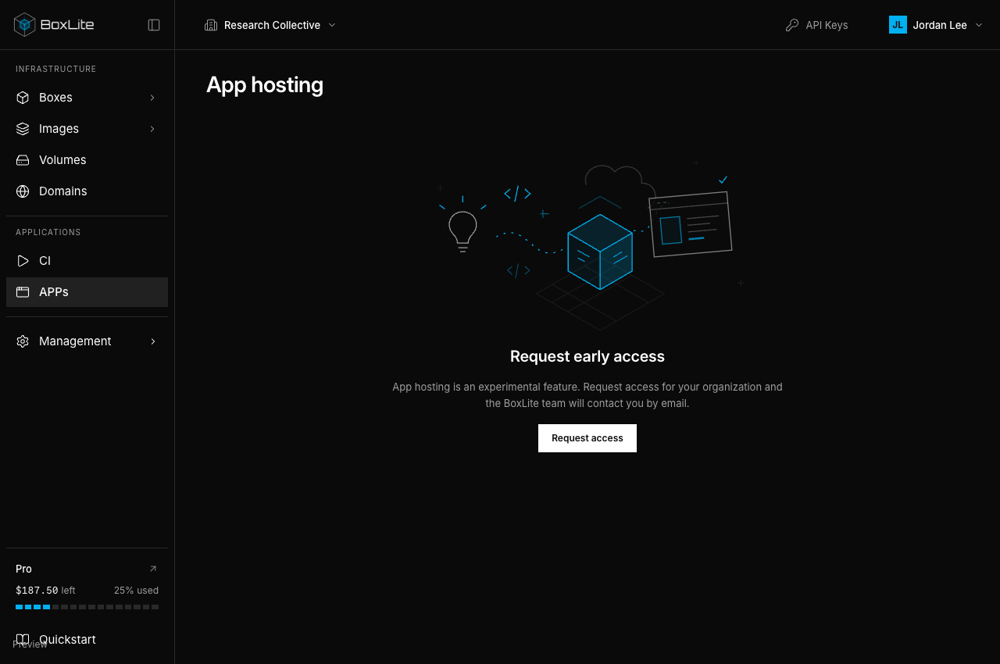
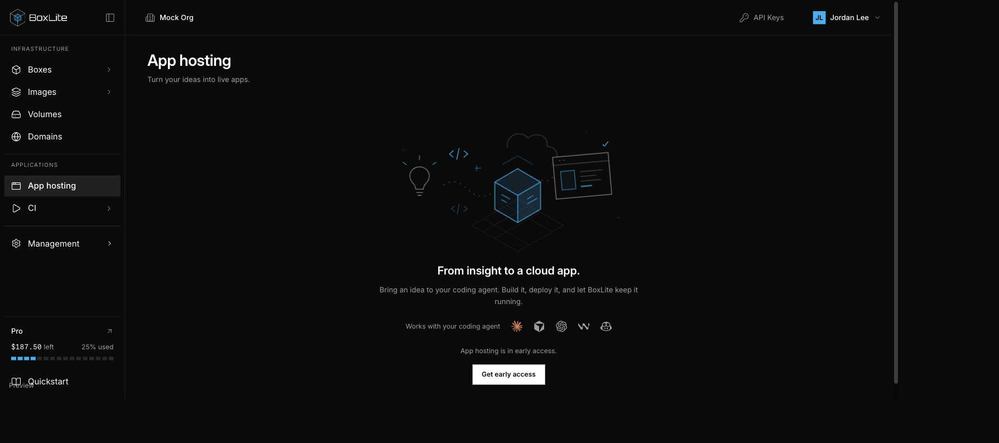
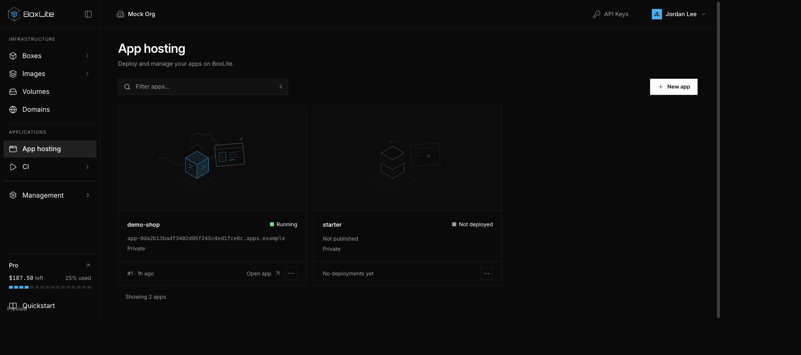
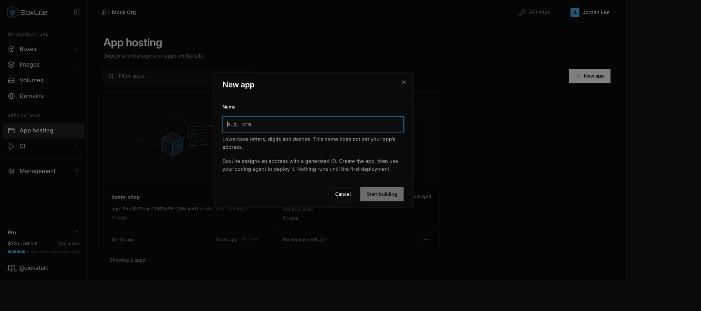
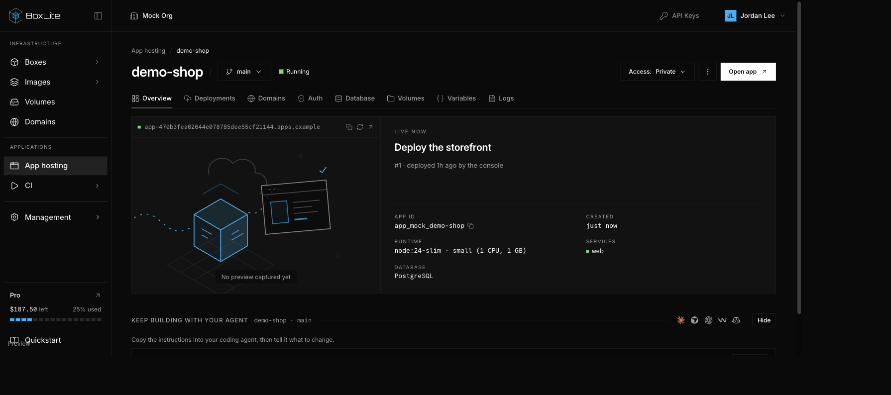
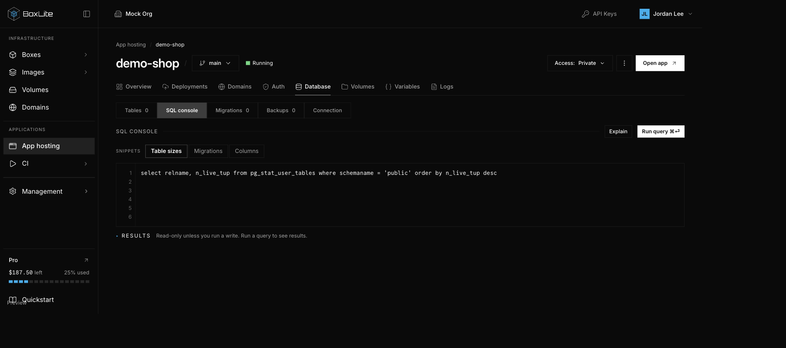

# App hosting UI

These screenshots show the frontend in mock mode. App data, generated addresses,
deployments and database responses are fixtures, not live hosted applications.
See [App hosting](README.md#app-hosting) for access boundaries and fixture switches.

## Request access

Open **Applications → APPs** in an organization that lacks `read:apps`.
Select **Request access** to send the BoxLite team your organization, account
email and the name of the experimental feature. A successful submission shows a
confirmation on the same page. An App detail link opens this same request page.

## Early access

In an invited organization, members with App read permission can select
**Get early access** to open the current organization's Apps. The same
button on a direct App link opens that App's details. The introduction appears
once per browser tab.

## Application cards

The mock Apps list shows responsive application cards. Undeployed apps use an
unassembled outline Box; deployed apps without screenshots use the cloud-app
illustration. Illustrations leave a generous margin. Actual screenshots fill the
preview region. Card links open details; open-app and menu actions are independent.

## Create an app

The name identifies the application, not its hostname. The platform assigns an
address using a generated identifier. Creating an app does not start its runtime;
the coding agent supplies the first deployment.

## Application details

Shared Console buttons, environment selector, typography and section headings
keep the application views consistent. Placeholder artwork remains visible until
an available screenshot loads.

Primary tabs and segmented secondary navigation use compact spacing. Secondary
screens support keyboard navigation and only mount the selected content.

## Verification

The shared-control update passed all 1,664 Dashboard tests. Subsequent decorative
and spacing changes passed the production Dashboard build. Browser checks covered
card navigation, independent menus, secondary-tab keyboard navigation, dark/light
themes, narrow layouts and reduced-motion behavior. The screenshots do not verify
real deployment, payment, DNS, access approval or database execution.
