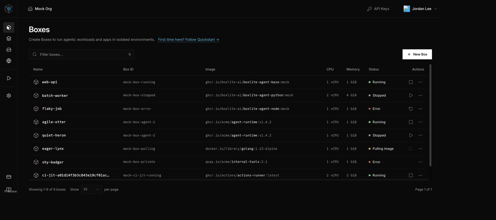
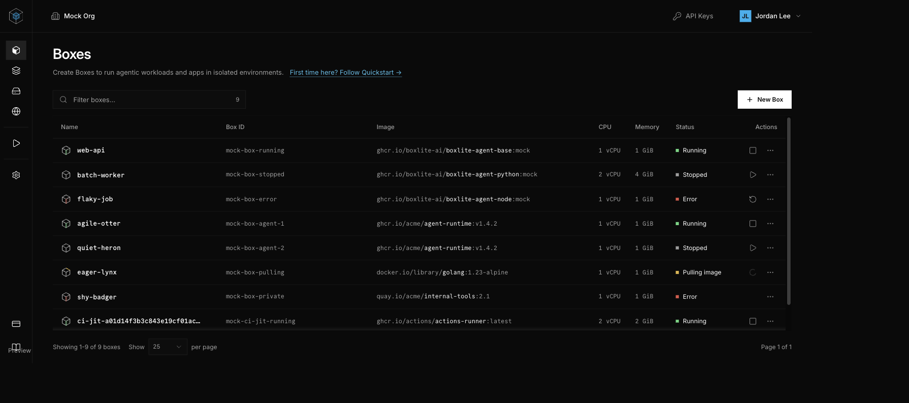
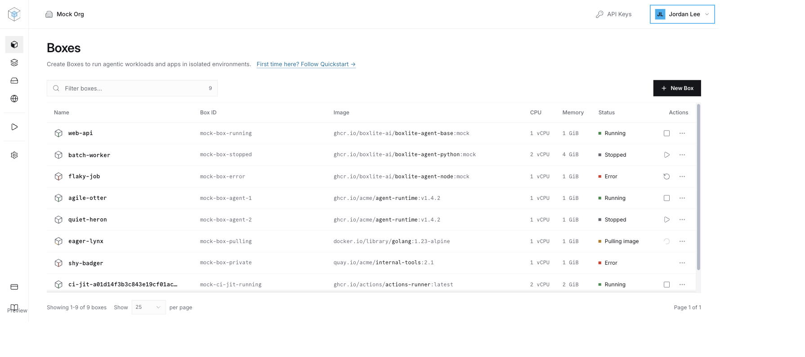

# Account avatar fallback

The global profile menu renders `AccountAvatar` inside its existing fixed 23px
brand-colored container. Name initials, then email initials, provide the fallback;
an identity without either uses the shared `UserRound` icon. Whitespace-only values
are treated as missing.

## Loading and identity

The image stays invisible until its browser `load` event. An `error` removes it
and retains the fallback, without retrying on unrelated renders. The menu keeps
working while the image loads or fails. Avatar content is decorative; the menu
button supplies its accessible name.

Sidebar keys the avatar by OIDC issuer, subject and normalized picture URL.
Changing any of these mounts fresh state, including when another account uses the
same picture URL. Events from an old image cannot update the new avatar.

This uses native image events and React's [key-based state reset](https://react.dev/learn/preserving-and-resetting-state#resetting-state-with-a-key).
An error-only handler would leave the loading state unprotected; a new avatar
dependency adds no necessary capability for this single entry point.

## Verification

- Before production edits, `make test:apps:dashboard FILTER=avatar` ran against
  the original Sidebar: seven regression cases failed on the missing loading
  fallback, retained broken image, reused identity state and missing-name handling.
- With the fix, `make test:apps:dashboard FILTER=Sidebar` passed all 62 tests.
- `make build:apps:dashboard` passed.
- Browser checks used temporary mock identity data and a local HTTP image fixture:
  a 404 response, a 200 response with undecodable bytes, valid SVG and delayed SVG.
  Both failures retain initials; delayed loading reveals the image only on success.
  Empty identity uses the account icon. Measured size remains 23px (browser rounding
  approximately 22.995px). Enter opens the menu; Escape closes and restores focus.
- Screenshots use the mock Console with the same failing image URL before/after.
  Temporary identity and HTTP fixtures are not shipped. The original production
  avatar URL and its underlying failure cause have not been inspected.

| Original broken image | Fallback, dark theme |
| --- | --- |
|  |  |

