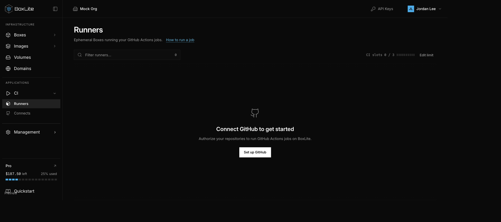
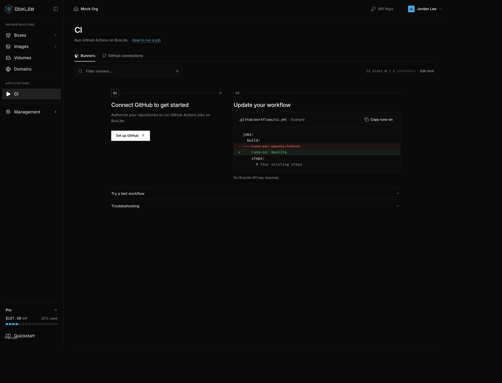
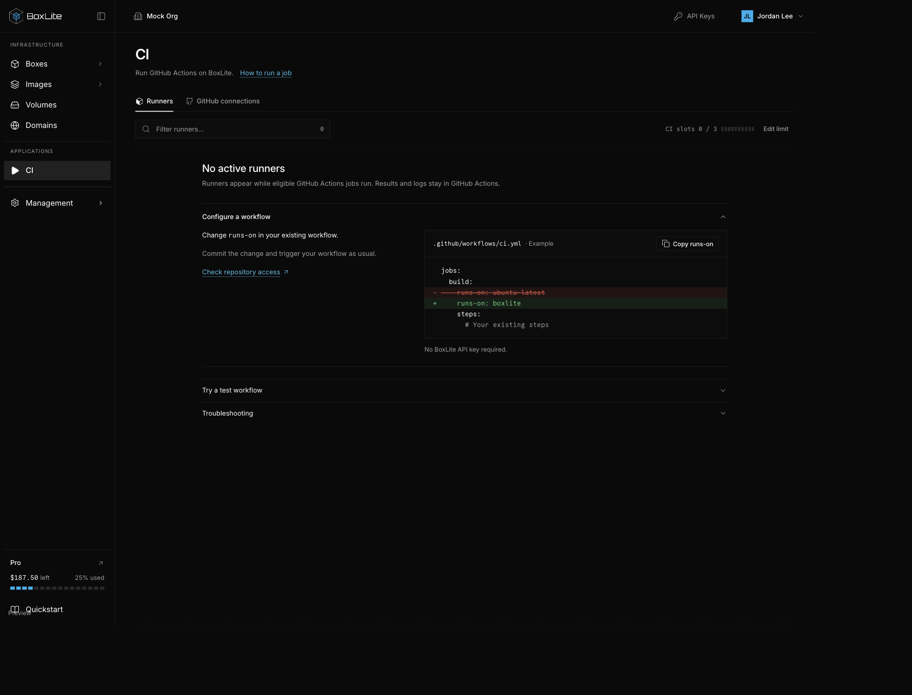
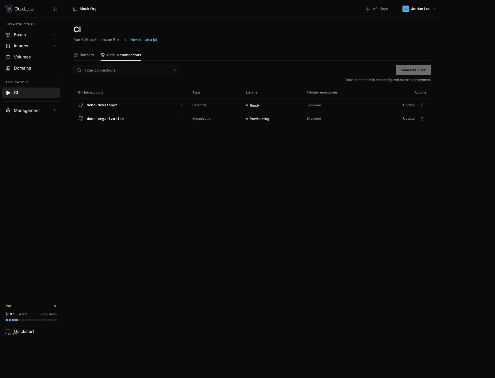

# Inline workflow setup

## Contract
CI uses one sidebar entry, two page tabs and inline workflow setup in the Runners
empty inventory. Keep the existing Console shell, capacity/filter toolbar,
Runners/Connects routes, connection authorization and runner inventory intact.
An empty runner inventory is not evidence of first use or completion.

For an owner with confirmed available CI and no connections, show the existing
new-tab Connects route beside a read-only workflow diff. An ordered two-step list uses aligned 01/02 markers and equal heading levels; desktop adds a directional connector, while narrow screens stack the steps. Numbering expresses sequence, not completion. With connections present,
retain “No active runners” and offer an initially expanded, collapsible workflow
section. The section copies only `runs-on: boxlite` and exposes separate inline disclosures for a test workflow and troubleshooting. The test disclosure reuses the existing workflow constant and copy component; it shows only the filename, default-branch instruction, YAML and GitHub trigger path. Troubleshooting lists three checks. The header guide remains available for the full reference. No new billing eligibility or
job-result states are inferred. A connection does not certify repository access.

## Options
- Keep only the side sheet: safe but hides the primary configuration change.
- Replace CI with a wizard: rejected; it changes inventory semantics and requires
  completion evidence that is not supplied by the current API.
- Inline the existing workflow diff in empty inventory (chosen): reuse existing
  query branches, copy behavior and detailed guide, with no API changes.

Show the minimal workflow change directly without inferring step completion.
Console visual-language and state-flow contracts govern
spacing, typography, query errors and permission handling.

## Validation
New presentation contract, not a backend defect fix: check disconnected/connected
branches, collapsibility and copy content; retain existing loading/error/member/
unavailable tests. Check the actual mock-enabled app in desktop and narrow layouts.
The MSW preview does not verify GitHub authorization or real CI execution.

Preview: `/dashboard/ci?preview=ci-disconnected`, `ci-connected`, `ci-unknown`,
`ci-loading`, or `ci-runners` (populated inventory). Queries are mock-only fixtures.

## Navigation and cardinality

The sidebar exposes one CI destination, active for both CI routes. A stable CI
page header contains two always-visible content tabs: Runners and GitHub connections.
Tabs update the existing URLs, so direct links, refresh and browser history work.
Both desktop and mobile use the same tabs and keyboard interaction. There is no
separate Back to CI or page-header connection button.

Each panel retains its full multi-resource inventory within the organization:
runner filtering/pagination/capacity and multi-account connection/repository controls.
No connection is selected implicitly and no resource count is constrained to one.
The onboarding Set up GitHub link still opens the connections route in a new tab.

## Screenshots

Actual Console with MSW fixture data, not live GitHub authorization or job execution.
The disabled connect action in the connections fixture reflects mock deployment
configuration, not removal of connection support.

| Before: disconnected empty state | After: two-step setup |
| --- | --- |
|  |  |

