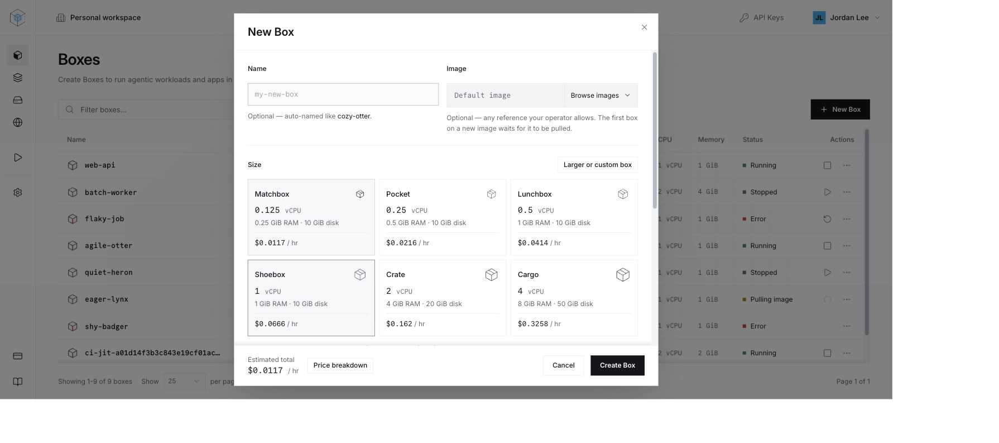
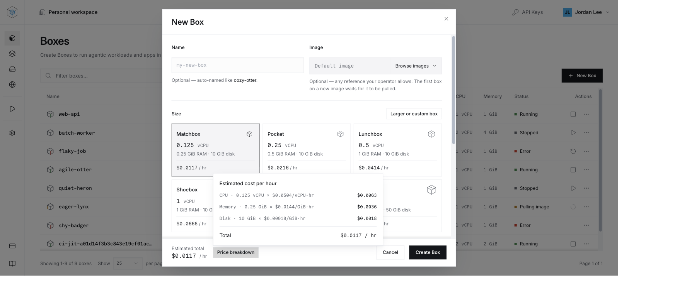

# Create Box sizing

See [behavior and constraints](../../README.md#create-box-sizing).

Screenshots use the existing Console with mocked API responses. They demonstrate
layout and estimated-rate presentation, not successful production provisioning.

