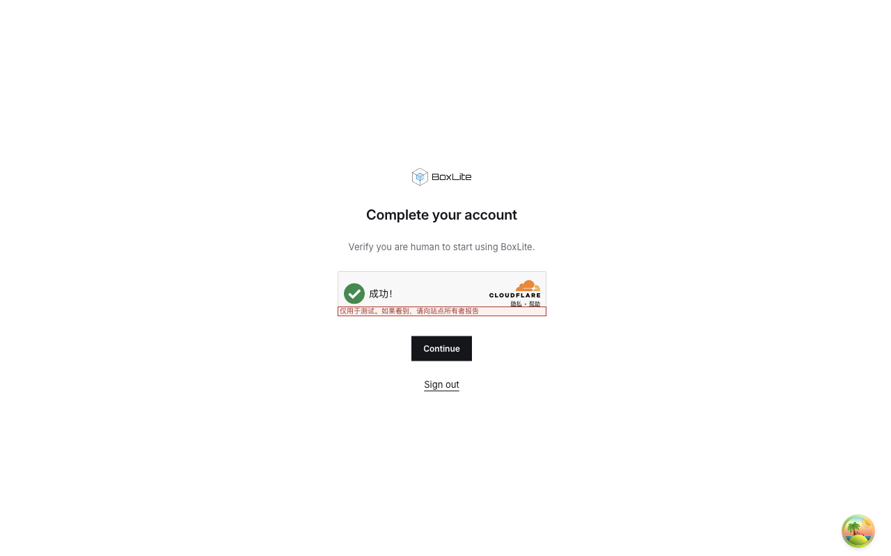
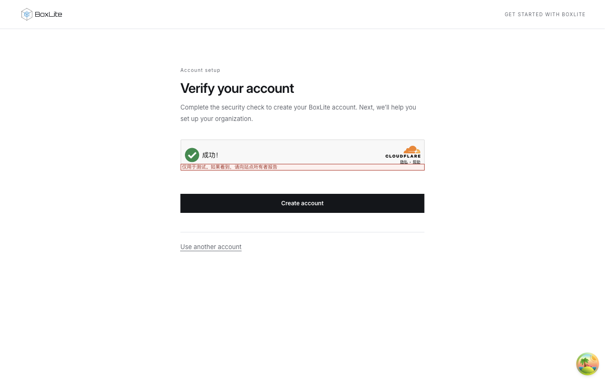
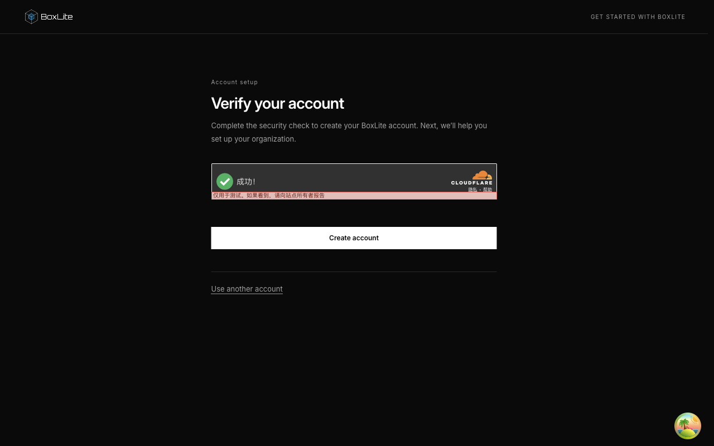
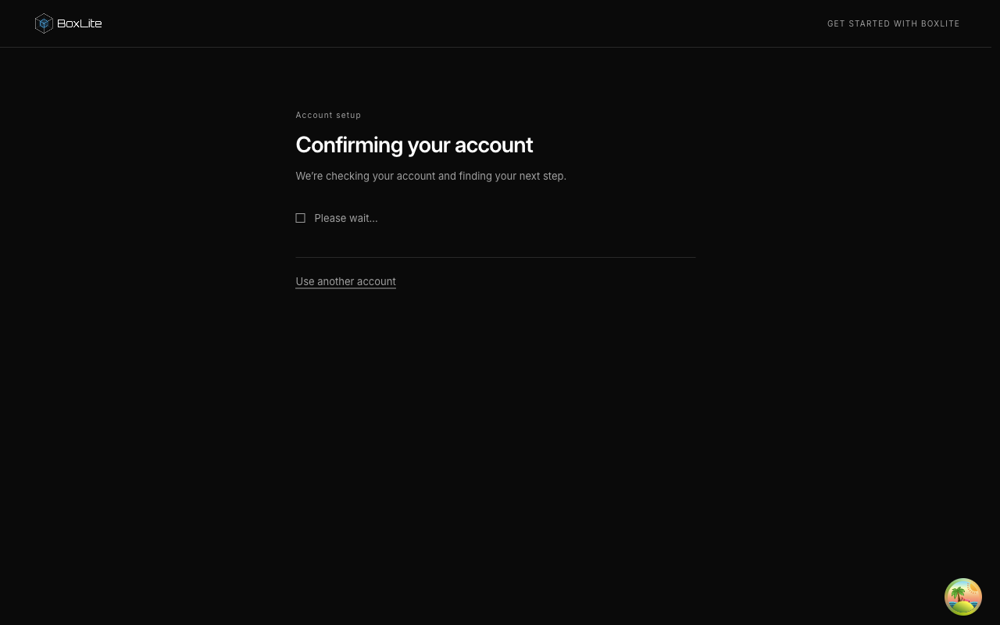
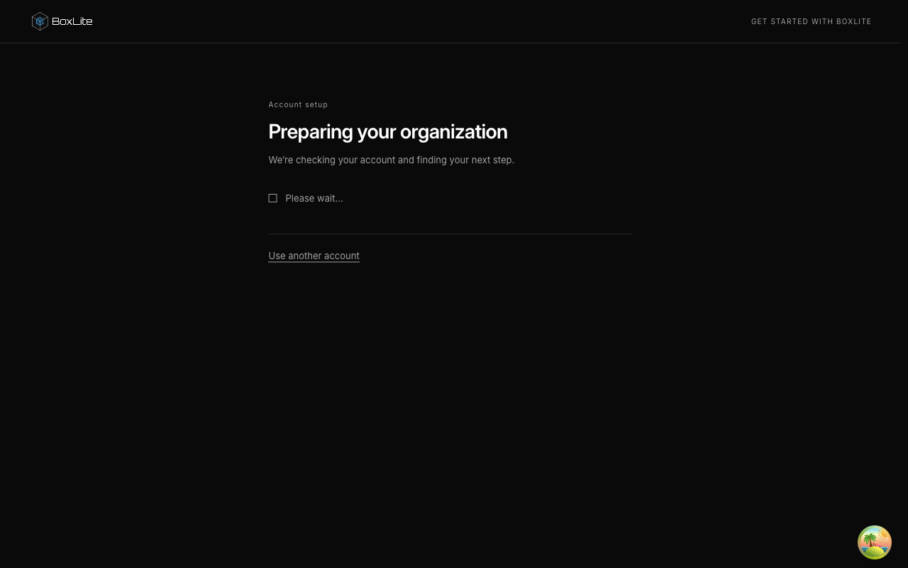
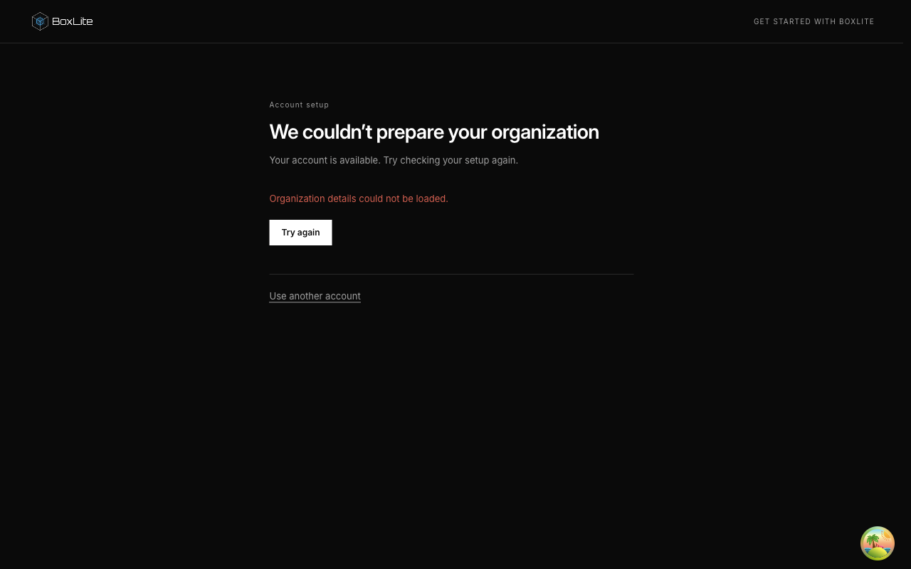
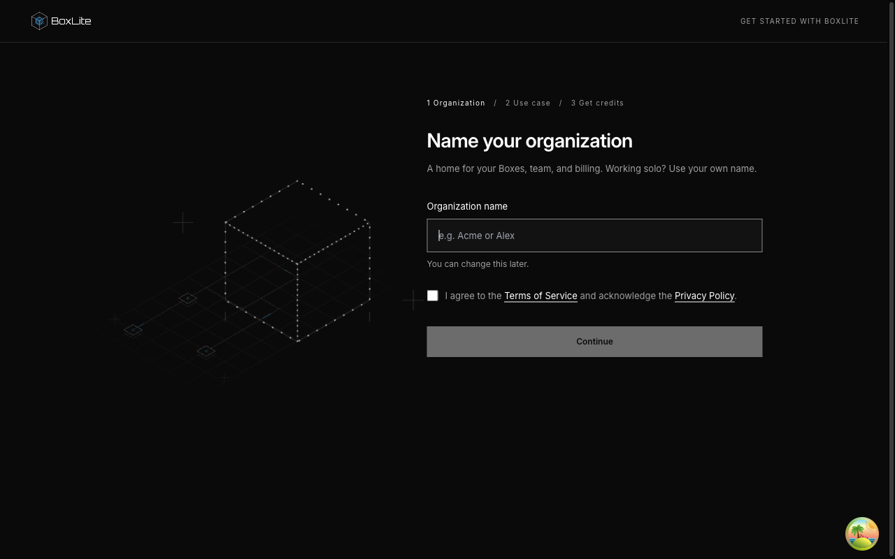
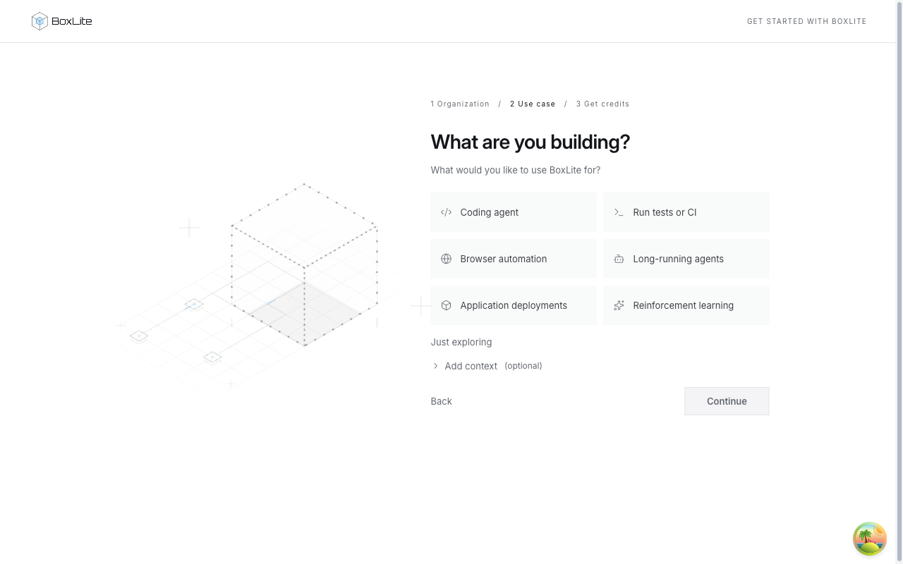
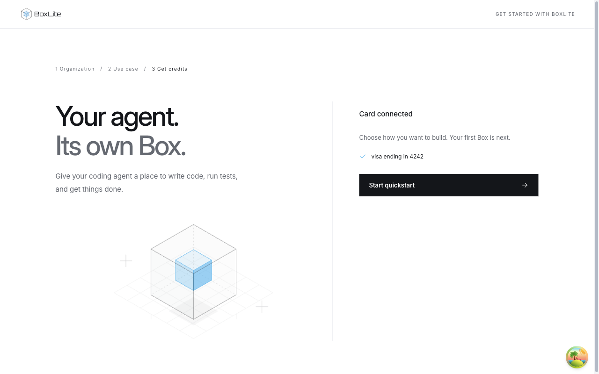
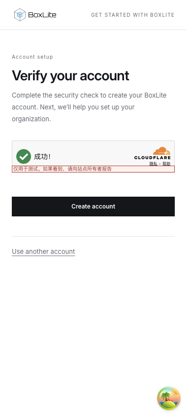

# Registration and onboarding entry

## User flow

An account that still needs setup stays outside the Console navigation until its
next destination is known. Verification, account confirmation, organization
preparation, and retry share the same header and content layout. Existing accounts
enter Boxes; explicit resource links retain their destination and admit the Console
for later navigation within the same user and organization. Entry matching follows
the router's case-insensitive and trailing-slash semantics, including Welcome's
setup header. The existing owner,
resource-presence, and local-dismissal policy determines whether to open Welcome.

The entry decision is scoped to user and organization. A newly mounted decision
waits for a fresh read, including when cached data exists. After admission, changing
routes or refreshing data preserves the mounted Console shell. Read failures offer
retry without repeating successful registration. The gate performs read-only checks;
it does not confer API authorization or change membership.

## Local preview

From `apps`, run `yarn start:mock --port=4317`, then open
`http://localhost:4317/docs/onboarding-entry/preview.html`.
The harness renders production components with MSW account data and Cloudflare's
[official always-pass test key](https://developers.cloudflare.com/turnstile/troubleshooting/testing/).
The widget's red test notice is expected. No real account or resource is created.
Auth0 and production Siteverify were not exercised by this preview.

Use `?scenario=confirm` for a delayed account confirmation after clicking Create
account, `?scenario=prepare` for a delayed organization read, `?scenario=error` for
one failed organization read (Try again recovers), or `?scenario=welcome` for the
organization naming form. Reopen the preview URL to restart; refreshing a redirected
Dashboard URL opens the regular mock console instead.

## Screenshots

Captured from the local browser at 1280×800, except the 390×844 mobile view.
The before view uses main at `666d436a5`; all other views use this change.

| Before verification | After verification |
| --- | --- |
|  |  |

| Verification, dark | Confirmation |
| --- | --- |
|  |  |

| Preparation | Recoverable error |
| --- | --- |
|  |  |

| Organization naming | Use case |
| --- | --- |
|  |  |

## Verification and boundaries

The pending/error shell assertions fail against the fully restored main production
code and pass with this change. Cached true and false decisions also require fresh
reads. Tests cover explicit links, non-owners, retries, and navigation continuity.
Run `make test:apps:dashboard` and `make build:apps:dashboard` from the repository root.

Cross-browser completion persistence, organization rename partial-success recovery,
and the remaining field-validation improvements are separate follow-ups. A saved
use case is not treated as proof that every onboarding step is complete.
