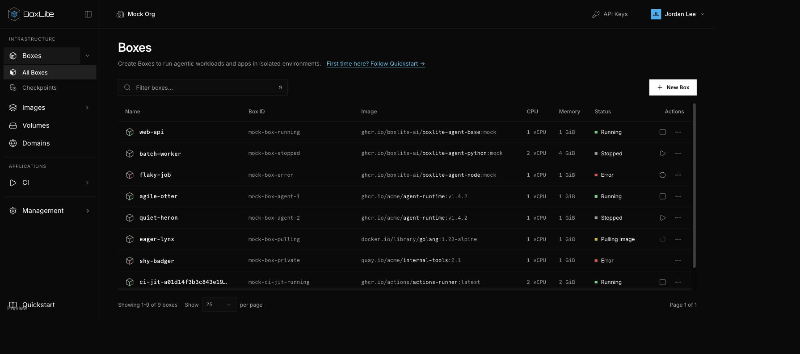
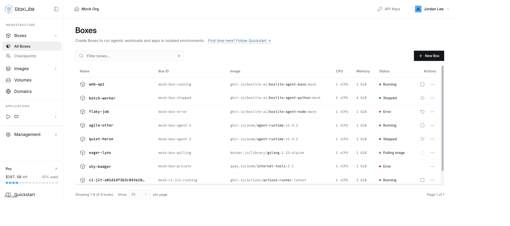
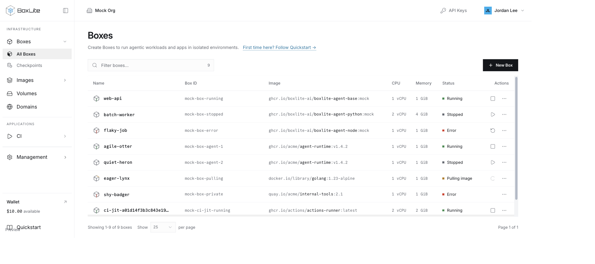
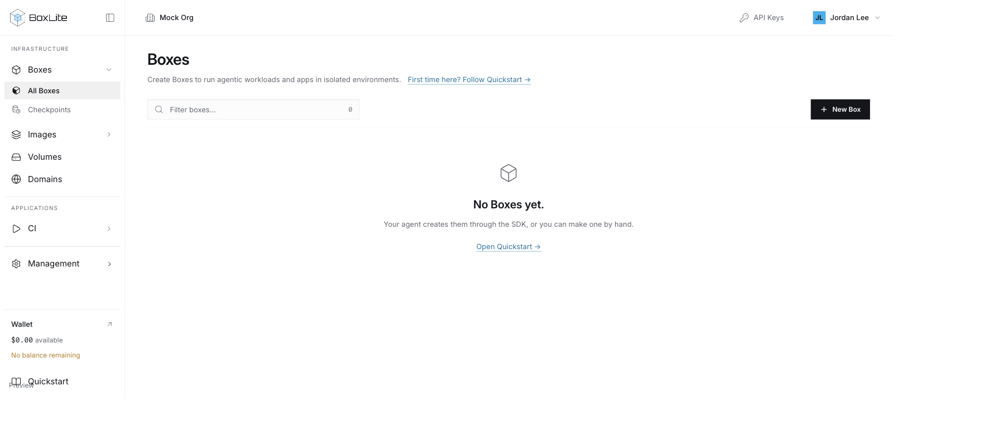

# Sidebar billing summary

The summary uses the existing Billing API and Console shell. Screenshots below
use synthetic amounts in the local mock preview; they do not show live accounts.

## Before

Funding information is available through Billing, without a sidebar summary.

## Subscription allowance

Open `/dashboard/boxes?preview=balance-subscription` in the mock preview.
A $250 plan with $187.50 remaining shows 25% used. The wallet row stays hidden.
The shared segmented meter fills as allowance is consumed, without bracket decoration.

## Wallet only

Open `/dashboard/boxes?preview=balance-wallet`. With no subscription, the
sidebar shows the actual wallet balance. No fixed allowance denominator is assumed.

## New user without a subscription

Open `/dashboard/boxes?preview=new-user`. An unfunded account shows $0.00 and
“No balance remaining”, with no resources. Registration and card connection do not
supply an amount to this summary. Existing promotional funds, if present, are
represented by the wallet balance returned by the API.

The new-user fixture also clears CI runner inventory and used capacity through
navigation. The opt-in Quickstart handoff demo still creates a complete Box fixture.

Click any summary to open the existing Billing page. Collapse the sidebar to use
the billing icon and its tooltip. These previews change local mock responses only;
production reads remain the existing organization-scoped wallet and plan requests.
