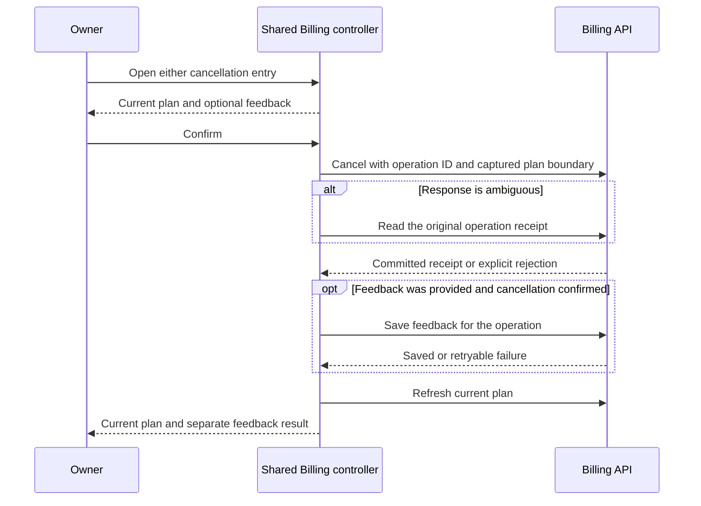
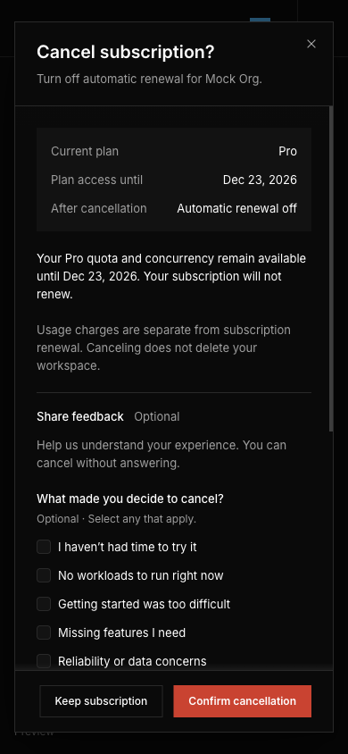

# Subscription cancellation

## Customer flow

Organization owners can cancel from Billing Overview's Active Plan panel or the current plan in Plans. Both entries open the same FormDialog.

Confirmation states the current organization, plan and server-provided cycle end. Paid quota remains available until that boundary.

Trial cancellation before conversion prevents conversion; a payment already processing must be reconciled by the billing service. Trial cancellation cannot be undone.

Paid scheduled cancellation retains the existing Keep action.


Share feedback is always expanded and optional. Reasons allow multiple selections; original intent allows one selection or none.

Other — tell us more reveals Your reason, an optional 1,000-character text field. Closing an unsubmitted dialog makes no API request.

The fixed footer remains reachable while the body scrolls, using the shared FormDialog, Button, Checkbox, RadioGroup and Textarea.


## Persistence and failure handling

The billing service must support the cancellation receipt and feedback APIs before this Console feature is released. GET plan supplies an optional subscriptionId; an older backend without it renders an unavailable cancellation action with guidance, rather than sending an unbound request.

The Console posts operationId, subscriptionId, cycleTo, trialConversionState and feedbackExpected to `POST /api/billing/organization/:organizationId/plan/cancellations`. The required server contract rejects changed confirmation details and returns a committed, idempotent receipt.

The server remains authoritative for subscription policy. Historical retries return their receipt without re-canceling a subsequently restored subscription.


A lost response is reconciled through `GET …/cancellations/:operationId`. Feedback is sent separately to `POST …/cancellations/:operationId/feedback`, with version 1, stable reason IDs, nullable intent and custom note.

Only a committed backend response is described as saved. An independent retry queue survives Billing tab changes and plan disappearance, is scoped to the organization, and does not block further cancellation.

Unconfirmed requests retain the same operation ID; definite rejection allows a new confirmation against refreshed plan details. Current plan data is refetched after cancellation, and confirmation text does not continue claiming renewal is off after Keep.


The server must persist accepted feedback with the authenticated actor and subscription association. The client never supplies another user identity or treats browser state as proof of durable acceptance.

Unaccepted answers remain an in-memory draft while Billing is open. Leaving the page, changing organization or reloading can discard these drafts; they are never represented as durable or saved. No feedback text is placed in URL parameters, analytics or application logs.

## Local UI review

Run from the repository root:

```sh
NX_DAEMON=false NX_ISOLATE_PLUGINS=false node apps/scripts/start-dashboard.mjs --target=mock --host 127.0.0.1 --port 43134
```

Open `http://127.0.0.1:43134/dashboard/billing?preview=subscription-cancel&tab=plans`.

The dedicated MSW handlers use the production client endpoints. They model `scenario=paid` (default), `trial`, `scheduled`, `none` and `readonly`; `failure=cancel` or `failure=feedback` fails the first matching request.

Mock state resets on reload. This review mode makes no production billing calls and is not evidence of database durability.

Durability must be validated in the billing service deployment separately from this UI preview.


## Verification

`make build:apps:dashboard` validates the production bundle and types. `make test:apps:dashboard` covers the client contract and shared dialog along with the existing dashboard suite.

New cancellation contracts are tested through request mapping and rendered UI: empty feedback, custom selection, retry, lost-response reconciliation, and feedback independence. Trial recovery is an existing-behavior fix: its regression assertion fails against the complete base checkout (Keep Pro instead of null), then passes with the fix.


The design reuses [WAI dialog guidance](https://www.w3.org/WAI/ARIA/apg/patterns/dialog-modal/) through the existing Radix/FormDialog primitives. Browser review verifies actual Console entry placement, fixed footer, custom text, success state and feedback retry.

## Shared state and requests



## UI review examples

The previous Billing surface exposed scheduled-change recovery without a direct cancellation entry. The new current-plan action opens the shared confirmation flow shown below using mock organization data.



