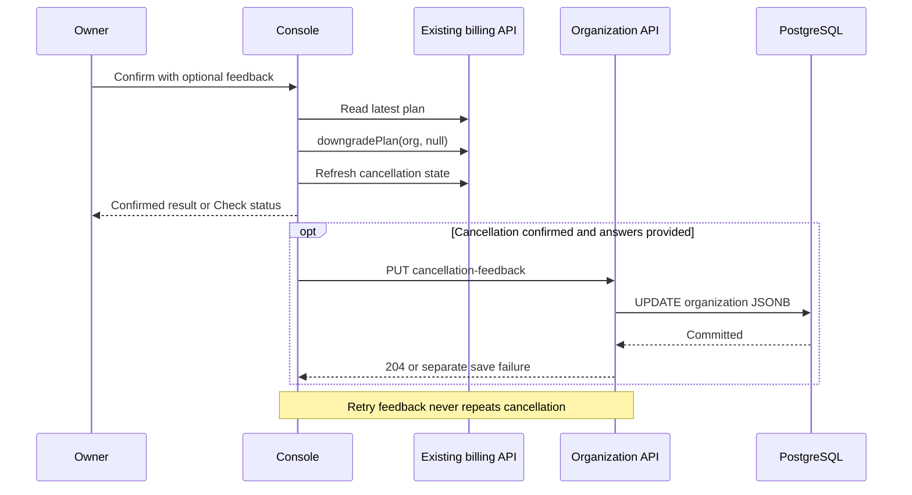
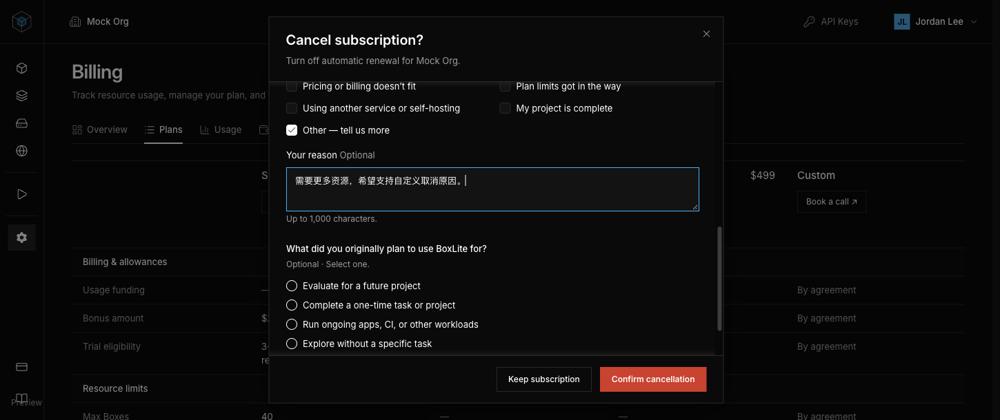

# Subscription cancellation

## Customer flow

Organization owners can cancel from Billing Overview's Active Plan panel or the current plan in Plans. Both entries open the same FormDialog.

Confirmation states the current organization, plan and server-provided cycle end. Paid quota remains available until that boundary.

Trial cancellation before conversion prevents conversion; a payment already processing must be reconciled by the billing service. Trial cancellation cannot be undone.

Paid scheduled cancellation retains the existing Keep action.


Share feedback is always expanded and optional. Reasons allow multiple selections; original intent allows one selection or none.

Other — tell us more reveals Your reason, an optional 1,000-character text field. Closing an unsubmitted dialog makes no API request.

The fixed footer remains reachable while the body scrolls, using the shared FormDialog, Button, Checkbox, RadioGroup and Textarea.


## Persistence and failure handling

The Console calls the existing `POST /api/billing/organization/:organizationId/plan/downgrade` with `{ "planId": null }`. The current plan requires no subscription identifier extension, and the billing service needs no changes.

Before sending, the Console reads the plan and compares its plan ID, cycle end and trial conversion state with the dialog. Changed terms require another explicit confirmation. This read does not atomically condition the subsequent POST: another tab can change the plan between them.

Only refreshed cancellation state confirms cancellation. A lost response or failed/empty refresh keeps the answers and offers Check status; this button only reads state. An active plan then requires explicit confirmation again, with the refreshed terms.

Cancellation and status requests have finite deadlines. Confirmation is shown before waiting for optional feedback, so feedback failure does not delay the cancellation result.

The optional answers go to `PUT /api/organizations/:organizationId/cancellation-feedback` in the main API. Its successful 204 response means the organization row update completed. The nullable JSONB field `cancellationFeedback` stores reasons, nullable intent, note, and server-owned submittedBy/submittedAt.

This is the latest accepted feedback, not a cancellation receipt or history. A new submission replaces the previous value; no answers means no write. Separate tabs use database write order, not click time.

A feedback failure keeps one draft in the shared Billing controller for Retry feedback. This retry only writes the organization field, without another cancellation request. A later confirmed cancellation supersedes the old unsaved draft, including when no new answers were supplied.

Changing organization, leaving Billing or reloading discards unaccepted drafts. Late responses from an old controller cannot submit further requests or change the new organization's UI. No feedback text is placed in URL parameters, analytics or application logs.

The feedback endpoint requires an authenticated current organization owner and rejects API keys. The field is excluded from ordinary organization queries and responses. See [API persistence and rollout](../../api/README.md#organization-cancellation-feedback).

## Local UI review

Run from the repository root:

```sh
NX_DAEMON=false NX_ISOLATE_PLUGINS=false node apps/scripts/start-dashboard.mjs --target=mock --host 127.0.0.1 --port 43134
```

Open `http://127.0.0.1:43134/dashboard/billing?preview=subscription-cancel&tab=plans`.

The dedicated MSW handlers use the production client endpoints. They model `scenario=paid` (default), `trial`, `scheduled`, `none` and `readonly`; `failure=cancel` or `failure=feedback` fails the first matching request.

Mock state resets on reload. This review mode makes no production billing calls and is not evidence of database durability.

Real PostgreSQL and authenticated HTTP tests validate organization persistence separately from this in-memory UI preview.


## Verification

`make build:apps:dashboard` validates the production bundle and types. `make test:apps:dashboard` covers the client contract and shared dialog along with the existing dashboard suite.

Request-mapping and rendered UI tests cover the new cancellation and organization-feedback contract. Cases include no answers, custom text, status-only checks, changed terms, feedback-only retry, superseded drafts and organization switching. Trial recovery is an existing-behavior fix: its regression assertion fails against the complete base checkout (Keep Pro instead of null), then passes with the fix.


The design reuses [WAI dialog guidance](https://www.w3.org/WAI/ARIA/apg/patterns/dialog-modal/) through the existing Radix/FormDialog primitives. Browser review verifies actual Console entry placement, fixed footer, custom text, success state and feedback retry.

## Shared state and requests



## UI review examples

The previous Billing surface exposed scheduled-change recovery without a direct cancellation entry. The new current-plan action opens the shared confirmation flow shown below using mock organization data.




