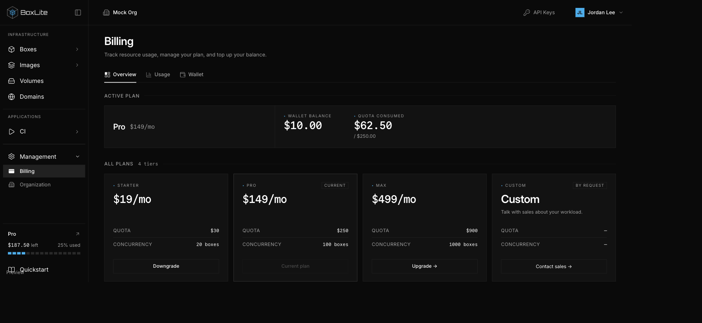
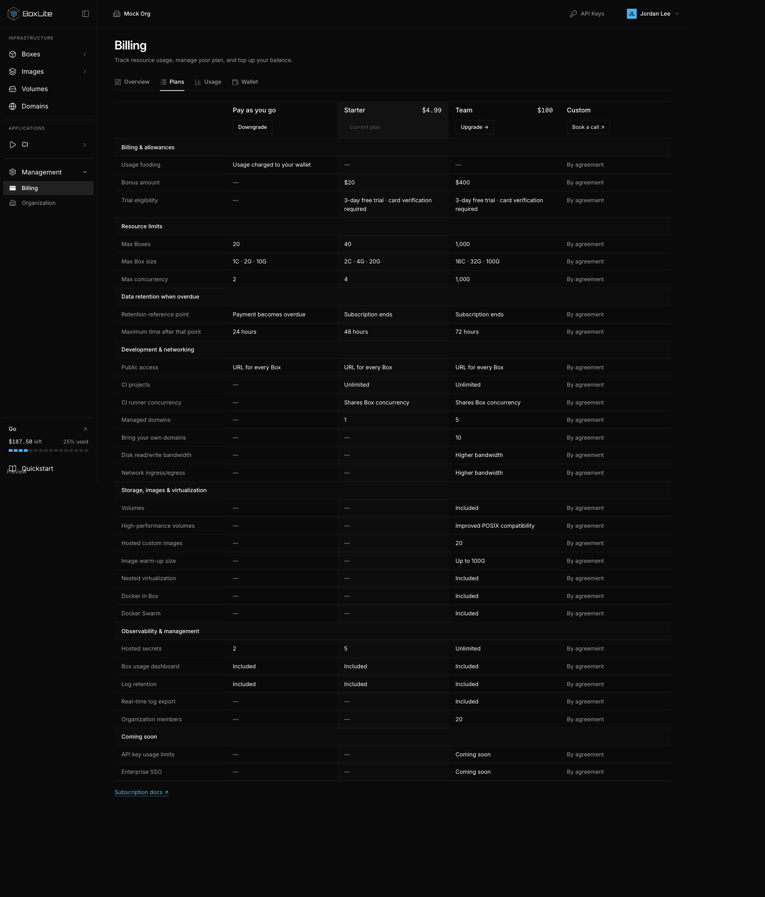

# Billing Plans comparison

## Design

Overview shows the current account's plan, wallet and quota. A View plans action
opens the independent, URL-addressable Plans tab. Plans uses a grouped comparison
table, adapted from the Modal Plans page reviewed on 2026-11-17. Plan names,
prices and actions form the column headers; one shared feature label per row
replaces repeated card lists. Desktop uses natural page scrolling with the plan header pinned below the app
header. Narrow layouts use a bounded table viewport with pinned feature labels.
Plan names and prices share one line, with aligned actions below; the active
plan column has a subtle background. The subscription documentation link follows the table.

The authoritative benefits are from Notion `11·16 新的订阅计划`
(41a8d8d971798052930bfdcdb28e3877), with the product definitions: Free is
presented as Pay as you go and creation concurrency means total Boxes held.
Catalogue names identify the documented tiers: NoSubscription → Pay as you go,
Go → Starter, Team → Team. Replacement names are also accepted. Order changes
and missing tiers do not change the mapping; unknown names receive no inferred benefits. Missing facts show a dash,
accessible as unspecified, never unsupported. Custom terms are negotiated.

Plans displays Notion names, prices and bonus amounts without adding a monthly
cycle or grant cadence. Overview retains real account data. A self-serve action
is available only when its catalogue price matches the displayed price; otherwise
the user can contact support. This keeps the Go/$5 catalogue entry from silently
charging against a Starter/$4.99 display. Existing plan IDs remain unchanged.
The table does not activate trials or upcoming features. Trial eligibility is
presented as documented (3 days with card verification), not an activation CTA.
Hosted secrets and key management are the same capability per product clarification,
shown once as Hosted secrets. Undefined
Funder support and Region support are omitted pending product clarification.

## Interaction contract

Billing tabs use `?tab=overview|plans|usage|wallet`, preserving other parameters.
Browser back/forward and direct links restore the selected tab. Owners can use
existing current/scheduled/upgrade/downgrade actions. Other members can compare
public plans but are directed to their organization owner to change a plan.
Existing APIs, charge calculations and confirmation routes are unchanged.

Retention is split into its reference point and maximum time after that point:
PAYG uses overdue time; paid tiers use subscription end. All apply only when
payment is overdue. These are maximum periods, not guarantees. Log retention
has no documented duration and is kept separate.

## Validation

Check Overview-to-Plans navigation, direct URLs and history, catalogue loading,
error/retry and empty states, owner/non-owner actions, and cancelled/scheduled
plans. Verify unchanged confirmation targets, exact catalogue prices, missing
facts versus unsupported, and retention reference points. Inspect desktop light
and dark themes, sticky headers, keyboard focus and narrow horizontal scrolling.

## Local preview

`http://127.0.0.1:3198/dashboard/billing?preview=subscription-cards&tab=plans`
uses the existing mock catalogue matching the supplied screenshot. No real
checkout or payment is performed by this preview.

## Source audit (2026-11-17)

- Names: PAYG is the display name replacing for Notion Free; Starter and
  Team use the document names. Prices are 4.99 and 100, with no inferred period.
- Bonuses: 20 and 400, no inferred issue frequency, expiry or credit type.
- Trials: 3 days with card verification on the two paid tiers; no trial activation
  behavior is added.
- Box limits: 20/40/1000 total Boxes, 1C·2G·10G / 2C·4G·20G / 16C·32G·100G,
  and 2/4/1000 maximum runtime concurrency. CI sharing is a table row, not a footer.
- Retention: overdue-only, with the reference point and maximum offset separated.
- Included facts: public URLs, CI projects, domains, bandwidth, volumes, images,
  warm-up, virtualization, observability and 20 organization members.
- Higher tiers include lower-tier capabilities, per the product clarification on
  2026-11-17. Team includes the usage dashboard. Hosted secrets are 2 / 5 /
  Unlimited, including unlimited Team secrets. Key
  management is included in this same row, not a separate capability. Resource limits increase across all
  three tiers; public URLs and log retention are present throughout; paid CI
  capabilities carry from Starter to Team. Commercial terms, overdue retention
  reference points and coming-soon statuses remain explicit rather than inherited.
  Custom remains negotiated; the inheritance rule applies to the three standard tiers.
- Coming-soon API key limits and SSO remain explicitly coming soon.
- Funder support and Region support are absent from the public comparison until
  their meanings are confirmed. The document's “Double Limited of Free” does
  not override its explicit Team values.
- Website docs link currently points to an older plan document; this change
  does not claim that external document is synchronized.

Earlier presentation decisions retained: no Free or zero-monthly headline for
PAYG, aligned plan actions, no shared-slots jargon,
Max Box size wording, members away from the top, and independent Plans navigation.
Per-card expand/collapse is intentionally replaced by the approved comparison
table. The comparison tab preserves the existing active/scheduled indicators.

Contact actions open https://boxlite.ai/contact in a new tab; the Console does
not display a support email. Custom uses the Book a call label.

## Screenshots and evidence

All screenshots use mock accounts. The baseline uses the main-branch mock
catalogue; the final screenshots use the subscription-cards preview catalogue.

| Before | Plans |
| --- | --- |
|  |  |

[Light theme](plans-light.png) · [Mobile](plans-mobile.png)

Dashboard tests: 147 files / 1,582 tests passed. Production build passed.
The catalogue-reordering regression failed before the mapping fix and passed
afterward. Workspace lint reports three pre-existing module-boundary errors in
infra/deployment/release-audit-workflow.test.ts, outside this change.
Actual payments and backend enforcement were not exercised.
