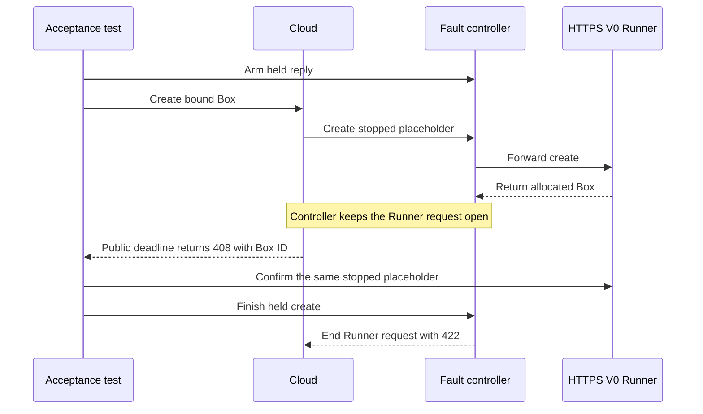
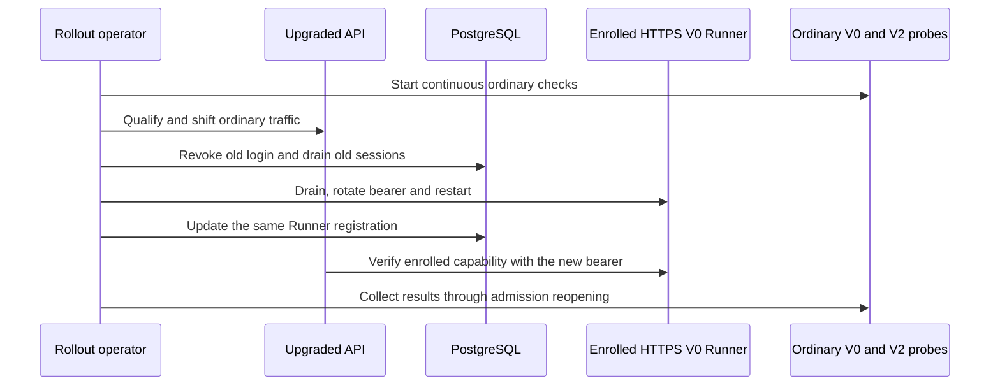
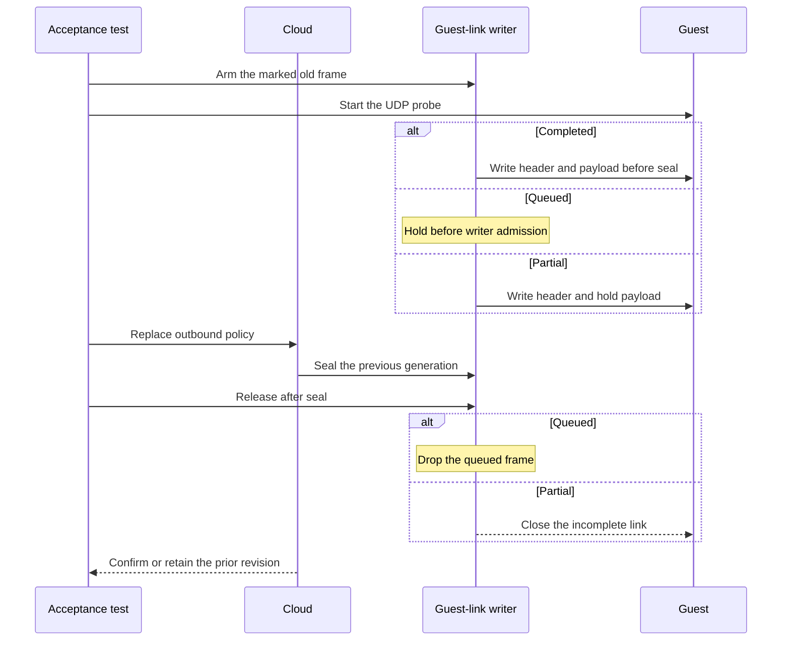

# End-to-end test suite

These tests exercise the **full production path**:

```
Python SDK (boxlite.Boxlite.rest) → HTTP → NestJS API → HTTP → boxlite-runner → libkrun VM
```

Cloud runs accept an optional `tag` in the **E2E cloud** workflow, including
reusable calls. For example, `tag=v0.13.1` downloads that release's Python wheel,
Node SDK/native addon and CLI instead of compiling them. Leave `tag` blank to
build clients from the selected checkout, as before. Only stable `vX.Y.Z` tags
are accepted; unavailable artifacts fail the run without falling back to source.

```bash
gh workflow run e2e-cloud.yml -f stage=dev -f tag=v0.13.1
```

Tests still come from the selected checkout and target the selected deployed
stage. On dev, C/Go domain drivers link the released C library; Go SDK source
comes from the release tag. The Rust domain driver compiles against that tag's
Rust SDK, so dev still has some Rust compilation. All driver source programs
come from the test checkout, preserving current acceptance coverage. A release
that lacks APIs required by current tests fails those tests or driver builds.
Prod retains its Python-only smoke selection. This input changes client versions;
it does not deploy or change the cloud stack.

The Node release installer removes SDK development/workspace metadata before
adding the test tools, while retaining runtime dependencies. npm resolves peer
dependencies before applying `--omit=dev`; resolving the published SDK's build
metadata can otherwise abort installation with an `edgesOut` error.
To exercise the real npm resolver and TypeScript tools in a temporary checkout,
run `E2E_RELEASE_REAL_NPM=1 make test:unit:scripts` with the workflow's Node/npm
versions. This opt-in check downloads test tools from the npm registry.

Existing `make test:integration:*` tests use the local PyO3 / FFI path
(`Boxlite.default()`) and bypass both the API and the runner — so a bug that
only surfaces on the REST → API → runner chain (e.g. #563's exec-stdout drop,
#627's attach re-drain) will pass those tests and reach production. This suite
exists to catch those.

It sits under `apps/` because the stack it drives — `apps/api`, `apps/runner`,
`apps/proxy` — does. It is **not** an Nx project: there is no `project.json` or
Jest config for Nx to infer, and pytest invokes its polyglot SDK drivers. It is
also **not** what `npm run e2e:local` starts — that command brings up the local
Dex environment for the dashboard. Drive this suite through the
`make test:e2e*` targets.

The wider REST API test flow, from the contract inventory and this suite to the
CLI matrix and both authentication modes, is in
[REST API testing](../../docs/contributing/development/rest-api-testing.md).

## What the suite verifies

### Managed checkpoints

`cases/test_checkpoints.py` exercises stopped-source export and upload, source deletion and
creating a Box from the checkpoint through the SDK and actual guests.
Guest reads verify immutable disk contents and inherited environment values.
Deleting the checkpoint must leave the created Box usable.

Stop requests are asynchronous: the case waits for the source to report `stopped`
before capture. Source deletion and teardown wait for absence by stable Box ID,
since deletion admission renames a Box before destruction finishes. Cleanup retries
only the state-change conflict, bounds each Box removal to 30 seconds, and reports
other errors while continuing the remaining cleanup.

Checkpoint creates leave lifecycle options unset instead of receiving the harness
defaults again. The source receives the suite's 300-second `auto_stop` and
600-second `auto_delete` policy before capture; the restored Box must inherit both,
which the case verifies through the API-backed SDK metadata.

Run against an API/runner built from this branch with checkpoint storage enabled:

```bash
make test:e2e E2E_ARGS=cases/test_checkpoints.py
```

Use the existing environment/profile authentication described below. The case
requires `capabilities.checkpoints_enabled=true`; absence fails before creating
a Box. It uses unique `e2e-` resource names, retains the suite's bounded Box
lifetimes, and reports cleanup failures. It is outside the production smoke
selection because it uses checkpoint storage and multiple guest lifecycles. Loopback, mock-storage and
native stub checks do not satisfy this real VM/storage acceptance case.

### Existing coverage

CLI cases invoke detached workloads as `boxlite run -d IMAGE sleep 300`.
The image begins the CLI's trailing argument vector, so an extra `--` after
IMAGE becomes the guest executable; it is not a command separator. Keep
`boxlite exec BOX -- COMMAND` for exec, which uses a separate command argument.

The CLI cases share `lib/cli_process.py` to include stdout, stderr and exit
status in checked-command failures. Exit-code tests use `check=False` and
inspect the returned result. Named-box creation failures fail the test; a
unique suite name allows cleanup even when creation returns no Box ID.

`tests/scripts/test_e2e_cli.py` drives these callers through the actual CLI and
a loopback HTTP endpoint. Run it via `make test:unit:scripts` with the E2E
Python dependencies installed and `BOXLITE_E2E_CLI` pointing to the built CLI.
These checks verify request arguments and diagnostics; real cloud E2E remains
necessary to verify the API, Runner and VM path together.

Product acceptance cases use the REST-mode runtime built by `conftest.py::rt`.
`test_network_harness.py` separately checks probe failures and framing without
creating a box; those checks are not counted as product E2E evidence.

The Node tunnel driver waits for every created box's removal before closing its runtime.
A failed removal fails the case after the other removals settle; the runtime closes even when cleanup fails.

`cases/test_path_verification.py` is the meta-test: it spawns one box, runs
one exec, and asserts that **both** `:3000` (API) and `:8080` (runner)
received the corresponding HTTP requests by tailing `/var/log/boxlite-api.log`
and `journalctl -u boxlite-runner`. If that meta-test passes, every other
case in this suite is using the same fixtures and the same path.

## Managed local E2E (preferred)

`make test:e2e:setup` starts the dependency services with Docker Compose and runs the current-source API/Runner/proxies as host processes; fixtures and a real guest smoke follow. State lives in `target/e2e/`; no sudo or system services are used.

Initialize submodules once (`git submodule update --init --recursive`, or `make setup`), then:

```bash
nix develop -c make test:e2e:doctor
nix develop -c make test:e2e:setup
make test:e2e FILTER=exec_working_dir
make test:e2e:down
```

`make test:e2e:down` also terminates `bwrap`/`boxlite-shim` processes left in this checkout's runtime home by an interrupted run, removes their box directories, and fails if any process survives. The jailer starts every shim with `setsid()`, so signalling the runner's process group never reaches them.

The fixed host ports support one managed stack at a time on a host, including across users; coordinate shared hosts and run stacks sequentially. `status` takes the lifecycle lock without reserving an unused stack. Lifecycle commands share a user-wide lock and persist the owning checkout and state directory until a successful `down`. Another checkout or `E2E_STATE_DIR` fails before changing resources; stop the owner using its original checkout and state directory first. Compose projects and runtime homes include the user, checkout and state identity and cannot be overridden by inherited Compose settings. Switching state after teardown therefore does not reuse volumes encrypted with another state's keys. PID records are published atomically.

Runtime roots and the coordination directory are opened without following symlinks,
checked for the current user's ownership, and made private. Foreign-owned or
group/other-writable runtime parents are refused rather than repaired. Safe owned
0755 parents from older launchers are tightened to 0700. Inside that private root,
owned Runner-created box directories are tightened to 0700, including directories
from earlier runs with umask 002; foreign owners and symlinks remain rejected.
Host services inherit umask 077. Teardown also verifies
the `boxes` directory and its children before recursively removing anything.

Before replacing the Runner, startup reaps owned box process trees only when
their `shim.pid` cannot identify a live process. PID/start-time verification and
legacy PID handling follow runtime recovery; recoverable guests are preserved.
This does not replace the runtime's database reconciliation or VM adoption.

`E2E_PYTHON` accepts absolute paths, bare interpreter names found on `PATH`, or paths relative to the repository root. An existing interpreter must belong to a virtual environment; a bare system `python3` is not accepted. The same resolved interpreter is used for dependency sync, SDK installation, fixtures and pytest, including recursive Make invocations. A command-line `E2E_STATE_DIR` overrides an inherited `BOXLITE_E2E_STATE_DIR`; relative state paths are anchored at the repository root.

An existing virtual environment created with `--without-pip` is supported:
dependency setup bootstraps pip through that interpreter's bundled `ensurepip`
before installing the pinned uv version. To select another Python version, create
its virtual environment first and point `E2E_PYTHON` at its existing interpreter;
unsupported executable names are rejected before creating a new environment.

The source-run API reads the repository's `openapi/` through `BOXLITE_OPENAPI_DIR`; packaged deployments retain the bundled-assets default. This avoids requiring generated copies beneath `apps/api/src/assets` for local startup.

Host API, Runner and proxy listeners bind to loopback through `BOXLITE_LISTEN_HOST=127.0.0.1`. Other deployments retain their existing all-interface default when this variable is unset. Credentials and encryption keys are generated once in `target/e2e/credentials.json` (mode 0600); preserve this file with the stack's data. Initial `POSTGRES_PASSWORD` and `MINIO_PASSWORD` overrides are persisted and later environment changes do not rotate existing credentials. Generated Compose `.env` files contain no passwords.

`setup`, `up` and `test:e2e` reuse an unchanged healthy stack. The launcher hashes tracked and non-ignored untracked working-tree inputs, including submodule sources, and the launch environment/interpreter. Test directories and Markdown documentation are excluded; changing pytest cases, `FILTER` or `E2E_ARGS` therefore does not reinstall dependencies or restart services. Product or configuration changes conservatively rebuild components and restart all host services. Dependency manifests have a separate fingerprint, so source-only changes skip dependency installation when the Python environment and package directories still exist.

Reuse also requires the expected build artifacts, matching host PID/start-time records, responsive dependency and HTTP health checks, and a ready registered Runner. Missing records, artifacts or unhealthy services trigger preparation. Successful startup and fixture setup publish the reuse record; a failed preparation invalidates it. Delete `target/e2e/stack-inputs.json` to force preparation, or also delete `dependencies-inputs.json` to force dependency sync after manually altering installed packages. This cache assumes installed packages and generated artifacts have not been manually replaced; it does not fingerprint toolchain installations or external data.

The Runner build fingerprints `target/debug/libboxlite.a` and forces Go recompilation when its content changes, because Go's cache does not track external CGO archives. A failed build never advances that fingerprint.

This invalidation follows [Go's documented external C-library cache limitation](https://pkg.go.dev/cmd/go#hdr-Build_and_test_caching). Compose isolation follows its [project-name boundary](https://docs.docker.com/compose/how-tos/project-name/); a separate user-wide owner reservation is still needed because project names do not isolate host ports.

Startup failure or interruption stops newly started host services and box processes, preserves pre-existing guest process identities, removes newly created dependency containers, and preserves existing dependency containers, volumes and logs. Build failures occur before stopping existing services. A restart intentionally replaces the old host processes; failed replacements are stopped rather than left half-running. Failed startup retains ownership so recovery or teardown uses the same checkout/state.

Each dependency-readiness subprocess shares its check's remaining deadline, so
a connected but unresponsive Redis or PostgreSQL cannot block startup forever.
`status` fails if any required API/Runner/proxy PID record is missing or stale,
including before startup and after teardown.

Explicit paths supplied through `E2E_ARGS` suppress default whole-suite selection,
just like paths passed directly to `run.sh`:

```bash
make test:e2e E2E_ARGS='cases/test_lifecycle.py -x'
```

Stacks created before checkout-specific Compose projects used the shared `boxlite-e2e` project and fixed encryption keys. Stop those stacks with the old launcher before upgrading. Their volumes are not adopted or deleted automatically; keep their original state and keys if data must be migrated. The new launcher creates a separate project and must not be used to clean up an old project's resources.

Compose uses the configured Docker connection; Podman users must explicitly set
`DOCKER_HOST=unix:///path/to/podman.sock`. Only one engine is needed: a `docker`
command supplied by Podman does not imply a Docker daemon at `/var/run/docker.sock`.
For rootless Podman, use `DOCKER_HOST=unix://$XDG_RUNTIME_DIR/podman/podman.sock`
with its API socket running. The launcher saves Docker connection environment
variables in `target/e2e/compose-engine.json` after the first successful Compose
command and reuses them for all lifecycle commands. Failed initial connections
leave no selection, so correcting `DOCKER_HOST` and retrying works. Keep the
selected Docker context unchanged until teardown;
a newly available Podman socket never changes the selected engine automatically.

The launcher script tests keep real `/proc` process checks Linux-only and mock process discovery in platform-independent lifecycle tests. Runtime process tests resolve `sleep` through `PATH`, preserving its executable name for multicall coreutils on NixOS; neither `/bin/sleep` nor a renamed sleep applet is required.

Nix is optional: install the same tools with the distro and run the same commands. Host prerequisites remain Docker with Compose v2, `/dev/kvm`, and (for volumes) `/dev/fuse`, `mount-s3` and `user_allow_other` in `/etc/fuse.conf`. The devshell includes `docker-compose`; Ubuntu can use `docker-compose-v2`. The bootstrap instructions below are the legacy Ubuntu system-service path and are no longer used by `make test:e2e:setup`.

## Prereqs

`BOXLITE_E2E_CATALOG_IMAGE` accepts tagged, digest-pinned, and untagged
references, including registry ports such as `registry.local:5000/acme/app`.
The catalog tests retain the port when deriving the repository name and the
deliberately unpullable test image.

Set up via the bootstrap script (one-time per machine):

```bash
apps/e2e/bootstrap.sh
```

This installs / starts:

- Postgres + Redis (apt)
- Node.js 22 + yarn (corepack)
- Docker registry on `:5000`
- Rust toolchain (rustup) + Go toolchain (release tarball)
- `boxlite-runner.service` on `:8080` — **built from the working tree**, not from a release pin. The runner CGOs into `libboxlite.a` so any change under `sdks/c/`, `src/boxlite/`, or `apps/runner/` shows up after the next `make test:e2e:setup`. Release-pinned binaries would test stale code instead of the PR.
- `boxlite-api.service` on `:3000` (ts-node, reads `/etc/boxlite-api.env`)

First run is slow (~5–10 min, mostly the Rust release build). Subsequent runs are incremental.

Tear down with `apps/e2e/teardown.sh` (basic), `--wipe-data`
(also drops the DB and `/var/lib/boxlite`), or `--full` (also drops
the persistent secrets file so the next bootstrap mints fresh keys).
Postgres + Redis + Node are kept around — they're cheap to leave and
likely shared with other things on the host.

Bootstrap stores the random `ADMIN_API_KEY`, `ENCRYPTION_KEY`, and
runner / proxy tokens in `/etc/boxlite-secrets.env`
(mode 600, owned by the bootstrap user). It's read back on every
re-run, so the API env file can be regenerated whenever a PR adds a
new variable without losing access to data encrypted under the old
keys. If you ever need to rotate, run `teardown.sh --full`.

Then run the fixture setup (idempotent — re-running is safe):

```bash
python3 apps/e2e/fixture_setup.py
```

This:

- Registers `alpine:3.23` snapshot via the API admin endpoint
- Waits for the snapshot to reach `active` state (runner pulls + pushes to local registry)
- Sets reasonable per-box quotas on the admin org
- Adds a `[profiles.p1]` entry in `~/.boxlite/credentials.toml` pointing at the local API

## Running against a remote API (dev / staging)

No bootstrap or fixture_setup needed — just set environment variables:

```bash
# Required:
export BOXLITE_E2E_API_URL=https://api.dev.boxlite.ai
export BOXLITE_E2E_API_KEY=blk_live_...        # your API key for the remote env
export BOXLITE_E2E_AUTH=api-key

# Optional (auto-discovered from /v1/me if omitted):
export BOXLITE_E2E_PREFIX=<org-path-prefix>

# Image must exist on the remote runner. run.sh otherwise derives this from
# apps/box-images/VERSION, so a local run needs no override:
export BOXLITE_E2E_IMAGE=ghcr.io/boxlite-ai/boxlite-agent-base:v0.1.0

# Skip local-only checks (journalctl, runner log):
export BOXLITE_E2E_SKIP_PATH_VERIFY=1

# Or keep path verification on a runner started by hand (a local stack on
# macOS has no systemd journal): read its log file instead of journalctl.
export BOXLITE_E2E_RUNNER_LOG=/path/to/runner.log

# Image the catalog case boots, which must be on a host the API's allowlist
# admits. Defaults to a small public one on quay.io, so a run needs no override:
export BOXLITE_E2E_CATALOG_IMAGE=quay.io/libpod/alpine:latest

# Two tags of one repository with different digests, the repository spelled
# the same in both, which the tag case pulls and moves a tag between. Defaults
# to two alpine releases on Docker Hub, so a run needs no override. Moving a
# tag takes the write:images scope, which an API key made before that scope
# existed does not have:
export BOXLITE_E2E_TAG_IMAGE_OLD=docker.io/library/alpine:3.19
export BOXLITE_E2E_TAG_IMAGE_NEW=docker.io/library/alpine:3.20

# Only for a stack that predates the image catalog: skip that case instead of
# failing. Without it a 404 on /images is treated as the regression it is:
export BOXLITE_E2E_ALLOW_MISSING_CATALOG=1

# The live disk-expansion case (test_disk_expansion.py) runs only with both
# set, after an operator has already grown the runner's data disk in GCP —
# the test polls admin REST until the healthcheck-reported filesystem size
# catches up (0.975 × target: the API's confirm tolerance, since ext4 keeps
# the filesystem ~2% below the device), and never calls the GCP API itself.
# Needs an admin-role API key. Set TARGET to the post-resize device size,
# meaningfully larger than the pre-resize one. Mind the per-test pytest
# timeout: propagation takes minutes (hyperdisk allows 2 resizes per
# disk per 4h window):
export BOXLITE_E2E_EXPANDED_DISK_RUNNER_ID=<runner-id>
export BOXLITE_E2E_EXPANDED_DISK_TARGET_GIB=<new-size-in-gib>

# The private image case runs only with a real private image and its login,
# written with its host and a tag or digest. The prefix defaults to the
# image's namespace. It adds its own login and refuses to start while the
# organization already has one for that registry and prefix:
export BOXLITE_E2E_PRIVATE_IMAGE=ghcr.io/acme/private-app:1
export BOXLITE_E2E_PRIVATE_USERNAME=acme-bot
export BOXLITE_E2E_PRIVATE_PASSWORD=...        # a token with read access only
export BOXLITE_E2E_PRIVATE_PREFIX=acme/

# CLI tests need a profile pointing at the remote API:
export BOXLITE_E2E_PROFILE=p1
export BOXLITE_E2E_CLI=/path/to/boxlite   # CLI binary built with REST support
```

Private-image cleanup keeps its login record until deletion succeeds. If the
removal step fails, teardown retries that login; a transient failure must not
leave an untracked credential that prevents the next run.

Then run the profile into `~/.boxlite/credentials.toml` so the CLI
picks it up (one-time per machine):

```bash
mkdir -p ~/.boxlite
cat > ~/.boxlite/credentials.toml << 'EOF'
[profiles.p1]
url = "https://api.dev.boxlite.ai"
api_key = "blk_live_..."
auth_method = "api_key"
path_prefix = ""
EOF
```

The `path_prefix` is auto-discovered at runtime from `/v1/me` — leave
it empty or set `BOXLITE_E2E_PREFIX` explicitly if discovery fails.

Run:

```bash
pytest apps/e2e/cases/ -v --timeout=120
```

For CI, use the stage-specific secrets below. No local bootstrap, Postgres,
or runner services are needed — the remote stack provides everything.

## Managed outbound proxy acceptance

Run this group against an isolated Cloud organization with managed outbound
enabled and placement restricted to one enrolled HTTPS V0 Runner. Use the SDK,
CLI, API, Runner, and Runtime from the build under test. The Guest image needs
Python 3, `curl`, and trust for the HTTPS probe target.

Run the [probe target](fixtures/managed_outbound_target.py) on a separate owned
host. Pass `--bind`, `--port`, `--udp-port`, `--cert`, `--key`, and
`--observations` with a new private file for each run.

Allow connections from the test Runner and proxy exits, and make the live
observations file readable by the test process. The target records the socket
peer, marker, and receive time, plus Host and SNI for HTTPS.

For the REST credentials use the profile or API-key settings above. Set
`BOXLITE_E2E_MANAGED_INVENTORY_TOKEN` to the enrolled Runner's Cloud inventory
credential and `BOXLITE_E2E_MANAGED_RUNNER_KEY` to the Runner API credential.

Configure a PostgreSQL service with read-only access to the test Box epoch and
binding. Runner inspection remains the source of installed and durable state.

Pass `--managed-outbound-config` an absolute path to a JSON file with these fields.

| Field | Value |
| --- | --- |
| `api_origin`, `organization_prefix` | Exact HTTPS API origin and dedicated organization routing prefix. |
| `runner_origin`, `runner_id`, `inventory_url` | Runner HTTPS origin and UUID, plus its authenticated Cloud inventory endpoint ending in `/api/box/for-runner`. |
| `postgres_service` | Local `psql` service name for the isolated Cloud database. |
| `target_origin`, `target_tcp_ip`, `target_log`, `direct_source` | Owned HTTPS origin and its numeric IPv4 destination, local path to the observations file, and the Runner's direct source IP at the target. |
| `target_udp_ip`, `target_udp_port` | Owned IPv4 address and port of the target's datagram listener. |
| `workload_secret_file` | Private file on the test controller containing the same synthetic workload token supplied to the HTTPS target. Required by the credentials case. |
| `dns` | Pinned DoH and Runner DNS observers for the DNS path cases. See the DNS fixture instructions below. |
| `tcp_faults` | Dedicated business TCP fault listeners and two packet capture logs. See the TCP fault instructions below. |
| `external_udp` | Direct DNS and HTTP/3 endpoints with their application and packet logs. See the external UDP instructions below. |
| `udp_unbind` | The delayed reply release directory and independent unlisted UDP target. |
| `protected_target` | Separately observed private HTTPS target for the connector address policy check. |
| `deployment` | Fault controller executable and the second enrolled Runner for lifecycle acceptance. See Deployment lifecycle below. |
| `variants` | Entries for `http-anonymous`, `http-credential`, `https-anonymous`, `https-credential`, `socks5-anonymous`, and `socks5-credential`. |

Each variant contains `endpoint`, `source`, and `proxy_log`. Use the canonical
proxy URL for `endpoint`, omitting credentials and any explicit default port.
Set `source` to the IP the target sees and use a separate local `proxy_log` file
for each listener.

Credential variants specify a private `credential_file` with synthetic
`username` and `password` strings. The BoxLite CLI reads these from stdin.

Start the [recording proxy](fixtures/managed_outbound_proxy.py) on each fixture
exit, with one listener per variant. Set `--variant` to the config entry name,
provide `--bind`, `--port`, and `--observations`, and repeat `--client` for the
Runner's allowed source addresses. Repeat `--destination` for the owned target
and pinned DoH IPv4 socket addresses.

For HTTPS variants, supply `--cert` and
`--key` for the registered DNS name and a chain trusted by the Runner. For
credential variants, pass the fixture credential file with `--credential`.

Use two distinct proxy exits for rotation and reserve the destination tuples
for one acceptance run. Synchronize clocks on the controller, proxy exits,
and target. Make the live observation files readable to the test process.

The proxy records a successful CONNECT only after the real listener
has negotiated the expected authentication and opened the permitted upstream
socket. The record includes the selected auth mode, TLS SNI or offered SOCKS5
methods where applicable, and the exact numeric destination. It omits
credential values and tunnel payloads.

```bash
make test:rest:e2e AUTH=api-key \
  PYTEST_FILTER='-m managed_outbound --managed-outbound-config=/path/to/config.json'
```

Each case registers its endpoint, creates an explicit managed unbound control
and a bound Box, and compares the observed sources for two Guest clients. Both
Boxes must be on the configured Runner and produce an exact authenticated
installed revision before and after the probe.

A bound HTTPS probe requires
one matching first-hop CONNECT before the target receives its marker. A direct
probe requires the window to contain no CONNECT to that target. The cases also
check that an in-use registration cannot be deleted, then verify the direct
route after confirmed unbind.

Rotation verifies a new registry and policy revision on both Boxes, fresh
traffic on the new exit, and HTTP 412 for the stale policy write. A TCP
connection held across rotation must keep its original exit and target
connection ID with no new CONNECT.

Both Boxes share a 120-second confirmation window, and the held connection
resumes before the stale-write and fresh-traffic checks. The Guest probe has
270 seconds for the whole exchange. The recording proxy and HTTPS target each
keep an idle tunnel open for 300 seconds.

The UDP cases bracket the blocked probe with successful unbound echoes and
check the target log for ingress. The cutover case also sends from an existing
Guest UDP socket before binding and after authenticated confirmation of the new
revision. Use the Runtime UDP link tests for timing evidence about frames
already queued during the switch.

For the UDP unbind case, start the permitted UDP target with `--udp-release-dir`
pointing to a private directory shared with the acceptance controller. The
controller creates an empty marker file there after confirmed unbind.

The target sends a delayed reply from its UDP socket to the saved old peer and
logs the send. The Guest checks the still-open old socket before opening a
fresh source port and probing both the listed and unlisted addresses.

| `udp_unbind` field | Value |
| --- | --- |
| `release_dir` | Controller path to the same writable directory seen by the permitted UDP fixture. |
| `unlisted_address`, `unlisted_port`, `unlisted_log` | Separate owned IPv4 outside the permitted CIDR, its UDP echo port, and its live target log. |
| `unlisted_capture_log`, `unlisted_capture_address` | Independent `udp` packet capture log and optional interface-local IP for that tuple. |

Both UDP listeners must observe the configured direct Runner source in their
positive controls. Use a separate unbound Box to reach the unlisted listener
before and after the denial. Its packet capture must show no ingress during
the test Box's refused request.

The legacy client case sends a policy-only write using the current ETag and
expects HTTP 409. It checks the policy and authenticated binding. After using
the SDK to unbind, it confirms the same allowlist still permits the literal
HTTPS target on the direct route.

For the credentials case, pass the target `--workload-secret-file` with the
same synthetic token as the controller. Use a private file on each host with
one token of 16 to 256 URL-safe characters, and choose unique synthetic proxy
credentials. The HTTPS target compares the bearer header in memory and records
the boolean result alongside the route evidence.

The Guest receives a probe script and harmless request values. The controller
requires a completion marker and nonempty records from the Guest environment,
selected readable files, and process inputs. It checks those records and both
command streams for the synthetic values.

The target must match on the injection path and reject the missing- and
wrong-header controls. It returns only the case marker to the Guest.

For the Registry permission case, set `BOXLITE_E2E_MANAGED_WORKER_PROFILE` to
an API-key profile in the isolated organization that lacks `write:proxies` and
`delete:proxies`. Set `BOXLITE_E2E_MANAGED_FOREIGN_PROFILE` to a profile with
both grants and `write:boxes` and `delete:boxes` in a separate isolated
organization on the same stage.

Both identities must be able to read their own scope. Denied writes must leave
the owner's registration intact, and the worker's denied create must leave no
entry.

Managed create must reject both an unknown registration and a registration
owned by the other organization. The SDK must report rejection with HTTP 404
and no Box ID, and the caller's Box list must omit the attempted name.

### Cloud DNS observations

Install the [DNS fixture](fixtures/managed_outbound_dns.py) on the owned DoH
and direct DNS observer hosts. Start `doh` with `--bind`, `--port`, `--zone`,
`--a`, `--aaaa`, `--observations`, `--cert`, and `--key`, and repeat `--client`
for the allowed proxy exits. Set `--a` to the business target's IPv4 and start
the HTTPS target on port 443 with a Guest-trusted certificate for the test
zone's wildcard names.

Run the same fixture in `direct` mode on an isolated resolver endpoint with
the same zone and addresses and a separate log. Route the Runner's system
resolver queries for the test zone and registered proxy names through this
observer, with caching disabled for those names. Pass `--client` for the
forwarder's source, and repeat `--bootstrap NAME IPV4` for the healthy and
stalled proxy listeners' DNS records.

Pin the trusted HTTPS `/dns-query` URI and numeric `IP:port` in the enrolled
Runner slot's `dohUrl` and `dohAddress` settings. Run a separate HTTPS
anonymous recording proxy with `--fault stall` and `--fault-destination` set
to that tuple. Use the JSON configuration below, with live log paths on the
test controller and synchronized clocks across the observers.

| `dns` field | Value |
| --- | --- |
| `url`, `address`, `zone` | The exact pinned DoH URI, its bare IPv4 address, and the owned DNS test zone. |
| `guest_business_ip`, `answer_ipv6` | An owned IPv4 distinct from the DoH and business targets, and the IPv6 answer configured in both DNS observers. |
| `doh_log`, `runner_log`, `runner_source` | Live DoH and direct DNS logs, and the expected source at the direct observer. |
| `stalled_proxy` | Dedicated HTTPS anonymous listener with `endpoint`, `source`, and `proxy_log`. |

The ordinary `https-anonymous` listener needs a hostname and must allow the
pinned DoH tuple and the business target. The inspected probe opens a socket
to `guest_business_ip` and supplies the marked hostname in SNI and Host.
The tracked CONNECT and target request must use the address returned by DoH.

The Gateway UDP and TCP probes issue individual A and AAAA requests to the
Guest DNS gateway.

Run a successful DNS control before and after each fault. The resolver and
proxy logs must distinguish a stalled CONNECT, a stalled DoH response, and a
wrong DNS transaction ID. The Runner observer must see the unbound and
bootstrap controls and record zero bound workload queries.

Faults must finish within the five-second resolver budget plus measured
control time, allowing up to two seconds of overhead.

Each fault runs with an empty TCP diagnostic and with a seeded TCP failure on
the same installation. Keep port 1 on the owned DoH IPv4 outside both proxy
listeners' allowed destination lists (port 2 if the DoH service uses port 1).
The seed must fail at proxy negotiation, and subsequent DNS-only work must
leave the public TCP diagnostic unchanged.

### Cloud external UDP protocols

Run the [DNS fixture](fixtures/managed_outbound_dns.py) in `direct` mode on an
owned external DNS socket with the same test zone and answers as the DoH
fixture. Allow the Runner source via `--client` and use a dedicated log for
this listener. The direct DNS probe sends a marked UDP query to this socket.

Run a trusted HTTP/3 endpoint with separate JSON access logs on another
owned UDP socket. The Guest image needs [curl with HTTP/3 support](https://curl.se/docs/http3.html),
and the endpoint must return the request path for `GET /probe/<marker>`.
This example uses [Caddy's JSON access log](https://caddyserver.com/docs/caddyfile/directives/log).

```caddyfile
h3.acceptance.example:443 {
    tls /path/to/guest-trusted.crt /path/to/guest-trusted.key
    log {
        output file /path/to/quic-access.jsonl
        format json
    }
    respond /probe/* "{http.request.uri.path}"
}
```

Run the [packet observer](fixtures/managed_outbound_capture.c) in `live` mode
with `udp` for each of the two exact socket tuples. Each blocked attempt is
bracketed by successful application requests and captured packets from an
unbound Box. The bound probe must fail, the captured window must contain no
target ingress, and both Boxes must retain their installed revisions.

| `external_udp` field | Value |
| --- | --- |
| `dns_address`, `dns_port`, `dns_log` | Dedicated external DNS IPv4 and UDP port, plus its live application log. |
| `quic_origin`, `quic_address`, `quic_log` | Trusted HTTPS origin, configured IPv4, and live Caddy JSON access log for the HTTP/3 endpoint. |
| `dns_capture_log`, `quic_capture_log` | Independent live packet observation logs for the two UDP destination tuples. |
| `dns_capture_address`, `quic_capture_address` | Optional interface-local IPv4 addresses when NAT maps the public endpoints to other addresses. |

### Cloud business TCP faults

Allow the owned HTTPS business tuple on the healthy `https-anonymous` and
`https-credential` listeners. Start two additional anonymous HTTPS listeners
with `--fault stall` and `--fault malformed` for that tuple. Each listener
needs its own endpoint and observation log.

Reserve a separate closed TCP port on an owned proxy host, with the isolated
Runner permitted to reach that port. Use the host's TCP reset as evidence of
transport refusal. Provide a private credential file with different synthetic
values for the authentication rejection case.

Compile the [capture observer](fixtures/managed_outbound_capture.c) on each
capture host with its libpcap development headers. Run `live` with capture
permission on the interface that carries the isolated test traffic. Use the
addresses visible on that interface and export the private JSONL logs to the
test controller in append order.

```bash
cc -std=c11 apps/e2e/fixtures/managed_outbound_capture.c -lpcap -o managed-outbound-capture
./managed-outbound-capture live INTERFACE syn TARGET_IPV4 TARGET_PORT target-syn.jsonl
./managed-outbound-capture live INTERFACE rst CLOSED_PROXY_IPV4 CLOSED_PORT proxy-rst.jsonl RUNNER_SOURCE_IPV4
```

| `tcp_faults` field | Value |
| --- | --- |
| `syn_log`, `syn_capture_address` | Live target SYN log and optional interface-local target address if NAT changes the configured `target_tcp_ip`. |
| `refused_endpoint`, `refused_log`, `refused_peer` | Registry URL for the reserved closed port, its live RST log, and the Runner source IPv4 visible to the proxy host. |
| `refused_capture_address` | Optional interface-local IPv4 if NAT changes the closed endpoint address on the capture host. |
| `stalled_proxy`, `malformed_proxy` | Objects with each dedicated listener's `endpoint`, `source`, and `proxy_log`. |
| `bad_credentials` | Private JSON credential file on the controller with deliberately different username or password. |
| `bridge_log_dir` | Private live mirror of the isolated Runner's test Box directories, with daily logs at `<box_id>/logs/boxlite-shim.log.*`. Enable `gvproxy=trace` in the shim's `RUST_LOG`. |
| `anonymous_listener_address` | IPv4 address the Runner dials for the `https-anonymous` proxy, which can differ from its exit `source`. The isolated proxy hostname must resolve to this single A record and have no AAAA record during the literal refusal cases. |
| `negotiation` | TLS and SOCKS5 fixtures described below. |

The capture records packet timestamps and reports when it has drained the
queue. A missing checkpoint, a gap, or capture drops fail the observation.
Reserve the target tuple for one acceptance case at a time so the positive
controls and failed attempt can be correlated by time.

The Guest uses one literal-address HTTPS attempt and measures its elapsed
time. The controller checks the fault-specific proxy evidence, the target's
SYN window bracketed by successful controls, and the same installed revision
after the failure. It compares the diagnostic in the Box's shim log with a
separate check for a fresh typed code from the public outbound status.

The literal allowlist refusal case reuses the healthy anonymous HTTPS proxy
and SYN capture. A Box whose allowlist excludes the target must record a
Runtime refusal for that address and port. Its probe window must contain
zero CONNECTs and zero target SYNs.

The two literal refusal cases calibrate the shim connect trace with the
closed-port control. The healthy proxy probes must record dials to its ingress
IPv4. The refused probe must record zero dials to the proxy or target tuple.

The protected-address case uses a separate owned RFC1918 HTTPS target reachable
by the unbound Runner path. Configure `protected_target` with `address`, `origin`,
`source`, `target_log`, `capture_log`, and an optional interface-local
`capture_address`. Give both Boxes the same allowlist, which explicitly includes
the private address, the public HTTPS control, and the closed-port control.

Use a certificate trusted by the Guest for the private target and start the
independent SYN capture on its ingress. Configure the HTTPS recording proxy
with `--observe-tls` and both exact destination tuples.

The bound Box must reach the public controls and refuse the private request
before any proxy TLS selection or CONNECT. The private target stays reachable
through the direct control.

Enable `--observe-tls` on the healthy `https-anonymous` listener and the
untrusted listener. Point `negotiation.wrong_name_endpoint` to an alias on the
healthy listener's port that its certificate does not cover. The fixture
records the same leaf fingerprint on the healthy and wrong-name attempts.

Use a separate `negotiation.untrusted_proxy` object with `endpoint`, `source`,
`proxy_log`, `certificate_file` and `ca_file`. The certificate must match the
untrusted listener's DNS name and verify with the supplied fixture CA. Keep
that CA outside the Runner trust store, and use the supplied leaf on the
listener whose selection fingerprint will be compared.

Configure `negotiation.downgrade_proxy` with `endpoint`, `source` and
`proxy_log` for a separate `socks5-credential` listener started with
`--fault socks-downgrade`. It answers the password-only greeting with the
no-auth selection and records whether the client closes before sending more
data.

```bash
BOXLITE_E2E_TEST_PCAP=1 make test:rest:e2e PYTEST_FILTER='-k managed_packet_capture'
```

### Deployment lifecycle

Use two enrolled HTTPS V0 Runners dedicated to the test organization and the
independent target SYN observer described above. Restrict initial placement to
the primary Runner and make the second Runner available for reassignment.

The PostgreSQL service also needs read access to `outbound_proxy_reference`. Keep
the target and Runner observation clocks synchronized with the controller.

Set `deployment.controller` to the absolute path of the isolated deployment's
executable fault controller. Set `deployment.replacement_runner` with
`runner_id`, `runner_origin` and `inventory_url` for the second Runner. Supply
`BOXLITE_E2E_REPLACEMENT_INVENTORY_TOKEN` and
`BOXLITE_E2E_REPLACEMENT_RUNNER_KEY` through the test environment.

The controller reads one JSON object from stdin and writes one JSON object
to stdout. Each request specifies `action`, `run_id`, `organization` and the
two Runner IDs. Echo `action` and `run_id` in every response.

Run these faults in a dedicated acceptance deployment. Observe public create
requests, Runner ingress, and V2 job dispatch before arming a fault. Return
only records for the requested run and restore placement, forwarding rules
and any suspended reconciliation in `cleanup`.

| Action | Deployment controller behavior and evidence |
| --- | --- |
| `arm-create` | Scope the fault to `name`. For `http-only-v0` or `v2-only`, give that organization exactly one eligible placement candidate of the requested kind and return `candidate_runner_id`. Leave the enrolled control Runners visible to their observers. |
| `arm-create` with `drop-public-reply` | Allow exactly one complete upstream create through bootstrap. Close the public client connection after the upstream 201, before forwarding any response bytes. Observe all public POSTs for that name. |
| `arm-create` with `reset-first-runner-reply` or `reset-all-runner-replies` | Deliver the exact stopped placeholder create on each Runner ingress. Reset the Cloud connection after the successful allocation but before sending response bytes, either once or on all four ingresses. |
| `arm-create` with `hold-first-runner-reply` | Deliver the stopped placeholder create and keep its successful reply held beyond the public 30-second deadline. The public observer records that the Runner request remains active when Cloud sends 408. |
| `finish-held-create` | End the held Runner request with HTTP 422 and wait for it to leave the fault relay. Record that status on the same create event. `cleanup` must also release the hold after a failed assertion. |
| `create-evidence` | Drain the public, Runner and V2 observers for `name` through the current barrier, including the terminal public response. Return `name`, `public_ready`, `public_posts` and cumulative Runner evidence. Include the incompatible candidate in `ready` when present. |
| `stage-v2-restart` | Move only the isolated Box assignment from the primary to the V2 candidate and return `candidate_runner_id`. Keep the recorded epoch, binding and pins, and restore the original assignment in `cleanup`. |
| `seed-warm-pool` | Arrange one claimable warm Box matching `image` and the ordinary create shape on the primary Runner. Return its `box_id` and begin recording the managed create for the requested `name`. The ordinary REST control omits the `network` field so it can claim the warm Box. |
| `drop-prepare-reply` | For the requested `box_id`, deliver managed `prepare` and discard the successful Runner reply. Return a prompt upstream transport failure on each prepare until resumed. Pass through inspections. |
| `resume-prepare` | Restore prepare replies for the requested Box so Cloud's reconciliation worker can apply the existing pending update. |
| `observe-box` | Start a fresh lossless Runner dispatch window immediately before the settled conditional write. |
| `arm-apply-evidence` | Forward the real Apply. For `lost-exact` and `lost-pending`, discard its reply and promptly fail the Cloud request to the Runner. Keep Inspect exact for `lost-exact`. For `lost-pending`, make Cloud-facing Inspect retain this attempt's pending marker over the candidate. For `wrong-proxy-revision` or `wrong-epoch`, modify the Apply reply and consistently obstruct exact Cloud-facing Inspect until resumed. |
| `resume-apply-evidence` | Restore original forwarding and let Cloud reconcile the same pending attempt. |
| `drop-inspect-reply` | Start a fresh evidence window, allow the Cloud-side `inspect` to reach the Runner, and return a prompt failure without forwarding its authenticated receipt. Leave direct acceptance readback available. |
| `arm-delete-404` / `await-delete-404` | Pass the real seal, fail the exact retirement calls before delivery, and reply to fallback ordinary stop with 404. Wait for the refusal sequence to finish. Cleanup restores normal forwarding and lets the admitted deletion finish. |
| `arm-recovery` | Arm the fault for the exact `box_id` and `old_epoch`. For `missing-retire-reply` and `irreconcilable-seal`, arrange a durable pending update and pin before reassignment. |
| `reassign` | Trigger the real Cloud reassignment from the primary Runner to the replacement. |
| `await-recovery-barrier` | For `missing-retire-reply`, deliver retirement but withhold exact replies. For `irreconcilable-seal`, return the mismatched sealed revision before forwarding exact retirement. For `held-release`, wait for the replacement bootstrap receipt and hold release before delivery. |
| `probe-held-guest` | Execute the bounded target probe in the actual replacement Guest via the Runner. Return `box_id`, `runner_id`, `epoch`, the supplied `marker` and `completed: true` once the Guest has exited the probe. |
| `release-recovery` and `await-recovery-settled` | Resume delivery only for the supplied `epoch` and `generation`. Wait until Cloud publishes the settled replacement. |
| `evidence` | Drain both live, lossless Runner observers through the named `barrier`. Return the observer Runner IDs in `ready` and ordered, Box-scoped `events`. |
| `cleanup` | Disarm this run, restore its Runner traffic and clean up controller-owned fixture state. The test then deletes its Boxes and registrations through the normal APIs. |



Each Runner event contains `runner_id`, `box_id`, `operation`, and booleans
`delivered`, `reply_forwarded` and `credential_present`. Use operation names
`create`, `bootstrap`, `prepare`, `apply`, `retire` and `release-gate` for the
corresponding V0 requests.

Protected create is a POST to the enrolled Runner's
`/v1/boxes/{boxId}/network/outbound/bootstrap/allocation/{attemptId}` route.
Include `attempt_id` on protected create, prepare and bootstrap events and
`epoch` and `generation` on release events.

On create, set `stopped_placeholder` only for a credential-free stopped placeholder request
with a successful upstream allocation. Record `reply_fault` as
`reset-before-response` or `held` when that fault applies.

The Runner reports a configured placeholder as `creating`. Confirm its ID,
the `skipStart` allocation, and zero start, credential delivery or target SYN.
Cloud reserves the allocation before dispatch so a background worker cannot
open another request after the adapter's four attempts are exhausted.

Cloud records ownership on the Box row and waits for the Runner outside the
database transaction. The Runner serializes dispatch and cleanup for the same
Box and remembers closed attempts across restart. The old binding and pending
reference stay pinned until the Runner confirms exact closure and absence.

The create observer returns redacted `public_posts` entries with `box_id`,
integer `status`, and `reply_forwarded`. Omit the Box ID when placement failed.
Record `runner_request_active` at the public response boundary for the held
case.

Include any mutating dispatch seen on an incompatible Runner or in its
V2 job queue. The deletion observer uses `stop` with `response_status: 404`
and `remove-retired` for protected removal. Leave payloads and credential
values out of all evidence.

Apply evidence includes the `attempt_id` from the exact delivered Apply.
For forwarded replies used as proof, `reply` reports the redacted `epoch`,
`policy_revision`, `registration_id`, `registration_revision` as a string,
and `pending_attempt` as a string or null. Keep direct authenticated Runner
reads outside the reply fault so the test can distinguish installed state from
what reached Cloud.

The legacy-write case waits for the original API request to return
`outbound_application_unconfirmed` and release its Box lock. It then sends the
legacy write while Cloud and Runner still record the pending attempt. It also
sends the same stale `If-Match` against both states and checks the respective
412 and 409 responses, persistent references and dispatch evidence.

The pytest cases independently read the stored assignment and references,
authenticate Runner receipts and check target ingress. A missing observer,
stale receipt or unconfirmed cleanup fails the case.

```bash
make test:rest:e2e PYTEST_FILTER='-k managed_proxy_deployment --managed-outbound-config /absolute/path/managed-outbound.json'
```

#### Protected V2 release acceptance

Use the existing dev test organization and two enrolled V2 Runners. Run the dedicated acceptance job on the Linux fixture machine registered with the Actions label `boxlite-protected-dev`. The ordinary cloud suite uses its regular worker.

Set `BOXLITE_DEV_PROTECTED_OUTBOUND_CONFIG` to the fixture configuration. The test worker needs the configured executable controller, its read-only PostgreSQL service, and the Python SDK build tools. The job checks controller and database access before injecting a fault.

| Action | Deployment controller behavior and evidence |
| --- | --- |
| `prepare-protected-v2-release` | Scope placement for the test name to the primary V2 Runner and start the live observers. The test creates and starts the bound Box through the public API. |
| `interrupt-protected-v2-release` | End the exact unsealed protected workload with SIGKILL and withhold its termination evidence. Echo the Box, epoch and attempt, and return `runner_id` and the observed `process_exit_signal`. |
| `settle-protected-v2-release` | Resume exact termination evidence and let Cloud reconcile the same epoch. The `protected-v2-release` evidence barrier includes the delivered `retire-terminated` event and its forwarded reply. |
| `verify-protected-v2-final-restart` | Restart the V2 Runner and scope placement for the next test name to it. Return `runner_id`, `previous_process_id` and the live `process_id`. The test creates the next bound Box through the public API and verifies its actual assignment. |

### HTTPS V0 credential cutover

Run this check on the deployed revision during the dev rollout. Local fixtures
verify request authorization before measuring stage traffic and login handoff.

Before enabling exact allocation for an enrolled Runner, close its legacy
protected admissions and settle existing placeholders. Give the upgraded API a
distinct service identity and PostgreSQL login. Verify ordinary V0 and V2 traffic
on the upgraded revision before moving traffic and draining the old revision and
its database sessions.

Start continuous ordinary requests on an unaffected V0 Runner before shifting
traffic. Track ordinary job completion on an unaffected V2 Runner throughout the
same window. Continue both probes until the enrolled Runner reopens.

With admission still closed, drain accepted work on the enrolled Runner, pin
the replacement bearer version, and restart the Runner. Update the bearer in the
existing Runner record by UUID and verify the matching capability and ordinary
operation before reopening admission. If the host and record are on different
versions, keep the enrollment closed and complete the update using that same
version.

Capture old login rejection, absence of old sessions and old bearer rejection
on both ordinary and protected routes before allowing new allocations. Record
the success and failure counts of the unaffected V0 and V2 probes for the
whole interval, including database login revocation and Runner restart. Keep
bearer values and request payloads out of the evidence.



### Network boundary observers

Set `--private-a` to the owned `protected_target.address` on both DNS fixture
listeners. Probes use unique `private-<marker>.<zone>` names. The direct
subject permits the hostname and public IPv4, while bound subjects also
explicitly permit the private IPv4 in `allow_net` to exercise the connector.

A separate unbound Box has the explicit private rule and proves the target
and capture work.

The fault controller attaches `start-connect-trace` to the exact attested
Box shim and epoch on the primary Runner. Wait for all shim threads to be
traced before returning, and keep the trace complete across thread creation
through the requested `connect-evidence` window.

Run `strace -ff -ttt -e trace=connect -o <private-prefix> -p <shim-pid>`.
Use the [connect decoder](fixtures/managed_outbound_connect.py) to extract the
exact IPv4 tuple, including mapped attempts and failed calls.

`connect-evidence` echoes `runner_id`, `box_id`, `epoch`, `address`, and `port`. It returns
`from_ns`, `through_ns`, `complete`, and `attempts` only after draining through
`completed_ns`. Verify coverage independently of whether attempts exist.

Omit payloads and unscoped calls. The tests calibrate the tracer against
the owned closed port and its RST observer before requiring zero direct calls.

Use `arm-udp-writer` and `await-udp-writer` for the exact Box, epoch and echo
`marker` on the Linux Guest link of the build under test. `completed` waits
for a full host-side write while the Guest probe still waits for instructions.
`queued` holds the marked frame before writer admission, and `partial` lets
the peer read the four-byte header while stalling the payload.

On `release-udp-writer`, wait for the actual generation seal, then let the
queued frame proceed or close the partial link.



`udp-writer-evidence` reports `runner_id`, `box_id`, `epoch`, `marker`,
`phase`, `complete`, nonempty `generation`, and `old_writes_after_seal` from
the scoped observation. Include `queued_ns`, `sealed_ns`, `write_started_ns`,
`write_completed_ns`, `declared_bytes`, `accepted_bytes` for payload bytes,
and `header_bytes` separately. Include `frame_dropped: true` for the queued
frame, and `closed_ns`, `peer_payload_bytes: 0`, and `outcome: uncertain` for
the partial frame.

Use null for write timestamps of events that did not occur.

`arm-dhcp` starts an independent capture on the bound Box's Guest-facing
interface. `renew-dhcp` triggers one renewal in that Guest without changing
its lease or default route and waits for delivery.

Return `runner_id`, `box_id`, `epoch`, `complete`, and the matched `request`
and `ack`. Each record contains `type`, integer `xid`, `client` MAC,
`address`, and `time_ns`. The ACK also includes
`server` and `received_by_guest`.

Both records come from the current renewal. Capture loss or a mismatched
transaction fails the test.

### Local failure rehearsal

The recording proxy accepts `--fault stall` or `--fault malformed` for one
allowlisted `--fault-destination` on an HTTP or HTTPS listener. The fixture
records that CONNECT at the listener and leaves all other permitted destinations
available. Sending the wrong Basic credential produces a 407 and a redacted
authentication rejection record.

```bash
make test:rest:e2e FILTER=managed_outbound_harness
make test:unit:gvproxy GOTEST_FILTER="-count=1 -v -run 'Test(ManagedDNSFaults|GatewayDNS|ProxyDNS|ProxyConnector)'"
```

The managed DNS test exercises gateway UDP and TCP and the business hostname
resolver through a recording CONNECT peer and a TLS DoH service. It covers a
stalled CONNECT, a stalled DoH response, and a mismatched DNS transaction ID.
It checks that each fault reaches the expected listener, leaves the installed
route confirmed, and makes no direct lookup or dial.

Deployed fault acceptance also needs target-side TCP initiation and Runner-side
DNS observations. For business TCP faults, collect the required category from
the public outbound status or SDK and report an absent category as a failed
release check. The local bridge results establish only the Runtime behavior.

### Runner admission and recovery rehearsal

Run the protected Runner adapter and outbound store suites against a private
loopback PostgreSQL instance. They cover refusal before Box persistence on
HTTP-only V0 and V2-only placement. They also check that a stopped Box with
a V0 proxy binding cannot dispatch a legacy V2 job.

```bash
make test:apps:api TEST_FILES='protected-runner.spec.ts|outbound-policy.store.integration.spec.ts'
```

The adapter fixture drops one or all placeholder replies on the HTTPS
connection. Each request keeps the same Box ID, and bootstrap and credential
loading wait for an accepted placeholder reply. The Runner's native
`TestIntegrationCreateBoxIdempotentOnReplay` checks that the repeated request
adopts the existing stopped container.

The recovery fixture holds both proxy references while the old Runner's
retirement or durable state is unconfirmed. After exact retirement, it holds
the new gate release and verifies pending public status with unknown readback.
The resumed action must finish the original launch and report the exact
installed policy after releasing its generation.

The hosted run still needs the documented Runner-specific HTTP diagnostics
and the Guest-side held-gate traffic observations. Keep the control-plane
and native test results with the corresponding Cloud evidence.

## Subdomain acceptance

`cases/test_subdomain.py` exercises Python async/sync, Node, Go, C, Rust and
the CLI through the deployed API and proxy. It checks full-hostname bind/list/
unbind, full-hostname rebind to a second guest port, rejected short names and
port-suffixed hostnames, retained quota, HTTPS guest responses, and independent tunnel access.
Python unbind success is the empty tuple `()` in both APIs; failures raise.
A separate case verifies that binding does not publish a port: the domain
needs a public tunnel and becomes unavailable after revocation or private prepare.

Set `BOXLITE_E2E_DOMAIN` in GitHub **Settings → Secrets and variables → Actions → Variables**
as a repository variable containing the dedicated full hostname for dev.
The workflow reads it for the **p1 main suite** (`BOXLITE_DEV_API_KEY`);
the p2 identity step does not bind it. There is no hostname default in code.
Missing configuration fails cloud dev setup; local runs without it skip these
cases. They are not marked `smoke` and do not run on prod.

For a local run, build the SDKs/CLI from the checkout, then the native drivers:

```bash
BOXLITE_DEPS_STUB=1 make build:e2e:drivers SETUP_DONE=1
export BOXLITE_E2E_DOMAIN="$(gh variable get BOXLITE_E2E_DOMAIN --repo boxlite-ai/boxlite)"
BOXLITE_E2E_PROFILE=p1 BOXLITE_E2E_SKIP_PATH_VERIFY=1 \
make test:rest:e2e AUTH=api-key FILTER=subdomain
```

The Python environment needs `greenlet` for the sync SDK. `BOXLITE_E2E_CLI`
selects a CLI binary; otherwise the tests use `boxlite` on PATH, then
`target/debug/boxlite`. C/Go/Rust drivers are built by the command above.
The Rust driver is the non-published `boxlite-e2e-rust` workspace package in
`sdks/rust/`; its executable is `target/debug/domain-rust` at the repository root.
`make test:e2e:drivers` checks the driver's argument handling without a cloud or VM;
malformed invocations print usage and exit with an error.
Configured cases fail if a required client is missing. Public HTTPS probes
honor standard proxy environment variables, verify certificates, and reject redirects.

All cases reuse this one hostname and run serially. A hostname-specific file
lock prevents overlapping local processes; CI retains its stage concurrency
group. Do not run the same hostname simultaneously from different machines or
with pytest-xdist. The API key determines the organization: a local environment
override can select a different organization even when the profile is named p1.
Check that organization's held domains before choosing a local override.

Request the short test name in Dashboard > Domains first, then configure its
full hostname. Setup refuses an unowned hostname or one already bound to a target. It never deletes a reservation or changes quota. Teardown
unbinds only the case's own Box and removes that Box, retaining the hostname and
its slot. A killed process can skip teardown: automatic Box deletion does not
clear its domain binding. Inspect `boxlite domain ls` under the same profile;
after confirming that the target is from the interrupted test, recover with
`boxlite domain unbind "$BOXLITE_E2E_DOMAIN"` before rerunning. A binding that
moves to another target during the test is left intact and reported as a failure.

## The cloud legs (CI)

`.github/workflows/e2e-cloud.yml` runs this suite against a deployed
stage. It is dispatch-only, plus one call from `deploy-infra.yml`:

| Stage | Target | Selection | Sweep |
| --- | --- | --- | --- |
| `dev` | `api.dev.boxlite.ai` | everything | yes |
| `prod` | `api.boxlite.ai` | `-m smoke` | no |

The workflow writes the selected stage's credentials to
`~/.boxlite/credentials.toml` with mode `0600`. Each key's organization is
discovered through `/v1/me`; API-key permissions come from `/api-keys/current`,
not the placeholder scopes in `/v1/me`.

| Stage | Repository secret | Profile | Role |
| --- | --- | --- | --- |
| dev | `BOXLITE_DEV_API_KEY` | `p1` | Existing main suite and sweep; foreign identity for p2 boxes |
| dev | `BOXLITE_DEV_P2_API_KEY` | `p2` | Owns identity and catalog boxes in a different organization from p1 |
| dev | `BOXLITE_DEV_P2_READONLY_API_KEY` | `p2_readonly` | Reads p2's private previews; cannot manage their network |
| prod | `BOXLITE_PROD_API_KEY` | `p1` | Smoke suite only |

Both dev owner keys need `write:boxes` and `delete:boxes`; p2 also needs
`read:images` and `delete:images` for catalog inspection and cleanup. The readonly key
may carry only `read:*` permissions or none. Configuration fails before box
creation if any required key is missing/invalid, if p1 and p2 share an
organization, or if p2_readonly belongs to a different organization from p2.
`deploy-infra.yml` explicitly forwards all three dev secrets to the reusable
workflow. Prod neither receives nor requires dev keys.

The dev identity step reuses the SDK builds and runs
`test_preview_private_identity_permissions` with p2 as primary, p2_readonly
as same-org reader, and p1 as foreign identity. It sets
`BOXLITE_E2E_REQUIRE_IDENTITIES=1`, so missing profiles fail instead of skip.
The p1 main suite deselects this case; the identity result is uploaded alongside
the main result as `pytest-identities.xml`. These cases exercise API-key scopes,
not different users, member removal, or OIDC roles.

The dev and stage catalog lane runs `test_images_catalog.py` in a separate
pytest process using p2, reusing the SDK builds. The p1 main suite excludes
this module so its image usage cannot exhaust the catalog lane's quota.
Its result is uploaded as `pytest-catalog.xml` alongside the other reports.

Before the nonexistent-image case, the module removes only its successful
test image and checks `usage.count < usage.limit`. For example, 20 used slots
including that image become 19 before the registry pull; 20 unrelated entries
fail the capacity precondition without deleting them or attempting a create.
Removal retries for up to 25 seconds while earlier Boxes finish destruction.
The failed create has a unique `e2e-catalog-failed-` name, so teardown finds
and removes its Box even if create raises before returning a handle, then waits
up to 60 seconds for it to disappear. The full report-window assertion still
rejects any catalog entry for the failed pull. Module cleanup attempts both
owned image entries and reports failures. `make test:unit:scripts` exercises
this orchestration with stateful fakes; it does not verify the cloud API,
Runner or VM path, which still requires a real cloud E2E run.

Run the catalog lane with an independently provisioned p2 profile:

```bash
unset BOXLITE_E2E_API_URL BOXLITE_E2E_API_KEY BOXLITE_E2E_PREFIX
BOXLITE_E2E_PROFILE=p2 BOXLITE_E2E_SKIP_PATH_VERIFY=1 \
make test:rest:e2e AUTH=api-key FILTER=images_catalog
```

Run the same identity pair locally with three profiles targeting one API:

```bash
unset BOXLITE_E2E_API_URL BOXLITE_E2E_API_KEY BOXLITE_E2E_PREFIX
BOXLITE_E2E_PROFILE=p2 BOXLITE_E2E_READONLY_PROFILE=p2_readonly \
BOXLITE_E2E_FOREIGN_PROFILE=p1 BOXLITE_E2E_REQUIRE_IDENTITIES=1 \
BOXLITE_E2E_SKIP_PATH_VERIFY=1 \
make test:rest:e2e AUTH=api-key FILTER=preview_private_identity_permissions
```

Use ordinary user-owned API keys: a system administrator can bypass resource
permission checks even when its key declares only read scopes. The actual
denied-write assertions must pass; credential metadata alone is not acceptance.

`smoke` marks the cases that are safe against a paying stage — one box at a
time, no quota probing, no deliberate error storms. Mark a new case
`@pytest.mark.smoke` only if it stays inside that budget.

### What a green run does not cover

Two limits worth knowing before reading a green dev run as proof:

- The volume cases skip unless the stage's key carries volume permission —
  `POST /v1/volumes` answers 403 without it, and dev's key did on 2026-09-22.
  That takes the read-only-mount refusal with it, so that contract is pinned
  but unexercised.
- Short-exec stdout is dropped intermittently on a stage running without
  #1569: the runner writes Close and drops TCP while the balancer is still
  relaying the `101`, so a command that finishes before the client attaches
  can return nothing with exit 0. `test_p0_6_exec_stdout_race.py` reports it.
  Cases that grade a *negative* on stdout — "the secret is not in this dump" —
  carry a sentinel so an empty stream fails instead of passing.

### Known-broken on a cloud stage

Tunnel HTTP exchanges read the complete Content-Length response. Only the
separate Python/Node TLS-shutdown cases carry the remote-only strict xfail
for #1950, and only a missing TLS close_notify **after a complete response**
qualifies. Setup, status, payload and WebSocket failures stay failures.
The independent half-close cases accept only the specific lost-response
failure after a healthy tunnel has been demonstrated. Their strict marks
must be removed when the underlying defect is fixed.

The preview, private-session, revocation and dynamic-policy matrix, including
infra-local and browser setup, is in [network-coverage.md](network-coverage.md).
A stage running an older server can fail this matrix; validate against the
current infra-local source and record the deployed revision separately.

`test_cli_run_foreground_streams_command_output` is marked the same conditional
way for a different reason. `boxlite run
<image> <cmd>` without `-d` is create → WS `/boxes/{id}/attach` → `POST
/start`, and on a cloud stage that upgrade comes back a bare 503 whose body
(`upstream connect error or disconnect/reset before headers`) is an envelope
the API never writes — so it is the load balancing in front of the API that
refuses, though which hop is not established. Every other CLI case detaches,
so nothing else touched that socket and the failure was invisible to a green
suite. A local stack has no load balancer in front of `boxlite-api` on `:3000`
(its `:3001` proxy serves box previews, not API ingress), so the mark applies
only when the stage host is remote; what a local stack does with the attached
form has not been tested. The create lands before the 503, so the case names
its box and removes it by name in `finally` — the id is never printed.

### Boxes must not outlive their run

`auto_remove=True` is a no-op over REST and the API defaults `auto_delete` to
disabled, so a box whose teardown never ran stays in the org for good. That is
what killed the last dev run before this was fixed — run 30787280531: 53
failures, every one `Organization quota exceeded: disk limit exceeded (max
512GB)`.

Two things keep that from recurring:

- `conftest.bound_box_lifetime` fills in `auto_stop` / `auto_delete` on every
  box created through the SDK, and `conftest.with_bounded_lifetime` names and
  bounds the cases that hand-build a REST body, so the stage reclaims a
  stranded box within minutes. They differ in one respect: the SDK door
  applies the pair or neither, because the SDK rejects `auto_delete` that does
  not exceed `auto_stop`; a hand-built body never meets that rule, and the API
  checks only the floors, so each window is filled on its own there.
- `apps/e2e/sweep.py` clears what earlier runs left behind — boxes named
  `e2e-<random>`, which both doors produce (`conftest.e2e_box_name`):

  ```bash
  python3 apps/e2e/sweep.py                     # report only
  python3 apps/e2e/sweep.py --apply             # delete what it reports
  python3 apps/e2e/sweep.py --idle-minutes 120  # narrower window
  python3 apps/e2e/sweep.py --any-name          # ignore the name prefix
  ```

  It only sees the organization its credential belongs to, only considers
  boxes idle for a day, and only ones carrying that prefix. The prefix is what
  makes it safe to run unattended: a report against dev on 2026-09-21 listed
  `pol599-repro` and four siblings — someone's investigation, idle for a day,
  indistinguishable from a stranded box by age alone.

  Some older polyglot drivers (`apps/e2e/sdks/`) and CLI cases still create
  boxes without the prefix or lifetime, so the CI sweep cannot reclaim them.
  The Node tunnel driver now supplies both and disables auto-resume for its
  stopped-box scenario. The older Node and CLI cases remove their box in a
  `finally`, so this bites when a run is killed mid-driver; the old Go and C
  drivers exit past their own cleanup, and both legs `--ignore` those cases.
  Subdomain clients in every language share the bounded Python service-box
  fixture, which also removes the Box if a client operation fails.
  Clearing anything left behind means `--any-name`, by a human who has read
  the report first — which is why CI never passes it.

### A removed box stays listed until the runner destroys it

A cloud `rt.remove(...)` returns once the destroy is queued. The runner
destroys the box afterwards, and `list_info()` keeps listing it until then:
1–4 seconds on dev, longer on a loaded stage.

A case that checks a removed box is gone must not read the list once. Use
`conftest.wait_until_unlisted(rt, ids)` instead. It polls `list_info()` for up
to 60 seconds and returns the IDs still listed, so a real leak still fails:

```python
leaked = await wait_until_unlisted(rt, created_ids)
assert not leaked, f"leaked boxes: {leaked}"
```

A `list_info()` error fails the case; it is never read as "unlisted". The
design is in [#2663](https://github.com/boxlite-ai/boxlite/issues/2663).

## Running against local stack

```bash
# Everything (after bootstrap + fixture_setup):
apps/e2e/run.sh

# Or via pytest directly:
pytest apps/e2e/cases/

# Just one case:
pytest apps/e2e/cases/test_p0_6_exec_stdout_race.py -v

# Two-sided (proves the suite detects the bug and the PR fixes it):
PR_REF=<branch>  apps/e2e/two_sided.sh
```

The reusable REST auth matrix entry is:

```bash
make test:rest:e2e AUTH=api-key
make test:rest:e2e AUTH=oidc
```

`AUTH=api-key` reads `BOXLITE_E2E_API_KEY` or profile `api_key`.
`AUTH=oidc` reads `BOXLITE_E2E_OIDC_TOKEN` or profile `access_token`.
Both modes call `/v1/me` to refresh the route `path_prefix`; set
`BOXLITE_E2E_PREFIX` only when you need to override that discovery.

The C, Go, and Node SDK entry-point cases currently skip under `AUTH=oidc`
because those SDK smoke drivers still expose only API-key credential types.
The Python SDK REST path does run under both auth modes because its
`ApiKeyCredential` is the generic bearer-token slot on the wire.

## Layout

```
apps/e2e/
├── README.md
├── bootstrap.sh             # Install services (local stack only)
├── fixture_setup.py         # Register snapshots / quota / profile (local stack only)
├── run.sh                   # bootstrap + fixture_setup + pytest
├── sweep.py                 # Reclaim boxes earlier runs stranded (cloud)
├── two_sided.sh             # Validates that test catches bug + PR fixes it
├── pytest.ini
├── lib/
│   ├── catalog_boxes.py     # Boxes against the catalog: pull budget, report window
│   ├── e2e_auth.py          # Auth context: API-key / OIDC, env vars / profile
│   ├── images.py            # Curated ref derived from apps/box-images/VERSION
│   └── path_verification.py # Helpers that prove SDK→API→Runner was the route
├── sdks/
│   ├── node/                # TypeScript drivers (fallback: scripts/test/image.js)
│   ├── go/                  # Go drivers + e2e_image.go fallback for direct runs
│   ├── c/                   # C drivers + e2e_image.h fallback for direct runs
│   └── rust/                # Rust acceptance drivers (private Cargo package)
└── cases/
    ├── conftest.py                  # rt / image / box fixtures (REST-only)
    ├── test_path_verification.py    # Meta-test: prove SDK→API→Runner path
    ├── test_cloud_smoke.py          # /v1/me + /v1/config: the smoke core
    ├── test_lifecycle.py            # Box create / get_info / remove
    ├── test_box_lifecycle_policy.py # auto_stop / auto_delete reaping
    ├── test_box_metrics.py          # Per-box metrics through the runner
    ├── test_volumes.py              # Managed volumes: CRUD + data reuse
    ├── test_network_egress.py       # Outbound policy: block-all, allow_net
    ├── test_exec_*.py               # Exec stdout, attach, timeout
    ├── test_copy_roundtrip.py       # Copy in/out
    ├── test_cli_entry.py            # CLI smoke (run, exec, whoami)
    ├── test_cli_detach_recovery.py  # CLI detach + reattach
    ├── test_node_entry.py           # Node SDK smoke
    ├── test_node_coverage.py        # Node SDK exec, copy, errors
    ├── test_go_entry.py             # Go SDK smoke
    ├── test_go_coverage.py          # Go SDK exec options, copy, errors
    ├── test_images_catalog.py       # Image catalog via rt.images: booting records it, remove drops it, admission refuses bad hosts
    ├── test_images_private.py       # Private image through a login added with rt.images.registries
    ├── test_images_aliases.py       # Alias creation refuses overwrite; explicit replacement affects new boxes
    ├── test_c_entry.py              # C SDK smoke
    └── test_c_coverage.py           # C SDK exec, errors
```

## Adding a case

1. Drop a `test_*.py` into `cases/`
2. Take fixtures from `conftest.py` — at minimum `rt` (already REST-bound)
3. Reference the issue / PR in the docstring so it survives the regression
4. Run `pytest cases/test_yours.py -v` locally first

## Fractional CPU acceptance

`make test:e2e E2E_ARGS=cases/fractional_cpus_acceptance.py` exercises SDK → Cloud API → Runner → VM creation and restart with `0.125`, `0.5`, and `1.5` CPUs.
It reads the managed local Runner's SQLite metadata and the running process's cgroup to verify the actual `cpu.max`, as well as guest CPU topology and API query values.
The suite also calls the Runner v0 create/recover endpoints and verifies that rejected CPU values leave the running VM intact.
Run this file explicitly against the managed local stack; remote-stage suites do not collect it by default.
These tests require `BOXLITE_HOME_DIR` and the managed Runner URL/token; a missing or unreadable cgroup fails acceptance rather than silently skipping enforcement.
Use `make test:fractional-cpus:acceptance` for local Runtime quota/lifecycle tests and `BOXLITE_REST_PATH_PREFIX= make test:integration:cli FILTER=fractional_cpus` for the real serve HTTP path and server restart.
The membership policy remains best-effort in the product; the acceptance environment must successfully join the Box cgroup.

## Stage cloud acceptance

Run the existing `e2e-cloud` workflow with `stage=stage`. The API defaults to
`https://api.stage.boxlite.ai`; the optional `BOXLITE_STAGE_API_URL` variable or
`api_url` dispatch input overrides it, with the same precedence as dev. Provide independent
`BOXLITE_STAGE_API_KEY`, `BOXLITE_STAGE_P2_API_KEY`, and
`BOXLITE_STAGE_P2_READONLY_API_KEY` secrets. The p1 and p2 keys must belong to
different organizations; p2_readonly must share p2's organization and have only
read permissions. The p2 key also needs `read:images` and `delete:images`.
Missing stage settings never fall back to dev credentials.

The existing profile helper checks HTTPS, organization membership and key permissions
before writing the test profiles. Stage runs the main suite, identity lane and
isolated catalog lane, without dev's automatic sweep or
shared-subdomain fixture. Production still runs the single-profile smoke suite.
