## TL;DR

Existing SST stages require a frozen inventory, an IAM fence, reviewed native state, and explicit ownership cutover before Pulumi can update resources.

## Details

This is an operator runbook, not evidence of a completed migration.
Every cloud mutation, including bootstrap, IAM fencing, state import and configuration-triggered deployment, requires the operator's deployment approval.

Backoffice remains GCP-only.
AWS customer-owned domains remain disabled; platform wildcard application domains are supported.

### Ownership and recovery

```mermaid
stateDiagram-v2
    [*] --> legacy
    legacy --> adopting: IAM fence + settled writers + frozen snapshots
    adopting --> native: Reviewed import + refreshed preview + explicit cutover
    adopting --> legacy: Rollback before native update
    native --> legacy: Rollback before native update
    native --> native: Native update started; forward repair
```



The existing state bucket stores `migration/aws/<stage>/owner.json` and a conditional S3 lease beside it.
The lease covers checked-in legacy and native entrypoints, imports, refreshes, and ownership transitions.

Leases renew every 30 seconds and expire after 150 seconds.
Expired leases require explicit recovery; they are never stolen automatically.

A failed operation retains its lease because cloud work may still be running.
Inspect Pulumi operations and SSM command IDs before declaring writers settled and unlocking.

### Prepare and fence

1. Inventory AWS and Cloudflare resources, physical IDs, provider regions, dependencies, password references and Runner data locations.
2. Back up SST checkpoints and the sealed configuration before importing anything; retain the SSM encryption keys separately.
3. Prepare the native prerequisite role and policy under an administrator using `npm run bootstrap -- --stage <stage>`.
4. Separately approve an unconditional Deny-all inline policy on `boxlite-<stage>-github-deploy`, named `BoxLiteLegacyDeploymentFence`.
5. Cancel or finish historical workflows and external writers, settle submitted SSM/cloud operations, and verify denial with an old role session.
6. Confirm all writers have stopped, then begin adoption with the commands below.

The fence policy is:

```json
{"Version":"2012-10-17","Statement":[{"Effect":"Deny","Action":"*","Resource":"*"}]}
```

Historical workflow revisions do not contain code guards, so editing the current wrapper alone cannot prevent them from writing.
The native role cannot modify its own policy, runtime boundaries, or the legacy role's fence.

The CLI reads back the fence policy before native or migration work.
It cannot prove that historical sessions and previously submitted operations have stopped; `--writers-settled` records the operator's assertion.

### Snapshot and begin

Run from `apps/infra` with the intended AWS identity:

```bash
npm run aws:migrate -- --stage dev --action status
npm run aws:migrate -- --stage dev --action snapshot --file /private/path/aws-before.json
npm run aws:migrate -- --stage dev --action begin --writers-settled --confirm
```

The snapshot file is created with mode 0600 and refuses an existing destination.
`begin` records SHA-256 digests of the raw legacy checkpoint bytes, including the incumbent `boxlite` app.

Regular SST and Pulumi mutations are blocked during adoption.
The SST configuration also rejects direct invocation after adoption begins.

### Prepare the native export

Create a reviewed Pulumi version-3 export using native resource URNs and the target app/stage.
Importing a raw SST checkpoint, or merely renaming its JSON file, is unsupported.

For an existing Secrets Manager JSON secret, the database reads the `password` field and the cache reads `authToken`. A plain-text secret keeps its original ARN. Check that the selected value is nonempty before cutover.

| Preserve or reconcile | Required treatment |
| --- | --- |
| Physical resource IDs | Import incumbent resources instead of creating duplicates |
| ECS task-definition revisions | Preserve the incumbent ARN; set native state protection and retention to false for these stateless revisions |
| Provider identities and regions | Map AWS, Cloudflare and us-east-1 dashboard certificate providers explicitly |
| State secrets | Re-encrypt with the native `PULUMI_CONFIG_PASSPHRASE`; retain the original encrypted backups |
| Database and cache passwords | Set existing secret ARNs through `AWS_DATABASE_PASSWORD_SECRET_ARN` and `AWS_CACHE_PASSWORD_SECRET_ARN` |
| Volume-vending identity | Set `AWS_VOLUME_ACCESS_ROLE_NAME` to the existing role name |
| Configuration and application secrets | Reconcile the native app's mstage groups and secret ARNs; app names do not share configuration automatically |

Record `AWS_PULUMI_MIGRATION` in the native stage store as a JSON map from legacy app names to their frozen SHA-256 digests.
Changing a frozen source checkpoint invalidates adoption.

Review every resource mapping, including retained resources outside the native graph.
The inventory gate checks incumbent RDS, Redis, EC2, EBS and S3 identities; that check does not replace a complete human inventory.

### Move existing Runner data

Existing SST hosts keep box state on their root disk.
A native data-disk attachment does not move that state.

Drain the host and stop its Runner during an approved maintenance window.
Copy and verify its data onto the assigned EBS volume, establish the UUID mount at `/var/lib/boxlite`, and restore the stable device link.

Existing instances ignore boot-script changes, so their mounts must be reconciled explicitly.
The update payload refuses a missing or mismatched data mount instead of hiding old state.

Boot automation formats only an unformatted assigned volume.
Unexpected filesystems, disk signatures, root-device selection, and nonempty unmounted Runner homes cause startup failure.

### Import, preview and cut over

```bash
npm run aws:migrate -- --stage dev --action import --file /private/path/native-export.json --confirm
npm run aws:migrate -- --stage dev --action refresh --confirm
npm run aws:migrate -- --stage dev --action preview
npm run aws:migrate -- --stage dev --action cutover --confirm
npm run mdeploy -- --stage dev --diff
```

These migration operations manipulate state or preview the native graph; they do not apply AWS resources.
Import checks target URNs, duplicate identities and pending operations.

Cutover rechecks frozen evidence and stateful imports under the ownership lease.
Its refreshed, unfiltered preview rejects resource replacement and deletion before setting ownership to native.

ECS task-definition revisions are the exception: image/environment changes publish a new stateless revision.
Keep imported task-definition revisions unprotected in the reviewed native export; stage protection applies to the surrounding persistent resources.

Bootstrap and local tests do not establish a working imported deployment.
Approve the first native apply separately, then verify service health, Runner identity, private registry pulls, checkpoints and disk expansion.

### Rollback and failed attempts

```bash
npm run aws:migrate -- --stage dev --action rollback --confirm
npm run aws:migrate -- --stage dev --action unlock --writers-settled --confirm
```

Rollback is allowed only before the first native mutating engine call.
That attempt is recorded durably before submission, so an uncertain response does not reopen the legacy path.

At `begin`, the ownership record saves the SHA-256 of the encrypted native checkpoint, or records its absence. Rollback verifies and restores those bytes, or removes the imported checkpoint if the stage originally had none. It restores legacy ownership after this succeeds.

For an adoption begun with an older tool that recorded no backup, rollback stops for manual recovery from the operator’s pre-import backup. The SST source checkpoints stay frozen throughout adoption.
After pre-update rollback, an administrator may separately approve restoring legacy role access and use the saved source state.

After a native attempt, use forward repair.
Do not delete ownership records, restore stale checkpoints, remove protection, or bypass the IAM fence to force another deployer through.
