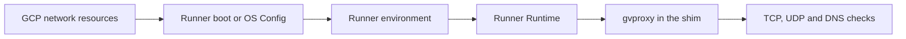
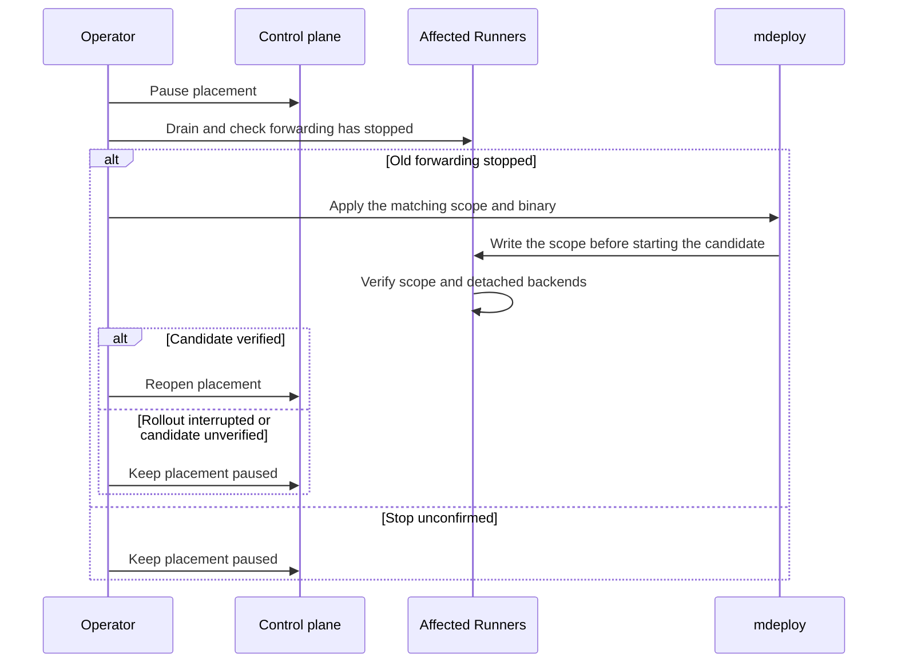

## TL;DR

GCP observes the first runner for five minutes, then updates the remaining runners in parallel through OS Config.

# GCP runner operations

[Cloud guide](README.md) · [Infrastructure index](../../README.md)

Use the shared [artifact build/promotion](../runners.md#build-and-promote),
[release update](../runners.md#upgrade-or-roll-back-a-release) and [scaling](../runners.md#scale-out) commands.
Development binaries live in the stage's GCS artifact bucket.

## Rollout behavior

Runner VMs carry `boxlite-stage=<stage>` alongside their logical `boxlite-runner` label.
Every OS Config inclusion entry requires both labels, so dev and stage can share a project
and zone without selecting each other's runners. For example, a stage canary requires
`boxlite-stage=stage` AND `boxlite-runner=default`; the dev canary uses `boxlite-stage=dev`.
Separate inclusion entries are ORed, so the stage label must stay inside every runner entry.
These labels isolate policy targeting, not IAM permissions or other applications using the same stage name.

For existing shared-project hosts, narrow every dev/stage Runner assignment before adding stage labels
to VMs. Wait for each new narrowed revision to finish rollout and become the baseline, then add the
correct stage label while preserving existing labels. Changing labels is an in-place operation;
it does not replace VMs or disks. Preserve policy scripts, target versions and rollout settings.
Do not run an older deployment during or after migration: it can restore the unscoped selectors.
Inspect both environments afterward; narrowing selectors does not undo earlier wrong-environment execution.

mdeploy splits the fleet into two disjoint OS Config assignments:

| Assignment | Hosts | Rollout |
| --- | --- | --- |
| `<app>-<stage>-runner-binary` | First runner | One host, 300-second observation window |
| `<app>-<stage>-runner-binary-fleet` | All remaining runners | 100% parallel, no additional observation window |

Pulumi waits for the first assignment's rollout before starting the second, and waits for both to finish.
A single-runner stage has only the first assignment. For four runners, the configured observation time
falls from four five-minute windows to one; agent execution and reporting still take additional time.

Each assignment has a 40-minute create/update timeout, covering convergence and observation, including
the initial migration from a whole-fleet assignment. This is an upper bound, not an added wait:
completed operations proceed immediately. Deletion keeps the provider's default timeout.

Each assignment carries a binary policy and an NFS client package policy. The binary policy first
converges the unit environment, including the Cloud network scope, then updates the binary.

The package policy installs `nfs-common` on existing hosts, including those whose startup script predates Filestore.
`runner:update` preserves that policy on existing assignments. Run `mdeploy` to add it to a legacy assignment.

New hosts get `nfs-common` from the boot script and use the current [Runner sizing settings](../configuration.md#runner-sizing).
Existing hosts retain their disks, image caches and local Box state. Machine type, boot image and startup script changes apply at creation.

`runner:update` checks stage labels, exact selectors and the ordered scope resource before writing.
Run `mdeploy` first to migrate a legacy assignment.

`runner:update` waits for each rollout and checks that every targeted policy reports compliance with the updated revision.
A failed update, missing report or stale revision stops progression.

The first Runner must be running, and Runner labels must be unique after normalization. `runner:update` operates on the full fleet.
The next `mdeploy` reasserts the checkout's policy target.

Both paths verify binary checksums and readiness. Already-converged hosts need no restart.
The update command requires `--allow-downgrade` for release downgrades.

Normal updates run through OS Config. IAP and OS Login remain available for authorized administration.

For an existing deployment, run mdeploy once to narrow the original assignment to the first runner and
create the fleet assignment. `runner:update` refuses the old whole-fleet layout before changing either
assignment. If an earlier rollout is still in progress, let it finish or investigate it before retrying.
The five-minute window controls rollout pacing; it does not continuously test box creation or tunnel health.

## Data disk

Each host gets its own Hyperdisk Balanced disk, `<app>-<stage>-runner-data[-N]`, attached as `boxlite-data`:
200 GiB by default, with optional `deploy.runners.dataDiskGb` selecting its capacity at creation.
Performance stays at 3,600 IOPS and 290 MiB/s (240 MiB/s on `small`, the n4-standard-4 limit). Box state lives on it:
the boot script formats a blank disk once and mounts it at `/var/lib/boxlite` with `nofail`, so `rootDiskGb`
sizes only the boot disk. The runner unit requires that mount: a host whose disk does not mount still boots
and stays reachable, with the runner stopped: `systemctl status var-lib-boxlite.mount` says why, or
`/var/log/runner-setup.log` when the boot script refused a disk that was missing, not blank, or would hide data.
A deploy sets size and performance only at creation and never
changes them back, so grow the disk online; the disk is protected, so a deploy that would replace it fails.
Each host's unit environment names its own disk — `GCP_PROJECT_ID`, `GCP_ZONE` and `RUNNER_DATA_DISK_NAME`, converged by
the same OS policy as the rest of the unit environment, each host reading its own row of the fleet table — which is what the
control plane reads to grow the disk online without a deploy. The resize grant is the API's alone, bounded to this stage's
data-disk prefix in this zone.
The attachment is fixed at creation too: a host that existed before its disk does not get it attached,
and that disk stays unattached, and billed, until the host is destroyed and recreated; a `--replace`
would carry the ignored attachment over.

## Cloud network scope

The GCP stack derives guest egress protection from deployed resources. It uses
the Runner, Cloud Run egress and managed proxy subnets, plus the GKE secondary
ranges and the allocated private service range.

Boot and the in-place OS policy write the stage and scope to the Runner
environment. The Runner sends the scope to gvproxy at launch and verifies
detached backends before reporting readiness.



Use the existing control-plane draining operation before changing a live pool's
network scope. Confirm old forwarding has stopped on every affected host before
changing its network reachability. After an interrupted rollout or rollback,
keep placement paused until the hosts are serving the intended Runner build
with its matching network scope.



Check the candidate with a real Box on GCP. Verify permitted TCP, UDP and DNS
traffic and confirm a protected destination receives no traffic even when the
Box allow rule matches. The private gvproxy `GET /network/cloud-scope` endpoint
reports the applied deployment scope for the specific Box.

### Qualify a dual-stack pool

Set `deploy.runners.externalIpv6` to `true` for a GCP stage that supports external
IPv6. The deploy configures the shared subnet and Runner NIC for dual-stack,
and adds the assigned subnet prefix to the Runner's trusted network scope.
The existing private IPv4 NIC and Cloud NAT path continue to serve IPv4.

The Runtime checks the Linux route and its selected source before preparing a
dual-stack Box. Gvproxy verifies the route in the forwarding process and binds
native TCP and UDP sockets to that Runner NIC and source. It also blocks guest
connections to the managed IPv6 subnet, alongside the existing IPv4 protection.

Keep placement on the verified release floor. Check an allowed IPv6 endpoint,
a denied endpoint and the same policy after restart from a real GCP Box.
Without an IPv6 declaration or a matching live route, the Runner can still
prepare IPv4 policies. A saved dual-stack Box requires its original Guest link
and matching host route when it starts or is adopted.

## Verify and recover

Inspect both assignments (only the first for a single-runner stage), including the binary policy and its
unit-environment resource after mdeploy:

```bash
gcloud compute os-config os-policy-assignment-reports list \
  --project=<project> --location=<zone> --assignment-id=<assignment-name>
gcloud compute os-config os-policy-assignment-reports describe <assignment-name> \
  --project=<project> --location=<zone> --instance=<runner-name> --format=json
```

Then perform the shared [registration, identity and box checks](../runners.md#verify-and-recover).
If convergence fails, inspect the host's OS Config result and service logs before retrying.
After a deployment timeout, check the assignment's current rollout state and reports: the cloud
operation may complete after Pulumi stops waiting, while the dependent fleet update remains pending.
A compliant policy alone does not prove box creation or tunnel health.

Source: [GCP runner provider](../../mdeploy/stack/providers/gcp/runners.ts),
[operator updater](../../mdeploy/src/runner-update.ts).
