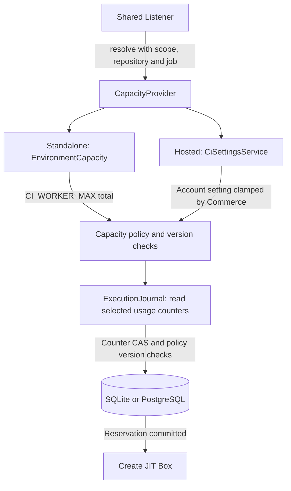
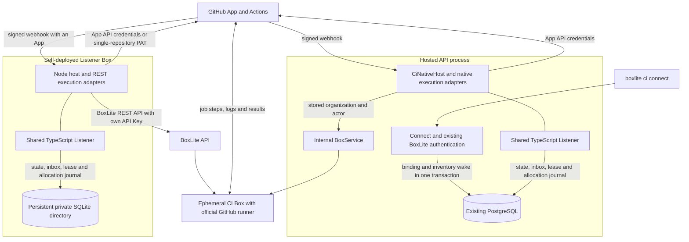
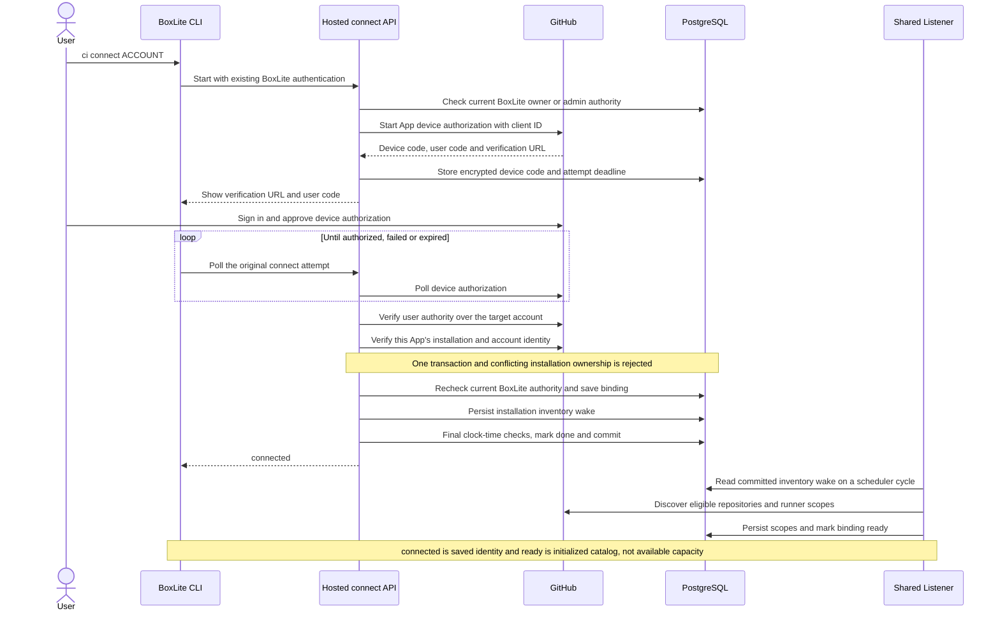
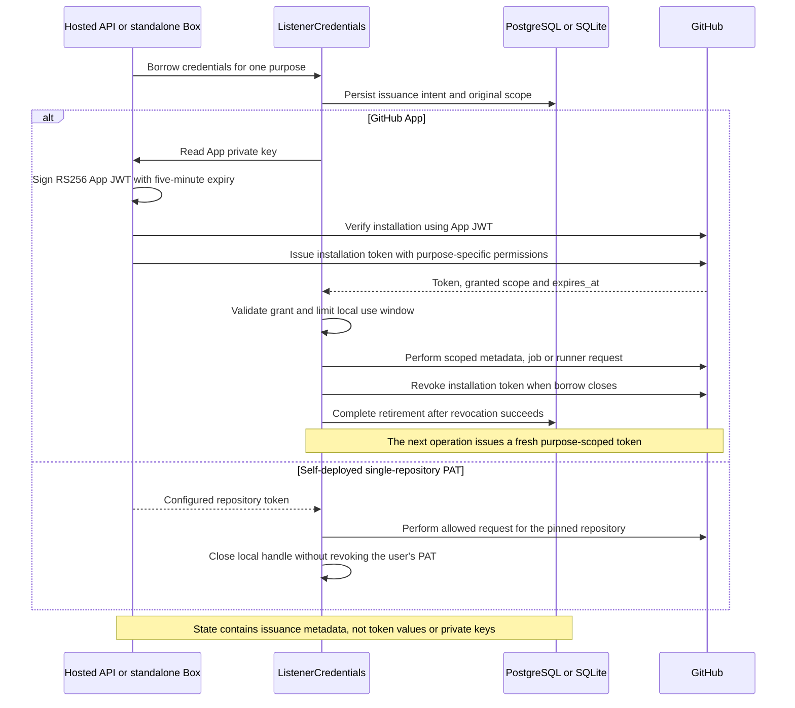
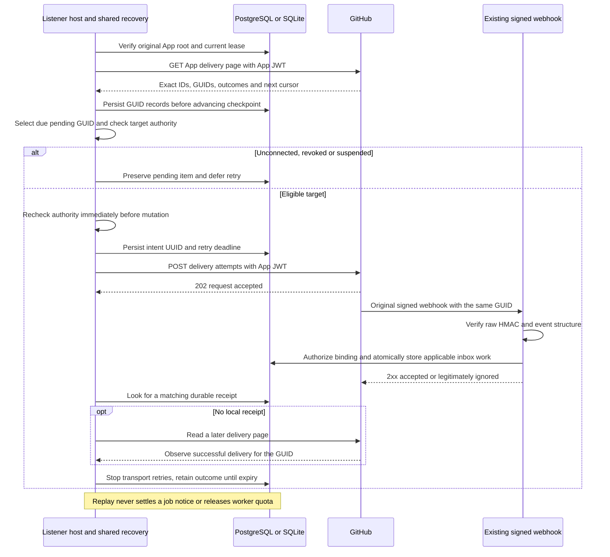
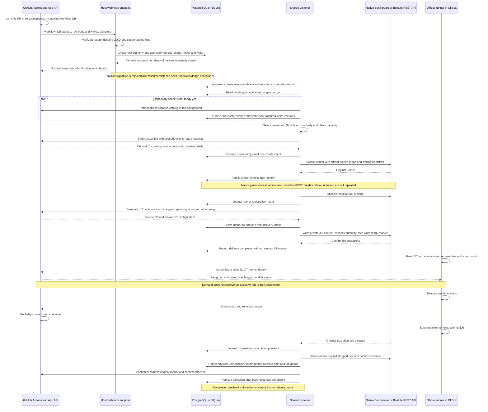

# Shared CI Listener

This server-side TypeScript library is the common boundary for the hosted API and
standalone Listener image. Hosts supply execution and storage adapters; the shared
controller must not depend on Nest, process environment or a specific database.

`WorkerExecutor` is consumed by the native API provider, which binds operations to
the original installation scope. The actual GitHub runner remains the executable
in the worker image; this library does not execute CI steps.

The API connect service also uses the shared GitHub App JWT signer and HTTP
transport. Requests use fixed GitHub.com origins, reject redirects, bound JSON
responses to 1 MiB and keep credentials out of errors. Mutation errors distinguish
a known HTTP denial from an outcome that may have produced a remote effect; the
controller must persist its intent before calling a mutation. Key loading remains
with the host.

`CiGitHubApp` owns one App identity and private loaders for its signing key, OAuth
client secret and webhook secret. Authentication and connect verification are
shared by the hosted registry and standalone host. An optional account type
restricts new connect/admission; original cleanup retains the original App source.
Self-owned Apps can omit that type and serve both personal and organization accounts.
`ScopeApplications` atomically associates each execution scope with its original
App when the scope is first defined. Missing or conflicting associations fail closed;
there is no legacy association backfill.
Multiple Apps retain one journal, scheduling lease and host capacity provider.
`AppDeliveryRecovery.prefix` separates each App's delivery history without
creating another execution namespace or quota.

`GitHubAppSource` lists installations and issues purpose-specific credentials for
repository discovery, Actions reads, repository runners or organization runners.
It rechecks installation identity and permissions before issuing a token, requests
the least required permission, and narrows repository operations to one repository.
`GitHubCredential` keeps its token in a JavaScript private field and refuses JSON
serialization. Invalid metadata prevents use while preserving the revocation handle.
Retirement stops further requests even when revocation needs a retry. Personal
tokens use the same request interface and are never revoked by `close()`.

Credential use has a short window; the controller must close an old App credential
before issuing its replacement and keep handles until cleanup succeeds. Controller
integration now records durable issuance intents in `ListenerCredentials`;
both the standalone Node host and the API assemble those integrations through
their own execution and persistence adapters.

`GitHubAppSource.deliveryPage()` exposes one validated App webhook-delivery page,
including an opaque next cursor. Delivery IDs remain exact decimal strings, even
above JavaScript's safe integer range. Pagination validates the fixed GitHub route
and rejects a next cursor equal to the current cursor; a multi-page scan must keep
its own visited-cursor history. Empty or short pages can still carry a next cursor.

`redeliver()` requires a successful `beforeMutation` callback before POST. The
caller must persist its intent and verify the original App root and execution
lease there. HTTP 202 only confirms a redelivery request, not inbox persistence or
job execution. These helpers use App JWTs and introduce no new configuration.
Both App hosts assemble `AppDeliveryRecovery` when their existing webhook secret
configuration is present. Replayed webhooks use the existing signature verifier
and binding-authorized inbox; recovery metadata grants no execution capability.

The recovery controller keeps one App-wide background slot, alternating delivery
pages and bounded pending-item scans. It saves `replay/item/<GUID>` before advancing
`replay/progress`, so interruption repeats a page instead of dropping its work.
Incremental scans overlap the completed watermark by one minute. Cursor hashes
survive restart and detect multi-page cycles; invalid order or cursors trigger a
reported rescan without advancing the completed watermark. The protective limit is
10,000 cursors per pass, not a throughput or latency guarantee.

Before each replay, hosts recheck the App root, execution lease and current target
authority. Hosted use requires a connected current owner; standalone use verifies
the App installation is current and unsuspended. The callback persists an intent
UUID and a five-minute retry deadline before POST. An uncertain replay can repeat
the same GUID; this permission does not apply to uncertain Box or JIT creation.
A receipt proves durable inbox acceptance. A later App delivery record with the
same GUID and a 2xx response also stops transport retries, including legitimately
ignored events; neither observation proves a CI job finished. Old failed attempts
cannot reopen a confirmed GUID, and new events cannot reset an existing retry.

[GitHub's delivery history](https://docs.github.com/en/webhooks/testing-and-troubleshooting-webhooks/redelivering-webhooks)
covers three days. Replay metadata is retained for that
window and pruned in bounded steps. Unconfirmed expiry reports a retention gap;
it never settles a job notice, removes an allocation or returns resource quota.
Global backoff honors GitHub retry deadlines, while a single delivery's 400/404/422
does not cool down other targets. Bounded repository job scans remain the fallback
outside the delivery-history window. See [the controller](src/replay/recovery.ts).

`ListenerCredentials` owns per-purpose App or pinned-repository PAT borrows. App
issuance records its intent before HTTP, retains known handles until retirement
succeeds and defers an immediate remint after an uncertain issuance. Replacement
starts after retiring the previous handle. A stale borrower cannot revoke its
replacement or release the replacement's purpose lock; concurrent retirement
shares one operation. Tokens remain private and failed/unknown issuance records
contain metadata only. PAT retirement closes the local handle without revoking
the user's token. Hosts must close borrows and the provider during shutdown.
Revocation alone does not complete retirement: the held entry remains available
until its durable issuance record is deleted successfully. A failed deletion
retries without revoking the already-closed token again. Lease loss still fences
the state write and preserves the cleanup debt for reconciliation.

`GitHubJobs` verifies the original repository identity before and after reading a
job. A job notice must match the repository, run and job IDs returned by GitHub.
Admission also requires an unassigned queued job and a complete supported label
set containing `boxlite-ci-runner`. Compensation scans inspect queued, running,
waiting, pending and requested workflow runs. A changing or truncated inventory,
permission failure or API pagination cap is an error; callers retain their wake
and retry discovery instead of acknowledging an incomplete pass.

`GitHubRunners` registers JIT runners in a fixed repository or organization group.
Organization admission requires a selected, non-inherited group with the exact
installed repository set supplied by its host. Workflow restrictions and public
repository access require explicit policy checks; unsafe group policies reject
admission before registration. The required `beforeMutation` callback must journal
each registration/removal intent and check the current execution lease. The
returned `JitRegistration` keeps configuration private, cannot be JSON serialized
and permits one delivery attempt. A malformed configuration still retains a known
runner ID for cleanup. Cleanup confirms absence through complete enumeration under
the original authority, without requiring a revoked group ACL to admit new work.
A 404 by itself never proves runner absence.
Runner lookups/removals, job reads, App credential issuance and state operations
capture caller-owned identities and selectors before their first asynchronous
operation. Mutating a supplied object or array while a call waits cannot change
the verified runner ID, journaled deletion target, token purpose/repository, job
notice, execution lease, read keys or recovery prefixes used by that call.

`verifyWebhook` checks HMAC-SHA256 over the original body bytes, a bounded payload,
delivery UUID and matching event structure. The API already uses this verifier.
The standalone HTTP host must apply its own body, concurrency and timeout limits
before invoking it. `ListenerInbox` atomically stores the delivery receipt, wake
and job identity in either database, with no execution lease required. Concurrent
duplicates converge; conflicting bodies/events or job identities are rejected.
A new delivery updates record versions, so settlement using an older captured
version fails rather than removing newer work. The API uses the same inbox through its binding-authorized PostgreSQL adapter.

`ListenerState` stores durable records through either the host's PostgreSQL pool
or the Node 24 SQLite adapter. PostgreSQL uses the single `ci_listener_state` table;
the API migration creates it. SQLite keeps `listener.sqlite` and its WAL/SHM files
in a private directory supplied by the standalone host.

Execution writes require a lease bound to the namespace, owner and epoch. Ingress
can commit receipts and notices without the scheduling lease. Batches use UUID
versions and atomic conditional writes; expired leases, stale versions, missing
roots and unsupported schemas reject admission. Point reads can carry the same
lease fence; recovery reads bounded pages from active indexes.
Permanent business roots can be seeded atomically during namespace initialization;
subsequent initialization checks their presence and never overwrites them. Recovery
selects indexed key prefixes so retained delivery receipts and inactive historical
scopes are not enumerated. Unleased reads serve ingress CAS lookups and dashboard
aggregates; they never grant permission to execute jobs.

Admission commits may include read-only record-version checks. The transaction
locks those records and rejects a missing or changed version before writing any
allocation. The checked policy keeps its version, so multiple admissions can use
one snapshot until an authorized configuration update commits. Hosts still own
policy authorization and resolution.

`CapacityProvider.resolve({ scope, repository, job, lease, signal })` is the single
admission-policy port. The standalone host always returns its `CI_WORKER_MAX` total;
the hosted API resolves account settings and Commerce. The controller does not
branch on the host or know account/repository quota rules. Each policy supplies
one or more explicit `global`, `organization` or GitHub `account` limits. Every
reservation atomically increments all three usage counters, even if the current
policy selects only one. Counter CAS and policy record-version checks prevent
concurrent overspending. Zero pauses new admission; null has no numeric ceiling.
Missing or invalid policies fail closed. The capacity API reads the organization
counter directly, without reading scope or worker history.

Every candidate asks the provider separately, including its repository identity;
a policy is never cached across different repositories by the controller.
Compensation only records pending jobs and does not query capacity. Existing worker recovery runs
before policy lookup and continues when Commerce or settings are unavailable.
Future repository rules belong in the hosted provider and candidate selection;
strict repository limits also require runner eligibility to be partitioned.
The triggering job alone does not identify the repository an organization worker
will actually execute. Repository-specific limits are not implemented.



The storage layer does not authorize GitHub requests or platform tenants. Hosts
must recheck their live binding in the same transaction used to persist ingress,
and execution adapters must enforce authorization at the actual side-effect
boundary. Both hosts implement those checks; deployed hosted acceptance remains pending.
Temporary GitHub tokens and JIT configuration must never be written as payloads.

The execution journal retains immutable scope definitions addressed by their hash.
Known worker lookups, App authorization and quota checks use point reads; none
enumerates historical scopes. `active-scope/<scope>` and
`active-worker/<scope>/<worker>` index only unfinished allocations. A separate
`job/<installation>/<repository>/<job>` record prevents duplicate reservations
across scope generations until both resources are cleaned up. Reservation and
final release update these memberships and the scope activity version atomically.
There is no global historical-scope catalog or 10,000-scope ceiling.

Usage includes uncertain creates and all historical generations whose original
Box is not yet confirmed absent. Each quota domain keeps a permanent marker and
counter, including at zero. Losing either member of an established pair fails
closed; initialization never silently repairs it. Point reads validate referenced
records, not arbitrary unreferenced historical debris. Coordinated loss of both
a domain marker and its counter cannot always be distinguished from a new domain.

The journal format is version 2 and requires a fresh CI execution namespace. Old
namespaces fail initialization; there is no migration, compatibility read or
backfill. For the current dev-only rollout, stop the Listener and explicitly reset
its CI execution state before starting this version, after accounting for any
remaining Boxes/runners. This is not an instruction to clear shared application
data or Box storage. Neither startup nor this change resets dev state automatically.
Each effect records an operation UUID first. Resource IDs are immutable, and an
unknown create cannot be reset, retried or settled through a missing-resource result.

`WorkerPool` drives boot, JIT registration/delivery and cleanup through host-bound
capabilities. It keeps JIT configuration in memory and never republishes an uncertain
delivery. A triggering job supplies demand rather than an exclusive assignment:
the Box may execute another authorized matching job. A completed notification alone
does not stop it. An elapsed timeout or a successful runner DELETE is not proof
that its Box is idle. Delivered workers remain running until actual Box exit;
automatic idle retirement requires separate verification. Physical Box capacity
returns after its original Box is confirmed absent. The allocation stays indexed
until both original resources are absent, preserving runner cleanup and job dedup.
The host must enforce authority and execution epoch
again at actual side effects, including native Box persistence. Both host entry
points use this kernel; runtime acceptance remains a separate deployment check.

### Independent repository compensation

Every Listener replica runs two compensation lanes alongside the single execution
scheduler. A lane claims only work it can start immediately. The existing state
table holds repository tasks, immutable scope references and ordered due keys; PostgreSQL uses short transactions
and SKIP LOCKED candidate selection, while SQLite uses its existing serialized
write transaction. Neither keeps a database lock during GitHub requests.

Each successful binding catalog activates its own completed snapshot. A failing
installation does not block another binding's scans, and a failed catalog read is
not an empty catalog. An authoritative installation index retires removed bindings.
Repeated discovery preserves existing task deadlines. Directory staging records
its committed batch offsets, so a canceled publication resumes without rereading
already written tasks and activates only after all batches complete. Old snapshot memberships and
expired credential metadata are removed in bounded pages, without scanning retained
execution history.

A task has an owner, epoch and 60-second lease; the full scan has a 45-second
abort deadline. Different installations can run concurrently, while one App's
installation has at most one effective scan lease across replicas. Busy repository
candidates move out of the due head. Successful scans become eligible again after
five minutes; failures use capped backoff. A 429 or rate-limited 403 with a retry
header also persists an installation-wide retry deadline. Other 403 responses
remain repository failures rather than being guessed to mean rate limiting.

The scanner has GitHub jobs-read capabilities only. It reuses credential issuance
intents and retirement, but its lease cannot create allocations or change cap.
Cleanup may conditionally remove its own original credential record after lease
expiry; it cannot delete another owner's operation or issue another credential.
Unknown issuance metadata expires after two hours, beyond the maximum App token
lifetime accepted by the transport. Tokens themselves are never stored.

Publication checks the task lease, active binding snapshot and exact job identity.
Hosted publication checks the original binding generation and owner in the same
PostgreSQL transaction. Standalone publication checks its captured backend and
binding record versions. A deleted connection or superseded snapshot rejects late
results. Repeated jobs converge with webhook ingress; repository, run, account or
installation conflicts fail closed.

Scanned jobs enter the ordinary pending-notice queue. They do not reserve slots
or query Commerce. The execution scheduler rechecks current authority, job state
and cap before creating a Box. A waiting notice can therefore resume after worker
cleanup releases a slot without waiting for the five-minute scan interval.
Stopping the Listener cancels and awaits both lanes and retires their credentials;
failed retirement retains its handle for retry and reports the cleanup failure.

### Worker recovery and logs

The scheduler rotates through at most eight active scopes per recovery page. Each
pool processes at most 32 active workers per page and keeps its cursor across ticks.
An exact full page requires another page to establish the end; deleted cursor keys
remain valid keyset boundaries. A scope must complete a clean recovery round before
one admission attempt is allowed. Incomplete rounds and Box lookup failures block
that scope, including across cursor wraps. Lease changes or membership changes
invalidate readiness; the final reservation checks the captured membership version.
A stable completed round must enumerate exactly the recorded active count; a
missing worker membership fails closed instead of silently omitting its cleanup.
A newly empty scope can complete recovery immediately. Large active sets may need
several ticks, but retained inactive scopes add no recovery work.
The native API can also record a definitive creation refusal when the typed
Box creation-limit error occurs before `onPersist` begins. It stores the original
scope and creation-operation UUID in the same ledger key that would hold a Box ID;
an expected-null CAS makes those outcomes mutually exclusive. Only this durable
fact yields `ConfirmedWorkerCreationRejected`. Hosted authority revocation can
use the same fence before dispatch or after a rejected native persistence
transaction rolls back. The optional `ExecutionHost.rejectUndispatchedCreate`
capability binds that proof to the exact original effect before reporting refusal;
hosts without it retain uncertain reservations. A committed original Box ID wins
over refusal and remains available for cleanup. Restart can recover the fact through
the original worker lookup. The kernel checks the original pending operation and
atomically retires its allocation and scope reference, leaving queued demand pending.
It emits `ci-worker-create-rejected`; a later attempt gets a new allocation/name.

Ordinary HTTP errors, timeouts, failed proof persistence and uncertain persistence
outcomes keep the reservation. The standalone REST adapter does not infer this
proof from a 429 or an error-body property. Unknown creates are never repeated.
The general resource state machine still forbids requested-to-absent transitions;
the explicit refusal path is limited to an unmaterialized Box with no runner.

Stopped/error Boxes are deleted by their original IDs; a lookup error retains
capacity and blocks that scope's admission. Confirmed absence releases physical
capacity even when GitHub registration cleanup must retry. Other allocations
still get reconciled after an ordinary per-worker error. Lease loss, corrupt or
conflicting state, abort and unretired credential handles stop further work.

An absent Box's allocation remains in the journal until runner cleanup is confirmed.
The same installation/repository/job cannot create a duplicate while that debt exists.
Unknown Box creation still occupies capacity and is never repeated. Cleanup debt
survives restart and remains in the paged active indexes. Runner-only cleanup debt
does not charge physical capacity or block fresh admission after a clean Box
recovery round. Final release removes memberships and deduplication without
decrementing capacity a second time.

Both production hosts write the same structured `WorkerEvent` facts: standalone
JSON on stderr, hosted API `Logger.log`/`warn`. Each includes binding/generation,
organization, installation/account, allocation, original Box/runner IDs, effect
and phases. `trigger` identifies the repository/run/job that requested capacity;
it is not an assertion that this Box executed that exact job.

| Event                         | Meaning                                                                       |
| ----------------------------- | ----------------------------------------------------------------------------- |
| `ci-worker-exited`            | Observed stopped/error and available exit code; clean exit 0 is informational |
| `ci-worker-box-absent`        | Original Box absence persisted; unexpected disappearance is a warning         |
| `ci-worker-recovery-deferred` | Cleanup/query failed; durable state remains retryable; error type only        |
| `ci-worker-released`          | Both original resources are absent; allocation record removed                 |

Logs contain no token, PEM, JIT configuration or upstream error message. Missing
exit codes remain unknown. These logs report infrastructure facts, do not cancel
a workflow and do not write to GitHub's job log or predict its final conclusion.
They are diagnostic output, not a durable audit stream: a crash after a state
commit can omit a line, while the journal still retains the recovery state.

`GitHubExecutionBackend` binds one original scope to the credential owner, job
reader, runner registry and host execution adapter. It rejects mismatched App
installations or PAT repositories before issuing credentials. Admission and
cleanup have separate host checks; each check also validates the current lease
and the known scope/allocation references by ID. This permits original-resource cleanup after admission is
revoked without permitting new runner registration or JIT delivery. Native hosts
must additionally fence Box persistence in their storage transaction. The backend
is an internal building block used by the standalone host. The API host uses the same backend.

`Listener` exposes `run(signal)` and `receive(verifiedNotification)`. It owns the
execution lease, renews it while GitHub/Box operations wait, pages active
allocations for recovery, and drives the shared worker pools. The
host supplies an authoritative scope directory, bound execution adapters and an
ingress transaction that checks the current binding. Receiving a notification
stores its receipt and job before waking the scheduler; it needs no execution
lease. A notification is a hint: admission fetches the actual job under its
original authority. Settlement uses the captured notice version, so a concurrent
delivery stays pending.

Queued jobs are selected by platform tenant, then GitHub account, then job; a
large repository list earns no extra turns. The controller processes at most one
job per account in a round, up to 32 accounts. Capacity exhaustion retains the
notice and skips admission-time GitHub job reads while the durable account or
tenant quota is full. Independent compensation scans continue recording pending
jobs without reading or reserving capacity. Other tenants can still admit jobs;
the final reservation rechecks the same usage atomically.
A recovery error blocks that scope's new admissions while other accounts
can proceed; corrupt shared journal state still blocks admission. Invalid discovered
scope definitions withhold that binding without restoring old authority or blocking
healthy bindings. Known
credential handles survive failed shutdown retirement, and another session cannot
start until retirement succeeds.

Idle ticks read local state rather than scanning every GitHub repository. The
default directory refresh and successful compensation interval is five minutes.
Independent lanes scan leased repositories with a 45-second deadline and record
discovered jobs durably before dispatch. Large inventories need multiple tasks;
the interval is not a guaranteed maximum recovery latency. Normal workflow-job
webhooks persist an exact job ID, so their admission does not wait for that scan.

`InstallationCatalog` enumerates a complete, bounded installation inventory using
a metadata-only token. Personal accounts receive one repository scope per eligible
repository. Organization accounts share a configured selected, non-inherited
runner group managed by BoxLite. The public-repository option includes installed
private and public repositories when enabled, and only installed private
repositories when disabled. Both hosts authorize and journal each group write
before the catalog creates or synchronizes the configured group. Membership is
exactly the eligible installed set; public access is enabled only after membership
converges. Existing default or inherited groups cannot be adopted, and other group
names are untouched. The configured name is reserved for BoxLite to manage.

The catalog reads back policy and complete membership before publishing scopes.
Provider failures withhold admission and retry from actual GitHub state, including
after an uncertain create response. No eligible repositories clears an existing
group but does not create a missing one. Correct groups require no mutation.
Standalone intents use SQLite; hosted intents use the current binding generation,
owner authority, execution lease and existing PostgreSQL state. Callers without a
mutation-authority callback can inspect matching groups but cannot provision or
repair them. Lease checks cannot fence an already-dispatched GitHub request;
subsequent reconciliation repairs drift. Existing runner identities remain usable
for original cleanup; group access changes may affect queued or unassigned jobs.

`InstallationDirectory` runs complete installation-index reads and individual
catalog refreshes in one background slot per App. The scheduler keeps processing
known scopes while catalog requests wait. Successful installations publish
independently; a failed catalog withholds that installation's admission and keeps
its durable hints. An index failure withholds new admission until a complete
index succeeds. Failed reads never count as an empty inventory or a removal.

Cold installations with durable hints take priority over unhinted catalog work.
After at most three hinted catalogs, one due background catalog gets a turn;
selection within each category remains round-robin. When eligible catalog work
exists, repeated inventory events cannot schedule two index reads consecutively.
Retry deadlines apply before either priority, so new hints cannot bypass cooldowns.
These rules allocate the single directory slot; they do not guarantee wall-clock
latency or serialize requests made by execution adapters.

Refresh requests coalesce by installation. A captured wake UUID can be settled
only after its corresponding refresh; a newer delivery remains pending. Waiting
for a retry occupies no catalog slot. Retries start at one minute and increase
to five minutes, while a later GitHub retry deadline takes precedence. Periodic
index refreshes and repeated webhooks do not clear that deadline. Installation
indexes are bounded to 10,000 entries, and the combined admitted repository cache
is bounded to 100,000 repositories. These are protective limits, not throughput
or recovery-latency guarantees.

Standalone ingress checks the configured App root and the current complete
installation/account index inside each storage transaction. A matching signed
job may be stored before its repository catalog is ready. Hosted ingress applies
the same distinction using connected installation/account bindings and current
platform authority. Notification storage grants no worker capability: admission
still requires the original repository scope, actual GitHub job and labels, and
live authorization at the execution boundary.

An installation not yet discovered by the standalone host can request only
inventory work. Its endpoint returns a failure and stores no job receipt or
notice, so that request is not acknowledged as an accepted job. Compensation
may find the queued job later, or redelivery can submit it after discovery.
In hosted use, an unconnected job is rejected without inbox writes; the connect
transaction supplies the authoritative binding and inventory wake. App delivery
recovery can request replay after target authority becomes available. Bad signatures
and mismatched known account identities cannot enqueue inventory through this path.

See [the directory protocol](src/directory.ts), [the shared inbox](src/webhook.ts),
and [the scheduler](src/listener.ts) for the implementation.

Runtime recovery covers records created by this implementation. The Node standalone
entry and image build are available. Standalone App webhook execution and multi-job
artifact transfer have [live playground evidence](https://github.com/DefeatMan/boxlite-ci-playground/actions/runs/41820205537/attempts/1).
Live organization-group and deployed hosted API acceptance remain pending.

The native API adapter is implemented in `api/src/ci/ci-native-state.ts` and
`ci-native-workers.ts`. It uses the same PostgreSQL record table for original Box
IDs and delivery attempts. `BoxService` persists the Box and its ledger atomically;
the callback rechecks the execution lease and original binding/owner before commit.
Cleanup retains the original resource identity after binding removal. Closing
allocations cannot create or receive JIT. Every JIT HTTP request checks authority
again after asynchronous Box lookup, and a durable delivery claim prevents replay.
`ci-native-host.ts` builds scopes from stored connect bindings, retaining their
original platform organization and actor. Its shared inbox checks the live binding
and owner inside every ingress read/write transaction. GitHub credentials reuse
`CiGitHubService.appSource()` and the same configured private App key as connect.
These adapters are registered as the API's runtime providers. `CiListenerService`
starts the shared controller when the platform App is configured; all replicas use
one PostgreSQL lease, with no CI state volume or worker execution API Key.

## Architecture and authentication

These diagrams describe the current code, rather than deployed acceptance.
Each host instantiates the shared controller with its own adapters.



The hosted service uses the connected binding's original organization and actor;
it does not retain a user's API Key for worker execution. Self-deployment uses
its own BoxLite API Key. The App private key and webhook secret belong to the
host. Worker Boxes receive only their JIT configuration from the Listener.

Sources: [native host](../../api/src/ci/ci-native-host.ts),
[native workers](../../api/src/ci/ci-native-workers.ts),
[standalone host](../../github-ci-runner/src/self-host.ts), and
[standalone workers](../../github-ci-runner/src/boxlite-workers.ts).

### Hosted connect



Sources: [connect service](../../api/src/ci/ci-connect.service.ts),
[GitHub account verification](../../api/src/ci/ci-github.service.ts),
[inventory wake](../../api/src/ci/ci-native-state.ts), and
[controller cycle](src/listener.ts).

### GitHub credentials



Sources: [credential owner](src/credentials.ts),
[App tokens](src/github-app.ts), and [JWT signer](src/github.ts).
The webhook HMAC secret is independent from these API credentials.

### App delivery recovery

This is the working-tree recovery path. Hosted deployment acceptance remains
separate; replay metadata is not a CI result or an execution grant.



Sources: [recovery controller](src/replay/recovery.ts),
[standalone authority](../../github-ci-runner/src/self-host.ts),
[native authority](../../api/src/ci/ci-native-host.ts), and
[signature verification and inbox](src/webhook.ts).

### One CI job from notification to cleanup



The host returns HTTP 204 for hosted webhook acceptance and HTTP 202 for the
standalone endpoint. When a delivery never reaches durable acceptance,
App-wide delivery recovery can request a signed replay; bounded REST compensation
can also discover pending jobs later through independent, leased repository tasks.
Each replica has two scan lanes; installations are serialized across replicas.
There is no fixed recovery-latency guarantee.

Sources: [webhook verification and inbox](src/webhook.ts),
[controller](src/listener.ts), [worker pool and bootstrap](src/execution/pool.ts),
[allocation journal](src/execution/journal.ts), and
[JIT registration](src/runners.ts).
The runner's GitHub connection is described in GitHub's
[self-hosted runner documentation](https://docs.github.com/en/actions/reference/runners/self-hosted-runners#communication).

## Build and test

Build and test from the repository root:

```sh
make build:apps:ci-listener
make test:apps:ci-listener
```

Run under Node 24. SQLite tests always run. To include PostgreSQL contracts, supply
`CI_CONNECT_TEST_DATABASE_URL` pointing to a disposable local database; tests create
and drop isolated schemas and reject remote hosts. This variable is test-only and
is not a Listener production setting. `FILTER` selects test names as on other Make
test targets. These checks do not establish real hosted or standalone CI acceptance.
When changing the optional PostgreSQL environment, use `NX_SKIP_NX_CACHE=true`
to execute the contracts rather than reuse a cached run from a different environment.

Workspace hosts import the shared pool from `@boxlite-ai/ci-listener`; SQLite uses
the separate `@boxlite-ai/ci-listener/sqlite` path, keeping its Node-only adapter out
of the hosted entry. Cross-project test fixtures use the scoped `/testing` alias.
Standalone shutdown attempts every owned resource and reports combined cleanup
failures; extracting that cleanup operation preserves failure precedence.
Cursor and label validators retain their existing ASCII-control rejection ranges.

Compensation scans can race a verified webhook inserting the same queued notice.
On an insertion conflict, the Listener rereads that notice and accepts it only if
installation, account, repository and run still match; identity conflicts remain
errors. This keeps ordinary duplicate delivery from aborting the cleanup cycle.
