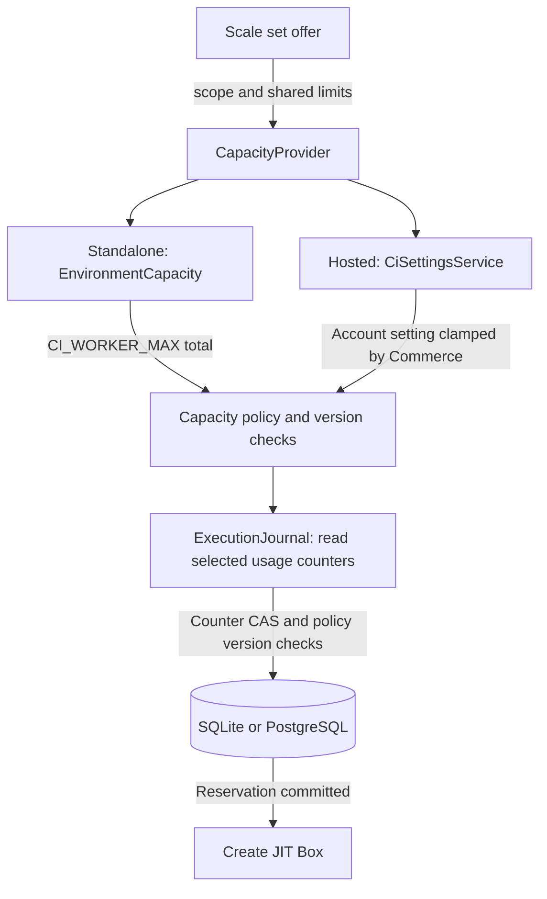
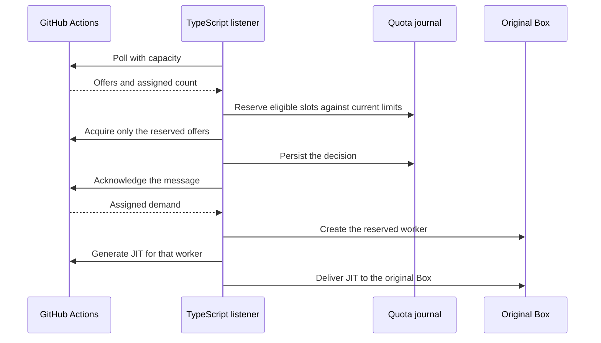
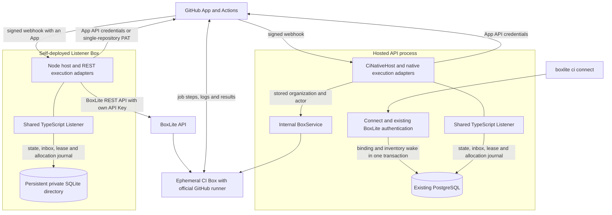
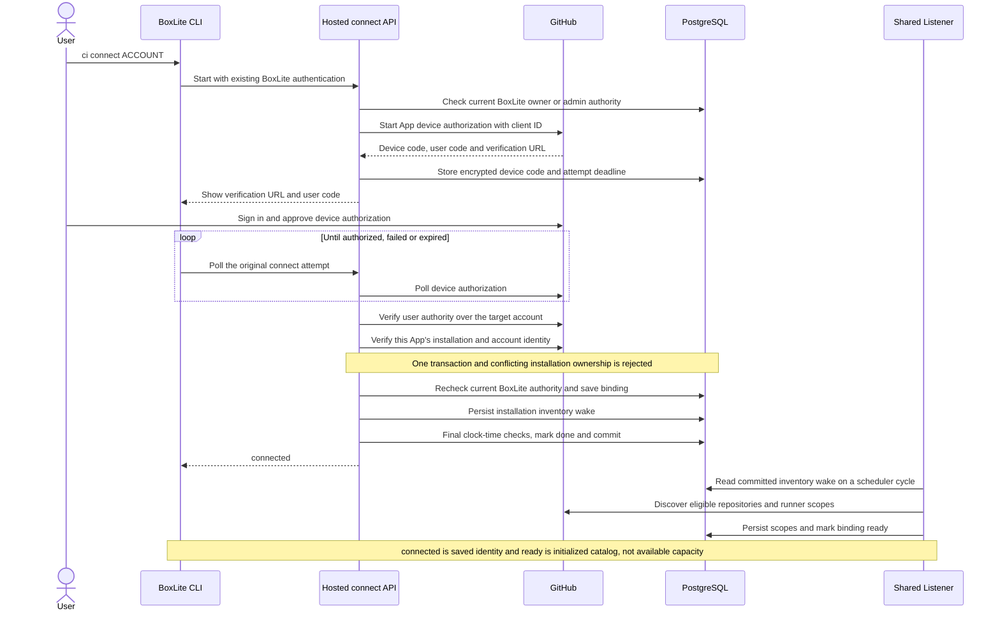
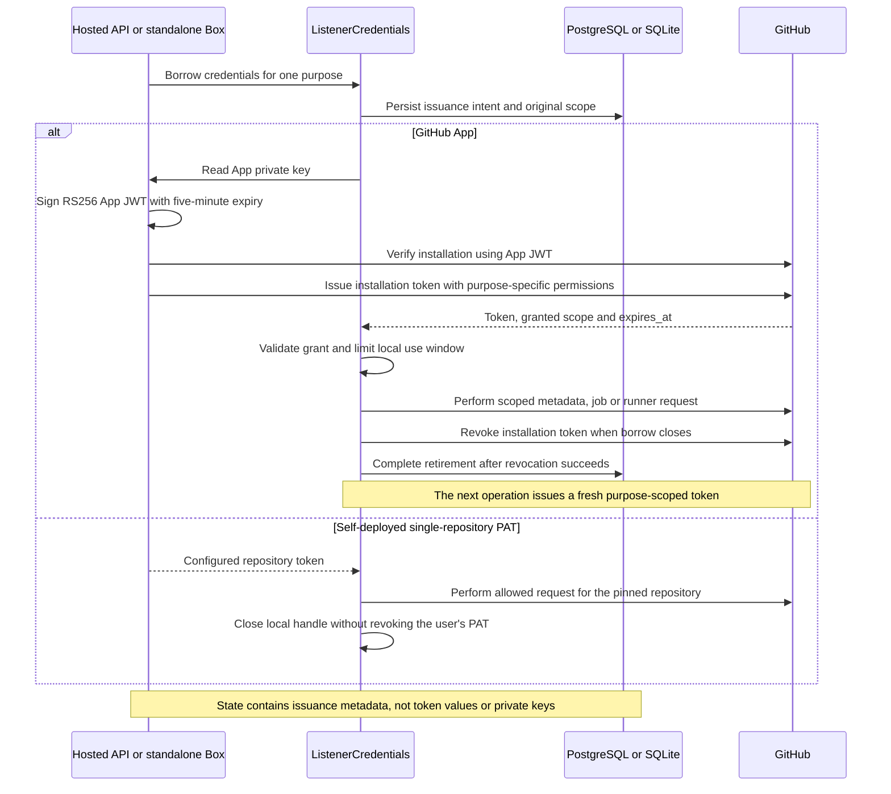
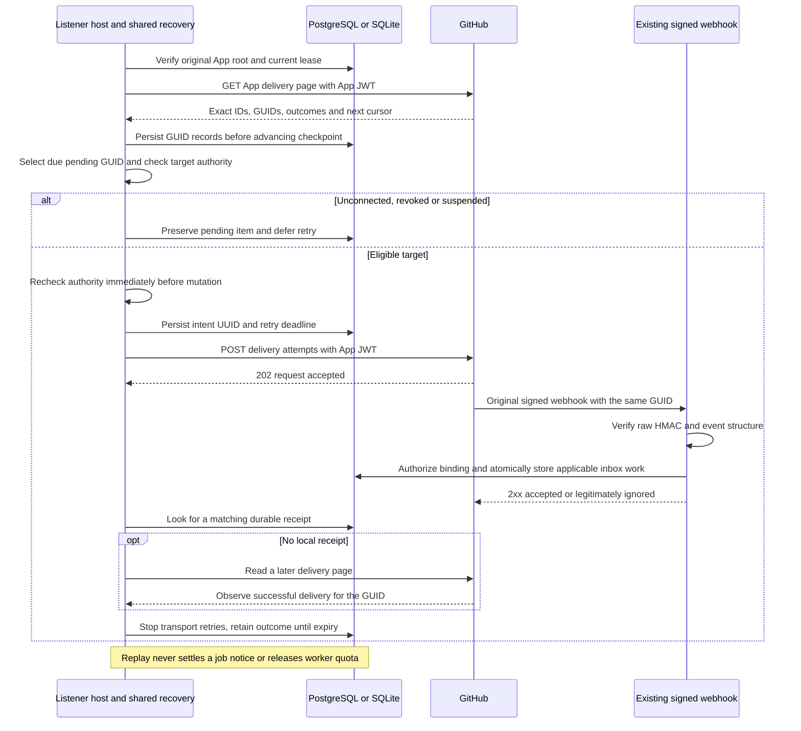

# Shared CI Listener

This server-side TypeScript library is the common boundary for the hosted API and
standalone Listener image. Hosts supply execution and storage adapters; the shared
controller must not depend on Nest, process environment or a specific database.

`WorkerExecutor` is consumed by the native API provider, which binds operations to
the original installation scope. The actual GitHub runner remains the executable
in the worker image; this library does not execute CI steps.

The API connect service also uses the shared GitHub App JWT signer and HTTP
transport. Requests use fixed GitHub.com origins, reject redirects, bound JSON
responses to 1 MiB and keep credentials out of errors. Mutation errors distinguish
a known HTTP denial from an outcome that may have produced a remote effect; execution
controllers must persist intents before execution mutations. Key loading remains
with the host.

`CiGitHubApp` owns one App identity and private loaders for its signing key, OAuth
client secret and webhook secret. Authentication and connect verification are
shared by the hosted registry and standalone host. An optional account type
restricts new connect/admission; original cleanup retains the original App source.
Self-owned Apps can omit that type and serve both personal and organization accounts.
`ScopeApplications` atomically associates each execution scope with its original
App when the scope is first defined. Missing or conflicting associations fail closed;
there is no legacy association backfill.
Multiple Apps retain one journal, scheduling lease and host capacity provider.
`AppDeliveryRecovery.prefix` separates each App's delivery history without
creating another execution namespace or quota.

`GitHubAppSource` lists installations and issues purpose-specific credentials for
repository discovery, Actions reads, repository runners or organization runners.
It rechecks installation identity and permissions before issuing a token, requests
the least required permission, and narrows repository operations to one repository.
`GitHubCredential` keeps its token in a JavaScript private field and refuses JSON
serialization. Invalid metadata prevents use while preserving the revocation handle.
Retirement stops further requests even when revocation needs a retry. Personal
tokens use the same request interface and are never revoked by `close()`.

Credential use has a short window; the controller must close an old App credential
before issuing its replacement and keep handles until cleanup succeeds. Controller
integration now records durable issuance intents in `ListenerCredentials`;
both the standalone Node host and the API assemble those integrations through
their own execution and persistence adapters.

`GitHubAppSource.deliveryPage()` exposes one validated App webhook-delivery page,
including an opaque next cursor. Delivery IDs remain exact decimal strings, even
above JavaScript's safe integer range. Pagination validates the fixed GitHub route
and rejects a next cursor equal to the current cursor; a multi-page scan must keep
its own visited-cursor history. Empty or short pages can still carry a next cursor.

`redeliver()` requires a successful `beforeMutation` callback before POST. The
caller must persist its intent and verify the original App root and execution
lease there. HTTP 202 only confirms a redelivery request, not inbox persistence or
job execution. These helpers use App JWTs and introduce no new configuration.
Both App hosts assemble `AppDeliveryRecovery` when their existing webhook secret
configuration is present. Replayed webhooks use the existing signature verifier
and binding-authorized inbox; recovery metadata grants no execution capability.

The recovery controller keeps one App-wide background slot, alternating delivery
pages and bounded pending-item scans. It saves `replay/item/<GUID>` before advancing
`replay/progress`, so interruption repeats a page instead of dropping its work.
Incremental scans overlap the completed watermark by one minute. Cursor hashes
survive restart and detect multi-page cycles; invalid order or cursors trigger a
reported rescan without advancing the completed watermark. The protective limit is
10,000 cursors per pass, not a throughput or latency guarantee.

Before each replay, hosts recheck the App root, execution lease and current target
authority. Hosted use requires a connected current owner; standalone use verifies
the App installation is current and unsuspended. The callback persists an intent
UUID and a five-minute retry deadline before POST. An uncertain replay can repeat
the same GUID; this permission does not apply to uncertain Box or JIT creation.
A receipt proves durable inbox acceptance. A later App delivery record with the
same GUID and a 2xx response also stops transport retries, including legitimately
ignored events; neither observation proves a CI job finished. Old failed attempts
cannot reopen a confirmed GUID, and new events cannot reset an existing retry.

[GitHub's delivery history](https://docs.github.com/en/webhooks/testing-and-troubleshooting-webhooks/redelivering-webhooks)
covers three days. Replay metadata is retained for that
window and pruned in bounded steps. Unconfirmed expiry reports a retention gap;
it never settles a job notice, removes an allocation or returns resource quota.
Global backoff honors GitHub retry deadlines, while a single delivery's 400/404/422
does not cool down other targets. Bounded repository job scans remain the fallback
outside the delivery-history window. See [the controller](src/replay/recovery.ts).

`ListenerCredentials` owns per-purpose App or pinned-repository PAT borrows. App
issuance records its intent before HTTP, retains known handles until retirement
succeeds and defers an immediate remint after an uncertain issuance. Replacement
starts after retiring the previous handle. A stale borrower cannot revoke its
replacement or release the replacement's purpose lock; concurrent retirement
shares one operation. Tokens remain private and failed/unknown issuance records
contain metadata only. PAT retirement closes the local handle without revoking
the user's token. Hosts must close borrows and the provider during shutdown.
After successful revocation, metadata deletion still uses the captured execution
lease. Ordinary deletion failures retain the handle and retry without repeating
revocation. If that write loses its lease, local retirement finishes and leaves
the metadata to the current scheduler; remote revocation failures still retain
the handle. This grants no stale owner permission to modify execution state.

## Credential metadata collection

New issuance metadata records its holder's lease owner, epoch and optional
deployment, never the token. The current scheduler collects at most sixteen
credential records per step, using database time and version-conditional writes.
It skips the exact current holder and independently leased scan credentials.
Issued App metadata is eligible at its persisted expiry; stale PAT borrow metadata
requires a recorded former holder and never revokes the user's token. Unknown
issuance, invalid expiry and legacy PAT records without holder proof remain.
This collector cannot stop Boxes, unregister runners or change capacity.

A malformed non-scan credential record aborts the current page without committing
its metadata deletions or advancing the collection cursor. Subsequent cycles
report `credential-collection` with `StateCorrupt` and retry the same page;
records on later pages remain uncollected until an operator repairs the original
record or restores consistent state. Corruption does not authorize skipping or
deleting unknown metadata, revoking a PAT, or releasing worker capacity.

## Deployment retirement

A positively observed higher deployment permanently retires the old Listener;
temporary same-deployment lease loss still permits recovery and reacquisition.
The old process stops scheduling and new compensation claims, cancels discovery
and replay, and closes its worker/backend, scanner and host credential owners.
Every owner is attempted even when another close fails. Pending local revocation
uses exponential retry delay capped at sixty seconds without restarting scheduling.
An in-flight scan opening or uncancellable worker create does not delay the
other owners' retirement. The old Listener retains ownership until each actual
operation settles, closes any late reader without
querying GitHub, and retries failed retirement before returning.

The current owner restores existing Box/runner identities, allocations and quota;
deployment never resets capacity or stops a running worker merely because its
creator retired. Authorized webhook ingress remains available on a retired hosted
API. Shared database/Redis pools and existing HTTP connections belong to the API
host's lifecycle. Retirement does not guarantee immediate instance termination or
eliminate database connection pressure and lock contention.

`GitHubJobs` verifies the original repository identity before and after reading a
job. A job notice must match the repository, run and job IDs returned by GitHub.
Admission also requires an unassigned queued job and a complete supported label
set containing exactly one routing label: `boxlite` for configured defaults, or
`boxlite-2vcpu-4gbmem-10gbdisk` for explicit resources. Compensation scans inspect queued, running,
waiting, pending and requested workflow runs. A changing or truncated inventory,
permission failure or API pagination cap is an error; callers retain their wake
and retry discovery instead of acknowledging an incomplete pass.

## Docker startup

Every CI worker Box requests guest privilege and prepares Docker before starting
the GitHub runner. Docker-dependent actions, service containers and scripts use
the guest-local `/var/run/docker.sock`. Bootstrap runs as root; readiness probes
and the GitHub runner execute as `runner` with the docker group active.

```text
Privileged CI Box -> Docker API ready -> run.sh -> workflow service containers -> steps
```

The official GitHub runner image supplies Docker binaries and util-linux `setpriv`.
Bootstrap switches directly to `runner:docker`, initializes the runner's
supplementary groups and sets `HOME`, `USER` and `LOGNAME` for both probes and
runner execution. The image's sudoers grants the sudo group access but excludes
root, so root bootstrap must not depend on sudo for this switch.

Other environment variables, including JIT configuration, are inherited.
Bootstrap installs `iptables` with apt when missing, starts `dockerd`, and probes
the API as the runner user. Dependency installation and readiness share a
120-second deadline; a ready daemon is reused.

Preparation failures stop startup and print the last 60 daemon log lines.
Failed JIT delivery stops an owned daemon;
an existing daemon remains untouched. Normal teardown belongs to the Box lifecycle.

Hosts need Docker-capable firmware and privileged guest support; standalone REST
creation also requires privileged creation to be enabled. Custom worker images
must supply Bash, Docker binaries, the docker group, util-linux `setpriv` and GNU
timeout, plus apt when `iptables` is absent.
See [Docker inside a Box](../../../docs/guides/docker-in-docker.md).

## Resource labels

Both hosts share resource parsing across webhook hints, compensation, job matching,
Box creation and JIT registration. `boxlite` uses configured CPU and memory with
10 GiB disk. `boxlite-2vcpu-4gbmem-10gbdisk` creates **2 vCPU, 4 GiB RAM and
10 GiB disk**; its JIT runner advertises that resource label, replacing `boxlite`.
Other requested labels must match the worker's supported platform labels.

`DEFAULT_RUNNER_LABELS` supplies the shared immutable platform labels and `boxlite`
default to both hosts and hosted scans. Per-job selection replaces `boxlite` with
the validated custom label. `DEFAULT_WORKER_DISK_GIB` supplies the same 10-GiB
default to resource validation, pool launch and both Box request adapters.

All three custom quantities must be positive decimal integers without signs,
fractions, exponent notation or leading zeroes. CPU is limited to 1–16 and memory
to 1–128 GiB. Disk must convert exactly to a safe integer byte count (at most
8,388,607 GiB); actual provisioning also remains subject to backend limits.
Labels are case-insensitive. Duplicate routing labels, multiple resource labels,
or `boxlite` combined with a resource label are rejected. Unsupported or invalid
jobs cannot reserve workers through compensation or job admission; signed
webhooks with invalid resource labels receive HTTP 400.

These labels request resources, not entitlements. Hosted creation still runs
BoxService's organization CPU, memory and disk checks and Commerce creation quota.
Standalone sends the same quantities through its authenticated REST create API,
which retains its backend checks. A hosted resource refusal before persistence
records the existing confirmed-rejection fact and returns its occupied slot.
Unknown creation outcomes retain capacity until the original Box can be reconciled.

Each allocation stores its Scale Set ID and canonical worker labels in `supply`. Recovery uses that identity to reconcile the original Box and runner. The host configuration supplies default `boxlite` resources.

Before switching an existing installation, drain its classic allocations. For each unresolved allocation, verify the original Box destruction and runner removal before clearing its journal entries. The Scale Set owner recovers allocations carrying a set ID and label snapshot.

Organization runner-group names are independent of resource labels. Admission verifies the organization, the dedicated runner group and its complete authorized repository set. The host also checks repository visibility and workflow restrictions.

The Scale Set service generates a JIT for the original worker. The listener journals the registration intent and checks its execution lease before requesting the credential. Each JIT permits one delivery and stays in memory.

Cleanup verifies the runner's unique name and set ID under its original authority. A known runner ID stays attached to its allocation even if the JIT is malformed. Idle retirement also checks that GitHub accepts removal of that runner.

Runner lookups/removals, job reads, App credential issuance and state operations
capture caller-owned identities and selectors before their first asynchronous
operation. Mutating a supplied object or array while a call waits cannot change
the verified runner ID, journaled deletion target, token purpose/repository, job
notice, execution lease, read keys or recovery prefixes used by that call.

`verifyWebhook` checks HMAC-SHA256 over the original body bytes, a bounded payload,
delivery UUID and matching event structure. The API already uses this verifier.
The standalone HTTP host must apply its own body, concurrency and timeout limits
before invoking it. `ListenerInbox` atomically stores the delivery receipt, wake
and job identity in either database, with no execution lease required. Concurrent
duplicates converge; conflicting bodies/events or job identities are rejected.
A new delivery updates record versions, so settlement using an older captured
version fails rather than removing newer work. The API uses the same inbox through its binding-authorized PostgreSQL adapter.

`ListenerState` stores durable records through either the host's PostgreSQL pool
or the Node 24 SQLite adapter. PostgreSQL uses the single `ci_listener_state` table;
the API migration creates it. SQLite keeps `listener.sqlite` and its WAL/SHM files
in a private directory supplied by the standalone host.

Execution writes require a lease bound to the namespace, owner and epoch. Ingress
can commit receipts and notices without the scheduling lease. Batches use UUID
versions and atomic conditional writes; expired leases, stale versions, missing
roots and unsupported schemas reject admission. Point reads can carry the same
lease fence; recovery reads bounded pages from active indexes.
Permanent business roots can be seeded atomically during namespace initialization;
subsequent initialization checks their presence and never overwrites them. Recovery
selects indexed key prefixes so retained delivery receipts and inactive historical
scopes are not enumerated. Unleased reads serve ingress CAS lookups and dashboard
aggregates; they never grant permission to execute jobs.

### Execution lease storage

`@owner` stores `{owner, epoch}` with record schema 2, or adds `deployment` with
schema 3 for deployment-aware hosts; `@lease` stores `{until}` with schema 1.
The identity and its UUID record version remain stable throughout
a scheduler's tenure. Renewal extends only the deadline; takeover increments the
epoch and changes both records atomically.

Execution checks hold a shared `FOR SHARE` lock on `@owner` before reading
`@lease`, so unrelated readers and allocation transactions can overlap.
Standby ticks and webhook receipts validate an initialized journal's roots and
requested seeds in a consistent snapshot. A missing or legacy owner sends
initialization through serialized bootstrap, which rereads the roots before
creating or migrating them. Missing seeds in an existing journal fail validation.
During a standby tick, acquisition reads the owner and deadline without a row
lock. A live lease or a different deployment ends the probe immediately.
Renewal shares the owner lock with workers and locks `@lease` for update before
checking expiry against database time. A worker can hold its transaction open
while the owner renews. Concurrent renewals serialize on the deadline row.
Activation, takeover and bootstrap take the owner lock exclusively, so an
identity change waits for guarded transactions and renewals to finish.
Adapters without shared point reads fall back to the exclusive lock; SQLite
serializes transactions at the file boundary.
Renewal rejects an expired or replaced owner and never shortens its deadline,
even if a caller requests a shorter TTL. A takeover candidate rechecks the
deployment and deadline against database time after obtaining the owner lock.
The lock is held until the database transaction commits or rolls back.

A failed renewal cancels in-flight work for that Listener session. The
`listener-renewal` warning identifies that operation before the session drains.
Hosted database failures include the SQLSTATE code without query text or parameters.

Snapshot checks read the deadline without locking that frequently updated row.
For example, a snapshot can precede a renewal from 10:00:30 to 10:00:40 and still
lock the unchanged scheduler identity. An older deadline can cause conservative
lease rejection, but cannot extend authority; actual takeover changes the locked
identity and can still produce a serialization error. Neither the shared state
adapter nor the hosted adapter automatically retries transactions.

Initialization upgrades a legacy schema-1 owner containing `{owner, epoch, until}`
under the bootstrap transaction and owner lock. It preserves identity, epoch,
deadline and journal data while creating `@lease` and writing schema-2 `@owner`.
An interrupted upgrade rolls back completely; mixed or missing records fail closed.
Repeated initialization validates the existing records without resetting them.
Conditional-write conflicts during bootstrap, migration, takeover or renewal
abort the whole transaction, preserving the previous identity, deadline and journal.
Malformed identity or deadline payloads block initialization or ingress rather
than admitting new work with incomplete lease metadata.

Pre-schema-2 binaries reject owner schema 2. During that upgrade, an old scheduler stops renewing
and an upgraded instance can acquire after the preserved deadline expires.
Upgrade all hosts sharing a namespace; reverting binaries alone is unsupported,
and deleting execution state would lose recovery records. The existing PostgreSQL
and SQLite tables are retained: identity columns belong to `@owner`, and
`lease_until` belongs to `@lease`.

### Deployment eligibility

A host may construct `ListenerState(database, namespace, deployment)` with a
positive safe integer assigned by its deployment workflow. After HTTP is serving,
it calls `activate()`: a higher deployment takes the same owner lock as execution
transactions, waits for those transactions to finish, then atomically advances the
deployment and epoch, clears the owner and expires the lease. Same-deployment
activation is idempotent; an older deployment cannot move the target backwards.

The first activation upgrades owner schema 2 to 3, so earlier binaries fail closed
instead of renewing an ownership record they do not understand. Acquisition,
renewal and execution writes require the active deployment. Initialization and
webhook ingress do not activate a deployment. Unversioned standalone hosts retain
schema 2 and cannot acquire an upgraded namespace. Keep the journal when upgrading;
rolling back to an older binary requires an explicit state-format recovery plan.

No HTTP call holds this database lock. A call issued before takeover may finish,
but stale state commits fail; the replacement owner recovers its persisted intent
using original resource identifiers. A retired API may keep WebSockets open and
accept authorized ingress without retaining scheduling authority.

### Conditional admission writes

Admission commits may include read-only record-version checks. The transaction
locks those records and rejects a missing or changed version before writing any
allocation. The checked policy keeps its version, so multiple admissions can use
one snapshot until an authorized configuration update commits. Hosts still own
policy authorization and resolution.

`CapacityProvider.resolve({ scope, repository, job, lease, signal })` is the single
admission-policy port. The standalone host always returns its `CI_WORKER_MAX` total;
the hosted API resolves account settings and Commerce. The controller does not
branch on the host or know account/repository quota rules. Each policy supplies
one or more explicit `global`, `organization` or GitHub `account` limits. Every
reservation atomically increments all three usage counters, even if the current
policy selects only one. Counter CAS and policy record-version checks prevent
concurrent overspending. Zero pauses new admission; null has no numeric ceiling.
Missing or invalid policies fail closed. The capacity API reads the organization
counter directly, without reading scope or worker history.

Compensation only records pending jobs and does not query capacity. Existing worker recovery runs
before policy lookup and continues when Commerce or settings are unavailable.

Future repository rules belong in the hosted provider and candidate selection;
strict repository limits also require runner eligibility to be partitioned.
The triggering job alone does not identify the repository an organization worker
will actually execute. Repository-specific limits are not implemented.



The storage layer does not authorize GitHub requests or platform tenants. Hosts
must recheck their live binding in the same transaction used to persist ingress,
and execution adapters must enforce authorization at the actual side-effect
boundary. Both hosts implement those checks; deployed hosted acceptance remains pending.
Temporary GitHub tokens and JIT configuration must never be written as payloads.

The execution journal retains immutable scope definitions addressed by their hash.
Known worker lookups, App authorization and quota checks use point reads; none
enumerates historical scopes. `active-scope/<scope>` and
`active-worker/<scope>/<worker>` index only unfinished allocations. Each new reservation has an independent
`supply/<allocation-id>` identity. Legacy `job/<installation>/<repository>/<job>`
records remain valid for original cleanup; new supply is not deduplicated by its
trigger job. Reservation and
final release update these memberships and the scope activity version atomically.
There is no global historical-scope catalog or 10,000-scope ceiling.

Usage includes uncertain creates and all historical generations whose original
Box is not yet confirmed absent. Each quota domain keeps a permanent marker and
counter, including at zero. Losing either member of an established pair fails
closed; initialization never silently repairs it. Point reads validate referenced
records, not arbitrary unreferenced historical debris. Coordinated loss of both
a domain marker and its counter cannot always be distinguished from a new domain.

The Scale Set controller uses the existing version-2 journal. Set identities are scoped to the original installation, runner group and resource label.

Each effect records an operation UUID first. Resource IDs are immutable, and an
unknown create cannot be reset, retried or settled through a missing-resource result.

`WorkerPool` drives boot, JIT registration/delivery and cleanup through host-bound
capabilities. JIT configuration stays in memory and is sent at most once. A triggering job supplies demand rather than an exclusive assignment:
the Box may execute another authorized matching job. A completed notification alone
does not stop it. An elapsed timeout or runner absence alone does not prove
that its Box is idle. Delivered workers remain until actual exit or confirmed
[idle retirement](#surplus-idle-retirement). Physical Box capacity
returns after its original Box is confirmed absent. The allocation stays indexed
until both original resources are absent, preserving original-resource cleanup.
The host must enforce authority and execution epoch
again at actual side effects, including native Box persistence. Both host entry
points use this kernel; runtime acceptance remains a separate deployment check.

## GitHub runner scale sets

Hosted CI and the standalone Listener Box use the same TypeScript Scale Set client for every installation. The elected listener opens one cancellable session per binding, execution scope and worker specification. Each session sends its available capacity to GitHub and explicitly acquires eligible job requests.

An authenticated queued-job observation can seed an additional supported resource label, with up to 64 open sessions per scope. When more specifications are waiting, an empty poll on an idle set gives another specification a turn. An active set keeps its session.

A failed session releases its lane during backoff. Other specifications can start while the failed one waits for its retry deadline.

A workflow can request a new specification directly:

```yaml
runs-on: boxlite-1vcpu-1gbmem-10gbdisk
```

Each binding starts with `boxlite`. A signed queued webhook opens a set for this label in the authorized runner group.

A standalone PAT listener can also discover the specification through its authorized repository scan. Once GitHub assigns the work, the Box requests 1 vCPU, 1,024 MiB of memory and 10 GiB of disk.

GitHub reports the total assigned jobs, including running jobs. If it reports 16 and five usable workers already hold reservations, the planner can reserve up to 11 more within quota. It counts pending Box creates across restarts.

A durable target precedes message acknowledgment. A dedicated JIT configuration binds each runner to its set and its original Box. Registration recovery uses a targeted name lookup and verifies the set ID.

The default polling deadline is two minutes. Network waits occur outside SQL transactions and the listener bounds concurrent setup and message handling across scopes. GitHub can still throttle credentials and management requests. [Reference protocol](https://github.com/actions/scaleset/tree/v0.5.0)

A failed admission or repository discovery leaves original allocations eligible for cleanup. Rediscovering a scope invalidates pending drain decisions before they can close an undispatched worker.

An idle poll with pending acquisitions reconciles them against statistics for that set. An explicit zero acquired and zero assigned releases the hold. A missing acquired count preserves it.

A completed long poll can carry an older capacity estimate. The listener rechecks the current policy and charges shared quota before acquiring offers.

Ten assigned jobs with ten reserved slots and no workers in flight dispatch ten Box creates in one pass. Each worker commits its create intent before calling the Box service. The next pass counts those starts toward the target. The same transaction advances the scope activity version using its locked, current membership count.

A retry checks the current policy and the scope’s allocation version in the transaction that records the retry intent. If a Box starts, begins closing, or becomes absent after the worker count was read, the listener rechecks capacity before retrying the request.

If a scope drain released those reservations, the set must obtain new quota. Held reservations start a Box only when GitHub confirms assigned demand.



An owner that loses an acquisition reply reconciles the first replay against the current set statistics when the session and message disagree. A worker that exits before GitHub reports it started work triggers per-specification creation backoff. A lost upload reply is recovered using the original Box and JIT delivery intent.

### Asynchronous allocation queue

The owner admits eligible offers under the current quota. It records the request IDs before the acquire call and persists the returned result before acknowledging the message. An idle poll keeps accepted work reserved until GitHub reports assignment or cancellation.

On reconnect, an explicit acquired count bounds the reservations carried from the previous session. Missing acquisition statistics preserve the existing charges.

The pool counts the original workers for each set. An assigned job can start its reserved Box even while other Boxes are booting. The shared work queues allow eight scope planners and 32 allocation consumers to make progress independently.

### Transaction and lock budget

The owner checks its lease at each durable change. Quota reservation checks the target version and all quota counters in one transaction.

PostgreSQL uses the API's connection pool and SQLite uses the Listener Box journal. A pending GitHub long poll holds no database connection.

### Surplus idle retirement

When assigned demand falls, the pool first withdraws surplus allocations that have no Box creation intent. For a running worker it checks the original runner ID, name and Scale Set membership.

A successful idle unregister and confirmation of absence precede stopping the Box. A busy refusal or an uncertain result keeps the original worker available for recovery.

## Independent repository compensation

Every Listener replica runs two compensation lanes alongside the single execution
scheduler. A lane claims only work it can start immediately. The existing state
table holds repository tasks, immutable scope references and ordered due keys; PostgreSQL uses short transactions
and SKIP LOCKED candidate selection, while SQLite uses its existing serialized
write transaction. Neither keeps a database lock during GitHub requests.

Each successful binding catalog activates its own completed snapshot. A failing
installation does not block another binding's scans, and a failed catalog read is
not an empty catalog. An authoritative installation index retires removed bindings.
Repeated discovery preserves existing task deadlines. Directory staging records
its committed batch offsets, so a canceled publication resumes without rereading
already written tasks and activates only after all batches complete. Old snapshot memberships and
expired credential metadata are removed in bounded pages, without scanning retained
execution history.

A task has an owner, epoch and 60-second lease; the full scan has a 45-second
abort deadline. Different installations can run concurrently, while one App's
installation has at most one effective scan lease across replicas. Busy repository
candidates move out of the due head. Successful scans become eligible again after
five minutes; failures use capped backoff. A 429 or rate-limited 403 with a retry
header also persists an installation-wide retry deadline. Other 403 responses
remain repository failures rather than being guessed to mean rate limiting.

The scanner has GitHub jobs-read capabilities only. It reuses credential issuance
intents and retirement, but its lease cannot create allocations or change cap.
Cleanup may conditionally remove its own original credential record after lease
expiry; it cannot delete another owner's operation or issue another credential.
Unknown issuance metadata expires after two hours, beyond the maximum App token
lifetime accepted by the transport. Tokens themselves are never stored.

Publication checks the task lease, active binding snapshot and exact job identity.
Hosted publication checks the original binding generation and owner in the same
PostgreSQL transaction. Standalone publication checks its captured backend and
binding record versions. A deleted connection or superseded snapshot rejects late
results. Repeated jobs converge with webhook ingress; repository, run, account or
installation conflicts fail closed.

Scanned jobs publish resource labels. The owner persists the specification before settling the notice. Only GitHub Scale Set messages can trigger a new quota reservation.

Stopping the Listener cancels and awaits both lanes and retires their credentials;
failed retirement retains its handle for retry and reports the cleanup failure.

## Worker recovery and logs

`ci-worker-reserved` records the completed reservation. Pending resource work
emits `ci-worker-execution-started` with `queueWaitMs` and
`ci-worker-execution-settled` with `durationMs`. These are management timings,
not proof that a GitHub job started or that an external mutation succeeded.
Healthy running allocations do not emit these timing events on every poll.

The owner pages active scopes and reads allocation records in batches. It counts charges by Scale Set ID and keeps each Box and runner tied to its original allocation.

The native API records a definitive creation refusal for any failure before
`onPersist` begins, including throttling, placement, image policy and prerequisite
lookups. It stores the original scope and creation-operation UUID in the same
ledger key that would hold a Box ID;
an expected-null CAS makes those outcomes mutually exclusive. Only this durable
fact yields `ConfirmedWorkerCreationRejected`. Hosted authority revocation can
use the same fence before dispatch or after a rejected native persistence
transaction rolls back. The optional `ExecutionHost.rejectUndispatchedCreate`
capability binds that proof to the exact original effect before reporting refusal;
hosts without it retain uncertain reservations. A committed original Box ID wins
over refusal and remains available for cleanup. Restart can recover the fact through
the original worker lookup. The kernel checks the original pending operation and
atomically retires its allocation and scope reference, leaving queued demand pending.
It emits `ci-worker-create-rejected`; a later attempt gets a new allocation/name.

Native lookup also corrects historical pending creates after five minutes from
reservation. It verifies the original operation and absence of a Box/ledger before
conditionally recording that refusal. A delayed Box transaction must acquire the
same ledger key and rolls back if correction wins. Time alone is not absence proof;
known IDs and unexpected same-name Boxes retain their existing ownership checks.

Ordinary HTTP errors, timeouts, failed proof persistence and uncertain persistence
outcomes keep the reservation. The standalone REST adapter does not infer this
proof from a 429 or an error-body property. Unknown creates are never repeated.
The general resource state machine still forbids requested-to-absent transitions;
the explicit refusal path is limited to an unmaterialized Box with no runner.

When Hosted has already persisted the original Box and confirms destruction,
the adapter returns the Box ID and creation effect for the requested allocation.
The pool saves that ID, then follows ordinary known-Box recovery. A restart
between those writes resumes at the same ID. A stale synchronization error
cannot overwrite a later destroy callback. Standalone keeps a requested slot
when only a REST 404 and a filtered public inventory are available.

Stopped/error Boxes are deleted by their original IDs; a lookup error retains
capacity. Confirmed absence releases physical
capacity even when GitHub registration cleanup must retry. Other allocations
still get reconciled after an ordinary per-worker error. Lease loss, corrupt or
conflicting state, abort and unretired credential handles stop further work.

If soft deletion frees a Hosted worker's name but the runner fails to confirm
destruction, the Box manager retries on the original runner. It matches the
Box ID, original name and organization in the configured Hosted App's ledger.
If a V2 Box still says destroying after its last destroy job failed on that runner,
the manager submits a replacement once no incomplete job remains. A late failure
from an earlier attempt preserves a confirmed destroyed Box.
Stale-error cleanup retains the row while destruction is pending. The 24-hour
cleanup keeps a destroyed Box while a charged allocation still needs its receipt.
If historical cleanup already pruned a failed destruction, recovery keeps the
slot reserved. A destroy job on a previous runner can refer to an older copy of
the same Box ID.
A change to the primary Hosted App ID requires draining its old namespace first.

An absent Box's allocation remains in the journal until runner cleanup is confirmed.
A new supply allocation does not exclusively reserve its trigger job.
Unknown Box creation still occupies capacity and is never repeated. Cleanup debt
survives restart and remains in the paged active indexes. Runner-only cleanup debt
does not charge physical capacity or prevent matching demand from receiving new
capacity. Final release removes memberships and allocation identity without
decrementing capacity a second time.

Both production hosts write the same structured `WorkerEvent` facts: standalone
JSON on stderr, hosted API `Logger.log`/`warn`. Each includes binding/generation,
organization, installation/account, allocation, original Box/runner IDs, effect
and phases. `trigger` identifies the repository/run/job that requested capacity;
it is not an assertion that this Box executed that exact job.

| Event                         | Meaning                                                                       |
| ----------------------------- | ----------------------------------------------------------------------------- |
| `ci-worker-exited`            | Observed stopped/error and available exit code; clean exit 0 is informational |
| `ci-worker-box-absent`        | Original Box absence persisted; unexpected disappearance is a warning         |
| `ci-worker-recovery-deferred` | Cleanup/query failed; durable state remains retryable; error type only        |
| `ci-worker-released`          | Both original resources are absent; allocation record removed                 |

Logs contain no token, PEM, JIT configuration or upstream error message. Missing
exit codes remain unknown. These logs report infrastructure facts, do not cancel
a workflow and do not write to GitHub's job log or predict its final conclusion.
They are diagnostic output, not a durable audit stream: a crash after a state
commit can omit a line, while the journal still retains the recovery state.

`GitHubExecutionBackend` ties the original scope, Scale Set, executor and GitHub credentials to the live execution lease. The host rechecks authority at admission and cleanup.

`Listener.receive` records a verified notification before acknowledging it. A signed event or authorized repository scan discovers resource labels. The elected owner opens the corresponding Scale Set and settles each notice against the version it observed.

`InstallationCatalog` enumerates a complete, bounded installation inventory using
a metadata-only token. Personal accounts receive one repository scope per eligible
repository. Organization accounts share a configured selected, non-inherited
runner group managed by BoxLite. Hosted scopes always permit installed Public
repositories and additionally permit Private repositories only with explicit
`allowPrivate` consent. Standalone retains its Public switch and permits Private
repositories independently. Both hosts authorize and journal each group write
before the catalog creates or synchronizes the configured group. Membership is
exactly the eligible installed set; public access is enabled only after membership
converges. Existing default or inherited groups cannot be adopted, and other group
names are untouched. The configured name is reserved for BoxLite to manage.

The catalog reads back policy and complete membership before publishing scopes.
Provider failures withhold admission and retry from actual GitHub state, including
after an uncertain create response. No eligible repositories clears an existing
group but does not create a missing one. Correct groups require no mutation.
Standalone intents use SQLite; hosted intents use the current binding generation,
owner authority, execution lease and existing PostgreSQL state. Callers without a
mutation-authority callback can inspect matching groups but cannot provision or
repair them. Lease checks cannot fence an already-dispatched GitHub request;
subsequent reconciliation repairs drift. Existing runner identities remain usable
for original cleanup; group access changes may affect queued or unassigned jobs.

`InstallationDirectory` runs complete installation-index reads and individual
catalog refreshes in one background slot per App. The scheduler keeps processing
known scopes while catalog requests wait. Successful installations publish
independently; a failed catalog withholds that installation's admission and keeps
its durable hints. An index failure withholds new admission until a complete
index succeeds. Failed reads never count as an empty inventory or a removal.

Cold installations with durable hints take priority over unhinted catalog work.
After at most three hinted catalogs, one due background catalog gets a turn;
selection within each category remains round-robin. When eligible catalog work
exists, repeated inventory events cannot schedule two index reads consecutively.
Retry deadlines apply before either priority, so new hints cannot bypass cooldowns.
These rules allocate the single directory slot; they do not guarantee wall-clock
latency or serialize requests made by execution adapters.

Refresh requests coalesce by installation. A captured wake UUID can be settled
only after its corresponding refresh; a newer delivery remains pending. Waiting
for a retry occupies no catalog slot. Retries start at one minute and increase
to five minutes, while a later GitHub retry deadline takes precedence. Periodic
index refreshes and repeated webhooks do not clear that deadline. Installation
indexes are bounded to 10,000 entries, and the combined admitted repository cache
is bounded to 100,000 repositories. These are protective limits, not throughput
or recovery-latency guarantees.

Standalone ingress checks the configured App root and the current complete
installation/account index inside each storage transaction. A matching signed
job may be stored before its repository catalog is ready. Hosted ingress applies
the same distinction using connected installation/account bindings and current
platform authority. Notification storage grants no worker capability: admission
still requires the original repository scope, actual GitHub job and labels, and
live authorization at the execution boundary.

An installation not yet discovered by the standalone host can request only
inventory work. Its endpoint returns a failure and stores no job receipt or
notice, so that request is not acknowledged as an accepted job. Compensation
may find the queued job later, or redelivery can submit it after discovery.
In hosted use, an unconnected job is rejected without inbox writes; the connect
transaction supplies the authoritative binding and inventory wake. App delivery
recovery can request replay after target authority becomes available. Bad signatures
and mismatched known account identities cannot enqueue inventory through this path.

See [the directory protocol](src/directory.ts), [the shared inbox](src/webhook.ts),
and [the scheduler](src/listener.ts) for the implementation.

Runtime recovery covers records created by this implementation. The Node standalone
entry and image build are available. Standalone App webhook execution and multi-job
artifact transfer have [live playground evidence](https://github.com/DefeatMan/boxlite-ci-playground/actions/runs/41820205537/attempts/1).
Live organization-group and deployed hosted API acceptance remain pending.

The native API adapter is implemented in `api/src/ci/ci-native-state.ts` and
`ci-native-workers.ts`. It uses the same PostgreSQL record table for original Box
IDs and delivery attempts. `BoxService` persists the Box and its ledger atomically;
the callback rechecks the execution lease and original binding/owner before commit.
Cleanup retains the original resource identity after binding removal. Closing
allocations cannot create or receive JIT. Every JIT HTTP request checks authority
again after asynchronous Box lookup, and a durable delivery claim prevents replay.
`ci-native-host.ts` builds scopes from stored connect bindings, retaining their
original platform organization and actor. Its shared inbox checks the live binding
and owner inside every ingress read/write transaction. GitHub credentials reuse
`CiGitHubService.appSource()` and the same configured private App key as connect.
These adapters are registered as the API's runtime providers. `CiListenerService`
starts the shared controller when the platform App is configured; all replicas use
one PostgreSQL lease, with no CI state volume or worker execution API Key.

## Architecture and authentication

These diagrams describe the current code, rather than deployed acceptance.
Each host instantiates the shared controller with its own adapters.



The hosted service uses the connected binding's original organization and actor;
it does not retain a user's API Key for worker execution. Self-deployment uses
its own BoxLite API Key. The App private key and webhook secret belong to the
host. Worker Boxes receive only their JIT configuration from the Listener.

Sources: [native host](../../api/src/ci/ci-native-host.ts),
[native workers](../../api/src/ci/ci-native-workers.ts),
[standalone host](../../github-ci-runner/src/self-host.ts), and
[standalone workers](../../github-ci-runner/src/boxlite-workers.ts).

### Hosted connect



Sources: [connect service](../../api/src/ci/ci-connect.service.ts),
[GitHub account verification](../../api/src/ci/ci-github.service.ts),
[inventory wake](../../api/src/ci/ci-native-state.ts), and
[controller cycle](src/listener.ts).

### GitHub credentials



Sources: [credential owner](src/credentials.ts),
[App tokens](src/github-app.ts), and [JWT signer](src/github.ts).
The webhook HMAC secret is independent from these API credentials.

### App delivery recovery

This is the working-tree recovery path. Hosted deployment acceptance remains
separate; replay metadata is not a CI result or an execution grant.



Sources: [recovery controller](src/replay/recovery.ts),
[standalone authority](../../github-ci-runner/src/self-host.ts),
[native authority](../../api/src/ci/ci-native-host.ts), and
[signature verification and inbox](src/webhook.ts).

### One CI job from notification to cleanup

A job requesting a custom label seeds a set for that specification. When GitHub offers the job, the owner reserves quota, acquires the request and acknowledges the durable result. Assigned demand starts a Box using its own JIT configuration.

The GitHub runner executes the workflow, and the original Box and runner are reconciled independently. A confirmed Box disappearance returns physical quota. Both resource outcomes must be settled before deleting the allocation.

## Build and test

Build and test from the repository root:

```sh
make build:apps:ci-listener
make test:apps:ci-listener
```

Run under Node 24. SQLite tests always run. PostgreSQL contracts follow other API
tests: set `DB_HOST`, `DB_PORT` (default 5432), `DB_USERNAME`, `DB_PASSWORD` and
`DB_DATABASE` for the existing local test database. With `DB_HOST` unset, only
the PostgreSQL suites skip. Tests create and drop isolated schemas and reject
remote hosts. `FILTER` selects test names as on other Make
test targets. These checks do not establish real hosted or standalone CI acceptance.
When changing the optional PostgreSQL environment, use `NX_SKIP_NX_CACHE=true`
to execute the contracts rather than reuse a cached run from a different environment.

Workspace hosts import the shared pool from `@boxlite-ai/ci-listener`; SQLite uses
the separate `@boxlite-ai/ci-listener/sqlite` path, keeping its Node-only adapter out
of the hosted entry. Cross-project test fixtures use the scoped `/testing` alias.
Standalone shutdown attempts every owned resource and reports combined cleanup
failures; extracting that cleanup operation preserves failure precedence.
Cursor and label validators retain their existing ASCII-control rejection ranges.

Compensation scans can race a verified webhook inserting the same queued notice.
On an insertion conflict, the Listener rereads that notice and accepts it only if
installation, account, repository and run still match; identity conflicts remain
errors. This keeps ordinary duplicate delivery from aborting the cleanup cycle.

## Interactive repository metadata

`InstallationRepositoryReader` owns metadata-only credentials for bounded UI page
reads. Unlike execution controllers, it reserves in-memory ownership before
issuance, independent of scheduler leases and worker capacity. Its 32-slot bound
includes in-flight issuance and failed retirement. A returned invalid handle is
still revoked; cancellation cannot skip finally cleanup. Uncertain issuance waits
60 seconds before another attempt for that installation. Failed retirement is
retained for retry and shutdown, and only verified expiry permits forgetting a
known handle. Shutdown refuses new reads and drains late issuance before retirement.

Scopes carry explicit Public and Private decisions. Standalone configuration keeps
its Public switch and always permits Private, while hosted policy always permits
Public and requires explicit Private consent. Existing scope hashes are incompatible:
finish cleanup with the old Listener and start a fresh journal before upgrading.
