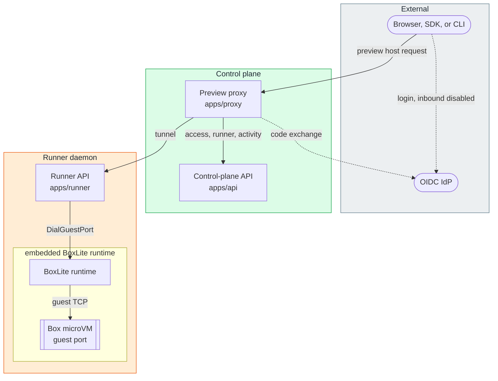

## TL;DR

The proxy authorizes box access through the control plane and tunnels traffic through the box's runner.

# BoxLite preview proxy

`apps/proxy` is the Go service behind `https://<port>-<box>.proxy.<domain>`. It checks with the
control-plane API that the caller may reach the box, then forwards the request to that port inside
the box through the box's runner. GCP runs two replicas on GKE Autopilot; AWS uses ECS Fargate.
Both expose port 4000 behind a load balancer that terminates public TLS.
See [infrastructure networking](../infra/docs/networking.md) and [architecture](../infra/docs/architecture.md).

- Routes: [`apps/API.md`](../API.md#preview-proxy-api)
- Place in the platform: [`apps/README.md`](../README.md)

## Architecture



The proxy asks the API whether the box has inbound access enabled and whether the requested guest
port has an active public tunnel. It resolves the box's runner and records activity before forwarding.

## Preview hosts

The first label of the host is `<port>-<id>`, where `<id>` takes one of two forms:

| `<id>`     | Meaning                                                           | Minted by                                                                    |
| ---------- | ----------------------------------------------------------------- | ---------------------------------------------------------------------------- |
| `d-<hex>`  | Hex-encoded box ID: box IDs are mixed-case, and hostnames are not | `getNetworkTunnelUrl` in [`box.service.ts`](../api/src/box/services/box.service.ts) |
| `<box ID>` | Raw box ID, still accepted from URLs minted before the encoding   | nothing current                                                              |

A host without a `<port>-` label serves only the utility routes listed in
[`apps/API.md`](../API.md#preview-proxy-api).

## Request paths

| Request                          | Upstream                                                      | Access rule                              |
| -------------------------------- | ------------------------------------------------------------- | ---------------------------------------- |
| HTTP or WebSocket to a guest port | Reverse proxy over a runner CONNECT tunnel to the guest port  | Inbound enabled and active tunnel declaration |
| Raw `CONNECT` to a guest port    | TCP tunnel through the runner                                 | Inbound enabled and active tunnel declaration |

The HTTP path in code:

```text
  StartProxy (— · apps/proxy/pkg/proxy/proxy.go:80) — registers the catch-all route for preview hosts
    └─ NewProxyRequestHandler (— · apps/libs/common-go/pkg/proxy/proxy.go:116) — reverse proxy for one request
      ├─ GetProxyTarget (Proxy · apps/proxy/pkg/proxy/get_box_target.go:49) — choose the upstream
        ├─ parseHost (Proxy · apps/proxy/pkg/proxy/get_box_target.go:340) — canonical port plus box ID
        ├─ getBoxInboundEnabled (Proxy · apps/proxy/pkg/proxy/get_box_target.go:229) — ask the API for the inbound mode, cached 3 s
        ├─ Authenticate (Proxy · apps/proxy/pkg/proxy/auth.go:17) — authorize access to a box with inbound disabled
        ├─ hasPublicTunnelAccess (Proxy · apps/proxy/pkg/proxy/tunnel_access.go:15) — check every guest service port
        └─ updateLastActivity (Proxy · apps/proxy/pkg/proxy/get_box_target.go:411) — renew activity every 50 s
      └─ dialGuestPort (Proxy · apps/proxy/pkg/proxy/get_box_target.go:145) — dial each new upstream connection
        └─ dialGuestPortWithWake (Proxy · apps/proxy/pkg/proxy/guest_wake.go:52) — dial, waking a stopped box
          ├─ getBoxRunnerInfo (Proxy · apps/proxy/pkg/proxy/get_box_target.go:187) — runner URL and key, cached 2 min
          ├─ dialRunnerTunnel (— · apps/proxy/pkg/proxy/tunnel.go:118) — CONNECT through the runner to the guest port
          ├─ wakeBox (Proxy · apps/proxy/pkg/proxy/guest_wake.go:174) — POST ensure-ready to the API, once per box
          └─ waitForGuestPort (Proxy · apps/proxy/pkg/proxy/guest_wake.go:125) — poll the woken port, once per port
```

The upstream URL `http://<box ID>:<port>` is only a routing key. `dialGuestPort` is the transport's
`DialContext`: it resolves the box's runner and returns a tunneled connection, so HTTP connection
pooling reuses tunnels per box and port. Raw `CONNECT` requests skip this router and go to
`handleTunnelConnect` in [`tunnel.go`](pkg/proxy/tunnel.go), which dials through the same
`dialGuestPortWithWake`.

Every new HTTP/WebSocket guest service request and raw CONNECT checks the API's public tunnel
endpoint. It requires an unrevoked public declaration, inbound access enabled, and a box outside the
destroying/archiving states. The API caches allowed and denied verdicts in Redis for 3 seconds;
the proxy does not cache tunnel verdicts. Declaring a port clears its cached denial, and
`DELETE /api/v1/boxes/{boxId}/network/tunnel?port={port}` clears its cached allowance. A check that
races the revoke, or a box whose inbound access was disabled, can still admit new requests until a
cached allowance expires, so revocation takes effect within 3 seconds; existing connections
continue until they close. If the tunnel check fails, both paths return
502. Ports are parsed as numbers, so `03000` and `3000` name the same guest port.

## Waking a stopped box

A request to a declared port on a stopped box wakes it. The aim is that the first request succeeds
when the box and its service come up within 30 seconds
([`guest_wake.go`](pkg/proxy/guest_wake.go)):

1. The proxy dials first, so a running box costs no extra API call. A failed dial to a running
   box returns at once, so a port that nothing serves is still a `502`.
2. The runner refuses a box that is not running with `409` and code `box_not_running`. It does
   not boot the box itself, so the API stays the only path that starts one. A box paused for a
   snapshot is refused the same way until it thaws.
3. The proxy calls `POST /api/preview/{boxId}/ensure-ready`. The API takes the same steps as SDK
   auto-resume: it refuses a box with auto-resume off, refuses a box in a state that cannot
   resume (such as archived or resizing), records activity, checks that the organization is not
   suspended, and starts the box under its state-change lock. A box the API records as started and
   meant to stay started, such as one paused for a snapshot, is never refused, whatever its
   auto-resume setting, so the proxy keeps polling until it thaws. Concurrent requests for one box share one call per proxy
   replica, and the API lock turns the calls from all replicas into one start.
4. A resumed box replays its `cmd`, so its service listens a few seconds after the box starts.
   The box's network acks a tunnel only once the guest accepts it, so the runner answers `502`
   until then. The proxy polls the dial every 500 ms, and concurrent requests for one port share
   that poll. The poll closes the connection it gets, then each request dials its own. A request
   that arrives during this window gets `502` on its first dial, not `box_not_running`, so it
   joins the wake in progress for that box rather than failing. The wake lasts as long as the
   shared poll, so it stays joinable even after the request that started it hangs up.
5. The request is served once its dial succeeds. If 30 seconds pass first, the client gets `503`
   with `Retry-After: 3` and code `BOX_STARTING`, and the start keeps going.

Only a port that passed the tunnel check reaches this path, so an undeclared port never wakes a
box.

## Authentication

A box with inbound disabled takes the first credential that works ([`auth.go`](pkg/proxy/auth.go)):

1. `Authorization: Bearer <API key or JWT>`: the API checks box access with the caller's own token.
2. `boxlite-box-auth-<id>` cookie: signed with `PROXY_API_KEY` and trusted without an API call.
3. Otherwise, a 307 redirect to the OIDC provider with PKCE. `/callback` exchanges the code, checks
   access, sets the cookie, and sends the browser back to the original URL.

Credential checks cache only rejections, for 2 minutes. Accepted credentials go back to the API on
every request, so a revoked key stops working at once. The cookie is the exception: browsers keep
it for 1 hour, the signature check accepts it for securecookie's default of 30 days, and nothing
re-checks it with the API.

## Failure responses

| Situation                                                  | HTTP or WebSocket                                                   | `CONNECT`                    |
| ---------------------------------------------------------- | ------------------------------------------------------------------- | ---------------------------- |
| Inbound is disabled                                        | `404` after credential resolution; previews need inbound enabled | `403`, whatever the credential |
| Inbound is enabled but the port has no active declaration  | `404`                                     | `404` |
| The tunnel access API is unavailable                       | `502`                                     | `502` |
| The host has no `<port>-<id>` label                        | `404`, except the utility routes                                    | `400`                        |
| The API still fails the visibility check after its retries | `400`                                                               | `502`                        |
| A woken box, or its service, is not up after 30 s           | `503`, `Retry-After: 3`, code `BOX_STARTING`              | `503`, `Retry-After: 3`      |
| The box is stopped and auto-resume is off                  | `503`, code `BOX_STOPPED`                                           | `503`                        |
| The organization is suspended, or the box is in error, archived or resizing | `409`, code `BOX_UNAVAILABLE`                      | `409`                        |
| The runner, or a running box's port, is unreachable        | `502`, code `BAD_GATEWAY`                                           | `502`                        |

Guest-dial failures on the HTTP path return the JSON error body that the proxy's other errors use.
A box with inbound disabled needs a credential. SDK and CLI callers should always send one: without it
they get the browser redirect, not a `401`.

## Box activity

Each proxied request and each CONNECT tunnel reports activity to the API at once and then every
50 seconds until the connection closes, so an idle policy does not stop a box that is in use. A
per-box cache drops reports made within the previous 45 seconds.

## Caches

| Cache                     | Key                 | TTL   |
| ------------------------- | ------------------- | ----- |
| Box inbound mode          | box ID              | 3 s   |
| Runner URL and API key    | box ID              | 2 min |
| Rejected credential       | box ID + credential | 2 min |
| Activity already reported | box ID              | 45 s  |

The caches live in Redis when `REDIS_HOST` is set, as in the local stack
([`native.py`](../infra-local/compose/native.py)). Otherwise each process keeps its own caches in
memory. Neither deploy stack in `apps/infra` gives the proxy `REDIS_*` settings, so a hosted proxy
caches in memory unless its stage adds them.

## Other behavior

- **CORS** allows any origin, with credentials. A request carrying `X-BoxLite-Disable-CORS: true`
  leaves CORS to the app in the box.
- **Preview warning**: with `PREVIEW_WARNING_ENABLED`, browsers see an interstitial page until they
  accept it, which sets a cookie for 1 day. Non-browser clients, WebSockets, and requests
  carrying `X-BoxLite-Skip-Preview-Warning: true` skip it.
- **Shutdown** waits up to `SHUTDOWN_TIMEOUT_SEC` (default 1 hour) for open requests and tunnels. A
  second signal forces the exit.
- **Tracing** stamps `boxlite.box_id` on the span of each proxied HTTP request. CONNECT tunnels
  bypass the router and have no span.

## Calls to other services

The preview host format and the reserved paths are the proxy's public contract. Everything below
is internal and changes together with the API and the runner.

| Service | Call                                                                                                     | Credential                                              |
| ------- | -------------------------------------------------------------------------------------------------------- | ------------------------------------------------------- |
| API     | `GET /api/config` at startup, for unset OIDC settings                                                    | `PROXY_API_KEY`                                         |
| API     | `GET /api/preview/{boxId}/inbound`, `/tunnels/{port}`                                                    | `PROXY_API_KEY`                                         |
| API     | `GET /api/preview/{boxId}/access`                                                                        | The caller's bearer token                               |
| API     | `GET /api/runners/by-box/{boxId}`, `POST /api/box/{boxId}/last-activity`                                 | `PROXY_API_KEY`                                         |
| API     | `POST /api/preview/{boxId}/ensure-ready`, when the runner reports the box is not running                 | `PROXY_API_KEY`                                         |
| Runner  | `CONNECT /v1/boxes/{boxId}/network/tunnel?port={port}`                                                   | The runner's key from `by-box`, in `X-BoxLite-Authorization` |

## Configuration

Settings come from the environment. `.env`, then `.env.local`, then `.env.production` in the
working directory override it, but loading stops at the first file that is missing
([`config.go`](cmd/proxy/config/config.go)).

| Variable                                                                         | Purpose                                                                                 |
| -------------------------------------------------------------------------------- | --------------------------------------------------------------------------------------- |
| `PROXY_PORT`                                                                     | Listen port (required)                                                                  |
| `PROXY_PROTOCOL`                                                                 | `http` or `https`, for redirects and `X-Forwarded-Proto` (required)                     |
| `PROXY_API_KEY`                                                                  | Bearer key for API calls and the cookie-signing key (required)                          |
| `BOXLITE_API_URL`                                                                | Control-plane API base URL, ending in `/api` (required)                                 |
| `OIDC_CLIENT_ID`, `OIDC_CLIENT_SECRET`, `OIDC_DOMAIN`, `OIDC_PUBLIC_DOMAIN`, `OIDC_AUDIENCE` | Login for boxes with inbound disabled; an unset client ID, domain, or audience comes from the API's `/config` at startup |
| `COOKIE_DOMAIN`                                                                  | Cookie domain; defaults to `.<request host>`                                            |
| `ENABLE_TLS`, `TLS_CERT_FILE`, `TLS_KEY_FILE`                                    | Serve TLS directly; `ENABLE_TLS` also marks auth cookies `Secure`                       |
| `REDIS_HOST` and the other `REDIS_*` settings                                    | Shared caches                                                                           |
| `PREVIEW_WARNING_ENABLED`                                                        | Browser warning page                                                                    |
| `SHUTDOWN_TIMEOUT_SEC`                                                           | Drain limit                                                                             |
| `OTEL_LOGGING_ENABLED`, `OTEL_TRACING_ENABLED`, `OTEL_EXPORTER_OTLP_ENDPOINT`, `OTEL_EXPORTER_OTLP_HEADERS`, `ENVIRONMENT` | Telemetry                                          |

## Build and test

```bash
cd apps/proxy
go build ./cmd/proxy
go test ./...
```

From `apps/`, the Nx project `proxy` wraps the same commands in its `build`, `serve`, `test`, and
`lint` targets ([`project.json`](project.json)). `make build:apps` and `make test:apps` cover the
whole apps workspace, this service included. `make up` in [`apps/infra-local`](../infra-local/)
runs the proxy on port 4000 with the rest of the local stack.

## Related code

- [`cmd/proxy/main.go`](cmd/proxy/main.go): startup, telemetry, and signal handling
- [`pkg/proxy/proxy.go`](pkg/proxy/proxy.go): router, middleware, caches, and the CONNECT split
- [`pkg/proxy/get_box_target.go`](pkg/proxy/get_box_target.go): host parsing, upstream choice, API
  lookups, and activity
- [`pkg/proxy/auth.go`](pkg/proxy/auth.go), [`pkg/proxy/auth_callback.go`](pkg/proxy/auth_callback.go):
  credentials and OIDC login
- [`pkg/proxy/tunnel.go`](pkg/proxy/tunnel.go): CONNECT tunnels to the runner
- [`pkg/proxy/guest_wake.go`](pkg/proxy/guest_wake.go): waking a stopped box and retrying the guest dial
- [`pkg/proxy/warning_page.go`](pkg/proxy/warning_page.go): preview warning page
- [`../libs/common-go/pkg/proxy/`](../libs/common-go/pkg/proxy/): shared reverse proxy and stream relay
- Runner side: [`network_tunnel.go`](../runner/pkg/api/controllers/network_tunnel.go) and
  [`guest_port_tunnel.go`](../runner/pkg/boxlite/guest_port_tunnel.go)
