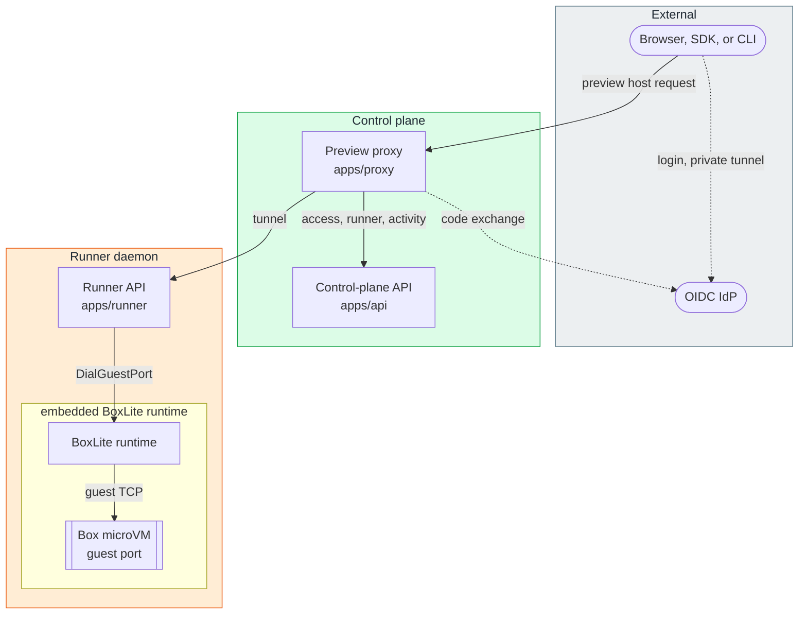

## TL;DR

The proxy authorizes box access through the control plane and tunnels traffic through the box's runner.

# BoxLite preview proxy

`apps/proxy` is the Go service behind `https://<port>-<box>.proxy.<domain>`. It checks with the
control-plane API that the caller may reach the box, then forwards the request to that port inside
the box through the box's runner. GCP runs two replicas on GKE Autopilot; AWS uses ECS Fargate.
Both expose port 4000 behind a load balancer that terminates public TLS.
See [infrastructure networking](../infra/docs/networking.md) and [architecture](../infra/docs/architecture.md).

- Routes: [`apps/API.md`](../API.md#preview-proxy-api)
- Place in the platform: [`apps/README.md`](../README.md)

## Architecture



The proxy asks the API whether the box has inbound access enabled and whether the requested guest
port has an active tunnel and the caller meets its access policy. It resolves the box's runner and records activity before forwarding.

## Preview hosts

The first label of the host is `<port>-<id>`, where `<id>` takes one of two forms:

| `<id>`     | Meaning                                                           | Minted by                                                                    |
| ---------- | ----------------------------------------------------------------- | ---------------------------------------------------------------------------- |
| `d-<hex>`  | Hex-encoded box ID: box IDs are mixed-case, and hostnames are not | `getNetworkTunnelUrl` in [`box.service.ts`](../api/src/box/services/box.service.ts) |
| `<box ID>` | Raw box ID, still accepted from URLs minted before the encoding   | nothing current                                                              |

A host without a `<port>-` label serves only the utility routes listed in
[`apps/API.md`](../API.md#preview-proxy-api).

## Request paths

| Request                          | Upstream                                                      | Access rule                              |
| -------------------------------- | ------------------------------------------------------------- | ---------------------------------------- |
| HTTP or WebSocket to a guest port | Reverse proxy over a runner CONNECT tunnel to the guest port  | Inbound enabled and active tunnel declaration |
| Raw `CONNECT` to a guest port    | TCP tunnel through the runner                                 | Inbound enabled and active tunnel declaration |

The HTTP path in code:

```text
  StartProxy (— · apps/proxy/pkg/proxy/proxy.go:78) — registers the catch-all route for preview hosts
    └─ NewProxyRequestHandler (— · apps/libs/common-go/pkg/proxy/proxy.go:116) — reverse proxy for one request
      ├─ GetProxyTarget (Proxy · apps/proxy/pkg/proxy/get_box_target.go:49) — choose the upstream
        ├─ parseHost (Proxy · apps/proxy/pkg/proxy/get_box_target.go:311) — canonical port plus box ID
        ├─ getBoxInboundEnabled (Proxy · apps/proxy/pkg/proxy/get_box_target.go:224) — ask the API for the inbound mode, cached 3 s
        ├─ authorizeTunnel (Proxy · apps/proxy/pkg/proxy/tunnel_auth.go:140) — check active declaration, credentials and cookie scope before any guest dial
        └─ updateLastActivity (Proxy · apps/proxy/pkg/proxy/get_box_target.go:382) — renew activity every 50 s
      └─ dialGuestPort (Proxy · apps/proxy/pkg/proxy/get_box_target.go:140) — dial each new upstream connection
        └─ dialGuestPortWithWake (Proxy · apps/proxy/pkg/proxy/guest_wake.go:52) — dial, waking a stopped box
          ├─ getBoxRunnerInfo (Proxy · apps/proxy/pkg/proxy/get_box_target.go:182) — runner URL and key, cached 2 min
          ├─ dialRunnerTunnel (— · apps/proxy/pkg/proxy/tunnel.go:113) — CONNECT through the runner to the guest port
          ├─ wakeBox (Proxy · apps/proxy/pkg/proxy/guest_wake.go:174) — POST ensure-ready to the API, once per box
          └─ waitForGuestPort (Proxy · apps/proxy/pkg/proxy/guest_wake.go:125) — poll the woken port, once per port
```

The upstream URL `http://<box ID>:<port>` is only a routing key. `dialGuestPort` is the transport's
`DialContext`: it resolves the box's runner and returns a tunneled connection, so HTTP connection
pooling reuses tunnels per box and port. Raw `CONNECT` requests skip this router and go to
`handleTunnelConnect` in [`tunnel.go`](pkg/proxy/tunnel.go), which dials through the same
`dialGuestPortWithWake`.

Every HTTP/WebSocket request and CONNECT checks `POST /api/preview/{boxId}/tunnels/{port}/access`.
It requires an active declaration, inbound enabled, and a box outside destroying/archiving states.
The endpoint returns only the tunnel ID, box, port, mode and authorization generation; it never
returns token hashes. Token verification happens in the API. The proxy does not cache grants;
the API caches each `boxId:port` lookup in Redis for three seconds, keyed without any token.
The legacy public-only GET endpoint remains for rolling upgrades and never admits private tunnels.
Prepare and revoke evict that entry, so revocation blocks the next request; inbound and box-state
changes take effect within the three-second window. Already-open streams continue until they close. A failed access check never records activity or wakes the box.

## Waking a stopped box

A request to a declared port on a stopped box wakes it. The aim is that the first request succeeds
when the box and its service come up within 30 seconds
([`guest_wake.go`](pkg/proxy/guest_wake.go)):

1. The proxy dials first, so a running box costs no extra API call. A failed dial to a running
   box returns at once, so a port that nothing serves is still a `502`.
2. The runner refuses a box that is not running with `409` and code `box_not_running`. It does
   not boot the box itself, so the API stays the only path that starts one. A box paused for a
   snapshot is refused the same way until it thaws.
3. The proxy calls `POST /api/preview/{boxId}/ensure-ready`. The API takes the same steps as SDK
   auto-resume: it refuses a box with auto-resume off, refuses a box in a state that cannot
   resume (such as archived or resizing), records activity, checks that the organization is not
   suspended, and starts the box under its state-change lock. A box the API records as started and
   meant to stay started, such as one paused for a snapshot, is never refused, whatever its
   auto-resume setting, so the proxy keeps polling until it thaws. Concurrent requests for one box share one call per proxy
   replica, and the API lock turns the calls from all replicas into one start.
4. A resumed box replays its `cmd`, so its service listens a few seconds after the box starts.
   The box's network acks a tunnel only once the guest accepts it, so the runner answers `502`
   until then. The proxy polls the dial every 500 ms, and concurrent requests for one port share
   that poll. The poll closes the connection it gets, then each request dials its own. A request
   that arrives during this window gets `502` on its first dial, not `box_not_running`, so it
   joins the wake in progress for that box rather than failing. The wake lasts as long as the
   shared poll, so it stays joinable even after the request that started it hangs up.
5. The request is served once its dial succeeds. If 30 seconds pass first, the client gets `503`
   with `Retry-After: 3` and code `BOX_STARTING`, and the start keeps going.

Only a port that passed the tunnel check reaches this path, so an undeclared port never wakes a
box.

## Authentication

Inbound disabled rejects every caller with 403. An undeclared or revoked port returns 404.
Public tunnels need no credential. Any access token or `X-BoxLite-Authorization` sent to a public
tunnel is stripped without being checked, so even an invalid or repeated one still gets through.
Private tunnels use these sources:

1. `X-BoxLite-Authorization: Bearer <API key or JWT>` for SDK/CLI CONNECT and explicit platform auth.
2. `X-BoxLite-Access-Token` or the `boxlite-access-token` query parameter for external visitors.
3. A valid `__Host-boxlite-tunnel-session` cookie.
4. `Authorization: Bearer ...` as a compatibility fallback when no token or valid platform session
   exists. Otherwise the application's own Authorization header is preserved.

An explicitly supplied invalid platform credential fails; it cannot fall back to a cookie.
Reaching a tunnel needs only membership in the box's organization: API keys must belong to that
organization, with any permissions, and JWT users must be members. Creating or revoking a tunnel
needs `write:boxes`. Accepted credentials, including membership, are revalidated for every request
without a positive cache, so a removed member loses access on the next request. Rejection-cache
keys contain a credential hash, never its plaintext.

The signed session binds tunnel ID, box ID, port, authorization generation, authentication kind,
issue time and expiry. It lasts one hour and is renewed on an authorized HTTP response in its last
fifteen minutes. User sessions recheck membership before renewal and access.
It is host-only (`Secure; HttpOnly; Path=/; SameSite=Lax`, no Domain), including behind TLS termination.
Browser sessions need an HTTPS browser-facing scheme (`PROXY_PROTOCOL=https`). Over plain HTTP the
browser drops the cookie: the token URL authorizes only that document request, so its scripts,
styles, fetches and in-app links fail with 401. SDK/CLI CONNECT and the token header work over
either scheme. Revoke/recreate changes the generation, invalidating old
sessions. Existing legacy cookies expire naturally and cannot authorize a new private tunnel.

The browser keeps a token URL. Before tracing and guest forwarding, the proxy removes the token
query/header and a Referer containing it; private responses use no-store and no-referrer.
All platform cookies, including other boxes' legacy cookies, are removed before reaching the guest.
Guest Set-Cookie values using reserved platform names are discarded; application cookies remain.
Cookie-authenticated cross-origin fetches, writes and WebSocket upgrades are rejected.
Without an `Origin`, a cookie request passes only as a top-level `GET`/`HEAD` document
navigation, with `Sec-Fetch-Site` of `same-origin` or `none`, or with no Fetch Metadata at all.
Safe top-level navigation remains allowed, including the OIDC return redirect.

A long-lived WebSocket has no HTTP responses on which to renew a cookie. It remains connected after
cookie expiry. An idle page also cannot renew silently without a request; reloading its retained
token URL creates a new session. Tokenless background requests after expiry receive 401.

HTML navigation without credentials can sign in with OIDC. The target sets a host-only browser
nonce and sends signed state to `/login` on the base host. That host keeps its own host-only PKCE
cookie, verifies state at `/callback`, and checks organization access. A 30-second, single-use
handoff ticket (stored under its SHA-256 hash in the API's Redis) then returns to the target host.
Only the matching browser and target can exchange it for the tunnel cookie. No parent-domain
platform cookie is issued; neither the JWT nor the persistent tunnel token appears in the handoff.

## Rollout

Apply the additive migration, upgrade **all API replicas**, then the proxies, then SDK/CLI clients.
No switch gates private creation once the API advertises `private_tunnels_enabled`, so create
private tunnels only after all proxies have upgraded. Older proxies use the public-only
endpoint and reject private tunnels. Before every private prepare, new SDKs fetch `GET /v1/config`
live and require `capabilities.private_tunnels_enabled`; an older API omits it, so the client refuses
before its POST handler, which ignores `isPublic`, could publish the port. The check and the POST
may reach different replicas, so do not expose mixed old/new API replicas to private creation. Configure edge/load-balancer logging to redact the token query too; proxy-side sanitization
cannot change logs already written by the edge.

## Failure responses

| Situation                                                  | HTTP or WebSocket                                                   | `CONNECT`                    |
| ---------------------------------------------------------- | ------------------------------------------------------------------- | ---------------------------- |
| Inbound is disabled                                        | `403`, whatever the credential                                      | `403`, whatever the credential |
| Inbound is enabled but the port has no active declaration  | `404`                                     | `404` |
| A private tunnel gets no credential                        | `302` to OIDC login for HTML navigation when OIDC is configured; otherwise `401` | `401` |
| A private tunnel gets an invalid token or platform credential, or a session from another generation | `401` | `401` |
| A private tunnel gets ambiguous or malformed token parameters | `400`                                                            | `400`                        |
| A cookie-authenticated cross-origin fetch, write or WebSocket upgrade | `403`                                                    | Not applicable               |
| The tunnel access API is unavailable                       | `502`                                     | `502` |
| The host has no `<port>-<id>` label                        | `404`, except the utility routes                                    | `400`                        |
| The API still fails the visibility check after its retries | `400`                                                               | `502`                        |
| A woken box, or its service, is not up after 30 s           | `503`, `Retry-After: 3`, code `BOX_STARTING`              | `503`, `Retry-After: 3`      |
| The box is stopped and auto-resume is off                  | `503`, code `BOX_STOPPED`                                           | `503`                        |
| The organization is suspended, or the box is in error, archived or resizing | `409`, code `BOX_UNAVAILABLE`                      | `409`                        |
| The runner, or a running box's port, is unreachable        | `502`, code `BAD_GATEWAY`                                           | `502`                        |

Guest-dial failures on the HTTP path return the JSON error body that the proxy's other errors use.
Access failures happen before the proxy wakes the box or records activity.

## Box activity

Each proxied request and each CONNECT tunnel reports activity to the API at once and then every
50 seconds until the connection closes, so an idle policy does not stop a box that is in use. A
per-box cache drops reports made within the previous 45 seconds.

## Caches

| Cache                     | Key                 | TTL   |
| ------------------------- | ------------------- | ----- |
| Box inbound mode          | box ID              | 3 s   |
| Runner URL and API key    | box ID              | 2 min |
| Rejected credential       | box ID + credential hash | 2 min |
| Activity already reported | box ID              | 45 s  |

The caches live in Redis when `REDIS_HOST` is set, as in the local stack
([`native.py`](../infra-local/compose/native.py)). Otherwise each process keeps its own caches in
memory. Neither deploy stack in `apps/infra` gives the proxy `REDIS_*` settings, so a hosted proxy
caches in memory unless its stage adds them.

## Other behavior

- **CORS** permits explicit-credential requests; private cookie authentication additionally requires the exact tunnel origin. A request carrying `X-BoxLite-Disable-CORS: true`
  leaves CORS to the app in the box.
- **Preview warning**: with `PREVIEW_WARNING_ENABLED`, browsers see an interstitial page until they
  accept it, which sets a cookie for 1 day. Non-browser clients, WebSockets, and requests
  carrying `X-BoxLite-Skip-Preview-Warning: true` skip it. An access token does not skip it, since
  public tunnels ignore tokens; the page posts the return URL, token included, in its form body,
  and accepting returns the browser to that token URL. The return URL uses the `PROXY_PROTOCOL`
  scheme, so behind a TLS-terminating load balancer (`ENABLE_TLS` unset) it stays `https`.
- **Shutdown** waits up to `SHUTDOWN_TIMEOUT_SEC` (default 1 hour) for open requests and tunnels. A
  second signal forces the exit.
- **Tracing** stamps `boxlite.box_id` on the span of each proxied HTTP request. CONNECT tunnels
  bypass the router and have no span.

## Calls to other services

The preview host format and the reserved paths are the proxy's public contract. Everything below
is internal and changes together with the API and the runner.

| Service | Call                                                                                                     | Credential                                              |
| ------- | -------------------------------------------------------------------------------------------------------- | ------------------------------------------------------- |
| API     | `GET /api/config` at startup, for unset OIDC settings                                                    | `PROXY_API_KEY`                                         |
| API     | `GET /api/preview/{boxId}/inbound`, `POST /api/preview/{boxId}/tunnels/{port}/access`                                                    | `PROXY_API_KEY`                                         |
| API     | `GET /api/preview/{boxId}/access`                                                                        | The caller's bearer token                               |
| API     | `GET /api/runners/by-box/{boxId}`, `POST /api/box/{boxId}/last-activity`                                 | `PROXY_API_KEY`                                         |
| API     | `POST /api/preview/{boxId}/ensure-ready`, when the runner reports the box is not running                 | `PROXY_API_KEY`                                         |
| Runner  | `CONNECT /v1/boxes/{boxId}/network/tunnel?port={port}`                                                   | The runner's key from `by-box`, in `X-BoxLite-Authorization` |

## Configuration

Settings come from the environment. `.env`, then `.env.local`, then `.env.production` in the
working directory override it, but loading stops at the first file that is missing
([`config.go`](cmd/proxy/config/config.go)).

| Variable                                                                         | Purpose                                                                                 |
| -------------------------------------------------------------------------------- | --------------------------------------------------------------------------------------- |
| `PROXY_PORT`                                                                     | Listen port (required)                                                                  |
| `PROXY_PROTOCOL`                                                                 | `http` or `https`, for redirects and `X-Forwarded-Proto` (required)                     |
| `PROXY_API_KEY`                                                                  | Bearer key for API calls; fallback input to purpose-separated session signing (required)                          |
| `BOXLITE_API_URL`                                                                | Control-plane API base URL, ending in `/api` (required)                                 |
| `OIDC_CLIENT_ID`, `OIDC_CLIENT_SECRET`, `OIDC_DOMAIN`, `OIDC_PUBLIC_DOMAIN`, `OIDC_AUDIENCE` | Login for private tunnels; an unset client ID, domain, or audience comes from the API's `/config` at startup |
| `TUNNEL_COOKIE_KEY` | Optional independent cookie-signing secret, shared by all proxy replicas; rotating it invalidates browser sessions |
| `COOKIE_DOMAIN`                                                                  | Legacy setting; platform session and login cookies are always host-only                                            |
| `ENABLE_TLS`, `TLS_CERT_FILE`, `TLS_KEY_FILE`                                    | Serve TLS directly; platform auth cookies are always `Secure`                       |
| `REDIS_HOST` and the other `REDIS_*` settings                                    | Shared caches                                                                           |
| `PREVIEW_WARNING_ENABLED`                                                        | Browser warning page                                                                    |
| `SHUTDOWN_TIMEOUT_SEC`                                                           | Drain limit                                                                             |
| `OTEL_LOGGING_ENABLED`, `OTEL_TRACING_ENABLED`, `OTEL_EXPORTER_OTLP_ENDPOINT`, `OTEL_EXPORTER_OTLP_HEADERS`, `ENVIRONMENT` | Telemetry                                          |

## Build and test

```bash
make test:apps:proxy
make fmt:apps:proxy
```

From `apps/`, the Nx project `proxy` wraps the same commands in its `build`, `serve`, `test`, and
`lint` targets ([`project.json`](project.json)). `make build:apps` and `make test:apps` cover the
whole apps workspace, this service included. `make up` in [`apps/infra-local`](../infra-local/)
runs the proxy on port 4000 with the rest of the local stack.

## Related code

- [`cmd/proxy/main.go`](cmd/proxy/main.go): startup, telemetry, and signal handling
- [`pkg/proxy/proxy.go`](pkg/proxy/proxy.go): router, middleware, caches, and the CONNECT split
- [`pkg/proxy/get_box_target.go`](pkg/proxy/get_box_target.go): host parsing, upstream choice, API
  lookups, and activity
- [`pkg/proxy/tunnel_auth.go`](pkg/proxy/tunnel_auth.go), [`pkg/proxy/tunnel_login.go`](pkg/proxy/tunnel_login.go):
  credentials, session isolation and OIDC login
- [`pkg/proxy/tunnel.go`](pkg/proxy/tunnel.go): CONNECT tunnels to the runner
- [`pkg/proxy/guest_wake.go`](pkg/proxy/guest_wake.go): waking a stopped box and retrying the guest dial
- [`pkg/proxy/warning_page.go`](pkg/proxy/warning_page.go): preview warning page
- [`../libs/common-go/pkg/proxy/`](../libs/common-go/pkg/proxy/): shared reverse proxy and stream relay
- Runner side: [`network_tunnel.go`](../runner/pkg/api/controllers/network_tunnel.go) and
  [`guest_port_tunnel.go`](../runner/pkg/boxlite/guest_port_tunnel.go)
