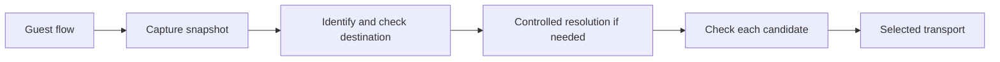

# Outbound connection and replacement contract

This is the shared implementation contract for destination policy, upstream transport, and complete outbound replacement.
It does not advertise proxy, deny-rule, IPv6, or revision support before the corresponding backend implements and reports that capability.
The [design](../investigations/2026-11-16-egress-foundation.md) records the rationale; [shared examples](../../../tests/fixtures/outbound/contract-v1.json) supply inputs for each implementation layer.

## Connection ownership

Capture one immutable policy and route snapshot when a new guest flow enters the forwarding boundary, before resolution or dialing.
All setup attempts and upstream sockets belonging to that flow use the captured snapshot.
Publishing a replacement changes later flows; it does not switch an established flow to another policy or transport.

Disabling outbound networking continues to suspend the guest NIC rather than promising to terminate every established connection.



Policy decides whether the real destination is permitted; transport decides how an approved destination is reached.
The proxy endpoint is not the business destination and cannot substitute for it in policy checks.

| Connection value | Meaning and owner |
| --- | --- |
| Original hostname | Canonical observed or authorized name, when available; retained for SNI, HTTP Host, and certificate verification. |
| Policy address | Guest destination before NAT; address rules must see this value. |
| Approved candidate | Literal IP that passed candidate checks; a connector must not resolve the business hostname again. |
| Connection address | Literal socket destination after the applicable NAT mapping; distinct from the policy address. |
| Port and protocol | Actual business destination port and transport protocol, independent of an upstream proxy's listening port. |
| Policy revision | Identity of the captured complete policy, when the revision protocol is supported. |
| Registration revision | Separate identity of the selected proxy registration, when proxy routing is supported; never a credential. |

Ordinary TCP, hostname-inspected TCP, and secrets MITM must use the same selected transport after their applicable checks.
Reuse the existing `resolveFunc`, `dialFunc`, `upstreamDial`, and `egressDialer` seams.
Retries check candidates individually and share one bounded setup deadline; cancellation releases unfinished setup resources.

Transport failure does not select a different route implicitly.

The local host alias keeps its existing direct NAT behavior.
A future remote transport must reject that alias unless it defines an explicit safe mapping; translated loopback is not the proxy server's equivalent destination.

### TCP transport implementation

The bridge's `egressTarget` carries the observed hostname, pre-NAT policy IP, approved connection IP, actual port, and protocol.
Ordinary TCP binds `egressDialer.byAddress`; inspected traffic binds either `byAddress` or `byName`, and MITM retains that bound dialer for its upstream connections.
The selected `connectFunc` receives this target after the applicable checks.
Its error is returned without selecting the direct socket dialer; an unset connector selects the existing direct transport.
Configure resolver and transport seams before installing the forwarder.

Initial unrestricted TCP also installs this boundary; initial unrestricted UDP retains its upstream handler.
Address setup and controlled hostname resolution each use a bounded setup context, including candidate retries and MITM redials.
The typed connector does not implement proxy registration or a proxy protocol, and this step does not implement revisioned snapshot publication.

The guest-stack transport tests consume the shared NAT and hostname examples, relay HTTP/TLS bytes to test-owned listeners, and verify refused targets never enter the connector.
The MITM test uses an isolated test CA in a subprocess so production certificate verification remains active; a wrong upstream certificate must receive no HTTP request.
For HTTP/2 fixture concurrency, one explicit `http2.ClientConn` owns the guest TLS pipe; separate transport pool dials must not return the same physical connection.

## Configuration boundary

The current policy shape is `{ "mode": "enabled" | "disabled", "allow_net": [...] }`.
An omitted `allow_net` has the existing empty-list meaning; disabled mode rejects a nonempty allowlist.
This foundation preserves the current rule grammar and does not increase rule limits or enable IPv6 forwarding.

Configuration contains user policy only.
Revisions, application status, platform constraints, and proxy authentication material belong outside the public policy object.
The future public proxy reference belongs at `network.outbound.proxy`; a Box selects at most one registration.
Proxy credentials use a separate host-only channel and do not enter Guest configuration, ordinary Box options, or exports.

| Replacement input | Required behavior |
| --- | --- |
| Current mode/allowlist request without a precondition | Preserve its unconditional public operation; serialize the internal replacement under the existing lock. |
| Versioned request | Require backend revision support and an internal expected revision; reject unsupported peers before claiming success. |
| Unsupported deny, proxy, or IPv6 input | Reject before application; parsing or retaining a field is not capability delivery. |
| Omitted future protection while it is active | Reject the incomplete replacement rather than clearing the protection. |
| Explicit empty deny list | Clears user denies once that feature is supported; does not clear platform constraints. |
| Explicit null proxy | Clears the user binding once supported; does not bypass destination policy. |

Future disabled configurations may retain supported deny or proxy settings, but those settings cannot enable traffic.
Their omission and clearing rules remain effective while the NIC is disabled.

## Revisions and acknowledgements

A revision is an opaque, Box-scoped token; clients compare for equality rather than ordering tokens or interpreting timestamps.
Existing records receive a documented initial token when revision support is introduced.
Each successful change receives a fresh token, including restoration after a failed persistence attempt.

One trusted coordinator creates the candidate token once and propagates it unchanged through API, Runner, Runtime, and gvproxy.
The complete snapshot includes normalized policy and the selected route identity, including a registration revision when applicable.
Internal metadata does not become an extra field accepted by strict policy decoders.

| Boundary | Contract |
| --- | --- |
| Public policy read | Return the existing policy shape and a strong ETag identifying its persisted revision. |
| Conditional public replacement | Evaluate `If-Match` under the update lock; a false precondition returns 412 before applying the candidate. |
| Internal replacement | Compare the expected current revision under the existing ownership lock, then apply the complete candidate snapshot. |
| Applied acknowledgement | Identify the exact installed candidate; missing, malformed, stale, or mismatched identity is not success. |
| Live status | Distinguish persisted revision, observed applied revision when available, and an explicit application state. |
| Old backend | Reject version-aware operations explicitly rather than silently discarding metadata or using unchecked replacement. |

Expose application metadata through a separate outbound status resource.
A stored policy or a successful HTTP status alone does not prove that the matching snapshot is live.
Confirmed application describes the control-plane snapshot; it is not an Internet-connectivity probe.

Example: connection A captures `rev-a`, which permits `api.example.com` through direct transport.
A conditional replacement installs `rev-b`, which permits only `updates.example.com`.
Later `api.example.com` connections are rejected before dialing, while A retains its original snapshot.

An update carrying stale `If-Match: "rev-a"` receives 412 without application.

## Application and recovery

Reuse the current Box update lock, Runtime persistence operation, and Cloud row-lock transaction.
All complete replacements, including future proxy rotation, share this ownership boundary.
Validate and compile the entire candidate before publishing it for new flows.

Install stable TCP and UDP entry points before guest traffic starts, with one shared snapshot reference.
Enabled-to-enabled replacement publishes that reference once; delayed setup, retries, and MITM upstream sockets retain their flow's captured snapshot.

Disabled mode rejects new flows independently of the empty allowlist.
A mode gate before IP endpoint demultiplexing also covers registered services such as DNS, which bypass default transport handlers.
This gate uses the same snapshot and leaves enabled-mode DNS behavior unchanged.
Packets arriving under disabled mode cannot start new DNS forwarding; work accepted before publication retains established-work semantics.

To disable, publish the disabled snapshot before suspending the NIC, then acknowledge only after suspension succeeds.
To enable, retain the disabled snapshot until NIC enabling succeeds, then publish the enabled candidate.
Mark application pending before publication or a mode transition.
On a failed mode transition, retain the disabled gate and report uncertainty; do not confirm the candidate or a stale previous revision.
Compilation failure before publication preserves the previous confirmed snapshot.

An acknowledgement timeout leaves the outcome uncertain because the candidate may already be live.
Perform bounded readback and distinguish the expected, candidate, and another revision; unresolved state remains explicit.
Observing the expected revision does not prove rejection while the original request can still apply later.

Keep uncertainty until completion or fencing is established; this contract does not require a new fencing API.

After confirmed application, persistence failure can trigger conditional compensation against the candidate revision.
Restoration uses a fresh token, so stale clients cannot succeed after a change-and-restore cycle.
Do not replay or compensate blindly after an ambiguous timeout.

If recovery cannot confirm both application and persistence, return failure and preserve readback diagnostics.

Database unavailability cannot support a durable-state claim; require readback after recovery.

The crash check stops the coordinator after a matching acknowledgement and before persistence.
Repeat with gvproxy surviving the coordinator, then with gvproxy restarting too.
Reconcile observed and persisted revisions or expose uncertainty; never label a stale stored revision as confirmed live state.

## Application and recovery timing

The coordinator marks application pending before publication or a NIC transition.
The following sequence expresses the application and recovery contract above; it is an implementation target.

```mermaid
sequenceDiagram
    participant C as Coordinator
    participant S as gvproxy snapshot
    participant N as Guest NIC
    participant D as Persistence
    Note over C,S: Complete candidate is validated and compiled
    C->>S: Mark application pending
    alt Disable
        C->>S: Publish disabled snapshot
        C->>N: Suspend NIC
    else Enable
        Note over S,N: Keep disabled snapshot during NIC enabling
        C->>N: Enable NIC
    else Enabled-to-enabled replacement
        C->>S: Publish candidate once
    end
    alt Mode transition fails
        Note over C,N: Retain disabled gate; report uncertainty without confirmation
    else Publication or transition succeeds
        opt Enabling
            C->>S: Publish enabled candidate after NIC enabling succeeds
        end
        alt Exact candidate application confirmed
            S-->>C: Acknowledgement or readback identifies exact installed candidate
            C->>D: Persist candidate
            alt Persistence succeeds
                Note over C,D: Application and persistence confirmed
            else Persistence fails
                C->>S: Conditional compensation against candidate with fresh token
                C->>D: Persist restoration if application confirmed
                Note over C,D: Unconfirmed restoration or persistence remains uncertain
            end
        else Application unresolved
            C->>S: Bounded readback after acknowledgement timeout
            S-->>C: Expected revision observed; application may still be running
            Note over C,S: Old-revision readback cannot prove rejection while request can still apply
            Note over C,S: Remain uncertain until request completion or fencing is established
            Note over C,D: Preserve uncertainty; no blind replay or compensation
        end
    end
```

## Shared examples and evidence

`tests/fixtures/outbound/contract-v1.json` separates current policy examples from versioned replacement and connection-boundary examples.
The versioned cases are implementation targets; the fixture file does not enable a backend capability.
Runtime, Runner, Cloud, and forwarding tests should consume the applicable cases through their real production boundaries.

| Boundary | Required evidence |
| --- | --- |
| Destination and transport | Allowed ordinary, hostname, and MITM flows reach the selected connector; rejected targets never reach it. |
| NAT and controlled DNS | Pre-NAT checks, approved literal dialing, candidate changes, cancellation, and setup budgets retain their contract. |
| Replacement | Stale writes and stale compensation lose under controlled interleavings. |
| Mode transitions | TCP/UDP and registered DNS stay gated during paused NIC transitions and after injected NIC failures; enabled controls still succeed. |
| Acknowledgement | Missing or mismatched acknowledgement cannot appear as confirmed success. |
| Recovery | Persistence errors, delayed application after old-revision readback, and the specified crash windows retain explicit uncertainty. |
| Compatibility | Existing mode/allowlist clients retain their documented behavior; unsupported extensions and old backends fail explicitly. |
