# Outbound connection and replacement contract

This is the shared implementation contract for destination policy, upstream transport, and complete outbound replacement.
It does not advertise proxy, deny-rule, IPv6, or revision support before the corresponding backend implements and reports that capability.
The [design](../investigations/2026-11-16-egress-foundation.md) records the rationale; [shared examples](../../../tests/fixtures/outbound/contract-v1.json) supply inputs for each implementation layer.

## Connection ownership

Capture one immutable policy and route snapshot when a new guest flow enters the forwarding boundary, before resolution or dialing.
All setup attempts and upstream sockets belonging to that flow use the captured snapshot.
Publishing a replacement changes later flows; it does not switch an established flow to another policy or transport.

Disabling outbound networking continues to suspend the guest NIC rather than promising to terminate every established connection.

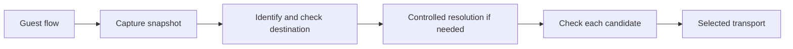

Policy decides whether the real destination is permitted; transport decides how an approved destination is reached.
The proxy endpoint is not the business destination and cannot substitute for it in policy checks.

| Connection value | Meaning and owner |
| --- | --- |
| Original hostname | Canonical observed or authorized name, when available; retained for SNI, HTTP Host, and certificate verification. |
| Policy address | Guest destination before NAT; address rules must see this value. |
| Approved candidate | Literal IP that passed candidate checks; a connector must not resolve the business hostname again. |
| Connection address | Literal socket destination after the applicable NAT mapping; distinct from the policy address. |
| Port and protocol | Actual business destination port and transport protocol, independent of an upstream proxy's listening port. |
| Policy revision | Identity of the captured complete policy, when the revision protocol is supported. |
| Registration revision | Separate identity of the selected proxy registration, when proxy routing is supported; never a credential. |

Ordinary TCP, hostname-inspected TCP, and secrets MITM must use the same selected transport after their applicable checks.
Reuse the existing `resolveFunc`, `dialFunc`, `upstreamDial`, and `egressDialer` seams.
Retries check candidates individually and share one bounded setup deadline; cancellation releases unfinished setup resources.

Transport failure does not select a different route implicitly.

Local host alias connections use direct NAT when Box and host rules permit them.
The Cloud platform guard denies connections to the alias.
A future remote transport must reject that alias unless it defines an explicit safe mapping; translated loopback is not the proxy server's equivalent destination.

### TCP transport implementation

The bridge's `egressTarget` carries the observed hostname, pre-NAT policy IP, approved connection IP, actual port, and protocol.
Ordinary TCP binds `egressDialer.byAddress`; inspected traffic binds either `byAddress` or `byName`, and MITM retains that bound dialer for its upstream connections.
The selected `connectFunc` receives this target after the applicable checks.
Its error is returned without selecting the direct socket dialer; an unset connector selects the existing direct transport.
Configure resolver and transport seams before installing the forwarder.

TCP uses this boundary even with an empty Box allowlist. UDP uses checked
admission when extended rules, host-protected ranges, or the Cloud guard apply.
Other legacy UDP delegates to the upstream forwarder after the Box policy check.

Address setup and controlled hostname resolution each use a bounded setup context, including candidate retries and MITM redials.
The connector carries the captured policy revision; revisioned publication uses the control resources below.

The guest-stack transport tests consume the shared NAT and hostname examples, relay HTTP/TLS bytes to test-owned listeners, and verify refused targets never enter the connector.
The MITM test uses an isolated test CA in a subprocess so production certificate verification remains active; a wrong upstream certificate must receive no HTTP request.
For HTTP/2 fixture concurrency, `http2.Transport` owns connection pooling and stream sharing; each pool dial owns a fresh guest/proxy TLS pipe.

## Configuration boundary

The current policy shape is `{ "mode": "enabled" | "disabled", "allow_net": [...] }`.
An omitted `allow_net` supplies an empty Box allowlist. Host protection
still applies, and disabled mode rejects a nonempty allowlist.

This foundation preserves the current rule grammar and does not increase rule limits or enable IPv6 forwarding.

Configuration contains user policy only.
Revisions, application status, platform constraints, and proxy authentication material belong outside the public policy object.
The future public proxy reference belongs at `network.outbound.proxy`; a Box selects at most one registration.
Proxy credentials use a separate host-only channel and do not enter Guest configuration, ordinary Box options, or exports.

| Replacement input | Required behavior |
| --- | --- |
| Current mode/allowlist request without a precondition | Preserve its unconditional public operation; serialize the internal replacement under the existing lock. |
| Versioned request | Require backend revision support and an internal expected revision; reject unsupported peers before claiming success. |
| Unsupported deny, proxy, or IPv6 input | Reject before application; parsing or retaining a field is not capability delivery. |
| Omitted future protection while it is active | Reject the incomplete replacement rather than clearing the protection. |
| Explicit empty deny list | Clears user denies once that feature is supported; does not clear platform constraints. |
| Explicit null proxy | Clears the user binding once supported; does not bypass destination policy. |

Future disabled configurations may retain supported deny or proxy settings, but those settings cannot enable traffic.
Their omission and clearing rules remain effective while the NIC is disabled.

## Extended destination rules

The extended rule policy defines `allow_net` and `deny_net` for backends that support them.
Each list accepts up to 64 entries, counted before normalization or deduplication.
Reject the entire policy if any entry is invalid.

Create and replace use the same rule grammar.
The shared fixtures specify parser, matcher, and request outcomes.
[Extended rule fixtures](../../../tests/fixtures/outbound/policy-rules-v1.json) · [Design and rationale](https://github.com/boxlite-ai/boxlite/issues/2831)

### Rule syntax

| Destination | Any port | One port |
| --- | --- | --- |
| Hostname or wildcard | `api.example.com`, `*.example.com` | `api.example.com:443`, `*.example.com:443` |
| IPv4 address or prefix | `192.0.2.8`, `192.0.2.0/24` | `192.0.2.8:443`, `192.0.2.0/24:443` |
| IPv6 address or prefix | `2001:db8::8`, `2001:db8::/32` | `[2001:db8::8]:443`, `[2001:db8::/32]:443` |

- Trim surrounding whitespace. Reject blank entries, internal whitespace, commas, inline `!` markers, and URLs.
- Hostname labels use 1–63 ASCII letters, digits, or hyphens with alphanumeric endpoints. A hostname is at most 253 bytes, excluding a leading `*.`.
- Rule hostnames omit the root dot. Lowercase both names before comparing and strip one root dot from the observed name. A wildcard matches one or more subdomain labels, excluding its apex.
- Parse addresses and prefix lengths strictly. Reject malformed dotted IPv4, IPv6 zones, and invalid prefix lengths. Mask CIDRs to their network.
- Split the port before classifying four nonempty decimal labels as IPv4. Reject an overlong or out-of-range octet, a leading zero, or a wildcard on that numeric suffix.
- Parse a bare IPv6 address or prefix in full. An IPv6 rule with an explicit port requires brackets. Each explicit port consists of decimal digits in the range 1–65535.
- Convert mapped IPv6 addresses and mapped prefixes of length 96–128 to IPv4 before matching. Reject shorter prefixes written with mapped literals. Native IPv6 prefixes match native IPv6 addresses.

Reject `192.0.2.999:443`, `192.0.02.8`, `192.0.2.1024`, and `*.192.0.2.8`.
`192.0.2.8:443` is an IPv4 rule and `192.api.example:443` is a hostname rule.

### Decision order

Evaluate external destinations against one captured snapshot.

| First applicable condition | Outcome |
| --- | --- |
| Outbound mode is disabled | Deny. |
| Trusted platform policy denies the destination | Deny. |
| A user deny rule matches | Deny. |
| A hostname deny applies to this port and the name is unavailable | Deny. |
| A user allow rule matches, or the existing HTTPS secrets permission applies | Allow subject to applicable candidate checks. |
| The allow list is empty | Allow subject to applicable candidate checks. |
| No rule grants permission | Deny. |

Use the actual transport destination port even when the HTTP Host header includes a port.

Address rules use the pre-NAT policy address for guest-addressed flows.
Check each candidate for platform and user address denies using its own address and the actual destination port.
A candidate matching user deny never reaches the connector, even when the guest address and observed name both match allow.

Skip denied DNS candidates. Try approved candidates in resolver order within the shared deadline.
If every candidate is denied, fail with zero connector calls.

With `192.0.2.0/24:443` denied, answers `192.0.2.8` and `203.0.113.8` call the connector only for `203.0.113.8:443`.
Answers `192.0.2.8` and `192.0.2.9` call it zero times.

After deny checks, route secrets by checked name first, then IP allow by address, then hostname allow by checked name, then empty allow by address.
For example, an allow for `api.example.com:443` can authorize the name while a deny for `192.0.2.0/24` filters a candidate at `192.0.2.8`.

When a hostname rule affects the decision, identify TLS ClientHello SNI or the first plaintext HTTP Host on any TCP port.
Bound inspection to 16 KiB and the 30-second setup budget, with at most ten simultaneous inspections per Box.

Close excess flows before dialing. Release the slot on completion or failure.
An invalid, conflicting, or hidden name, or expiration of the inspection budget, makes the name unavailable.

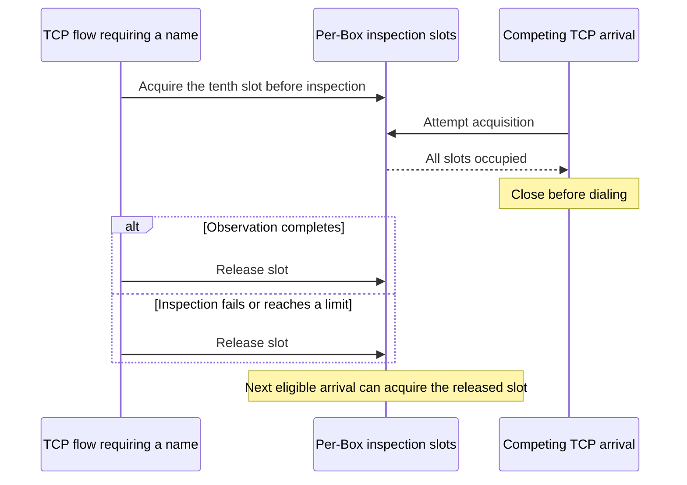

Name policy covers connection establishment using the first verified TLS SNI or plaintext HTTP Host and its required address association.
Filtering per request, URL path, later Host, or encrypted identity falls outside this boundary.

UDP and QUIC have no supported name observation.

| Address allow matches and name is unavailable | TCP | UDP and QUIC |
| --- | --- | --- |
| Additional hostname allow | Allow by address | Allow by address |
| Hostname deny covers the actual port | Deny | Deny |
| Hostname deny covers a different port | Allow by address | Allow by address |

The table assumes that mode, platform, and address deny checks passed. A hostname rule with no port covers all ports.

An applicable hostname deny requires a usable name even when the flow is otherwise allowed by its address or an empty allow list.
For a guest-addressed flow, controlled resolution must include the external business IP that the connector will dial.
An observed name without that association cannot rule out a hostname deny.

In the extended policy, direct and resolved targets both run mandatory address checks after unmapping IPv4-mapped IPv6.
Link-local, unspecified, IPv4 0/8, multicast, IPv4 limited broadcast, and trusted platform-denied addresses are refused.
Name-resolved candidates also exclude the Box subnet.

The Cloud guard denies loopback, private and CGNAT IPv4 destinations and native
IPv6 egress. On Local, direct IPv4 access to those ranges follows Box and host
rules. With a nonempty Box allowlist, a resolved candidate in those ranges
requires a matching IP rule for its address and port.

User address rules evaluate the pre-NAT target.
Platform policy also checks the translated dial destination, so the Cloud
guard denies translated loopback even when the pre-NAT address passes.
The Local alias maps to host loopback when Box and host policy allow it.

Trusted UDP admission checks both addresses before endpoint creation and dials the exact approved literal.
See [Extended UDP enforcement](#extended-udp-enforcement).

Platform rollout validates deployment address sets and trusted exceptions.

Enabled mode exempts DNS on the registered gateway TCP/UDP 53 endpoints, DHCP on the registered UDP 67 endpoint, and required ARP/NDP link control.
Other traffic to the gateway or guest IP and forwarded host aliases follows the normal policy.

Disabled mode continues to block forwarding and registered DNS/DHCP delivery.
On guarded Cloud Runners, those services also stop when the guard expires.

### Creation and replacement

| Input | Required behavior |
| --- | --- |
| Image create omits `deny_net` | Start with an empty deny list. |
| Create with `checkpoint_id` | Inherit its complete saved policy. Keep existing restrictions on request overrides and reject a selected backend that cannot enforce the inherited policy. |
| Complete replacement omits `deny_net` | Reject if an effective or possibly active snapshot contains denies, including while disabled. Otherwise use an empty list. |
| Complete replacement supplies `deny_net: []` | Clear user denies. Platform constraints still apply. |
| `deny_net: null` | Reject invalid input. |
| Disabled mode supplies supported denies | Store the supplied denies and keep the NIC disabled. A nonempty allow list is invalid. |
| A valid request requires unsupported enforcement | Return unsupported. An explicitly supplied deny list requires support even when empty. |
| A supported replacement fails its revision precondition | Return 412 before applying the candidate. |

Under update ownership, a confirmed pending candidate becomes the effective policy before checking omission.
For unresolved attempts, check both committed and pending snapshots before normalizing the request.
An explicit replacement uses the existing revision and acknowledgement protocol to fence an older attempt.

Check backend support before reserving pending intent. Recheck support where the dedicated operation applies the snapshot.

Revision support identifies the replacement protocol. Require deny, port, and IPv6 policy enforcement separately when the policy uses them.

| A revision-capable peer lacks | Create | Complete replacement | Restart |
| --- | --- | --- | --- |
| Deny enforcement | Explicit member is unsupported before attach | Explicit member is unsupported before application | Nonempty effective deny is unsupported before attach |
| Destination-port enforcement | Unsupported before attach | Unsupported before application | Unsupported before attach |
| IPv6 policy enforcement | Unsupported before attach | Unsupported before application | Unsupported before attach |

Create and PUT require deny support whenever the request explicitly supplies the member, including `[]`.
Restart checks the reconciled, durably confirmed effective policy.

A peer without deny support can restart a Box with a confirmed empty deny list when it supports every other active rule.
This covers older records that omit deny and policies cleared by a confirmed operation.
Persist no historical presence marker.

Nonempty deny blocks unsupported attachment.
Unresolved active state cannot be treated as confirmed empty.
A refusal leaves committed policy intact.

A definitive refusal before application permits retiring that reservation under its ownership check.
A complete replacement can supersede an older attempt, but reservation alone does not fence it.

Omission checks see the older candidate's possible active denies until confirmation or an applied CAS fences it.
If the new candidate explicitly clears deny and the backend refuses it, retire only that reservation.
The older unresolved evidence remains durable across coordinator restart.

The guard also covers a backend-confirmed candidate whose durable commit failed.
Keep that candidate's denies visible during unresolved restoration, even if the restoration candidate contains no denies.
Matching the previously durable revision alone is insufficient.

Clear that evidence after confirmed restoration or durable reconciliation of the effective policy.
If reconciliation commits the deny, the committed list still blocks omission.

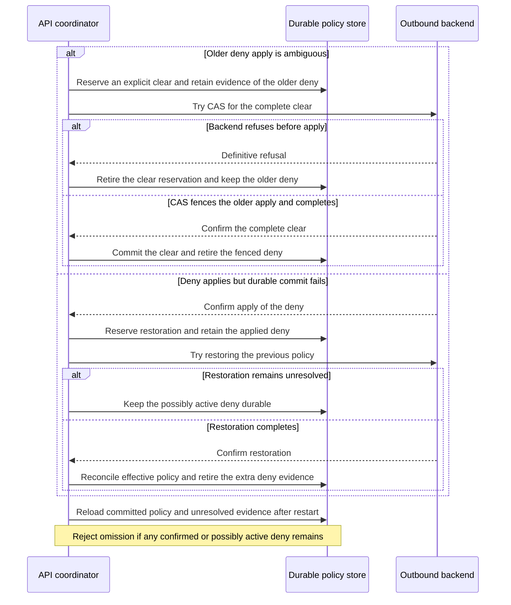

Ambiguous delivery retains pending evidence. Committed policy advances only after confirmed application of the complete candidate.

At create or restart, attach the guest NIC after the launched backend confirms full policy application. A refusal or uncertain startup leaves the guest unattached and preserves stored policy.

After rollout, nested create and outbound PUT accept up to 64 rules per list, including allow-only policies with 11 or 64 rules.
Deprecated flat create retains its 10-rule cap and grammar. An older receiver must decline an extended request before apply, including an allow-only policy above 10.

Nested create and PUT to an extended peer use the expanded grammar.
An old-peer PUT also requires the legacy peer grammar before dispatch.
It rejects malformed four-label numeric literals, including overlong octets, and numeric wildcard suffixes.

The deprecated flat-create API rejects `192.0.2.999`.
It can pass `192.0.2.1024` to the legacy bridge, which rejects the launch.
The mixed-label hostname `192.api.example` is valid on all paths without a port.

Public outbound PUT rejects blank allow entries with both capable and older peers. Legacy internal entry points retain their existing blank normalization.

Previously persisted legacy policies load with their effective allow lists and an empty deny list.
Every replacement obeys the omission check.

IPv4 admission excludes native IPv6 candidates and makes zero connector calls for an AAAA-only response.
Dual-stack admission binds the Guest address, gateway, and NIC to the installed revision. The forwarder considers native IPv6 targets after Guest readiness and applies platform rules to the original destination and the final literal.

Mapped addresses keep their IPv4 normalization. [Full dual-stack plan](https://github.com/boxlite-ai/boxlite/issues/2733)

### Go rule matching

`compileExtendedOutboundPolicy` validates both lists before returning an immutable policy.
The evaluator takes a pre-NAT target and platform facts for the same normalized address.
It returns a decision and selects a route after applying deny precedence.

An address allow can resolve a pending flow immediately when only a hostname allow could also match.
A possible secrets grant or a hostname deny for the actual port instead requests inspection.
The caller evaluates the completed observation against the same policy.

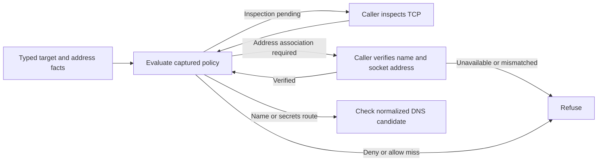

For example, a matching address allow and an applicable hostname deny require the observed name to resolve to the actual socket address.
An association for a different address leaves the decision denied.

`checkCandidate` evaluates one normalized DNS candidate and its classification.
For a restricted local candidate and nonempty allow list, the candidate needs an IP rule covering its actual port.
The caller selects the connector and enforces transport eligibility.

The shared rule fixtures exercise the compiler and matcher. Trusted TCP and UDP snapshots use the shared policy at guest flow setup.
[Design and handoff](https://github.com/boxlite-ai/boxlite/issues/2874)

### Extended TCP enforcement

The bridge's trusted Go controller compiles extended rules into a snapshot shared by TCP and UDP.

Legacy launch selects legacy forwarding. Versioned launch and snapshot replacement carry explicit admission. The bridge advertises extended IPv4 admission, deny rules, destination ports, expanded rule lists, and native IPv6 support independently.

At flow entry, capture the snapshot and the pre-NAT and translated addresses. For example, an IP allow for `192.0.2.254:8080` can admit a local alias to loopback, subject to the platform check on `127.0.0.1:8080`. A Cloud snapshot refuses that translated socket.

The extended forwarder classifies TLS ClientHello or a complete HTTP/1.x header on any TCP port. It preserves all bytes for relay and releases the inspection slot before resolving or dialing. ECH, incomplete headers, and conflicting authorities leave the name unavailable.

The initial 30-second deadline covers observation, required DNS association, candidate dialing, and the first verified MITM upstream TLS connection. The guest TCP handshake uses gVisor's own timer; a late endpoint closes before inspection or dialing. An MITM guest with no first request also closes at the deadline.

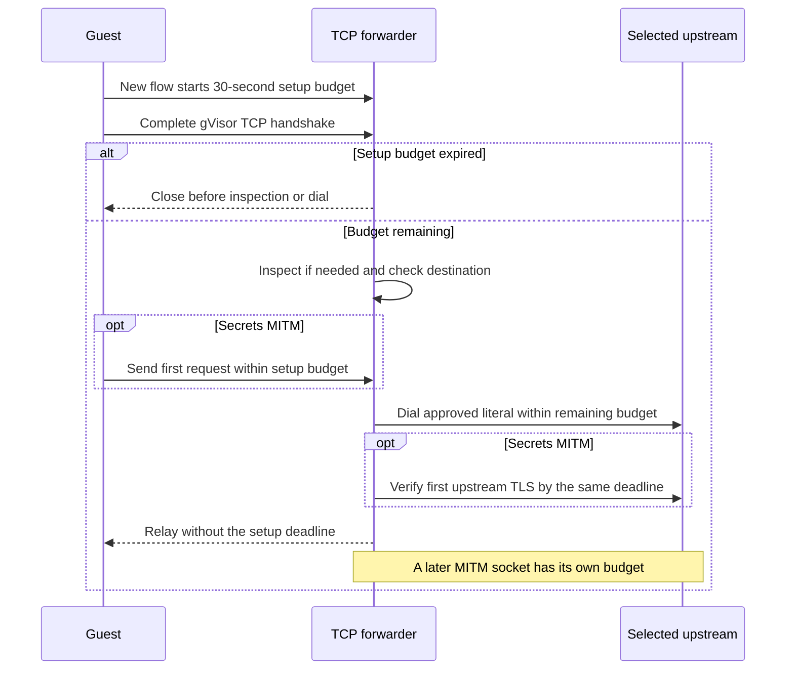

Plaintext Host can match user rules. Only TLS SNI on actual port 443 can grant secrets MITM. Subsequent MITM sockets re-resolve and check candidates with the captured policy and a fresh setup deadline.

An HTTP/1.1 upgrade keeps its tunnel open for bidirectional traffic. Closing the guest connection releases the per-flow MITM listener, including after an upgrade.

An extended DNS route screens raw answers with the captured policy. Only approved IPv4 literals reach the chosen connector. An address route keeps its translated socket and requires a matching controlled DNS answer when the matcher requests name association.

Trusted replacement publishes through the NIC transition. Both PUT resources return 409 for a valid legacy-shaped write while extended admission is active, including while disabled.

| Requested transition | Before NIC call | On success | On NIC failure |
| --- | --- | --- | --- |
| Disable | Publish candidate with disabled gate and pending status | Confirm disabled candidate | Keep disabled gate and report uncertain status |
| Re-enable | Keep previous disabled gate and publish pending status | Publish and confirm enabled candidate | Keep previous disabled gate and report uncertain status |

When the policy has a legacy view, policy GET returns 503 while either operation is pending or uncertain. Complete status reports the snapshot and its application state.

[TCP design and acceptance](https://github.com/boxlite-ai/boxlite/issues/2880)

### Extended UDP enforcement

Trusted snapshots select extended UDP admission even when both rule lists are empty. IPv4 UDP and QUIC use the original guest address and port for user rules, and platform checks cover both the original and translated addresses. An applicable hostname deny blocks the flow because UDP does not supply verified name evidence.

Legacy wire snapshots continue to check the legacy allow list and delegate NAT and dialing to the [pinned upstream forwarder](https://github.com/containers/gvisor-tap-vsock/blob/v0.8.7/pkg/services/forwarder/udp.go#L15-L41). The global mode gate precedes endpoint demultiplexing in both paths. Registered gateway DNS and DHCP handle packets gVisor delivers to their sockets, and other datagrams enter ordinary admission.

A trusted flow reserves one of 256 per-Box slots after its destination passes. For example, Local can admit `192.0.2.254:8080` and dial its translation `127.0.0.1:8080`, while Cloud refuses that translation before endpoint creation or dialing. The 30-second setup budget covers the first readable guest datagram and the literal UDP dial.

The flow uses one connected guest endpoint and one host socket. Traffic in either direction renews a 90-second idle deadline and preserves datagram boundaries, including empty payloads. Idle expiry, I/O failure, or Box cancellation closes both sides and releases the slot.

One writer per Box drains up to 32 queued trusted UDP replies independently of flow cleanup. When the guest link is backpressured, a full queue drops additional replies and closed flows discard queued replies. Box cancellation also closes the accepted guest link to wake an in-progress write.

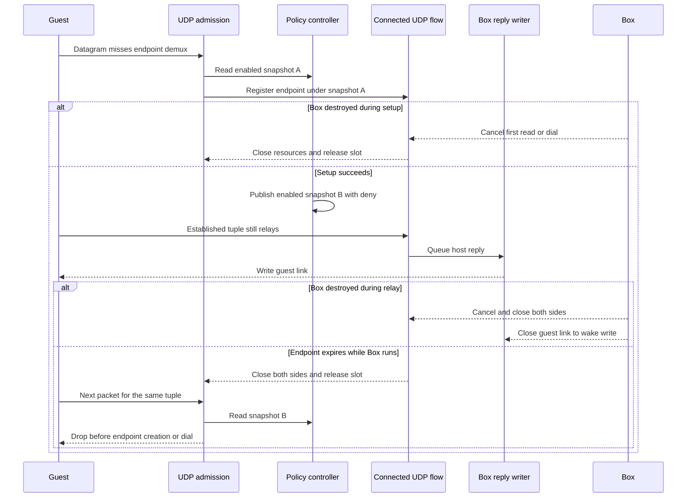

While egress stays enabled, new tuples and reopened tuples take the latest policy. To verify a new deny, check that an established tuple still delivers and both kinds of new admission produce zero socket dials and no delivery. Disabled mode blocks new guest frames before demux, including frames for existing sockets.

[UDP design and acceptance](https://github.com/boxlite-ai/boxlite/issues/2886)

## Revisions and acknowledgements

A revision is an opaque, Box-scoped token; clients compare for equality rather than ordering tokens or interpreting timestamps.
Existing records receive a documented initial token when revision support is introduced.
Each successful change receives a fresh token, including restoration after a failed persistence attempt.

One trusted coordinator creates the candidate token once and propagates it unchanged through API, Runner, Runtime, and gvproxy.
The complete snapshot includes normalized policy and the selected route identity, including a registration revision when applicable.
Internal metadata does not become an extra field accepted by strict policy decoders.

| Boundary | Contract |
| --- | --- |
| Public policy read | Return the existing policy shape and a strong ETag identifying its persisted revision. |
| Conditional public replacement | Evaluate `If-Match` under the update lock; a false precondition returns 412 before applying the candidate. |
| Internal replacement | Compare the expected current revision under the existing ownership lock, then apply the complete candidate snapshot. |
| Applied acknowledgement | Identify the exact installed candidate; missing, malformed, stale, or mismatched identity is not success. |
| Live status | Distinguish persisted revision, observed applied revision when available, and an explicit application state. |
| Old backend | Reject version-aware operations explicitly rather than silently discarding metadata or using unchecked replacement. |

Expose application metadata through a separate outbound status resource.
A stored policy or a successful HTTP status alone does not prove that the matching snapshot is live.
Confirmed application describes the control-plane snapshot; it is not an Internet-connectivity probe.

Example: connection A captures `rev-a`, which permits `api.example.com` through direct transport.
A conditional replacement installs `rev-b`, which permits only `updates.example.com`.
Later `api.example.com` connections are rejected before dialing, while A retains its original snapshot.

An update carrying stale `If-Match: "rev-a"` receives 412 without application.

## Application and recovery

Reuse the current Box update lock, Runtime persistence operation, and Cloud row-lock transaction.
All complete replacements, including future proxy rotation, share this ownership boundary.
Validate and compile the entire candidate before publishing it for new flows.

### Bridge snapshot publication

The bridge installs its TCP and UDP handlers once, before attaching the guest.
An atomic pointer publishes the complete immutable policy, filter, dialer, and application state; a TCP flow keeps the snapshot captured at entry, including while resolution is paused.
The gVisor IPv4 input/forward gate reads the same snapshot before registered endpoint delivery.
Enabled traffic continues through the existing filter-table chains, including the embedded DNS service.

Disabling publishes a rejecting snapshot before NIC suspension; enabling retains that gate until the NIC has enabled successfully.
NIC errors retain the disabled gate and mark application uncertain.

Policy and status responses use the shapes in the bridge revision protocol below.

The registered-DNS regression fixture binds native gVisor UDP/TCP endpoints on port 5353 and forwards received DNS messages to a test-owned host listener.
It exercises endpoint demultiplexing without replacing the global mode gate, and includes a new query on an established TCP DNS connection.
Controlled NIC pauses separately verify the interval before suspension and the interval after enabling but before policy publication.

### Bridge revision protocol

| Control resource | Contract |
| --- | --- |
| `GET /network/outbound` | Legacy policy JSON and strong ETag, 503 while legacy application is pending or uncertain, or 501 when the policy requires complete status. |
| `PUT /network/outbound` | Legacy policy replacement with optional `If-Match`. The bridge chooses a fresh revision. |
| `PUT /network/outbound/snapshot` | Flat legacy policy or versioned complete replacement. Requires a strong `If-Match` and a fresh `X-Boxlite-Outbound-Revision`. |
| `GET /network/outbound/status` | Legacy policy, revision, application state, and `revision-v1`. Returns 501 when the policy requires complete status. |
| `GET /network/outbound/complete-status` | Complete snapshot with admission, rules, and revision, plus application state and supported outbound capabilities. |

Version-aware clients use the dedicated snapshot resource and never fall back to legacy PUT.
An old handler may ignore extra headers on its existing resource; a new resource makes unsupported peers reject the operation before application, including after a capability-probe/backend-restart race.
Coordinator headers on the legacy resource are rejected rather than silently ignored.

For a snapshot initialized as `initial`, this request returns policy JSON with `ETag: "rev-b"` only after NIC suspension succeeds:

```http
PUT /network/outbound/snapshot
If-Match: "initial"
X-Boxlite-Outbound-Revision: rev-b
Content-Type: application/json

{"mode":"disabled"}
```

A stale expected revision returns 412 without application.
Candidate metadata requires a single strong expected token; missing, empty, ambiguous, oversized, reserved, or current candidate identities are rejected.
Trusted coordinators allocate fresh candidate IDs once and propagate them unchanged; the bridge does not keep a historical ID registry.
Legacy conditional requests use HTTP strong comparison, including tag lists and wildcard matching.

Startup wire metadata may supply `outbound_revision` to restore an existing identity.
Without a seed, the bridge generates a fresh 128-bit token for that startup, avoiding an initial-token reset across unseeded restarts.
Internal identities use 1–128 ASCII letters, digits, hyphens, or underscores; clients treat them as opaque values.
The public Rust `GvproxyConfig` shape remains unchanged; restoring Runtime-owned revisions belongs to its private bootstrap metadata path.

A matching status revision is not an acknowledgement while `application_state` is `pending` or `uncertain`.
This capability describes the gvproxy control boundary; Runtime persistence and Cloud/Runner propagation require their own completed implementation and verification.

### Runtime control client

`NetworkBackend::outbound_snapshot` reads the backend's policy identity and installation phase.
It requires the `revision-v1` capability and rejects invalid tokens, policies, or phases.
An observed `pending` or `uncertain` phase remains visible to the caller; an identity match alone does not establish completion.

`replace_outbound_snapshot` sends an `OutboundReplacement` to the dedicated snapshot resource.
The validated operation keeps expected and candidate revisions separate from user policy JSON.
It returns `Applied` only for HTTP 200 with exactly one matching strong ETag and the complete matching policy response.
Missing, weak, duplicate, or different acknowledgements produce an error with an uncertain application outcome.
HTTP 412 returns `PreconditionFailed`, a must-use outcome that does not represent successful application.
Unsupported backends return an explicit error; the versioned operation never falls back to the existing unconditional setter.

The existing setters and public configuration structs retain their signatures and wire shapes.
Backends inherit unsupported defaults for the added methods, so an existing custom implementation still compiles.
These methods verify the Runtime-to-gvproxy control boundary, independently of durable recovery or Cloud/Runner propagation.

### Runtime pending attempts and persistence

Runtime replacement uses the existing Box operation lock, including its disk refresh and VM-handle identity checks.
Control metadata lives under `outbound_control` in the stored state JSON; public `BoxState` and user policy structs keep their existing fields.
Records without control metadata use the initial token `initial`.
Lifecycle state writes preserve both the latest policy and its control metadata, including when a handle holds an older state copy.

Before contacting the backend, Runtime durably records the expected live revision and the complete candidate.
Only a matching ACK or a matching `confirmed` readback permits policy and revision to be committed together.
For example, after an ambiguous attempt from `rev-a` to `rev-b`, observing `rev-a` does not clear the pending attempt.
Observing `rev-b` while pending does not confirm completion either.
A later mutating operation may finish persistence once `rev-b` and its policy are confirmed; a persisted-policy read performs no such reconciliation.

If confirmed application succeeds but persistence fails, restoration compares against the applied candidate and uses a fresh identity.
Restoring the old policy as `rev-c` never makes a stale `If-Match: "rev-a"` valid again.
A rejected restoration or failed restoration persistence leaves explicit uncertainty and the durable pending evidence.
An ambiguous timeout never causes an unchecked replay or compensation.
A newly requested unconditional complete replacement may use the observed revision for a fresh CAS, fencing a queued older request once acknowledged.

`NetworkHandle::outbound_snapshot` reads persisted policy and identity without claiming live confirmation.
`replace_outbound_snapshot` applies a trusted coordinator's validated candidate and returns the explicit precondition outcome.
The existing unconditional setter retains its old-backend path only while no versioned control metadata exists.
A versioned call, or a Box already using versioned state, cannot silently fall back to that path.

### Revision-aware REST transport

The Rust REST backend carries `outbound_snapshot`, `outbound_status`, and conditional replacement through the same typed NetworkHandle API.
The policy GET decodes user policy and one strong ETag; the separate status GET retains durable/live comparison and pending evidence.
A response claiming confirmation must contain matching durable and completed live snapshots with no pending attempt.

Internal replacement uses `PUT /boxes/{id}/network/outbound/snapshot`, one expected token in `If-Match`, and the candidate in `X-Boxlite-Outbound-Revision`.
Only policy enters the JSON request body.
HTTP 200 requires one strong matching ETag and the complete matching policy; 412 remains a distinct rejected-precondition outcome.

Missing, weak, duplicated, malformed, or mismatched acknowledgements cannot establish application.
Unsupported routes never trigger the old policy setter, whose unconditional request shape remains unchanged.
Revision control exchanges have a ten-second total bound, including response reading.

Socket-backed REST tests run requests through NetworkHandle and the real HTTP encoder/decoder.
They cover exact request metadata, matching and rejected acknowledgements, old peers, invalid stored policy, and contradictory confirmed status.

### Native C revision boundary

The additive C ABI exposes `boxlite_network_outbound_snapshot`, `boxlite_network_outbound_status`, and `boxlite_network_replace_outbound_snapshot`.
Read calls allocate JSON strings owned by the caller; release them with `boxlite_free_string`.
Their output pointer is initialized to NULL before validating other inputs.

Replacement takes separate expected revision, fresh candidate revision, and complete policy JSON strings, borrowed for the blocking call.
For example, expected `rev-a`, candidate `rev-b`, and `{"mode":"disabled"}` preserve the same identity through NetworkHandle and its selected local or REST backend.
`Ok` with `out_applied=1` confirms application; `Ok` with `out_applied=0` reports a failed precondition.

Errors also initialize `out_applied` to zero and keep the existing error-code ABI.
Malformed UTF-8, invalid tokens, repeated/reserved candidates, invalid policy, and null required pointers are rejected before dispatch.
These are trusted-coordinator operations; the existing unconditional setters retain their signatures.

The C boundary tests call the actual exported functions through a REST runtime and inspect the resulting HTTP requests.
They free returned strings and check output initialization and rejection without dispatch.

### Go coordinator API

`Network.OutboundSnapshot` reads durable intent; `Network.OutboundStatus` reads the durable/live comparison and pending evidence.
`ReplaceOutboundSnapshot(ctx, expected, candidate)` preserves the coordinator's fresh candidate across the C ABI and selected Runtime backend.
Check both its error and `OutboundReplaceOutcome`: `OutboundPreconditionFailed` with a nil error is a rejected update, not application.

`OutboundPolicy` supplies explicit wire field names without changing the existing `OutboundNetworkSpec` structure or setter request shapes.

Revision strings are validated before C-string conversion, including embedded NUL, length, and ASCII-token checks.
Network calls retain a shared lifetime lock; Close takes the exclusive lock before freeing the C handle.
Policy updates remain serialized by Runtime's Box operation lock, while a concurrent status read through the same Go Network handle remains available.

As with the existing blocking setters, context cancellation is checked before entering the native call; it does not cancel an in-flight native update.

Go tests use the actual Go/C/Rust stack against controlled HTTP peers, including a held update with concurrent status read.
They cover precondition failure, malformed ACK, unsupported peers, and invalid or cancelled calls rejected before dispatch.

Durable-control tests use the real Runtime operation lock and SQLite database with controlled backend replies.
They cover lost ACKs, pending readback, late requests, competing writers, failed pending writes, fresh restoration identities, stale compensation, and restoration persistence failure.
These tests exercise the new revision protocol; the existing unversioned setter's compatibility behavior is covered separately.

### Runner control resources

Runner exposes policy GET, status GET, and dedicated snapshot PUT under its existing bearer-authenticated Box network routes.
Reads use request-owned Runtime handles without starting a VM; replacements require a running Box.

The independent network handle retains its native ownership after the temporary Box wrapper closes.
Readback leaves borrowed lifecycle cache entries untouched.

Policy GET returns the policy body and persisted revision as a strong ETag.

Snapshot PUT requires one strong expected revision and one fresh candidate header before acquiring a Runtime handle.
A stale comparison returns 412; only the explicit `applied` outcome returns the matching policy and candidate ETag.

Runner tests execute its production bearer and error middleware over HTTP.
Missing, malformed, and wrong credentials cannot reach control lookup; the configured bearer can use all three resources.
A separate client test crosses the actual Go/C/Rust transport against a controlled Runtime peer, including stopped-Box reads and refused mutation.

#### Complete outbound preparation and reads

Runner's bearer-authenticated `POST /v1/boxes/{boxId}/network/outbound/complete/prepare-create` takes an outbound policy and an allocated `X-Boxlite-Outbound-Revision` header.
Runtime checks the selected backend and returns the normalized snapshot plus `deny_present` before provisioning a Box.
The field records whether the request explicitly supplied `deny_net`, including an empty list.

For example, revision `rev-b` with `EXAMPLE.com:0443` and `deny_net: []` prepares `example.com:443` at `rev-b` with `deny_present: true`.
A backend missing deny capability refuses that request even when the effective deny list is empty.

The local Runtime bridge can create or adopt a named Box using the prepared snapshot.
Before new creation it validates the snapshot and rechecks capability. Adoption requires the same committed revision, admission mode, and rules with no pending operation.

The complete snapshot and status GETs under `/network/outbound/complete` carry both lists and admission mode.
Snapshot GET returns a strong ETag for the durable revision. Status GET reports durable and live observations separately without starting the Box.

The production Runner server tests authorize and refuse requests to the complete outbound routes over loopback HTTP.
The Go SDK test crosses C and Rust against a shim that advertises no deny capability. On that backend, omission succeeds and explicit empty deny is refused during preparation and creation.

#### Complete create and cancellation on Runner

On the same bearer-authenticated resource, `POST /complete/create` carries the target incarnation, attempt ID, generation, prepared policy and Box configuration.
`POST /complete/cancel-create` carries the same attempt identity and prepared policy.
The prepared policy always carries an explicit `deny_present` boolean.

Runner holds the logical Box lock across both operations, using the same lock as legacy provisioning and checkpoint restore.
It synchronizes a target record independently of the native Box before provisioning. The record binds the generation to the exact prepared policy and contains no Box credentials.

Runtime rechecks the backend while creating the configured Box. Runner mounts volumes and starts the Box after that check succeeds.

Cancellation before provisioning persists a fence and returns `no_effect`. A definitive unsupported refusal from Runtime persists the same fence before returning HTTP 501.

The fence survives Runner restart and a refused attempt keeps its `unsupported` failure code.
Delayed create and repeated cancel return the original attempt's outcome without provisioning.
An incomplete capability response leaves the attempt pending.

After provisioning starts, Runner returns `installed` only for a running Box whose durable and live policy both match the prepared snapshot exactly.
An incomplete observation returns `pending` and leaves the journal in place. A different owner cannot claim the same generation.

Legacy create, legacy recovery, and archive or checkpoint transfer refuse a target owned by a complete create attempt.
The controlled shim test removes deny capability after preparation and checks that Runner creates neither a Box nor a volume probe.

The VM test verifies that create and cancel return the same live snapshot across Rust, C, and Go.

### CLI serve control resources

The CLI serve router implements the same resources.
Its existing public policy PUT accepts HTTP `If-Match`, including tag lists and wildcard matching, while retaining the unconditional response shape.
Coordinator headers on that public resource are rejected; trusted candidates use the dedicated snapshot path.

A rejected CAS triggers a fresh predicate check; tag lists and wildcard requests may still match a competing revision.
The server retains one candidate identity across at most two CAS attempts, then returns conflict if contention persists.
Transport errors and uncertain outcomes return immediately without retry or an unconditional fallback.

The diagram uses illustrative revision tokens; HTTP tests allocate the candidate through the real coordinator.

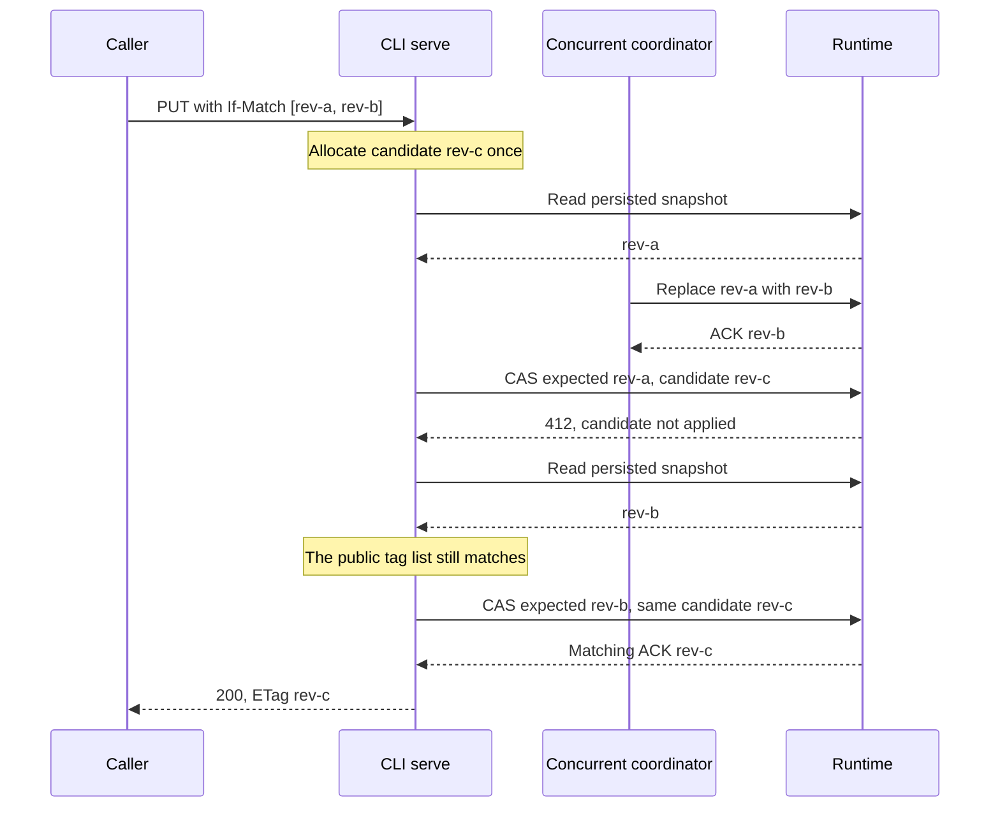

Local status reports the same durable snapshot in `persisted` and `runtime_persisted` because this server has no separate Cloud store.
Absent pending and observation-error fields are omitted; an existing pending revision remains a string.
HTTP tests exercise the actual API-key middleware and verify denied requests cannot reach Box lookup or Runtime control.

### Cloud-to-Runner control adapter

`RunnerOutboundControl` uses the dedicated snapshot and status resources through the assigned Runner's existing control endpoint and bearer credential.
It never retries a versioned operation through the unconditional policy route.

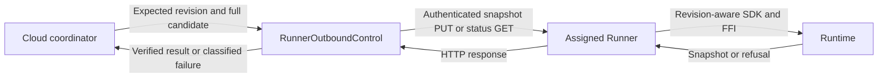

Only HTTP 200 with the exact strong candidate ETag and complete matching policy acknowledges replacement.
HTTP 412 is a distinct precondition outcome; bare 404, 405, or 501 reports unsupported control.

Status requires `revision-v1`, valid complete snapshots, and an explicit application phase.
Runtime confirmation requires matching persisted and observed snapshots, a confirmed observation, and no pending revision or observation error.

For example, a live `rev-b` with unfinished Runtime persistence remains pending or uncertain, even when its policy matches.
This adapter validates Runtime completion; the Cloud coordinator must additionally compare its own durable state.

Every HTTP call has a ten-second deadline including response-body consumption and a 64 KiB response limit.
Redirects are rejected, and public errors omit endpoint credentials and upstream diagnostics.

`make test:apps:api TEST_FILES=runner-adapter/outbound-control.spec` exercises actual loopback HTTP, including stalled bodies and invalid acknowledgements.
The fixture models a Runner control peer; it does not boot a guest VM.

### Cloud durable intent

`OutboundPolicyStore` keeps private control metadata in the Box's nullable `outboundControl` JSONB column.
Apply pre-deploy migration `AddOutboundControl1794888000000` before deploying callers; older records use revision `initial`.
Ordinary entity reads omit the column.

The pending record contains the expected Runtime revision, full candidate policy and revision, and assigned Runner identity.
Policy and persisted revision change together when finalization clears pending.

`OutboundPolicyCoordinator` reserves pending in one transaction before dispatch.
A second transaction reacquires the same organization-scoped Box row lock and verifies that reservation and Runner still own the attempt.
It holds the lock through matching acknowledgement or confirmed Runtime readback and final persistence.

Five seconds bounds database lock acquisition; each Runner request independently has the adapter's ten-second deadline.
Failed or ambiguous application leaves the already committed pending evidence intact.

```mermaid
sequenceDiagram
    participant C as Cloud coordinator
    participant P as PostgreSQL primary
    participant R as Runner / Runtime
    C->>P: Tx1 lock Box; write full pending
    P-->>C: COMMIT reservation; release lock
    C->>P: Tx2 lock Box; verify exact pending owner
    C->>R: CAS expected to candidate
    R-->>C: Matching complete ACK
    C->>P: Write policy + revision; clear pending; COMMIT
    alt COMMIT reply received
        P-->>C: Completion; release lock
    else Publication failed or COMMIT outcome unknown
        C->>P: Release failed connection; new primary transaction and lock
        P-->>C: Durable policy, revision, pending owner
        alt Matching candidate is already durable
            Note over C,P: Keep the committed candidate; no restoration
        else Original pending still owns the previous durable policy
            C->>P: Write fresh restoration pending; COMMIT reservation
            C->>P: Reacquire Box lock; verify restoration and Runner owner
            C->>R: CAS acknowledged candidate to fresh restoration
            Note over C,R: Failed restoration keeps its pending evidence
            Note over C,P: Completed restoration uses the same finalization path
        else Superseded owner or primary unavailable
            Note over C,R: Return failure; no restoration dispatch
        end
    end
```

`OutboundCommitUnknown` distinguishes an unacknowledged commit from an error inside the transaction callback.
Recovery reads through a new primary transaction before deciding whether restoration is allowed.
A matching durable candidate needs no restoration; a superseded owner or unavailable database cannot authorize one.

Proven failed persistence may reserve the previous policy with a fresh revision and apply it conditionally against the acknowledged candidate.
Restoration failure preserves its own pending evidence and returns failure.
A successful restoration repairs state but does not make the original failed replacement successful.

Cloud status compares its persisted snapshot with both Runtime persistence and completed backend observation.
GET does not reconcile pending or wait behind the writer's row lock.

A later mutation may finalize a completed pending candidate before checking its public precondition; stale callers then receive 412.
An unconditional complete replacement may fence unresolved older requests through a fresh CAS.

Run `make test:apps:api TEST_FILES=outbound-policy.store.integration` with loopback `DB_HOST`, `DB_PORT`, `DB_USERNAME`, and `DB_DATABASE`.
The suite owns a temporary schema and a PostgreSQL frame proxy that disconnects before forwarding COMMIT or before forwarding its server completion.
It combines real transactions and HTTP with a controlled Runner peer; it does not exercise a guest VM or deployed Cloud instance.

A real PostgreSQL trigger rejects final publication after the Runner ACK to exercise restoration and failed-restoration intent.
Socket loss and pending/uncertain readback checks distinguish matching revisions from completed application.

#### Complete policy reads

Apply pre-deploy migration `AddCompleteOutboundControl1795096800000` before deploying complete-policy readers.
The nullable `completeOutboundControl` column carries committed and pending complete policy separately from the legacy projection.
Downgrade locks the Box table and refuses while any complete record remains, including a protected policy with empty lists.

The organization-scoped `GET /v1/{org}/boxes/{boxId}/network/outbound/complete` returns the committed snapshot with a strong revision ETag.
A pending replacement returns the committed predecessor. A pending first create returns `outbound_pending` with no policy ETag.

Existing Boxes without complete control metadata return their legacy revision and an empty deny list from the complete resource.
The legacy outbound routes refuse protected Boxes. Legacy replacement checks this condition under the same row lock used to reserve changes.

The companion `GET /network/outbound/complete/status` reports pending intent without sending a Runner request.
Without pending intent, Cloud compares the exact policy and revision from its primary with the Runner's durable and live observations.

An unavailable Runner or a disagreement yields `uncertain`. A reservation or change in owner or snapshot during readback invalidates that observation.

REST Box detail, list, create, start, and stop responses read network metadata from the primary for the authorized organization.
For protected Boxes the default response omits `network`. Requests with `X-BoxLite-Source: dashboard` still receive the inbound setting and show outbound as unavailable.

The Box response varies by that header and is private and non-cacheable. When the primary cannot supply the projection, the response omits network metadata.

#### Cloud V0 dispatch and recovery

Nested outbound create selects the complete path when `deny_net` is present or the allowlist has more than ten rules.
An allow rule with a port, or an address or CIDR written in IPv6 notation, also selects complete creation.

A Runner with qualified Cloud inventory v2 uses `extended_dual_stack`.
Other supported complete requests use `extended_ipv4`.
Native IPv6 rules require `extended_dual_stack`.

The deprecated flat form still uses the legacy rules and limit.
Legacy creation trims surrounding whitespace in allow rules before storage.
Complete creation bypasses the warm pool and asks the selected Runner to prepare the policy before reserving a Box.

Cloud verifies the placed Runner on the primary before sending the preparation request.
Reservation requires the same Runner lease, endpoint, and credential used for preparation.

The primary admission row starts closed. Reservation takes a shared lock on that row and checks admission again before inserting the Box and its attempt.
A definitive preparation refusal returns HTTP 501 before a Box row is inserted.

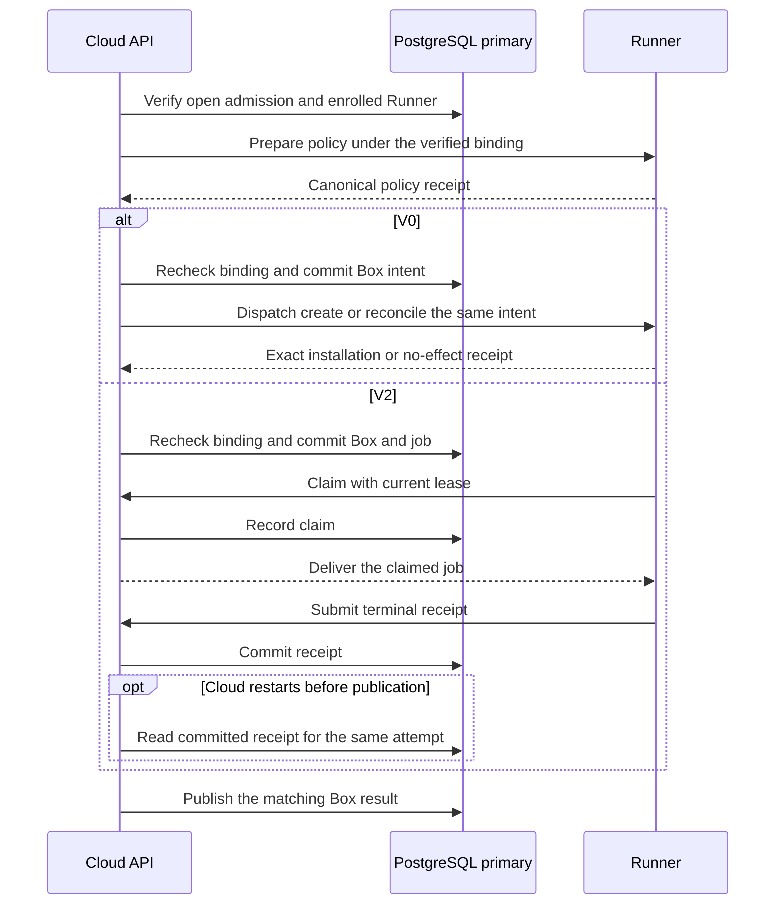

The Box-created event dispatches a committed V0 reservation through Runner's complete create route.
Cloud checks the response against the stored incarnation, attempt ID, generation and prepared policy, including deny presence.
Legacy lifecycle dispatch skips unresolved complete creates.

Startup and the periodic recovery job page the primary database for V0 reservations using `idx_box_pending_complete_v0_create`.
Recovery gives the initial dispatcher 30 seconds from the Box's creation timestamp, then calls the cancellation route for that exact attempt.
A lost or ambiguous response leaves the reservation pending for a later pass.

Cloud holds the Box row lock when consuming an exact installation or no-effect receipt. It verifies that the assigned Runner and full reservation still match.

An installation commits the snapshot and publishes STARTED. A no-effect receipt closes the reservation and records a terminal failure.

#### Cloud V2 delivery and recovery

The [hosted create sequence](#cloud-v0-dispatch-and-recovery) shows how a protected claim follows reservation.

V2 reserves the Box and its complete-create job in one primary transaction. The reservation and job share the same Box incarnation, Runner, attempt, job ID and claim ID.

Private claim and receipt routes require the current Runner bearer and its release-bound `BOXLITE_COMPLETE_OUTBOUND_LEASE_TOKEN`. The primary enrollment stores the token hash.

The ordinary queue excludes complete jobs from polling, startup replay, status writes and expiry.
The V2 executor handles claims. Direct create refuses V2 claim IDs, and recovery uses the V0 cancellation endpoint.

A claim can be delivered once. After ten minutes it enters reconciliation while its job remains `IN_PROGRESS`.

The reconciler asks the assigned Runner to settle that exact claim under the target lock. Incomplete or mismatched evidence keeps the Box pending.

The protected queue polls independently of the ordinary queue, waiting one second when empty.
Lease rotation can close an undelivered job under the claim lock. A delivered claim keeps its lease until terminal evidence is committed.

The primary commits terminal evidence before Box publication. STARTED reports and periodic recovery prompt readback, including after a restart.

Only the matching reservation can commit the installed snapshot or close with no effect.
The recovery scan uses the partial index `idx_box_pending_complete_v2_create` on Boxes with outstanding V2 reservations.

With loopback PostgreSQL, run `make test:apps:api TEST_FILES=complete-create-job.integration` to verify queue isolation, credentials, claim expiry and receipt recovery.
Admission starts closed and requires a compatible serving cohort before protected creates can be enabled.

#### Checkpoints and drain migration

Capture locks the stopped source and binds its committed policy to the disk.
Restore creates a new Box in the checkpoint region after qualifying a Runner.
The [coordination schema](platform/schema.md#protected-checkpoint-coordination) records the lease and cleanup hold.

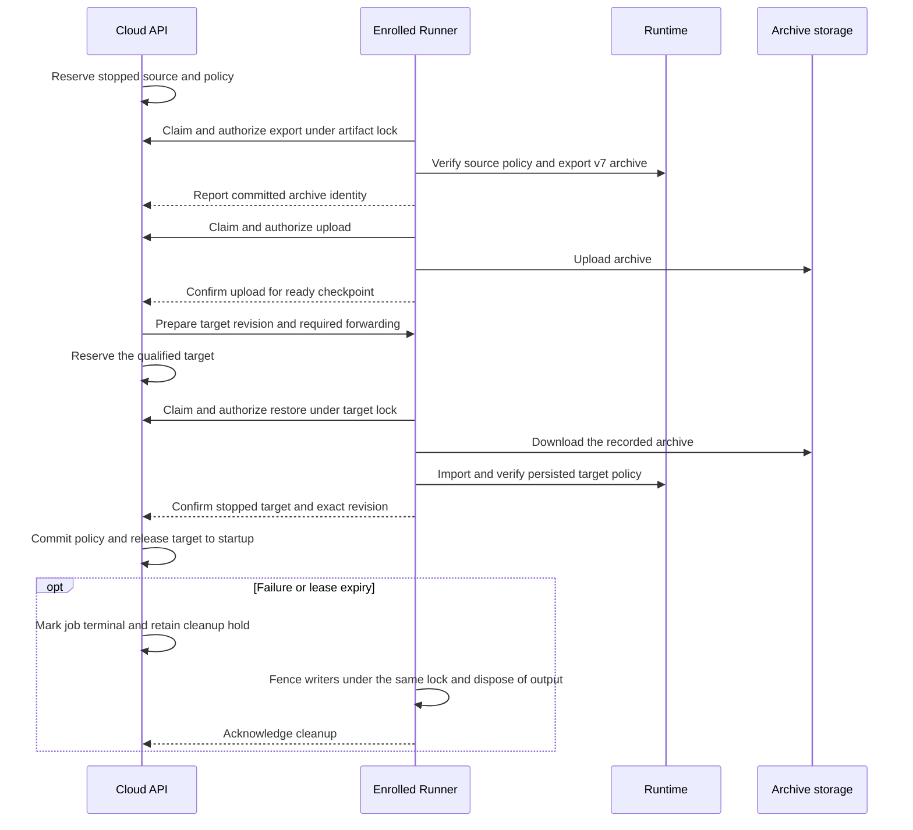

Drain migration checks legacy policy under the source lock and validates the legacy archive before acknowledging an existing target.

#### Hosted replacement and rebuild

Send `PUT /api/v1/{org}/boxes/{boxId}/network/outbound/complete` with a complete policy such as
`{"mode":"enabled","allow_net":["example.com:443"],"deny_net":[]}`.
The route requires Box write access and a running Box. An optional strong `If-Match` checks
the committed revision, and a pending replacement returns 409 until recovery completes.

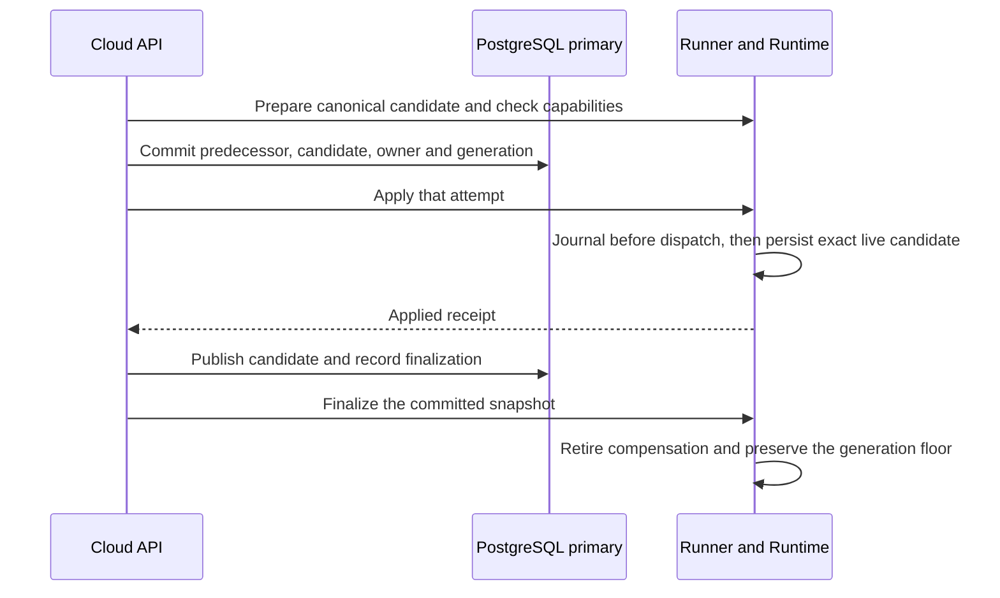

An omitted `deny_net` and an explicit empty array remain distinct when Runtime replays an
owned apply. The Runtime checks confirmed live policy before publishing an applied receipt,
and stores the exact predecessor alongside the attempt until finalization.

If the API loses a PostgreSQL commit reply, it rereads the primary. A committed candidate
can be finalized, while a retained intent uses its bound cancellation or installation receipt.

When installation won and Cloud did not publish it, Cloud reserves a fresh restoration revision
and Runtime restores the predecessor. Recovery retries the same restoration after an interrupted reply.

V0 recovery checks the durable policy under the Runner target lock and also checks live policy
when the predecessor is running. An exact match can rebuild under the same logical name,
seed the saved policy revision, and return a durable receipt for the resulting native Box.

The rebuild journal makes retry of the same request reuse that Box. The Runtime's generation
floor belongs to the logical name and survives replacement of the native Box ID.

Runtime verifies and pins a private copy of the V0 rebuild backend before Runner can remove the
predecessor. The replacement uses that copy for creation and boot, including after a Runner restart.

Legacy checkpoint recovery keeps the published Box ID as the replacement identity even when its
native name changes. After a complete policy is installed, checkpoint recovery refuses that Box
before downloading or importing another archive.

#### Release admission

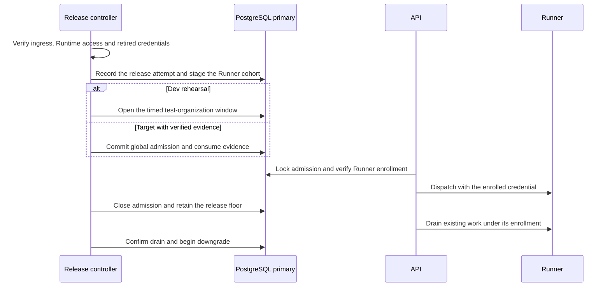

The PostgreSQL admission row starts closed. The release controller removes the old API from
ingress and excludes old Runner processes from Runtime state.

Before activation, the controller rotates Runner credentials and records each verified release
and lease.

The database owner begins a release attempt for the verified floor and the dedicated API role.
`complete_outbound_activate_attempt` requires retired roles to have login disabled and their
sessions drained, or requires trusted evidence that the stage is new.

It also checks the enrolled Runner cohort against the floor and current credentials.
The API role can lock the admission row and read enrollment.

Dev rehearsal admission has a time-limited acceptance organization. Complete create,
policy replacement, and protected checkpoint capture and restore check the authenticated
organization when reserving new work. The primary's clock is checked after taking the
admission lock, so a request waiting across expiry cannot reserve work.

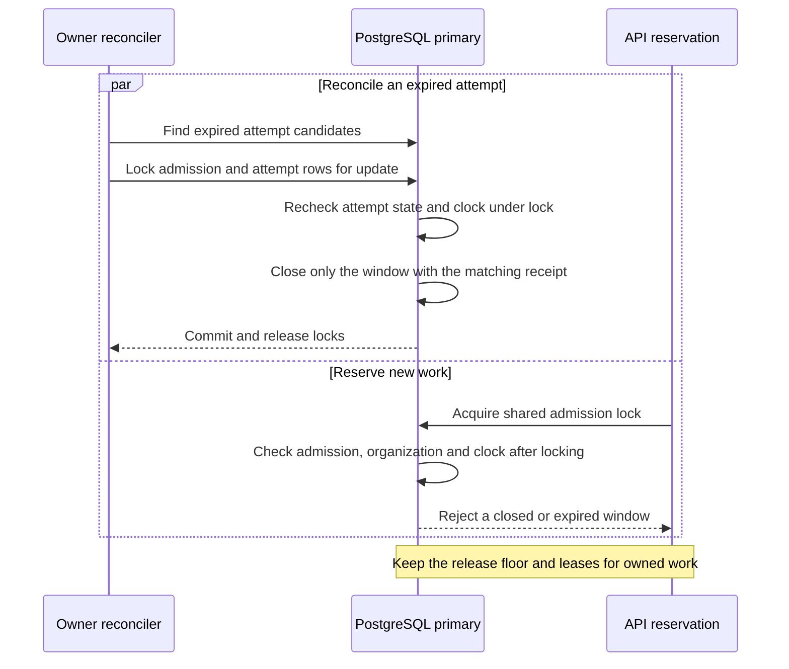

Provisional expiry blocks new reservations. Existing work can still reconcile under
its recorded floor and lease. Open admission without an acceptance organization
applies to all eligible organizations.

The release attempt binds the candidate manifest, database role, floor and
deadline to one receipt. Target activation checks the manifest and consumes a
unique evidence digest while committing global admission and the Runner cohort.
Expiry can close only the dev window owned by the expired attempt.

The owner job uses the image's `migrate.js release` command with a structured
`BOXLITE_RELEASE_REQUEST`. Use `begin` with an organization for dev and `null` for the target.
Use `activate` for the dev window or `activate-target` with the verified manifest and evidence digests.

A rejected activation preserves the prior enrollment for recovery.

Read `status` after a lost handoff reply to verify the retained application role
and the recorded predecessor's login state. Activation checks that the supplied
retired roles include that predecessor and that its database sessions have drained.

After an uncertain activation reply, read `status` to reconcile the receipt.
For a confirmed mismatch, use `close-target` with that receipt and evidence digest.
It closes only the matching current admission and preserves its floor and enrollment.

Use `abort` on a pending or provisional attempt after its provider operations settle.
An independent owner job can call `reconcile` for expired attempts.
Both operations preserve accepted receipts and the floor needed for owned work.

`complete_outbound_close` disables new reservations and preserves the floor for recovery.
`complete_outbound_begin_downgrade` requires drained work and expired enrollment. The migrations
also reject downgrade while protected policy or its generation floor remains.

### Public Cloud control resources

Public policy GET returns the existing policy object with a strong revision ETag; status GET returns completion metadata separately.
Policy PUT retains its complete-replacement body and accepts optional HTTP `If-Match`, including strong tag lists and wildcard matching.
The coordinator allocates candidate revisions; caller-supplied internal candidate headers are rejected.

Public lists ignore empty elements; an empty list matches no revision, while weak tags never satisfy strong comparison.
Wildcard stands alone, and the complete field is validated before any matching tag can authorize a mutation.
Only HTTP SP and HTAB count as surrounding whitespace, including on internal single-revision control resources.

These rules follow [RFC 9110 list parsing and whitespace](https://www.rfc-editor.org/rfc/rfc9110.html#section-5.6).

Reads require organization membership; writes also require the existing Box write permission.
Status describes control-state agreement and does not probe destination connectivity.
MCP access to these outbound resources requires an API key under its OAuth default-deny policy.

The HTTP authorization suite runs actual API-key and signed-JWT strategies and organization guards with controlled credential, membership, Redis, and Box storage.
It checks canonical, organization-prefixed, and legacy paths; it does not boot the production Cloud application or guest VMs.

### Runtime readback and coordinator recovery

`NetworkHandle::outbound_status` compares a durable snapshot with the backend's observed snapshot and installation phase.
It reports `persisted`, optional `observed`, overall `application_state`, optional `pending_revision`, and optional `observation_error` outside user policy JSON.
The durable policy, revision, pending attempt, and VM identity come from one SQLite row version.
Neither this status call nor `outbound_snapshot` acquires the mutating Box operation lock, so reads remain available during a pending update.
Both calls leave pending records and policy unchanged.

Overall `confirmed` requires an exact policy/revision match, a confirmed backend phase, and no durable pending attempt.
A pending backend phase remains `pending`; any mismatch or unresolved attempt is `uncertain`.
Backend observation has a ten-second bound; a failed observation retains durable intent and a diagnostic without claiming live confirmation.
An unsupported backend returns an explicit unsupported error.
A stopped Box returns uncertainty without starting a VM; a handle from an older VM epoch cannot query through its cached backend.
A newly acquired running handle can read the existing control socket without booting or attaching the guest.

After coordinator loss, a surviving backend can report the confirmed pending candidate while durable policy still identifies its predecessor.
GET preserves that divergence as uncertainty.
A subsequent mutating operation can reconcile the matching confirmed candidate before evaluating the caller's precondition; a caller using the predecessor then receives `PreconditionFailed`.
When the backend restarts from committed policy, matching the old durable revision still does not resolve the pending attempt.
A new unconditional complete intent can replace that uncertain state with a fresh candidate through CAS.

Recovery acceptance uses real SQLite storage and a real gvproxy instance over its Unix control socket.
A test-only cancellation point stops the coordinator after a matching backend ACK and before durable commit, then reacquires the Box handle with the backend surviving or restarting.
The VM and guest session remain test fixtures; this checks the control and persistence boundary, rather than an operating-system process crash or guest-VM boot.
Run these checks with real dependencies:

```sh
make test:unit:rust FILTER=outbound_recovery RUST_UNIT_CORE_ARGS='-p boxlite --all-features --lib'
```

### Runtime bootstrap identity

#### Complete policy in the local Runtime

Use `BoxliteRuntime::create_with_outbound_policy` or `get_or_create_with_outbound_policy` to configure a complete local IPv4 policy without changing existing `BoxOptions` literals. An explicit complete policy selects extended forwarding even when both rule lists are empty. A Box created through `NetworkSpec` uses legacy forwarding.

For example, a complete policy with `mode: enabled`, an empty `allow_net`, and `deny_net: ["192.0.2.0/24:443"]` denies that prefix only on port 443. The Runtime validates the rules and checks the selected shim's capabilities before creating a row. The versioned launch sends the committed policy, revision, admission mode, and the union of capabilities required by any unresolved attempt.

`NetworkHandle::update_outbound_policy` and `replace_outbound_policy` evolve the complete policy under the Box operation lock. `complete_outbound_snapshot` reads durable policy and `complete_outbound_status` compares it with backend observation. An explicit `deny_net: []` requires deny capability for the request and clears user denies without erasing the installed admission mode.

Complete replacements, clones, and exports acquire disk admission before the operation lock. This keeps the copy's policy eligibility valid through publication.

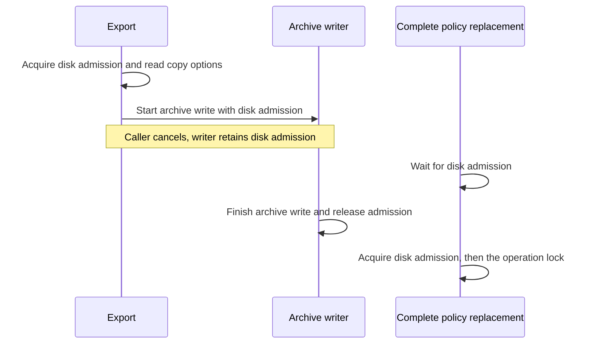

The versioned request uses canonical deny rules and preserves whether the caller supplied the field. Its body budget includes framing for an existing policy accepted by the 64 KiB legacy endpoint. Recovery preserves that policy's original allow strings and historical rule count.

An unresolved attempt survives restart as uncertainty. The shim installs the committed snapshot only, and a read never replays the attempt. The Runtime records restoration with its fresh revision before dispatch so a later mutation can confirm the exact restored identity if publication was interrupted.

If storing an applied candidate fails, the local Runtime reports failures to record or commit restoration as database errors. The diagnostic includes both write failures and identifies the recovery step. A missing Box still returns `NotFound`.

If recording restoration fails, status shows the committed predecessor and the pending candidate, with the applied candidate visible in the live observation. If committing a confirmed restoration fails, the pending and live revisions instead identify the restoration. Both outcomes remain uncertain until reconciliation.

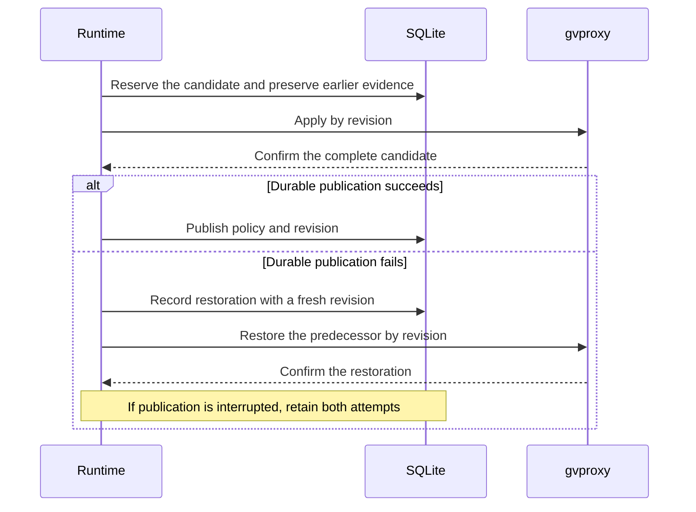

Legacy policy interfaces return `Unsupported` for protected snapshots. General Box metadata uses one durable row for the outbound policy and its visibility, even when the Box handle is cached. Metadata omits the network view when it cannot express the policy.

Box listings use one database snapshot for all entries.

`NetworkHandle::published_ports` and Go `Network.PublishedPorts` report the independent lifecycle-verified bindings. A port lookup does not start a VM or repair listeners.

Runtime records with protected policy require a compatible Runtime. A rollback needs a legacy-compatible store with no unresolved extended requirements. Clone, export, and import refuse policy they cannot represent before provisioning or writing the resulting archive.

#### Legacy revision bootstrap

New and restarted VMs receive the persisted revision alongside their persisted policy.
Records without control metadata use `initial`.

Startup seeds the backend with the committed policy and revision. The Runtime keeps an unresolved candidate for reconciliation and preserves a surviving backend's live identity on reattach.

The stdin launch message carries the legacy revision in a private field. The shim passes the revision to gvproxy through private JSON.
`InstanceSpec`, `NetworkBackendSpec`, `GvproxyConfig`, and `BoxState` keep their public fields.

The explicit revision constructor restores a coordinator-owned identity. The shim validates an optional token before startup and uses the legacy launch contract when metadata is absent.

The shared `bootstrap-v1.json` example passes through the production launch encoder, shim parser, and gvproxy JSON encoder.
Real-library tests create gvproxy with a restored revision, verify live readback and conditional replacement, reject a stale replacement, and repeat after backend restart.
These checks exercise the Rust/Go control boundary without requiring a guest VM.

Run the bootstrap checks with real dependencies, because stub mode cannot link the shim or gvproxy FFI:

```sh
make test:unit:rust FILTER=outbound_bootstrap RUST_UNIT_CORE_ARGS='-p boxlite-shim --bin boxlite-shim'
make test:unit:rust FILTER=outbound_bootstrap RUST_UNIT_CORE_ARGS='-p boxlite --all-features --lib'
```

Install stable TCP and UDP entry points before guest traffic starts, with one shared snapshot reference.
Enabled-to-enabled replacement publishes that reference once; delayed setup, retries, and MITM upstream sockets retain their flow's captured snapshot.

Disabled mode rejects new flows independently of the empty allowlist.
A mode gate before IP endpoint demultiplexing also covers registered services such as DNS, which bypass default transport handlers.
This gate uses the same snapshot and leaves enabled-mode DNS behavior unchanged.
Packets arriving under disabled mode cannot start new DNS forwarding; work accepted before publication retains established-work semantics.

To disable, publish the disabled snapshot before suspending the NIC, then acknowledge only after suspension succeeds.
To enable, retain the disabled snapshot until NIC enabling succeeds, then publish the enabled candidate.
Mark application pending before publication or a mode transition.
On a failed mode transition, retain the disabled gate and report uncertainty; do not confirm the candidate or a stale previous revision.
Compilation failure before publication preserves the previous confirmed snapshot.

An acknowledgement timeout leaves the outcome uncertain because the candidate may already be live.
Perform bounded readback and distinguish the expected, candidate, and another revision; unresolved state remains explicit.
Observing the expected revision does not prove rejection while the original request can still apply later.

Keep uncertainty until completion or fencing is established; this contract does not require a new fencing API.

After confirmed application, persistence failure can trigger conditional compensation against the candidate revision.
Restoration uses a fresh token, so stale clients cannot succeed after a change-and-restore cycle.
Do not replay or compensate blindly after an ambiguous timeout.

If recovery cannot confirm both application and persistence, return failure and preserve readback diagnostics.

Database unavailability cannot support a durable-state claim; require readback after recovery.

The crash check stops the coordinator after a matching acknowledgement and before persistence.
Repeat with gvproxy surviving the coordinator, then with gvproxy restarting too.
Reconcile observed and persisted revisions or expose uncertainty; never label a stale stored revision as confirmed live state.

## Application and recovery timing

The coordinator marks application pending before publication or a NIC transition.
The following sequence expresses the application and recovery contract above; it is an implementation target.

```mermaid
sequenceDiagram
    participant C as Coordinator
    participant S as gvproxy snapshot
    participant N as Guest NIC
    participant D as Persistence
    Note over C,S: Complete candidate is validated and compiled
    C->>S: Mark application pending
    alt Disable
        C->>S: Publish disabled snapshot
        C->>N: Suspend NIC
    else Enable
        Note over S,N: Keep disabled snapshot during NIC enabling
        C->>N: Enable NIC
    else Enabled-to-enabled replacement
        C->>S: Publish candidate once
    end
    alt Mode transition fails
        Note over C,N: Retain disabled gate; report uncertainty without confirmation
    else Publication or transition succeeds
        opt Enabling
            C->>S: Publish enabled candidate after NIC enabling succeeds
        end
        alt Exact candidate application confirmed
            S-->>C: Acknowledgement or readback identifies exact installed candidate
            C->>D: Persist candidate
            alt Persistence succeeds
                Note over C,D: Application and persistence confirmed
            else Persistence fails
                C->>S: Conditional compensation against candidate with fresh token
                C->>D: Persist restoration if application confirmed
                Note over C,D: Unconfirmed restoration or persistence remains uncertain
            end
        else Application unresolved
            C->>S: Bounded readback after acknowledgement timeout
            S-->>C: Expected revision observed; application may still be running
            Note over C,S: Old-revision readback cannot prove rejection while request can still apply
            Note over C,S: Remain uncertain until request completion or fencing is established
            Note over C,D: Preserve uncertainty; no blind replay or compensation
        end
    end
```

## Shared examples and evidence

`tests/fixtures/outbound/contract-v1.json` separates current policy examples from versioned replacement and connection-boundary examples.
The versioned cases are implementation targets; the fixture file does not enable a backend capability.
Runtime, Runner, Cloud, and forwarding tests should consume the applicable cases through their real production boundaries.

| Boundary | Required evidence |
| --- | --- |
| Destination and transport | Allowed ordinary, hostname, and MITM flows reach the selected connector; rejected targets never reach it. |
| NAT and controlled DNS | Pre-NAT checks, approved literal dialing, candidate changes, cancellation, and setup budgets retain their contract. |
| Replacement | Stale writes and stale compensation lose under controlled interleavings. |
| Mode transitions | TCP/UDP and registered DNS stay gated during paused NIC transitions and after injected NIC failures; enabled controls still succeed. |
| Acknowledgement | Missing or mismatched acknowledgement cannot appear as confirmed success. |
| Recovery | Persistence errors, delayed application after old-revision readback, and the specified crash windows retain explicit uncertainty. |
| Compatibility | Existing mode/allowlist clients retain their documented behavior; unsupported extensions and old backends fail explicitly. |
