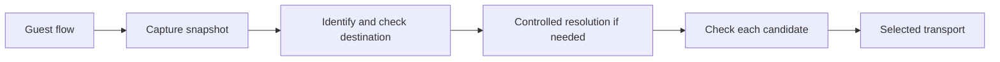

# Outbound connection and replacement contract

This is the shared implementation contract for destination policy, upstream transport, and complete outbound replacement.
It does not advertise proxy, deny-rule, IPv6, or revision support before the corresponding backend implements and reports that capability.
The [design](../investigations/2026-11-16-egress-foundation.md) records the rationale; [shared examples](../../../tests/fixtures/outbound/contract-v1.json) supply inputs for each implementation layer.

## Connection ownership

Capture one immutable policy and route snapshot when a new guest flow enters the forwarding boundary, before resolution or dialing.
All setup attempts and upstream sockets belonging to that flow use the captured snapshot.
Publishing a replacement changes later flows; it does not switch an established flow to another policy or transport.

Disabling outbound networking continues to suspend the guest NIC rather than promising to terminate every established connection.



Policy decides whether the real destination is permitted; transport decides how an approved destination is reached.
The proxy endpoint is not the business destination and cannot substitute for it in policy checks.

| Connection value | Meaning and owner |
| --- | --- |
| Original hostname | Canonical observed or authorized name, when available; retained for SNI, HTTP Host, and certificate verification. |
| Policy address | Guest destination before NAT; address rules must see this value. |
| Approved candidate | Literal IP that passed candidate checks; a connector must not resolve the business hostname again. |
| Connection address | Literal socket destination after the applicable NAT mapping; distinct from the policy address. |
| Port and protocol | Actual business destination port and transport protocol, independent of an upstream proxy's listening port. |
| Policy revision | Identity of the captured complete policy, when the revision protocol is supported. |
| Registration revision | Separate identity of the selected proxy registration, when proxy routing is supported; never a credential. |

Ordinary TCP, hostname-inspected TCP, and secrets MITM must use the same selected transport after their applicable checks.
Reuse the existing `resolveFunc`, `dialFunc`, `upstreamDial`, and `egressDialer` seams.
Retries check candidates individually and share one bounded setup deadline; cancellation releases unfinished setup resources.

Transport failure does not select a different route implicitly.

The local host alias keeps its existing direct NAT behavior.
A future remote transport must reject that alias unless it defines an explicit safe mapping; translated loopback is not the proxy server's equivalent destination.

### TCP transport implementation

The bridge's `egressTarget` carries the observed hostname, pre-NAT policy IP, approved connection IP, actual port, and protocol.
Ordinary TCP binds `egressDialer.byAddress`; inspected traffic binds either `byAddress` or `byName`, and MITM retains that bound dialer for its upstream connections.
The selected `connectFunc` receives this target after the applicable checks.
Its error is returned without selecting the direct socket dialer; an unset connector selects the existing direct transport.
Configure resolver and transport seams before installing the forwarder.

Initial unrestricted TCP also installs this boundary; unrestricted UDP delegates to the upstream forwarder.
Address setup and controlled hostname resolution each use a bounded setup context, including candidate retries and MITM redials.
The connector carries the captured policy revision; revisioned publication uses the control resources below.

The guest-stack transport tests consume the shared NAT and hostname examples, relay HTTP/TLS bytes to test-owned listeners, and verify refused targets never enter the connector.
The MITM test uses an isolated test CA in a subprocess so production certificate verification remains active; a wrong upstream certificate must receive no HTTP request.
For HTTP/2 fixture concurrency, `http2.Transport` owns connection pooling and stream sharing; each pool dial owns a fresh guest/proxy TLS pipe.

## Configuration boundary

The current policy shape is `{ "mode": "enabled" | "disabled", "allow_net": [...] }`.
An omitted `allow_net` has the existing empty-list meaning; disabled mode rejects a nonempty allowlist.
This foundation preserves the current rule grammar and does not increase rule limits or enable IPv6 forwarding.

Configuration contains user policy only.
Revisions, application status, platform constraints, and proxy authentication material belong outside the public policy object.
The future public proxy reference belongs at `network.outbound.proxy`; a Box selects at most one registration.
Proxy credentials use a separate host-only channel and do not enter Guest configuration, ordinary Box options, or exports.

| Replacement input | Required behavior |
| --- | --- |
| Current mode/allowlist request without a precondition | Preserve its unconditional public operation; serialize the internal replacement under the existing lock. |
| Versioned request | Require backend revision support and an internal expected revision; reject unsupported peers before claiming success. |
| Unsupported deny, proxy, or IPv6 input | Reject before application; parsing or retaining a field is not capability delivery. |
| Omitted future protection while it is active | Reject the incomplete replacement rather than clearing the protection. |
| Explicit empty deny list | Clears user denies once that feature is supported; does not clear platform constraints. |
| Explicit null proxy | Clears the user binding once supported; does not bypass destination policy. |

Future disabled configurations may retain supported deny or proxy settings, but those settings cannot enable traffic.
Their omission and clearing rules remain effective while the NIC is disabled.

## Revisions and acknowledgements

A revision is an opaque, Box-scoped token; clients compare for equality rather than ordering tokens or interpreting timestamps.
Existing records receive a documented initial token when revision support is introduced.
Each successful change receives a fresh token, including restoration after a failed persistence attempt.

One trusted coordinator creates the candidate token once and propagates it unchanged through API, Runner, Runtime, and gvproxy.
The complete snapshot includes normalized policy and the selected route identity, including a registration revision when applicable.
Internal metadata does not become an extra field accepted by strict policy decoders.

| Boundary | Contract |
| --- | --- |
| Public policy read | Return the existing policy shape and a strong ETag identifying its persisted revision. |
| Conditional public replacement | Evaluate `If-Match` under the update lock; a false precondition returns 412 before applying the candidate. |
| Internal replacement | Compare the expected current revision under the existing ownership lock, then apply the complete candidate snapshot. |
| Applied acknowledgement | Identify the exact installed candidate; missing, malformed, stale, or mismatched identity is not success. |
| Live status | Distinguish persisted revision, observed applied revision when available, and an explicit application state. |
| Old backend | Reject version-aware operations explicitly rather than silently discarding metadata or using unchecked replacement. |

Expose application metadata through a separate outbound status resource.
A stored policy or a successful HTTP status alone does not prove that the matching snapshot is live.
Confirmed application describes the control-plane snapshot; it is not an Internet-connectivity probe.

Example: connection A captures `rev-a`, which permits `api.example.com` through direct transport.
A conditional replacement installs `rev-b`, which permits only `updates.example.com`.
Later `api.example.com` connections are rejected before dialing, while A retains its original snapshot.

An update carrying stale `If-Match: "rev-a"` receives 412 without application.

## Application and recovery

Reuse the current Box update lock, Runtime persistence operation, and Cloud row-lock transaction.
All complete replacements, including future proxy rotation, share this ownership boundary.
Validate and compile the entire candidate before publishing it for new flows.

### Bridge snapshot publication

The bridge installs its TCP and UDP handlers once, before attaching the guest.
An atomic pointer publishes the complete immutable policy, filter, dialer, and application state; a TCP flow keeps the snapshot captured at entry, including while resolution is paused.
The gVisor IPv4 input/forward gate reads the same snapshot before registered endpoint delivery.
Enabled traffic continues through the existing filter-table chains, including the embedded DNS service.

Disabling publishes a rejecting snapshot before NIC suspension; enabling retains that gate until the NIC has enabled successfully.
NIC errors retain the disabled gate and mark application uncertain.
Policy GET returns 503 while application is pending or uncertain, and successful GET/PUT retain the existing policy JSON shape.
The separate status resource reports the observed snapshot identity and application state without changing the policy body.

The registered-DNS regression fixture binds native gVisor UDP/TCP endpoints on port 5353 and forwards received DNS messages to a test-owned host listener.
It exercises endpoint demultiplexing without replacing the global mode gate, and includes a new query on an established TCP DNS connection.
Controlled NIC pauses separately verify the interval before suspension and the interval after enabling but before policy publication.

### Bridge revision protocol

| Control resource | Contract |
| --- | --- |
| `GET /network/outbound` | Existing policy JSON plus a strong ETag; 503 while application is pending or uncertain. |
| `PUT /network/outbound` | Existing complete policy replacement, optional HTTP `If-Match`; the bridge chooses a fresh revision. |
| `PUT /network/outbound/snapshot` | Version-required internal replacement; one strong expected revision in `If-Match` and a fresh candidate in `X-Boxlite-Outbound-Revision`. |
| `GET /network/outbound/status` | Policy, observed `revision`, `application_state`, and capabilities including `revision-v1`; no persistence or Internet-connectivity claim. |

Version-aware clients use the dedicated snapshot resource and never fall back to legacy PUT.
An old handler may ignore extra headers on its existing resource; a new resource makes unsupported peers reject the operation before application, including after a capability-probe/backend-restart race.
Coordinator headers on the legacy resource are rejected rather than silently ignored.

For a snapshot initialized as `initial`, this request returns policy JSON with `ETag: "rev-b"` only after NIC suspension succeeds:

```http
PUT /network/outbound/snapshot
If-Match: "initial"
X-Boxlite-Outbound-Revision: rev-b
Content-Type: application/json

{"mode":"disabled"}
```

A stale expected revision returns 412 without application.
Candidate metadata requires a single strong expected token; missing, empty, ambiguous, oversized, reserved, or current candidate identities are rejected.
Trusted coordinators allocate fresh candidate IDs once and propagate them unchanged; the bridge does not keep a historical ID registry.
Legacy conditional requests use HTTP strong comparison, including tag lists and wildcard matching.

Startup wire metadata may supply `outbound_revision` to restore an existing identity.
Without a seed, the bridge generates a fresh 128-bit token for that startup, avoiding an initial-token reset across unseeded restarts.
Internal identities use 1–128 ASCII letters, digits, hyphens, or underscores; clients treat them as opaque values.
The public Rust `GvproxyConfig` shape remains unchanged; restoring Runtime-owned revisions belongs to its private bootstrap metadata path.

A matching status revision is not an acknowledgement while `application_state` is `pending` or `uncertain`.
This capability describes the gvproxy control boundary; Runtime persistence and Cloud/Runner propagation require their own completed implementation and verification.

### Runtime control client

`NetworkBackend::outbound_snapshot` reads the backend's policy identity and installation phase.
It requires the `revision-v1` capability and rejects invalid tokens, policies, or phases.
An observed `pending` or `uncertain` phase remains visible to the caller; an identity match alone does not establish completion.

`replace_outbound_snapshot` sends an `OutboundReplacement` to the dedicated snapshot resource.
The validated operation keeps expected and candidate revisions separate from user policy JSON.
It returns `Applied` only for HTTP 200 with exactly one matching strong ETag and the complete matching policy response.
Missing, weak, duplicate, or different acknowledgements produce an error with an uncertain application outcome.
HTTP 412 returns `PreconditionFailed`, a must-use outcome that does not represent successful application.
Unsupported backends return an explicit error; the versioned operation never falls back to the existing unconditional setter.

The existing setters and public configuration structs retain their signatures and wire shapes.
Backends inherit unsupported defaults for the added methods, so an existing custom implementation still compiles.
These methods verify the Runtime-to-gvproxy control boundary, independently of durable recovery or Cloud/Runner propagation.

### Runtime pending attempts and persistence

Runtime replacement uses the existing Box operation lock, including its disk refresh and VM-handle identity checks.
Control metadata lives under `outbound_control` in the stored state JSON; public `BoxState` and user policy structs keep their existing fields.
Records without control metadata use the initial token `initial`.
Lifecycle state writes preserve both the latest policy and its control metadata, including when a handle holds an older state copy.

Before contacting the backend, Runtime durably records the expected live revision and the complete candidate.
Only a matching ACK or a matching `confirmed` readback permits policy and revision to be committed together.
For example, after an ambiguous attempt from `rev-a` to `rev-b`, observing `rev-a` does not clear the pending attempt.
Observing `rev-b` while pending does not confirm completion either.
A later mutating operation may finish persistence once `rev-b` and its policy are confirmed; a persisted-policy read performs no such reconciliation.

If confirmed application succeeds but persistence fails, restoration compares against the applied candidate and uses a fresh identity.
Restoring the old policy as `rev-c` never makes a stale `If-Match: "rev-a"` valid again.
A rejected restoration or failed restoration persistence leaves explicit uncertainty and the durable pending evidence.
An ambiguous timeout never causes an unchecked replay or compensation.
A newly requested unconditional complete replacement may use the observed revision for a fresh CAS, fencing a queued older request once acknowledged.

`NetworkHandle::outbound_snapshot` reads persisted policy and identity without claiming live confirmation.
`replace_outbound_snapshot` applies a trusted coordinator's validated candidate and returns the explicit precondition outcome.
The existing unconditional setter retains its old-backend path only while no versioned control metadata exists.
A versioned call, or a Box already using versioned state, cannot silently fall back to that path.

### Revision-aware REST transport

The Rust REST backend carries `outbound_snapshot`, `outbound_status`, and conditional replacement through the same typed NetworkHandle API.
The policy GET decodes user policy and one strong ETag; the separate status GET retains durable/live comparison and pending evidence.
A response claiming confirmation must contain matching durable and completed live snapshots with no pending attempt.

Internal replacement uses `PUT /boxes/{id}/network/outbound/snapshot`, one expected token in `If-Match`, and the candidate in `X-Boxlite-Outbound-Revision`.
Only policy enters the JSON request body.
HTTP 200 requires one strong matching ETag and the complete matching policy; 412 remains a distinct rejected-precondition outcome.
Missing, weak, duplicated, malformed, or mismatched acknowledgements cannot establish application.
Unsupported routes never trigger the old policy setter, whose unconditional request shape remains unchanged.
Revision control exchanges have a ten-second total bound, including response reading.

Socket-backed REST tests run requests through NetworkHandle and the real HTTP encoder/decoder.
They cover exact request metadata, matching and rejected acknowledgements, old peers, invalid stored policy, and contradictory confirmed status.

### Native C revision boundary

The additive C ABI exposes `boxlite_network_outbound_snapshot`, `boxlite_network_outbound_status`, and `boxlite_network_replace_outbound_snapshot`.
Read calls allocate JSON strings owned by the caller; release them with `boxlite_free_string`.
Their output pointer is initialized to NULL before validating other inputs.

Replacement takes separate expected revision, fresh candidate revision, and complete policy JSON strings, borrowed for the blocking call.
For example, expected `rev-a`, candidate `rev-b`, and `{"mode":"disabled"}` preserve the same identity through NetworkHandle and its selected local or REST backend.
`Ok` with `out_applied=1` confirms application; `Ok` with `out_applied=0` reports a failed precondition.
Errors also initialize `out_applied` to zero and keep the existing error-code ABI.
Malformed UTF-8, invalid tokens, repeated/reserved candidates, invalid policy, and null required pointers are rejected before dispatch.
These are trusted-coordinator operations; the existing unconditional setters retain their signatures.

The C boundary tests call the actual exported functions through a REST runtime, inspect the resulting HTTP requests, free returned strings, and check output initialization and rejection without dispatch.

### Go coordinator API

`Network.OutboundSnapshot` reads durable intent; `Network.OutboundStatus` reads the durable/live comparison and pending evidence.
`ReplaceOutboundSnapshot(ctx, expected, candidate)` preserves the coordinator's fresh candidate across the C ABI and selected Runtime backend.
Check both its error and `OutboundReplaceOutcome`: `OutboundPreconditionFailed` with a nil error is a rejected update, not application.

`OutboundPolicy` supplies explicit wire field names without changing the existing `OutboundNetworkSpec` structure or setter request shapes.

Revision strings are validated before C-string conversion, including embedded NUL, length, and ASCII-token checks.
Network calls retain a shared lifetime lock; Close takes the exclusive lock before freeing the C handle.
Policy updates remain serialized by Runtime's Box operation lock, while a concurrent status read through the same Go Network handle remains available.

As with the existing blocking setters, context cancellation is checked before entering the native call; it does not cancel an in-flight native update.

Go tests use the actual Go/C/Rust stack against controlled HTTP peers, including a held update with concurrent status read.
They cover precondition failure, malformed ACK, unsupported peers, and invalid or cancelled calls rejected before dispatch.

Durable-control tests use the real Runtime operation lock and SQLite database with controlled backend replies.
They cover lost ACKs, pending readback, late requests, competing writers, failed pending writes, fresh restoration identities, stale compensation, and restoration persistence failure.
These tests exercise the new revision protocol; the existing unversioned setter's compatibility behavior is covered separately.

### Runner control resources

Runner exposes policy GET, status GET, and dedicated snapshot PUT under its existing bearer-authenticated Box network routes.
Reads use request-owned Runtime handles without starting a VM; replacements require a running Box.

The independent network handle retains its native ownership after the temporary Box wrapper closes.
Readback leaves borrowed lifecycle cache entries untouched.

Policy GET returns the policy body and persisted revision as a strong ETag.

Snapshot PUT requires one strong expected revision and one fresh candidate header before acquiring a Runtime handle.
A stale comparison returns 412; only the explicit `applied` outcome returns the matching policy and candidate ETag.

Runner tests execute its production bearer and error middleware over HTTP.
Missing, malformed, and wrong credentials cannot reach control lookup; the configured bearer can use all three resources.
A separate client test crosses the actual Go/C/Rust transport against a controlled Runtime peer, including stopped-Box reads and refused mutation.

### Runtime readback and coordinator recovery

`NetworkHandle::outbound_status` compares a durable snapshot with the backend's observed snapshot and installation phase.
It reports `persisted`, optional `observed`, overall `application_state`, optional `pending_revision`, and optional `observation_error` outside user policy JSON.
The durable policy, revision, pending attempt, and VM identity come from one SQLite row version.
Neither this status call nor `outbound_snapshot` acquires the mutating Box operation lock, so reads remain available during a pending update.
Both calls leave pending records and policy unchanged.

Overall `confirmed` requires an exact policy/revision match, a confirmed backend phase, and no durable pending attempt.
A pending backend phase remains `pending`; any mismatch or unresolved attempt is `uncertain`.
Backend observation has a ten-second bound; a failed observation retains durable intent and a diagnostic without claiming live confirmation.
An unsupported backend returns an explicit unsupported error.
A stopped Box returns uncertainty without starting a VM; a handle from an older VM epoch cannot query through its cached backend.
A newly acquired running handle can read the existing control socket without booting or attaching the guest.

After coordinator loss, a surviving backend can report the confirmed pending candidate while durable policy still identifies its predecessor.
GET preserves that divergence as uncertainty.
A subsequent mutating operation can reconcile the matching confirmed candidate before evaluating the caller's precondition; a caller using the predecessor then receives `PreconditionFailed`.
When the backend restarts from committed policy, matching the old durable revision still does not resolve the pending attempt.
A new unconditional complete intent can replace that uncertain state with a fresh candidate through CAS.

Recovery acceptance uses real SQLite storage and a real gvproxy instance over its Unix control socket.
A test-only cancellation point stops the coordinator after a matching backend ACK and before durable commit, then reacquires the Box handle with the backend surviving or restarting.
The VM and guest session remain test fixtures; this checks the control and persistence boundary, rather than an operating-system process crash or guest-VM boot.
Run these checks with real dependencies:

```sh
make test:unit:rust FILTER=outbound_recovery RUST_UNIT_CORE_ARGS='-p boxlite --all-features --lib'
```

### Runtime bootstrap identity

New and restarted VMs receive the persisted revision alongside their persisted policy.
Records without control metadata use `initial`.
An unresolved pending candidate is not replayed at startup: the committed policy and revision seed the backend, and the pending record remains available for reconciliation.
Reattaching to a surviving backend does not replace its live identity.

The revision travels in a private field of the existing stdin launch message, then in the private JSON object passed to gvproxy.
`InstanceSpec`, `NetworkBackendSpec`, `GvproxyConfig`, and `BoxState` keep their public fields.
The existing `GvproxyInstance::from_config` constructor remains available; the explicit revision constructor restores a coordinator-owned identity.
The shim validates the optional token before starting the backend; absent metadata preserves the legacy launch contract.

The shared `bootstrap-v1.json` example passes through the production launch encoder, shim parser, and gvproxy JSON encoder.
Real-library tests create gvproxy with a restored revision, verify live readback and conditional replacement, reject a stale replacement, and repeat after backend restart.
These checks exercise the Rust/Go control boundary without requiring a guest VM.

Run the bootstrap checks with real dependencies, because stub mode cannot link the shim or gvproxy FFI:

```sh
make test:unit:rust FILTER=outbound_bootstrap RUST_UNIT_CORE_ARGS='-p boxlite-shim --bin boxlite-shim'
make test:unit:rust FILTER=outbound_bootstrap RUST_UNIT_CORE_ARGS='-p boxlite --all-features --lib'
```

Install stable TCP and UDP entry points before guest traffic starts, with one shared snapshot reference.
Enabled-to-enabled replacement publishes that reference once; delayed setup, retries, and MITM upstream sockets retain their flow's captured snapshot.

Disabled mode rejects new flows independently of the empty allowlist.
A mode gate before IP endpoint demultiplexing also covers registered services such as DNS, which bypass default transport handlers.
This gate uses the same snapshot and leaves enabled-mode DNS behavior unchanged.
Packets arriving under disabled mode cannot start new DNS forwarding; work accepted before publication retains established-work semantics.

To disable, publish the disabled snapshot before suspending the NIC, then acknowledge only after suspension succeeds.
To enable, retain the disabled snapshot until NIC enabling succeeds, then publish the enabled candidate.
Mark application pending before publication or a mode transition.
On a failed mode transition, retain the disabled gate and report uncertainty; do not confirm the candidate or a stale previous revision.
Compilation failure before publication preserves the previous confirmed snapshot.

An acknowledgement timeout leaves the outcome uncertain because the candidate may already be live.
Perform bounded readback and distinguish the expected, candidate, and another revision; unresolved state remains explicit.
Observing the expected revision does not prove rejection while the original request can still apply later.

Keep uncertainty until completion or fencing is established; this contract does not require a new fencing API.

After confirmed application, persistence failure can trigger conditional compensation against the candidate revision.
Restoration uses a fresh token, so stale clients cannot succeed after a change-and-restore cycle.
Do not replay or compensate blindly after an ambiguous timeout.

If recovery cannot confirm both application and persistence, return failure and preserve readback diagnostics.

Database unavailability cannot support a durable-state claim; require readback after recovery.

The crash check stops the coordinator after a matching acknowledgement and before persistence.
Repeat with gvproxy surviving the coordinator, then with gvproxy restarting too.
Reconcile observed and persisted revisions or expose uncertainty; never label a stale stored revision as confirmed live state.

## Application and recovery timing

The coordinator marks application pending before publication or a NIC transition.
The following sequence expresses the application and recovery contract above; it is an implementation target.

```mermaid
sequenceDiagram
    participant C as Coordinator
    participant S as gvproxy snapshot
    participant N as Guest NIC
    participant D as Persistence
    Note over C,S: Complete candidate is validated and compiled
    C->>S: Mark application pending
    alt Disable
        C->>S: Publish disabled snapshot
        C->>N: Suspend NIC
    else Enable
        Note over S,N: Keep disabled snapshot during NIC enabling
        C->>N: Enable NIC
    else Enabled-to-enabled replacement
        C->>S: Publish candidate once
    end
    alt Mode transition fails
        Note over C,N: Retain disabled gate; report uncertainty without confirmation
    else Publication or transition succeeds
        opt Enabling
            C->>S: Publish enabled candidate after NIC enabling succeeds
        end
        alt Exact candidate application confirmed
            S-->>C: Acknowledgement or readback identifies exact installed candidate
            C->>D: Persist candidate
            alt Persistence succeeds
                Note over C,D: Application and persistence confirmed
            else Persistence fails
                C->>S: Conditional compensation against candidate with fresh token
                C->>D: Persist restoration if application confirmed
                Note over C,D: Unconfirmed restoration or persistence remains uncertain
            end
        else Application unresolved
            C->>S: Bounded readback after acknowledgement timeout
            S-->>C: Expected revision observed; application may still be running
            Note over C,S: Old-revision readback cannot prove rejection while request can still apply
            Note over C,S: Remain uncertain until request completion or fencing is established
            Note over C,D: Preserve uncertainty; no blind replay or compensation
        end
    end
```

## Shared examples and evidence

`tests/fixtures/outbound/contract-v1.json` separates current policy examples from versioned replacement and connection-boundary examples.
The versioned cases are implementation targets; the fixture file does not enable a backend capability.
Runtime, Runner, Cloud, and forwarding tests should consume the applicable cases through their real production boundaries.

| Boundary | Required evidence |
| --- | --- |
| Destination and transport | Allowed ordinary, hostname, and MITM flows reach the selected connector; rejected targets never reach it. |
| NAT and controlled DNS | Pre-NAT checks, approved literal dialing, candidate changes, cancellation, and setup budgets retain their contract. |
| Replacement | Stale writes and stale compensation lose under controlled interleavings. |
| Mode transitions | TCP/UDP and registered DNS stay gated during paused NIC transitions and after injected NIC failures; enabled controls still succeed. |
| Acknowledgement | Missing or mismatched acknowledgement cannot appear as confirmed success. |
| Recovery | Persistence errors, delayed application after old-revision readback, and the specified crash windows retain explicit uncertainty. |
| Compatibility | Existing mode/allowlist clients retain their documented behavior; unsupported extensions and old backends fail explicitly. |
