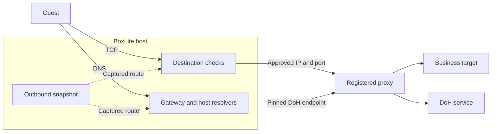
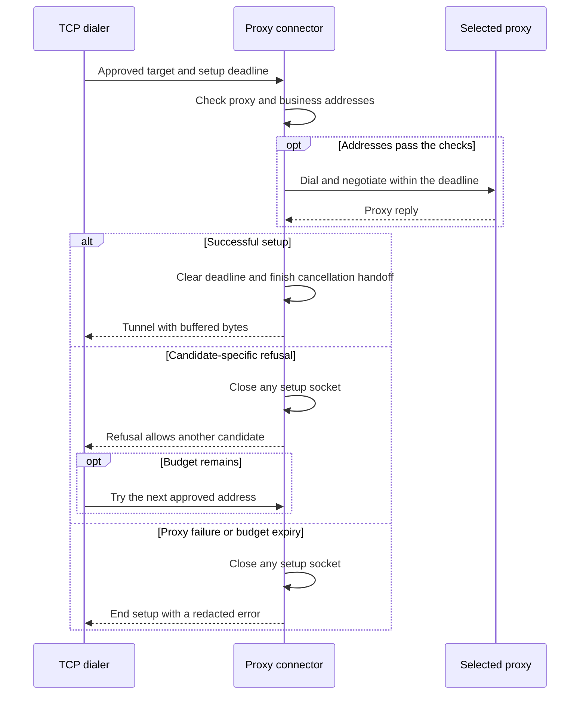
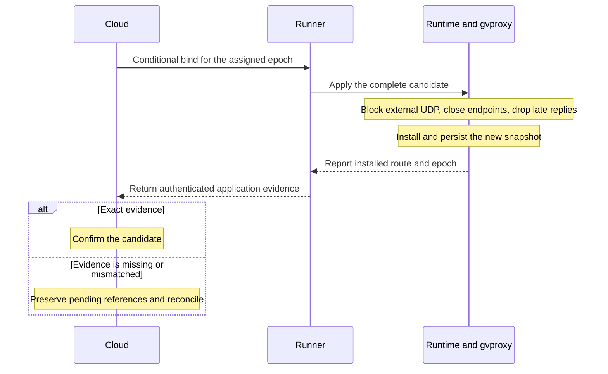

# Outbound proxy contract

**Status:** Proposed capability. This contract and its fixture scenarios define the behavior
that later changes will implement and verify.

The host enforces a Box's selected proxy through the existing
[outbound snapshot](outbound-contract.md#connection-ownership). Destination policy checks
the business target first. The captured transport then connects to the approved literal IP
and port, preserving the hostname for origin TLS and HTTP.

The proposed paths use the same captured route for approved TCP and external DNS queries.

## Registration and binding

An organization can register named proxies, each with one public endpoint URL. A Box selects
at most one registration by name in `network.outbound.proxy`. Names are immutable and unique
within the organization, matching `^[a-z0-9][a-z0-9-]{0,62}$`.

Under the existing organization prefix, `/proxies` accepts `POST` and `GET`, and
`/proxies/{name}` accepts `GET`, `PATCH`, and `DELETE`.

Members may read. Dedicated organization permissions govern mutation, and Box writers may
bind within their organization.
Missing and foreign names both return HTTP `404`.

The optional `credential` is a write-only object with `username` and `password` strings.
Omitting it on `PATCH` preserves it, and explicit `null` clears it. A change in scheme or
authority for a credentialed registration requires an explicit credential choice.

Registry readbacks expose the name, canonical URL, registration revision, and
`credential_configured`. Credential material travels only through authenticated host
control. Registry and outbound readbacks, Guest inputs, ordinary Box options, logs, and
exports omit it.

| Box input | Required behavior |
| --- | --- |
| Create with `proxy` omitted or `null` | Leave the Box unbound. |
| Create or replace with a registration name | Resolve it in the Box's organization. |
| Complete replacement omits `proxy` on a bound Box | Reject the incomplete replacement, including while outbound is disabled. |
| Complete replacement specifies `proxy: null` | Request explicit unbind through revisioned control. Destination policy still applies. |
| Disabled mode includes a binding | Retain the binding and block new egress. |

For example, `{"mode":"enabled","allow_net":["packages.example.com"],"proxy":"build-egress"}`
selects `build-egress` for allowed traffic. Failure to use the proxy ends the attempt.

The first release requires enrolled HTTPS Runner V0 with proxy bootstrap, staging, and
readback support for every binding. Bound create skips the warm pool. Ineligible placements
fail before dispatch or credential delivery, including HTTP-only and V2 Runners.

A protected Box can unbind only if its assigned Runner can attest the exact unbound state.
If the Runner cannot do so, refuse before reservation or dispatch and retain the existing
binding and references.

## Protocols and DNS

| Scheme | Default port | Tunnel and authentication |
| --- | --- | --- |
| `http` | 80 | HTTP/1.1 CONNECT, unauthenticated or Basic over plaintext TCP. |
| `https` | 443 | HTTP/1.1 CONNECT inside TLS, unauthenticated or Basic with verified endpoint identity. |
| `socks5` | 1080 | SOCKS5 CONNECT, unauthenticated or RFC 1929 username/password over plaintext TCP. |

Canonicalize the URL host and reject userinfo, query, fragment, non-root paths, invalid ports,
and unsupported schemes. Each credential field has 1–255 printable ASCII bytes, and a Basic
username cannot contain a colon.

Reject redirects, authentication downgrade, and SOCKS
commands other than CONNECT. Use TLS CONNECT for first-hop credential confidentiality.

Normalize mapped IPs before candidate checks. Refuse private, deployment-protected, and
non-public special addresses, including the host alias.

Check both pre-NAT and approved connection addresses for business TCP. Ordinary TCP,
inspected TCP, and secrets MITM use the same selected route.

Setup, including resolution and candidate retries, has a 30-second budget or the shorter
caller deadline. Direct bootstrap DNS resolves only registered proxy endpoint names.

Gateway DNS serves local records. Both gateway DNS listeners and the host business resolver
use a deployment-pinned DoH endpoint for external lookups. Those queries use the captured
proxy and a five-second budget.

Proxy or DoH failure ends the operation. Bind blocks external UDP, including UDP DNS and
QUIC, before acknowledgement, closes existing external UDP endpoints, and drops late replies.

Gateway DNS and DHCP remain available. Unbind restores ordinary policy for new direct endpoints.

### Bridge proxy connector

The bridge connector accepts one approved proxy socket address and a checked IPv4 TCP target.
It verifies both business addresses and the proxy address before opening a socket.
HTTPS verifies the endpoint certificate chain and registered name before sending CONNECT.

The connector caps all HTTP response headers for a tunnel at 32 KiB, including interim replies.
A final 2xx starts raw tunnel data at the end of the headers, regardless of HTTP body framing.
SOCKS5 offers exactly one authentication method and validates the complete reply before returning.

One deadline covers dial, TLS and proxy negotiation, and the connector releases the socket on failure.
The by-name dialer can advance past a refused connection IP or a well-formed SOCKS5 host-unreachable or
connection-refused reply. Proxy failures stop the operation, and combined setup remains bounded
by the original deadline.

The bridge pins its public address tables in [proxy_address_ranges.csv](../../../src/deps/libgvproxy-sys/gvproxy-bridge/proxy_address_ranges.csv).
Deployment deny prefixes override registry results.

The longest special-purpose match must be globally reachable. Native IPv6 proxy addresses
also require an allocated unicast range.

| IANA XML snapshot | Updated | SHA-256 |
| --- | --- | --- |
| [IPv4 special-purpose](https://www.iana.org/assignments/iana-ipv4-special-registry/iana-ipv4-special-registry.xml) | 2025-10-09 | `37f334466c842387a8aee8d1ae7a6d5b2208ef27eb8964072538b73ee2f5b21d` |
| [IPv6 special-purpose](https://www.iana.org/assignments/iana-ipv6-special-registry/iana-ipv6-special-registry.xml) | 2025-10-09 | `660acf0201b462b8d820605ba1cb20c4ed216acd883ee4a55a17453d73d4c3aa` |
| [IPv6 unicast allocations](https://www.iana.org/assignments/ipv6-unicast-address-assignments/ipv6-unicast-address-assignments.xml) | 2025-10-10 | `22f9a545e020ea6b9adea9ea0276f3157e32c838682459a45bfe7760de0aefc3` |

On refresh, split each special-purpose address list into one row per prefix and keep only
`True` as `allow`. Keep `ALLOCATED` as `allow` for the IPv6 allocation rows and `deny` for
every other value in either table. Review the diff and run `make test:unit:gvproxy`.

## Revisions and failure behavior

The [shared revision contract](outbound-contract.md#revisions-and-acknowledgements) owns
the update precondition, complete snapshot, and common acknowledgement format. The
registration revision identifies the proxy version independently of the Box policy revision.
A stale public `If-Match` returns `412` before mutation or Runner dispatch.

The proposed bind acknowledges publication after the host has stopped external UDP relays.

Confirm a proxy update only with authenticated application evidence matching the Box,
assigned Runner, runtime epoch, policy, and exact registration revision or explicit unbound
state. Exact same-epoch readback of the durable, installed candidate can settle a lost
acknowledgement. An old read or a pending attempt leaves the outcome uncertain.

While an update is uncertain, retain the committed and pending references and return `409`
to conflicting writes. Deleting a referenced registration or retiring a referenced version
returns `409`.

New flows capture the installed route, and established TCP keeps its captured route. Rotation
does not immediately revoke established tunnels.

After reassignment, keep new egress closed until the old runtime epoch is confirmed terminated
and durable state is reconciled. Ordinary Box deletion retains evidence and references while
the old instance or its application state is unresolved. A generic Runner `404` alone does
not establish that the exact epoch terminated.

A policy-only legacy write refuses a bound or unresolved Box before mutation. Legacy
destructive recovery likewise refuses before destruction unless the exact assignment and
epoch are clear of binding and recovery state. Clear unbound Boxes use the existing controls.

The outbound status resource separates desired, committed, pending, and installed identities.
It reports redacted diagnostics such as `proxy_unreachable`, `proxy_auth_failed`,
`proxy_handshake_failed`, and `proxy_timeout`.

Ineligible placements report `runner_proxy_unsupported` or `runner_proxy_tls_unsupported`.
Guest applications receive native network failures.

## Acceptance and ownership

[Fixture scenarios](../../../tests/fixtures/outbound/proxy-contract-v1.json) record proposed
inputs and expected evidence. They cover stale `If-Match` and zero business DNS fallback during
outages. They also require retaining references when old termination or durable evidence is
missing.

| Slice | Production acceptance it owns |
| --- | --- |
| 01 Contract | Public fields, support matrix, visible errors, and fixture scenarios. |
| 02 Connector | Controlled tunneling, authentication, address checks, timeouts, cancellation, socket cleanup, and zero direct fallback. |
| 03 DNS and UDP | Both gateway listeners, host business resolution, bootstrap exceptions, and UDP cutover during bind and unbind. |
| 04 Runtime and Runner | Host-only credential authorization and delivery, enrolled Runner identity, and a common route for ordinary, inspected, and MITM TCP. |
| 05 Registry | Organization authorization, authenticated encryption and key retention, redaction, and reference protection in deletion races. |
| 06 Runtime update | Complete snapshots and route evidence, stale writes, rotation, loss of acknowledgement, exact-epoch recovery, and deletion or legacy control safety. |
| 07 SDK and CLI | OpenAPI parity, actual requests, and write-only credential handling. |
| 08 Cloud acceptance | Controlled proxy and target, observed traffic and failures, DNS latency, and combinations with BUI-209 in the joint acceptance. |

The [PR01 design](https://github.com/boxlite-ai/boxlite/issues/2861) describes these boundaries.
The [overall design](https://github.com/boxlite-ai/boxlite/issues/2734) tracks dependencies and
the [detailed proposal](https://github.com/boxlite-ai/boxlite/issues/2832) records the planned
recovery and credential mechanisms.
