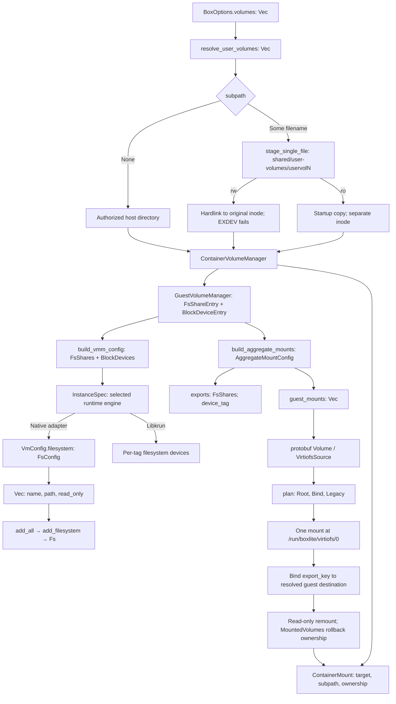
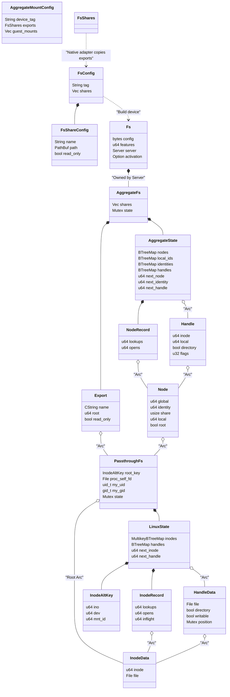
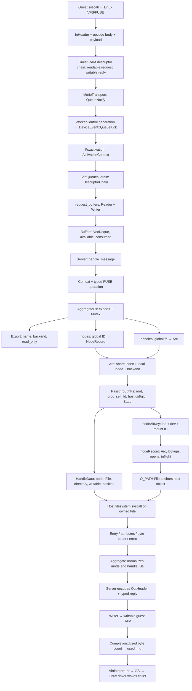
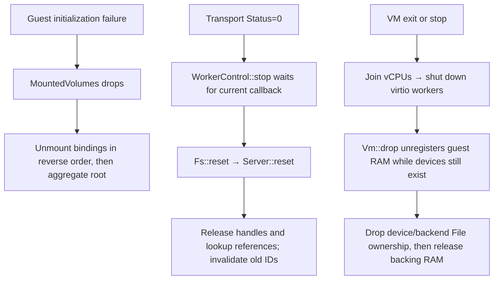
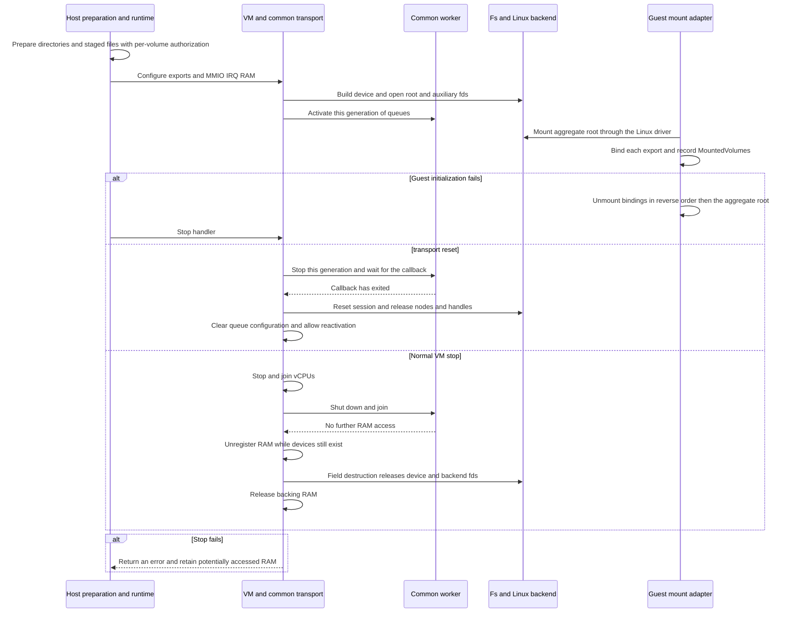

# Linux virtio-fs data flow

The experimental native VMM exposes multiple host directories through one virtio-fs device. The opt-in native adapter translates runtime shares into `VmConfig.filesystem` and sends matching aggregate guest mount instructions; libkrun remains the default engine.

## Configuration and mounting

Device tag identifies the device; export key selects a child of its synthetic root; logical tag resolves legacy guest paths. Host paths stay in host configuration. Directory exports retain their own read-only policy. A single-file export contains only the staged file; the existing container subpath binding selects that file at the requested container destination.

`build_aggregate_mounts` requires existing, disjoint export roots. It resolves
symlinks and rejects equal roots or either direction of directory containment,
regardless of read-only flags, naming both conflicting export keys. A share
must not become reachable through another export with different policy or
isolation boundaries. In particular, the existing
`shared/user-volumes/<tag>` staging layout cannot be used with this aggregate
builder alongside SHARED: configuration fails rather than exposing the staged
file through SHARED. Independent sibling directories remain valid. This is a
configuration-time path check, not protection against concurrent host namespace
changes or aliases introduced by bind mounts.

The existing libkrun preparation remains unchanged: single files are staged under
`shared/user-volumes/<tag>`, with writable hardlinks and read-only startup copies.
The legacy builders keep empty aggregate identity fields. Guest initialization
uses the original input-order mount loop for those batches, without new sorting
or rollback. Only batches carrying `device_tag` or `export_key` enter the aggregate
planner; malformed aggregate identities fail validation there. Dynamic attachment
and existing block-device mount behavior remain unchanged. This PR adds no host
staging migration, sandbox grants or runtime stop/cleanup changes.

## Data structures and ownership

Solid lines in the diagram below represent ownership; dashed lines represent
ID-based lookup or configuration translation. The aggregate layer and Linux backend maintain separate ID
spaces. Requests acquire an `Arc` and release the mapping lock before performing
host I/O. The native adapter converts `InstanceSpec.fs_shares` into `FsConfig`
before VM device registration. Engine selection remains explicit; the ownership
diagram does not imply that native is the product default.

`Buffers` owns a `VecDeque<VolatileSlice>` view of the currently validated
descriptors and tracks remaining and consumed lengths; `Reader` and `Writer`
wrap it. `ActivationContext` owns RAM, queues and the interrupt interface and
is held by `Fs` during activation. `MountedVolumes(Vec<PathBuf>)` records mounts
created for the current guest aggregate batch and unmounts them in reverse order
unless committed. Legacy configurations return an empty guard that does not
take over cleanup of legacy mounts. Host single-file staging and its lifecycle
remain unchanged; these objects do not transfer ownership of the original host
files.

## Device requests and replies

The aggregate root has node ID 1. `local_ids` maps `(share index, backend inode)` to the global node ID. `NodeRecord` tracks lookup and open ownership separately. Each request retains an `Arc` while host I/O runs; a concurrent FORGET or RELEASE cannot invalidate that request. Backend identity includes the mount ID so identical inode numbers on distinct mounts do not collide. Cross-export rename/link returns EXDEV.

Guest-visible file identity is separate from the FUSE request node ID.
`identities` maps `(share index, host device, host inode, host mount ID)` to a
stable number used by READDIR's `d_ino` and by lookup, READDIRPLUS, getattr and
setattr attributes. Hard links within one share use the same number even after
their request nodes are reclaimed; different shares retain separate identities.
Ordinary READDIR balances its temporary backend lookup and does not acquire
guest lookup ownership. Node records and file descriptors remain reclaimable.
The scalar identity map grows with distinct host identities observed during the
session and is cleared on destroy/reset; it does not retain file descriptors.
Host inode reuse may reuse a visible identity, but never revives a stale request
node ID. Request node IDs remain independently allocated and are not reused.

Read-only mutation policy belongs to the aggregate layer. Protocol lengths, descriptor direction and predictable response capacity are checked before effects. Ordinary file opens use direct I/O, zero entry/attribute timeouts and no writeback cache. WRITE returns the actual count; FSYNC/FSYNCDIR invoke host synchronization before replying. FLUSH is separate from durability. FORGET completes with zero reply bytes.

## Ownership and cleanup

Host staging, sandbox authorization and libkrun shutdown behavior are unchanged.
A native worker shutdown failure retains potentially accessed RAM according to
the common VMM lifecycle. Aggregate rollback applies only to explicitly selected
aggregate batches; legacy-only batches keep their original failure semantics.

Host file operations execute synchronously on the shared worker thread. A real
host write lease test holds a regular file while production FUSE OPEN blocks in
kernel `openat`: the kernel's lease-break SIGIO confirms the blocked operation,
a second fs device waits, and transport reset reports its stop timeout. Explicit
lease release lets both requests finish. This qualifies blocking host filesystem
behavior; it does not measure physical storage throughput or tail latency.

Injected `pread64` delay tests separately exercise successful reset, failed stop,
shutdown retry and RAM `Arc` retention. An expired gate watchdog fails the test.
A concurrent producer uses four independent request/reply chains, refills only
completed slots and stays live during reset. Reset has a separate one-second
bound; the producer's five-second watchdog is a failure. Initial runs passed,
but subsequent isolated runs reproducibly timed out with transport status 15
instead of 0. The unchanged regression therefore exposes a sustained-load stop
failure: the shared drain can remain inside the callback while requests keep
arriving. Earlier passes do not qualify bounded progress. Resolving this requires
a public queue budget/continuation decision, which the current design assigns to
common scheduling work; it cannot be solved by cancelling a host syscall.
The current delivery accepts this recorded limitation and defers sustained-load
stop progress to that follow-up. The failing test remains unchanged and runs
in the ordinary unit target; no clean full-suite result is claimed.
Joint VM/Fs lifecycle tests now run production FUSE READ on the VM's registered
RAM through the shared worker, with an injected `pread64` gate and a mock
hypervisor registration log. A timed-out shutdown keeps the registration and
backing; releasing the gate completes READ, shutdown retry succeeds, and VM drop
unregisters and frees the backing. Dropping the VM while READ remains blocked
instead preserves the registration and deliberately retains backing RAM, even
after the callback finishes. Both cases pass with
`make test:unit:vmm FILTER=blocked_fs`. This verifies host ownership and cleanup;
it does not exercise a real hypervisor or physical slow storage.

## Verification record

The table below records the source implementation's results before integration
with the current upstream device composition. It is retained for traceability;
these results do not establish that the integrated branch passes. Current-branch
verification must be recorded separately after resolving the interface changes.

The source runs used Linux x86_64 with KVM and Linux 6.12.110 built through
`make vmm:boot:host` with that checkout's effective kernel configuration:

| Check | Observed result |
| --- | --- |
| `make test:unit:vmm` | 283 VMM and 16 hypervisor passed; hardware tests ignored in this target |
| `make clippy:vmm` | Passed |
| `make test:integration:vmm:linux` | All 12 passed, including actual virtio-fs mount, host-byte read, guest creation/write/fsync, retained-fd fstat/fsync after rename/unlink, reboot and export-fd cleanup. A coordinated host rewrite becomes visible through the same guest fd using pread. Read-only MAP_PRIVATE faults return the same initial byte as read; MAP_SHARED returns ENODEV because direct-I/O mmap support is not negotiated. The mixed-export boot reads a read-only export, verifies EROFS on write-open, and writes through a separate hardlink export without changing SHARED's colliding name |
| `make test:integration:vmm:kvm` | VMM 8 passed; hypervisor 7 passed, 1 failed with EINVAL during set sregs |
| `BOXLITE_DEPS_STUB=1 make test:unit:rust FILTER=volumes` | Passed: core 14 in each feature pass, shared layout 1 |
| `BOXLITE_DEPS_STUB=1 make test:unit:guest FILTER=storage::aggregate` | All 6 passed, including real bind/remount/rollback inside a mount namespace |
| Single-file sandbox regression | Historical staging migration test; migration and its grants removed from this PR |
| `BOXLITE_DEPS_STUB=1 make test:unit:rust FILTER=volumes::staging` | All 5 passed in both core feature configurations, including actual cross-filesystem hardlink failure and startup snapshot isolation |
| `BOXLITE_DEPS_STUB=1 make test:unit:rust FILTER=single_file` | Core 4 and REST-enabled core 5 passed; includes both isolate_mounts modes, write-through and idempotent staging cleanup |
| `BOXLITE_DEPS_STUB=1 make test:unit:rust FILTER=cleanup_guard` | Initialization failure persistence regression passed in both feature configurations |
| `BOXLITE_DEPS_STUB=1 make test:unit:rust FILTER=watcher` | Both watcher lifecycle regressions passed in both feature configurations |
| `make test:unit:vmm FILTER=fs_device_routes_colliding` | Mixed-export routing, independent IDs, EROFS and hardlink write-through passed |
| `make fmt:check:rust` | Passed |
| `make test:vmm:boot` | Host build contracts 2 passed; box wrapper 6 passed and 1 failed because its isolated PATH lacks sh on this Nix host |

## Integrated branch verification

The integrated branch is based on upstream `d6cc835a0`, with fs added after block
devices through the existing slot allocator. Block, net, console and vsock
implementations retain their upstream behavior. The configured kernel was rebuilt
with `make vmm:boot:host BOOT_JOBS=16`; its effective configuration includes
`VIRTIO_BLK=y`, `FUSE_FS=y` and `VIRTIO_FS=y`. The kernel SHA-256 is
`9b34a2fb7b026d607a2a02d0339898afaec4e5f11358c4cc1c66e21789071288`.

| Check on the integrated worktree | Result and boundary |
| --- | --- |
| `make test:unit:vmm` | Earlier full run: 371 VMM and 16 hypervisor pass, 25 and 8 ignored. The subsequent isolated sustained-producer failure below means this is not a stable final green result |
| `make clippy:vmm` | Passes |
| `make test:integration:vmm:linux` with the merged-config kernel | All 15 tests pass, including upstream block boots and the three existing fs boots |
| `make test:unit:vmm FILTER=worker_tests` | Earlier seven-test run passed; later isolated four-chain producer runs fail reset with status 15 instead of 0. This supersedes the earlier clean lifecycle qualification. The failing assertion is retained |
| `make test:integration:vmm:mounts` | Passes after rebuilding the static init from the final guest source; uses the merged-config kernel and cached musl libseccomp 2.6.1 through the existing build helper |
| Construction and session fd tests | Isolated real EMFILE at root/auxiliary-fd open, later-export ENOENT rollback, populated reset/destroy/drop and recovery pass with exact fd baselines |

The combined boot invokes the actual guest `storage::mount_volumes`, rather than
reimplementing its syscalls. It verifies partial-batch rollback, guard rollback,
remount and commit, SHARED's conventional path, nested targets, colliding names,
read-only EROFS, directory writes and hardlink write-through. The host checks
snapshot isolation and export-fd release after VM destruction. The dedicated
`make test:integration:vmm:mounts` is the repeatable build-and-run entry; the final
run after review fixes passed in 1.49 seconds (excluding compilation).

Final supporting checks also passed:

- `BOXLITE_DEPS_STUB=1 make test:unit:guest FILTER=storage::`: 19 tests,
  including real namespace bind/remount/rollback and post-mount failure cleanup.
- `BOXLITE_DEPS_STUB=1 make test:unit:rust FILTER=volumes`: 16 core tests
  in each feature configuration and one shared-layout test.
- `BOXLITE_DEPS_STUB=1 make test:unit:rust FILTER=shutdown`: 30 core tests
  in each feature configuration, one hypervisor test and three VMM tests.
- `make fmt:check:rust`, `make help` and `git diff --check`: passed.

The earlier staging cleanup and block post-mount cleanup changes have been
removed to preserve existing libkrun behavior. Historical counts above predate
that scope correction and do not qualify the revised branch. Aggregate batches
retain parent-first planning and rollback; legacy-only batches use the original
mount loop. A regression with two missing block sources checks that the first
input error is preserved even when its destination is deeper than the second.

`make test:vmm:boot` remains a failure on this Nix host: two host-build contracts
pass; six box-wrapper tests pass and one fails because its isolated PATH has no
`sh`. Earlier use of the old kernel also failed three block tests; the rebuilt
kernel resolves those failures. Neither earlier failure is reported as a passing
run. `make test:integration:vmm:kvm` also ran: all eight VMM checks
passed; hypervisor checks reported seven passes and the existing register
round-trip failure (`set sregs` returns EINVAL). This remains a failed target.
`BOXLITE_DEPS_STUB=1 make test:unit:rust FILTER=single_file` passed: four core,
six shared and five REST-enabled core tests. SDK, full product runtime and real
release archive builds were not run.

Private mmap was checked for initial data access only; visibility of later host
changes through an existing private mapping is not guaranteed by this direct-I/O
contract. The producer workload has exposed a reproducible reset timeout under
concurrent replenishment. Sustained-load shutdown is an explicitly deferred
common-framework optimization and does not block this functional delivery.
The failure remains reproducible, rather than being counted as a pass.
At this earlier verification stage, whole-Box Guest.Init and lifecycle integration
had not been exercised. The
[native engine guide](../../../guides/native-vmm.md#linux-x86_64-m2-and-m3-matrices)
describes the current integration, matrix commands and qualification limits.
BSD source attribution has been checked; existing packaging is unchanged and real release
archive builds and inspection remain outstanding. A local `make runtime` release
attempt failed first because Go was absent from PATH. Retrying with the installed
Go toolchain built libgvproxy, then failed in libkrunfw install-name adjustment
because the required executable was unavailable. No release archive was produced.
These are open acceptance items, not passing results.

## Acceptance IDs and evidence layers

| ID | Current evidence | Limitations |
| --- | --- | --- |
| F01–F05 | Real object creation, attributes, reads/writes and removal/rename in `fs_protocol`; Linux backend identity matrix | Fixed host identity; request credentials are not switched |
| F06 | Stale nodeid/fh on the in-memory device; fstat/fsync after real guest rename/unlink | Results recorded separately for each layer |
| F07 | Small-buffer READDIR/PLUS over 300 files and reference reclamation | Test-fabricated replies are not evidence |
| F08–F10 | Real symlink/hardlink/xattr, cross-share EXDEV and host moves outside directory boundaries | Unsupported operations retain explicit errno values |
| F11–F12 | Actual WRITE counts; real FSYNC/FSYNCDIR; worker FSYNC/FDATASYNC gates verify reply waiting and EIO; READ after three FLUSH operations and RELEASE/FORGET fd regressions | Gates inject timing; successful synchronization executes real syscalls; FLUSH does not promise durability |
| F13–F17 | Protocol tests for statfs, allocation, seek, rename flags, INIT and unsupported operations | Does not extend to DAX, locks or special-file data access |
| B01–B03 | Mixed exports on one device, same-name routing, independent identities, read-only mutation entry points and real guest combined mounts | Whole-Box integration remains experimental; full filesystem conformance and other platforms remain unqualified |
| B04/B07/B12 | Out-of-boundary and renamed objects, host identity, writable write-through, read-only snapshots and EXDEV | Full jailed native Box acceptance not performed |
| B05 | Separate lookup/open/inflight ownership, FORGET/PLUS and real fd reclamation | IDs are not reused within a session |
| B06 | DIRECT_IO and zero-timeout contract; coordinated host rewrite through the same guest fd; initial MAP_PRIVATE faults and MAP_SHARED ENODEV | Later changes are not guaranteed visible through an existing private mmap |
| B08–B09 | Segmentation, direction, capacity, common frozen descriptors, indirect descriptors, dual queues, notifications and activation/reset | Follows common queue and transport boundaries |
| B10 | Real lease-blocked OPEN, delays to other Fs devices, reset timeout/success, injected gates and RAM Arc checks pass; replenishment over four chains ultimately reproduces a reset timeout failure | Follow-up common-framework optimization: drain stop progress under continuous replenishment; known failure retained without blocking this functional delivery; joint real Fs read callback and mock VM registration/release tests added |
| B11 | EMFILE on root/auxiliary fds, second-export failure, injected ENOSPC/short writes and repeated populated reset/destroy/drop | Injected errors and real disk exhaustion are identified separately |
| B13–B14 | Configuration, mounts, a minimal real guest and legacy-engine preparation regressions | Full Box, exit.json, independent copy RPC and dual-engine execution await external integration |

## Source attribution

FUSE ABI, filesystem interfaces, server, descriptor adapter and Linux passthrough derive from the Chromium OS implementation carried by libkrun commit `e12b9b3780ffa8df9f3e1797b217d13453479167`. Retain their original BSD headers and the accompanying `src/vmm/src/virtio/fs/LICENSE`; root `NOTICE` records the source. The original Chromium OS headers were compared against those six files at the pinned commit, and each adapted file now records its original path, commit and BoxLite modifications. The mapping is below. The upstream repository's top-level Apache license does not replace these file-specific BSD terms. The license conditions and disclaimer match the [historical Chromium OS crosvm license](https://chromium.googlesource.com/chromiumos/platform/crosvm/+/refs/heads/release-R80-12739.B/LICENSE). Native VMM source redistribution retains these headers, the full local
BSD text and root NOTICE. Existing runtime, CLI and C SDK packaging is unchanged;
future binaries carrying the native VMM must include the applicable license text.

| BoxLite path beneath `src/vmm/src/virtio/fs/` | Original path at the pinned commit |
| --- | --- |
| `filesystem.rs` | `src/devices/src/virtio/fs/filesystem.rs` |
| `fuse.rs` | `src/devices/src/virtio/fs/fuse.rs` |
| `server.rs` | `src/devices/src/virtio/fs/server.rs` |
| `multikey.rs` | `src/devices/src/virtio/fs/multikey.rs` |
| `linux/passthrough.rs` | `src/devices/src/virtio/fs/linux/passthrough.rs` |
| `descriptor.rs` | `src/devices/src/virtio/descriptor_utils.rs` |

`aggregate.rs` and the native device/VM registration glue are BoxLite implementation files with the project's Apache header. At the pinned commit, `src/devices/src/virtio/fs/linux/mod.rs` contains only module declarations and has no copyright header; the local `linux/mod.rs` conservatively carries the adjacent implementation's BSD notice, rather than a preserved upstream header.

The source and license check re-fetched all six mapped files at the pinned commit
and confirmed their original headers, source paths and local modification notes.
The commit matches the repository's libkrun gitlink. After stripping comment
prefixes and normalizing bullets, numbering and whitespace, all three conditions
and the complete disclaimer match the historical Chromium OS license linked
above. Root `NOTICE` identifies the same source and original copyright.
This source inspection does not claim that release archives have been built or
that other bundled components have been audited.

## Legacy compatibility scope correction

Legacy-only Guest.Init batches now call the original `volume::mount_volumes`
loop and return an empty guard. Their input order, first-error behavior and
post-initialization failure semantics remain unchanged. Aggregate identity fields
are empty in legacy builders; native Guest.Init selects the aggregate builder. Existing staging,
sandbox, block mounting, shutdown and artifact packaging files match main.

After this correction, `BOXLITE_DEPS_STUB=1 make test:unit:guest FILTER=storage::`
passed in the Nix development environment with libseccomp available: 24 passed,
4 privileged tests ignored. The legacy order regression failed against the prior
production code (the second, shallower destination failed first) and passed with
the restored legacy loop. The real VM mount target was not rerun in this checkout;
its kernel and static init artifacts are absent. Earlier VM results above remain
historical evidence, not a fresh qualification of this revision.
