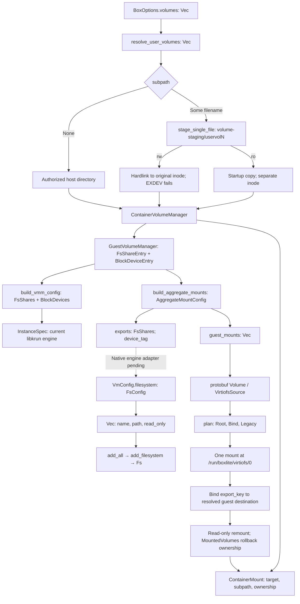
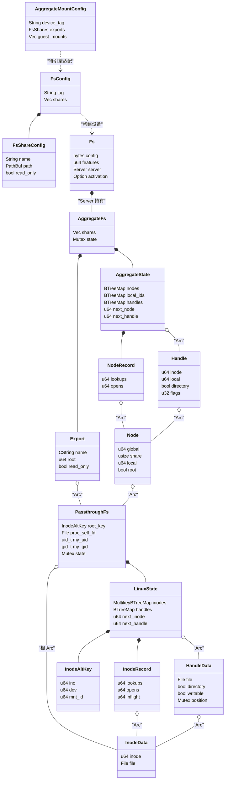
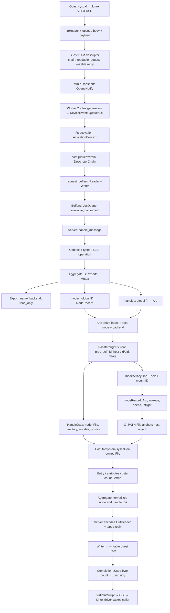
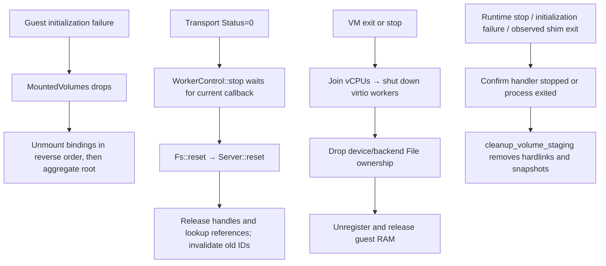
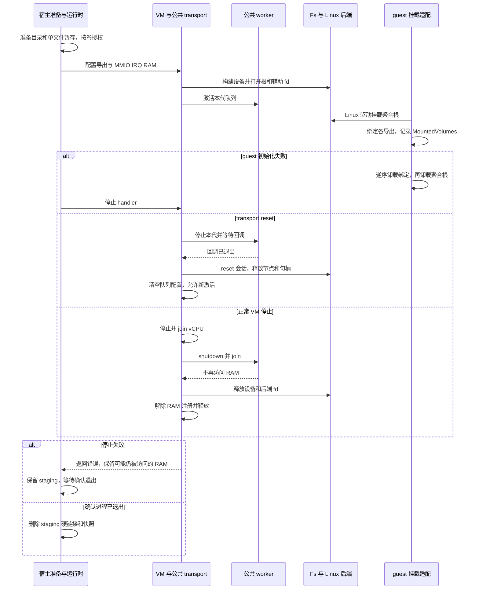

# Linux virtio-fs data flow

The experimental native VMM exposes multiple host directories through one virtio-fs device. The runtime still selects libkrun: the native engine adapter and full Box acceptance remain pending. The diagrams distinguish implemented configuration builders from the production engine integration still required.

## Configuration and mounting

Device tag identifies the device; export key selects a child of its synthetic root; logical tag resolves legacy guest paths. Host paths stay in host configuration. Directory exports retain their own read-only policy. A single-file export contains only the staged file; the existing container subpath binding selects that file at the requested container destination.

`volume-staging` is a sibling of `shared`, independent of `isolate_mounts`. Sandbox rules grant each existing staged export with its volume's write policy, without authorizing source siblings. Legacy registration consumes the same staged paths. Writable single-file staging requires the source and box storage to share a filesystem. Read-only single-file mounts retain startup bytes when the host later edits the source.

## 数据结构与所有权

下图中的实线表示持有关系，虚线表示按 ID 查找。聚合层与 Linux 后端分别维护自己的
编号空间；请求取得 `Arc` 后释放映射表锁，再执行宿主 I/O。配置转换与设备注册之间
仍缺 native engine adapter，不能把下图当作正常 Box 已经采用 native 引擎的证明。

`Buffers` 持有当前受检描述符的 `VecDeque<VolatileSlice>` 视图及剩余/已消费长度；
`Reader` 和 `Writer` 分别包装它。`ActivationContext` 持有 RAM、队列和中断入口，
由 `Fs` 在激活期间持有。`MountedVolumes(Vec<PathBuf>)` 记录本次建立的 guest
挂载，未提交时逆序卸载；宿主 `BoxFilesystemLayout` 定义 staging 的位置，运行时
负责确认 VM 已停后删除暂存硬链接和快照。这些对象不转移原始宿主文件的所有权。

## Device requests and replies

The aggregate root has node ID 1. `local_ids` maps `(share index, backend inode)` to the global node ID. `NodeRecord` tracks lookup and open ownership separately. Each request retains an `Arc` while host I/O runs; a concurrent FORGET or RELEASE cannot invalidate that request. Backend identity includes the mount ID so identical inode numbers on distinct mounts do not collide. Cross-export rename/link returns EXDEV.

Read-only mutation policy belongs to the aggregate layer. Protocol lengths, descriptor direction and predictable response capacity are checked before effects. Ordinary file opens use direct I/O, zero entry/attribute timeouts and no writeback cache. WRITE returns the actual count; FSYNC/FSYNCDIR invoke host synchronization before replying. FLUSH is separate from durability. FORGET completes with zero reply bytes.

## Ownership and cleanup

A failed handler stop preserves staging. The initialization guard still records failure and preserves diagnostic files. Removing a hardlink leaves the original host file intact. A worker shutdown failure retains potentially accessed RAM according to the common VMM lifecycle.

Host file operations execute synchronously on the shared worker thread. A real
host write lease test holds a regular file while production FUSE OPEN blocks in
kernel `openat`: the kernel's lease-break SIGIO confirms the blocked operation,
a second fs device waits, and transport reset reports its stop timeout. Explicit
lease release lets both requests finish. This qualifies blocking host filesystem
behavior; it does not measure physical storage throughput or tail latency.

Injected `pread64` delay tests separately exercise successful reset, failed stop,
shutdown retry and RAM `Arc` retention. An expired gate watchdog fails the test.
A concurrent producer uses four independent request/reply chains, refills only
completed slots and stays live during reset. Reset has a separate one-second
bound; the producer's five-second watchdog is a failure. This proves bounded
progress for that observed workload, not a universal scheduling guarantee or
cancellation of host syscalls. VM RAM-registration retention on failed shutdown
remains covered by the common VM lifecycle tests, separately from fs ownership.

## Verification record

The table below records the source implementation's results before integration
with the current upstream device composition. It is retained for traceability;
these results do not establish that the integrated branch passes. Current-branch
verification must be recorded separately after resolving the interface changes.

The source runs used Linux x86_64 with KVM and Linux 6.12.110 built through
`make vmm:boot:host` with that checkout's effective kernel configuration:

| Check | Observed result |
| --- | --- |
| `make test:unit:vmm` | 283 VMM and 16 hypervisor passed; hardware tests ignored in this target |
| `make clippy:vmm` | Passed |
| `make test:integration:vmm:linux` | All 12 passed, including actual virtio-fs mount, host-byte read, guest creation/write/fsync, retained-fd fstat/fsync after rename/unlink, reboot and export-fd cleanup. A coordinated host rewrite becomes visible through the same guest fd using pread. Read-only MAP_PRIVATE faults return the same initial byte as read; MAP_SHARED returns ENODEV because direct-I/O mmap support is not negotiated. The mixed-export boot reads a read-only export, verifies EROFS on write-open, and writes through a separate hardlink export without changing SHARED's colliding name |
| `make test:integration:vmm:kvm` | VMM 8 passed; hypervisor 7 passed, 1 failed with EINVAL during set sregs |
| `BOXLITE_DEPS_STUB=1 make test:unit:rust FILTER=volumes` | Passed: core 14 in each feature pass, shared layout 1 |
| `BOXLITE_DEPS_STUB=1 make test:unit:guest FILTER=storage::aggregate` | All 6 passed, including real bind/remount/rollback inside a mount namespace |
| Single-file sandbox regression | Missing staging grant assertion failed before the grant fix; passed after it |
| `BOXLITE_DEPS_STUB=1 make test:unit:rust FILTER=volumes::staging` | All 5 passed in both core feature configurations, including actual cross-filesystem hardlink failure and startup snapshot isolation |
| `BOXLITE_DEPS_STUB=1 make test:unit:rust FILTER=single_file` | Core 4 and REST-enabled core 5 passed; includes both isolate_mounts modes, write-through and idempotent staging cleanup |
| `BOXLITE_DEPS_STUB=1 make test:unit:rust FILTER=cleanup_guard` | Initialization failure persistence regression passed in both feature configurations |
| `BOXLITE_DEPS_STUB=1 make test:unit:rust FILTER=watcher` | Both watcher lifecycle regressions passed in both feature configurations |
| `make test:unit:vmm FILTER=fs_device_routes_colliding` | Mixed-export routing, independent IDs, EROFS and hardlink write-through passed |
| `make fmt:check:rust` | Passed |
| `make test:vmm:boot` | Host build contracts 2 passed; box wrapper 6 passed and 1 failed because its isolated PATH lacks sh on this Nix host |

## Integrated branch verification

The integrated branch is based on upstream `d6cc835a0`, with fs added after block
devices through the existing slot allocator. Block, net, console and vsock
implementations retain their upstream behavior. The configured kernel was rebuilt
with `make vmm:boot:host BOOT_JOBS=16`; its effective configuration includes
`VIRTIO_BLK=y`, `FUSE_FS=y` and `VIRTIO_FS=y`. The kernel SHA-256 is
`9b34a2fb7b026d607a2a02d0339898afaec4e5f11358c4cc1c66e21789071288`.

| Check on the integrated worktree | Result and boundary |
| --- | --- |
| `make test:unit:vmm` | 371 VMM and 16 hypervisor tests pass; 25 and 8 hardware tests are ignored by this unit target |
| `make clippy:vmm` | Passes |
| `make test:integration:vmm:linux` with the merged-config kernel | All 15 tests pass, including upstream block boots and the three existing fs boots |
| `make test:unit:vmm FILTER=worker_tests` | All seven production Fs/MMIO/SharedRuntime lifecycle tests pass, including kernel lease blocking, reset timeout, explicit release and concurrent four-chain replenishment |
| `make test:integration:vmm:mounts` | Passes after rebuilding the static init from the final guest source; uses the merged-config kernel and cached musl libseccomp 2.6.1 through the existing build helper |
| Construction and session fd tests | Isolated real EMFILE at root/auxiliary-fd open, later-export ENOENT rollback, populated reset/destroy/drop and recovery pass with exact fd baselines |

The combined boot invokes the actual guest `storage::mount_volumes`, rather than
reimplementing its syscalls. It verifies partial-batch rollback, guard rollback,
remount and commit, SHARED's conventional path, nested targets, colliding names,
read-only EROFS, directory writes and hardlink write-through. The host checks
snapshot isolation and export-fd release after VM destruction. The dedicated
`make test:integration:vmm:mounts` is the repeatable build-and-run entry; the final
run after review fixes passed in 1.49 seconds (excluding compilation).

Final supporting checks also passed:

- `BOXLITE_DEPS_STUB=1 make test:unit:guest FILTER=storage::`: 19 tests,
  including real namespace bind/remount/rollback and post-mount failure cleanup.
- `BOXLITE_DEPS_STUB=1 make test:unit:rust FILTER=volumes`: 16 core tests
  in each feature configuration and one shared-layout test.
- `BOXLITE_DEPS_STUB=1 make test:unit:rust FILTER=shutdown`: 30 core tests
  in each feature configuration, one hypervisor test and three VMM tests.
- `make fmt:check:rust`, `make help` and `git diff --check`: passed.

The review regressions failed before their production fixes and passed afterward:
retained runtime shutdown left staging present; mixed parent/child planning placed
Legacy before the aggregate root; and a real mounted tmpfs remained over its
underlying marker after a post-mount failure. The block regression used a temporary
test-only adapter for the old invocation, then removed it for the fixed run.
Synchronous shutdown now confirms process exit before deleting staging; a process
still alive preserves state. Mount ownership includes successful legacy mounts,
and block resize/diagnostic failure unmounts the current mount before outer rollback.

`make test:vmm:boot` remains a failure on this Nix host: two host-build contracts
pass; six box-wrapper tests pass and one fails because its isolated PATH has no
`sh`. Earlier use of the old kernel also failed three block tests; the rebuilt
kernel resolves those failures. Neither earlier failure is reported as a passing
run. The parent also ran `make test:integration:vmm:kvm`: all eight VMM checks
passed; hypervisor checks reported seven passes and the existing register
round-trip failure (`set sregs` returns EINVAL). This remains a failed target.
`BOXLITE_DEPS_STUB=1 make test:unit:rust FILTER=single_file` passed: four core,
six shared and five REST-enabled core tests. SDK, full product runtime and real
release archive builds were not run.

Private mmap was checked for initial data access only; visibility of later host
changes through an existing private mapping is not guaranteed by this direct-I/O
contract. The producer workload establishes observed reset progress under
concurrent replenishment, not a guarantee that the ring never empties under every
scheduler. Full Box exit.json, copy RPC and normal lifecycle acceptance still need
a native engine adapter and whole-machine Guest.Init integration. BSD source attribution and packaging recipes have been checked; real release
archive builds and inspection remain outstanding. These are open acceptance items, not passing results.

## Source attribution

FUSE ABI, filesystem interfaces, server, descriptor adapter and Linux passthrough derive from the Chromium OS implementation carried by libkrun commit `e12b9b3780ffa8df9f3e1797b217d13453479167`. Retain their original BSD headers and the accompanying `src/vmm/src/virtio/fs/LICENSE`; root `NOTICE` records the source. The original Chromium OS headers were compared against those six files at the pinned commit, and each adapted file now records its original path, commit and BoxLite modifications. The mapping is below. The upstream repository's top-level Apache license does not replace these file-specific BSD terms. The license conditions and disclaimer match the historical Chromium OS crosvm
license, with formatting and copyright-line differences documented in the
[distribution guide](../../development/building.md#virtio-fs-license-distribution).
Runtime assembly and the CLI/C archive recipes now include the full BSD text.
Fixture packaging checks passed; full release artifacts remain unbuilt in this
checkout because the vendor submodules are intentionally not expanded.

| BoxLite path beneath `src/vmm/src/virtio/fs/` | Original path at the pinned commit |
| --- | --- |
| `filesystem.rs` | `src/devices/src/virtio/fs/filesystem.rs` |
| `fuse.rs` | `src/devices/src/virtio/fs/fuse.rs` |
| `server.rs` | `src/devices/src/virtio/fs/server.rs` |
| `multikey.rs` | `src/devices/src/virtio/fs/multikey.rs` |
| `linux/passthrough.rs` | `src/devices/src/virtio/fs/linux/passthrough.rs` |
| `descriptor.rs` | `src/devices/src/virtio/descriptor_utils.rs` |

`aggregate.rs` and the native device/VM registration glue are BoxLite implementation files with the project's Apache header. `linux/mod.rs` preserves its original BSD header. This table records provenance rather than a claim that every source or binary package has already been audited.
