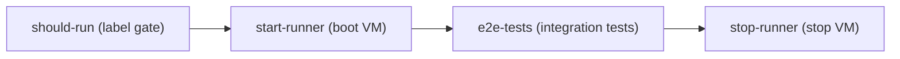

# E2E local CI runbook

`e2e-local.yml` runs BoxLite's VM-based integration tests on a self-hosted GCP VM runner.
This is the operational reference for that workflow: how it runs, how it is provisioned,
and how to fix it when it breaks.

## Overview

GitHub-hosted runners cannot expose `/dev/kvm`, so BoxLite's integration tests — which boot
real microVMs through libkrun — only run on hardware that allows nested virtualization. The
workflow selects one of two **persistent** VMs: it starts the primary in `us-east5-a`,
or falls back to `us-east4-a` after the primary exhausts its startup attempts. The selected
VM runs tests and is **stopped** (never deleted), preserving its build and image caches.
One e2e run selects from the pool at a time; newer runs queue behind the active run,
and GitHub keeps only the newest pending run.

## How it runs

The workflow is four jobs:



- **should-run** — decides whether to run. Pushes and manual dispatches always run; a pull
  request runs only when a maintainer adds the `e2e-local` label.
- **start-runner** — authenticates to GCP through OIDC, writes a fresh runner registration
  token into the VM's metadata, boots the VM, and waits up to 5 minutes for the runner to
  come online. It then removes the token from the metadata, whether or not the runner came up.
  When the zone rejects the boot for lack of capacity, the VM stays `TERMINATED`; after a
  minute in that state the job retries the start, up to 6 attempts a minute apart.
  After six rejected starts (about 11 minutes), it clears the primary token, confirms
  that VM is stopped, and tries the backup with the same retry budget. Authentication,
  metadata, or indeterminate boot failures fail the job without selecting the backup.
- **e2e-tests** — runs on the selected self-hosted runner (`gcp-e2e` and instance-name
  labels, 50-minute timeout):
  verifies `/dev/kvm`, installs build dependencies, then runs `make test:integration`.
- **stop-runner** — always runs at the end and stops the VM so it stops costing money,
  except when a `debug` dispatch fails and leaves the VM running for the SSH session.

### Runner registration

The VM's startup script ([`scripts/ci/gcp-e2e-startup.sh`](../../../scripts/ci/gcp-e2e-startup.sh))
runs on every boot. When the `runner-reg-token` metadata key is present, it drops the
runner's local registration and registers again with `config.sh --replace`. Every run
therefore re-registers, so a registration that GitHub deleted heals on the next run instead
of failing every start. (The previous AWS runner failed this way from 2026-10-20: it only
registered when an instance was first created.)

[`scripts/ci/gcp-e2e-vm.sh`](../../../scripts/ci/gcp-e2e-vm.sh) drives the VM for the
workflow: `start-pool`, `start`, `stop`, and `clear-token`. The startup script uses the
instance name as its runner name and an additional label. Readiness checks match that
name, and token cleanup and stop use the selected instance and zone.

If the VM is already running with its runner
online (for example, after a debug session), `start` reuses it; if it is running without an
online runner, `start` stops it and boots it again with a new token.

A backup retained after a failed debug run stays running when the next run succeeds on
the primary. That run stops only the primary; stop the retained backup manually after
debugging. Each VM keeps its own caches, so the first backup run has a cold build.

### Triggers

- Push to `main` touching runtime code (`src/boxlite`, `src/shared`, `src/cli`, `src/guest`,
  `sdks/**`, any `Cargo.toml`, `Cargo.lock`, or the workflow file itself).
- A pull request labeled `e2e-local` — the label is the cost gate, and only maintainers can
  add it. The trigger is `pull_request_target`, so fork PRs get the credentials a plain
  `pull_request` run would be denied, and the workflow definition always comes from `main`.
  A change to this workflow therefore affects pull requests only after it merges. Same-repo
  PRs re-run on every push while labeled; a fork PR runs only the head commit that was
  labeled — after new pushes, remove and re-add the label to approve the new code.
- Manual `workflow_dispatch`, with an optional `debug` input that opens an SSH session if the
  tests fail, and a `registries` input: `local` (the default, and what every push and labeled
  PR uses) replays images from the
  [local registry](../../../src/boxlite/tests/README.md#test_registries--the-local-registry);
  `upstream` pulls from the public mirrors, as the suites did before it, e.g.
  `gh workflow run e2e-local.yml -f registries=upstream`.
  A dispatch runs the selected branch's workflow, which is how a change to this
  workflow is tested before it merges.

## VM & auth

| Property | Value |
|---|---|
| VMs | Primary `ci-gha-e2e-1` in `us-east5-a`; backup `ci-gha-e2e-2` in `us-east4-a`; project `boxlite-dev-project` |
| Machine type | Both use `c3-highcpu-4` (4 vCPU, 8 GB), with nested virtualization enabled |
| Disk / image | 100 GB `pd-balanced`, Ubuntu 24.04 LTS |
| Runner | Each instance name is its runner name and label, alongside the shared `gcp-e2e` label |
| Network | VPC `ci-gha-e2e`, no inbound firewall rules or external IP; each region has its own subnet and Cloud NAT |
| Lifecycle | persistent — stopped between runs, never deleted |

The `ci-gha-e2e` names and the `purpose=ci-github-actions` label keep these VMs apart from the
product's own runners (`boxlite-app-*-runner`). Keeping the VM's disk is what makes repeat
runs fast: the first run compiles everything, and later runs reuse the cached toolchain and
build output. With 4 vCPUs a cold build is much slower than on the previous 16-vCPU
`c8i.4xlarge`, so a first run can come close to the 50-minute timeout.

Disk cleanup runs after checkout, before dependency setup, and again after tests and
diagnostic uploads. At **70% used or less than 50 GiB free**, it removes test caches
(`target/boxlite-test`, temporary `boxlite-*` paths, and `~/.boxlite`) first. If pressure
remains, it removes Cargo debug/release outputs, including Linux GNU/musl profiles,
stopping once usage is below 70% and at least 50 GiB is free. Healthy caches, toolchains,
`target/native`, `target/nextest`, rescued logs, and persistent test logs are preserved.
Final cleanup also runs after failure or cancellation, except failed debug sessions;
it requires successful checkout and a live runner. Cleanup errors fail the step.

Authentication uses no long-lived cloud secrets, and every identity is scoped to this VM:

- **GCP** — the workflow exchanges its GitHub OIDC token through workload identity pool
  `ci-gha-e2e` (provider `github`) and impersonates `ci-gha-e2e-ctl`. The provider accepts
  only tokens whose `workflow_ref` is this repository's `.github/workflows/e2e-local.yml` on
  any branch. `ci-gha-e2e-ctl` has no project-level role; its only grant is the custom role
  `ciGhaE2eVmControl` (`compute.instances.get/start/stop/setMetadata`) on each pool VM. It
  lacks `compute.zoneOperations.get`, so the script never waits on a gcloud operation.
- **The VM itself** — no service account, so the test code that runs on it gets no GCP
  credentials from the metadata server.
- **GitHub** — a GitHub App (repository variable `GH_APP_ID`, secret `GH_APP_PRIVATE_KEY`)
  mints the runner registration token at run time. There is no personal access token.

## One-time setup

These resources were created by hand with `gcloud` (a project owner or someone with
`roles/iam.roleAdmin` must create the custom role). Re-creating them follows the same steps:

```bash
P=boxlite-dev-project
gcloud compute networks create ci-gha-e2e --project $P --subnet-mode custom
gcloud compute networks subnets create ci-gha-e2e-us-east5 --project $P \
  --network ci-gha-e2e --region us-east5 --range 10.250.0.0/24
gcloud compute routers create ci-gha-e2e-router --project $P --network ci-gha-e2e --region us-east5
gcloud compute routers nats create ci-gha-e2e-nat --project $P --router ci-gha-e2e-router \
  --region us-east5 --auto-allocate-nat-external-ips --nat-custom-subnet-ip-ranges ci-gha-e2e-us-east5

gcloud compute instances create ci-gha-e2e-1 --project $P --zone us-east5-a \
  --machine-type c3-highcpu-4 --enable-nested-virtualization \
  --image-family ubuntu-2404-lts-amd64 --image-project ubuntu-os-cloud \
  --boot-disk-size 100GB --boot-disk-type pd-balanced \
  --subnet ci-gha-e2e-us-east5 --no-address --no-service-account --no-scopes \
  --shielded-secure-boot --shielded-vtpm --shielded-integrity-monitoring \
  --labels purpose=ci-github-actions,workload=e2e,managed-by=manual \
  --metadata-from-file startup-script=scripts/ci/gcp-e2e-startup.sh

gcloud iam roles create ciGhaE2eVmControl --project $P --title "CI e2e VM control" \
  --permissions compute.instances.get,compute.instances.start,compute.instances.stop,compute.instances.setMetadata
gcloud iam service-accounts create ci-gha-e2e-ctl --project $P
gcloud compute instances add-iam-policy-binding ci-gha-e2e-1 --project $P --zone us-east5-a \
  --member serviceAccount:ci-gha-e2e-ctl@$P.iam.gserviceaccount.com \
  --role projects/$P/roles/ciGhaE2eVmControl

gcloud iam workload-identity-pools create ci-gha-e2e --project $P --location global
gcloud iam workload-identity-pools providers create-oidc github --project $P --location global \
  --workload-identity-pool ci-gha-e2e --issuer-uri https://token.actions.githubusercontent.com \
  --attribute-mapping 'google.subject=assertion.sub,attribute.repository_id=assertion.repository_id,attribute.workflow_ref=assertion.workflow_ref' \
  --attribute-condition "assertion.repository_owner_id == '244449675' && assertion.repository_id == '1111937658' && assertion.workflow_ref.startsWith('boxlite-ai/boxlite/.github/workflows/e2e-local.yml@')"
gcloud iam service-accounts add-iam-policy-binding ci-gha-e2e-ctl@$P.iam.gserviceaccount.com --project $P \
  --role roles/iam.workloadIdentityUser \
  --member "principalSet://iam.googleapis.com/projects/929248348760/locations/global/workloadIdentityPools/ci-gha-e2e/attribute.repository_id/1111937658"
```

### Add the us-east4 backup

Create these resources once after the primary setup; the VPC, controller role, service
account, and workload identity federation are shared. The second subnet uses a distinct
CIDR; both persistent disks and regional NAT resources incur costs between test runs.

```bash
P=boxlite-dev-project
gcloud compute networks subnets create ci-gha-e2e-us-east4 --project "$P" \
  --network ci-gha-e2e --region us-east4 --range 10.250.1.0/24
gcloud compute routers create ci-gha-e2e-router-us-east4 --project "$P" \
  --network ci-gha-e2e --region us-east4
gcloud compute routers nats create ci-gha-e2e-nat-us-east4 --project "$P" \
  --router ci-gha-e2e-router-us-east4 --region us-east4 \
  --auto-allocate-nat-external-ips --nat-custom-subnet-ip-ranges ci-gha-e2e-us-east4
gcloud compute instances create ci-gha-e2e-2 --project "$P" --zone us-east4-a \
  --machine-type c3-highcpu-4 --enable-nested-virtualization \
  --image-family ubuntu-2404-lts-amd64 --image-project ubuntu-os-cloud \
  --boot-disk-size 100GB --boot-disk-type pd-balanced \
  --subnet ci-gha-e2e-us-east4 --no-address --no-service-account --no-scopes \
  --shielded-secure-boot --shielded-vtpm --shielded-integrity-monitoring \
  --labels purpose=ci-github-actions,workload=e2e,managed-by=manual \
  --metadata-from-file startup-script=scripts/ci/gcp-e2e-startup.sh
gcloud compute instances add-iam-policy-binding ci-gha-e2e-2 --project "$P" --zone us-east4-a \
  --member "serviceAccount:ci-gha-e2e-ctl@$P.iam.gserviceaccount.com" \
  --role "projects/$P/roles/ciGhaE2eVmControl"
gcloud compute instances stop ci-gha-e2e-2 --project "$P" --zone us-east4-a
```

Before enabling the workflow, update the primary startup metadata too, so its next boot
registers the instance-name label. Apply startup-script updates to both VMs:

```bash
gcloud compute instances add-metadata ci-gha-e2e-1 --project boxlite-dev-project \
  --zone us-east5-a --metadata-from-file startup-script=scripts/ci/gcp-e2e-startup.sh
gcloud compute instances add-metadata ci-gha-e2e-2 --project boxlite-dev-project \
  --zone us-east4-a --metadata-from-file startup-script=scripts/ci/gcp-e2e-startup.sh
```

The organization policy `compute.vmExternalIpAccess` forbids external IPs in this project,
which is why egress goes through Cloud NAT. After editing `scripts/ci/gcp-e2e-startup.sh`,
copy it into each VM's metadata with the commands above. The script runs on the next boot; a VM left running (for
example, after a debug session) keeps the old behavior until it is stopped.

When setup finishes, trigger a run with:

```bash
gh workflow run e2e-local.yml
```

## Troubleshooting

| Symptom | Likely cause | Fix |
|---|---|---|
| `Federate a GCP identity` fails | the run's workflow is not `e2e-local.yml` in this repository, or the pool/provider changed | check the provider condition above; reusable or renamed workflows need the condition updated |
| `start-runner` times out waiting for the runner to come online | the startup script failed | read the VM's serial port output (`gcloud compute instances get-serial-port-output ci-gha-e2e-1 --project boxlite-dev-project --zone us-east5-a`) and search for `startup-script` |
| Primary logs `could not start ci-gha-e2e-1 after 6 attempts` | Primary zone exhausted its startup budget | Check the following fallback notice; the job tries `ci-gha-e2e-2` in `us-east4-a` |
| Backup logs `could not start ci-gha-e2e-2 after 6 attempts` | Both zones exhausted their startup budgets | Inspect both zones; retry when capacity is available |
| `e2e-tests` fails on low disk | Allowed cache eviction could not restore headroom | cleanup targets below 70% use and at least 50 GiB free before builds and after tests; inspect remaining usage or grow the disk |
| `e2e-tests` hits its 50-minute timeout with every suite slower | box starts wait on a public registry: `boot_timing_profile` shows `stage_image_prepare` in seconds | Rust, CLI, Python and Node suites pull through a [local registry](../../../src/boxlite/tests/README.md#test_registries--the-local-registry); the C suite's `boxlite_simple_new` test still pulls from docker.io |
| A pull request doesn't trigger the workflow | the `e2e-local` label is missing | a maintainer adds the label (it is the cost gate) |
| A labeled fork PR doesn't re-run after a push | fork approval is per-commit | remove and re-add the `e2e-local` label to approve the new head |

For an interactive session, dispatch the workflow with `debug: true`; on failure it opens a
tmate SSH session and leaves the VM running. The next run reuses it; stop it from the GCP
console when you are done.

## References

- Workflow: [`.github/workflows/e2e-local.yml`](../../../.github/workflows/e2e-local.yml)
- VM control: [`scripts/ci/gcp-e2e-vm.sh`](../../../scripts/ci/gcp-e2e-vm.sh)
- VM startup script: [`scripts/ci/gcp-e2e-startup.sh`](../../../scripts/ci/gcp-e2e-startup.sh)
- Build-dependency setup: [`scripts/setup/setup-ubuntu.sh`](../../../scripts/setup/setup-ubuntu.sh)
- CI overview: [`.github/workflows/README.md`](../../../.github/workflows/README.md)
