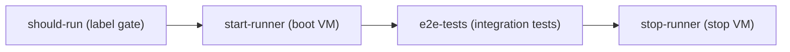

# E2E local CI runbook

`e2e-local.yml` runs BoxLite's VM-based integration tests on a self-hosted GCP VM runner.
This is the operational reference for that workflow: how it runs, how it is provisioned,
and how to fix it when it breaks.

## Overview

GitHub-hosted runners cannot expose `/dev/kvm`, so BoxLite's integration tests — which boot
real microVMs through libkrun — only run on hardware that allows nested virtualization. The
workflow keeps a single **persistent** VM for this: it is started before a run, runs the
tests, then is **stopped** (never deleted) so its build and image caches survive on its
disk. Because there is exactly one VM, only one e2e run executes at a time — a newer run
queues behind the one in progress, and GitHub keeps only the newest pending run.

## How it runs

The workflow is four jobs:



- **should-run** — decides whether to run. Pushes and manual dispatches always run; a pull
  request runs only when a maintainer adds the `e2e-local` label.
- **start-runner** — authenticates to GCP through OIDC, writes a fresh runner registration
  token into the VM's metadata, boots the VM, and waits up to 5 minutes for the runner to
  come online. It then removes the token from the metadata, whether or not the runner came up.
- **e2e-tests** — runs on the self-hosted runner (`gcp-e2e` label, 50-minute timeout):
  verifies `/dev/kvm`, installs build dependencies, then runs `make test:integration`.
- **stop-runner** — always runs at the end and stops the VM so it stops costing money,
  except when a `debug` dispatch fails and leaves the VM running for the SSH session.

### Runner registration

The VM's startup script ([`scripts/ci/gcp-e2e-startup.sh`](../../../scripts/ci/gcp-e2e-startup.sh))
runs on every boot. When the `runner-reg-token` metadata key is present, it drops the
runner's local registration and registers again with `config.sh --replace`. Every run
therefore re-registers, so a registration that GitHub deleted heals on the next run instead
of failing every start. (The previous AWS runner failed this way from 2026-10-20: it only
registered when an instance was first created.)

[`scripts/ci/gcp-e2e-vm.sh`](../../../scripts/ci/gcp-e2e-vm.sh) drives the VM for the
workflow: `start`, `stop`, and `clear-token`. If the VM is already running with its runner
online (for example, after a debug session), `start` reuses it; if it is running without an
online runner, `start` stops it and boots it again with a new token.

### Triggers

- Push to `main` touching runtime code (`src/boxlite`, `src/shared`, `src/cli`, `src/guest`,
  `sdks/**`, any `Cargo.toml`, `Cargo.lock`, or the workflow file itself).
- A pull request labeled `e2e-local` — the label is the cost gate, and only maintainers can
  add it. The trigger is `pull_request_target`, so fork PRs get the credentials a plain
  `pull_request` run would be denied, and the workflow definition always comes from `main`.
  A change to this workflow therefore affects pull requests only after it merges. Same-repo
  PRs re-run on every push while labeled; a fork PR runs only the head commit that was
  labeled — after new pushes, remove and re-add the label to approve the new code.
- Manual `workflow_dispatch`, with an optional `debug` input that opens an SSH session if the
  tests fail. A dispatch runs the selected branch's workflow, which is how a change to this
  workflow is tested before it merges.

## VM & auth

| Property | Value |
|---|---|
| VM | `ci-gha-e2e-1` in `boxlite-dev-project`, zone `us-east5-a` |
| Machine type | `n2-custom-4-8192` (4 vCPU, 8 GB), nested virtualization enabled |
| Disk / image | 100 GB `pd-balanced`, Ubuntu 24.04 LTS |
| Runner | name `ci-gha-e2e-1`, label `gcp-e2e` |
| Network | VPC `ci-gha-e2e`, no firewall rules (no inbound), no external IP; egress through Cloud NAT `ci-gha-e2e-nat` |
| Lifecycle | persistent — stopped between runs, never deleted |

The `ci-gha-e2e` names and the `purpose=ci-github-actions` label keep this VM apart from the
product's own runners (`boxlite-app-*-runner`). Keeping the VM's disk is what makes repeat
runs fast: the first run compiles everything, and later runs reuse the cached toolchain and
build output. With 4 vCPUs a cold build is much slower than on the previous 16-vCPU
`c8i.4xlarge`, so a first run can come close to the 50-minute timeout.

Authentication uses no long-lived cloud secrets, and every identity is scoped to this VM:

- **GCP** — the workflow exchanges its GitHub OIDC token through workload identity pool
  `ci-gha-e2e` (provider `github`) and impersonates `ci-gha-e2e-ctl`. The provider accepts
  only tokens whose `workflow_ref` is this repository's `.github/workflows/e2e-local.yml` on
  any branch. `ci-gha-e2e-ctl` has no project-level role; its only grant is the custom role
  `ciGhaE2eVmControl` (`compute.instances.get/start/stop/setMetadata`) on this one VM. It
  lacks `compute.zoneOperations.get`, so the script never waits on a gcloud operation.
- **The VM itself** — no service account, so the test code that runs on it gets no GCP
  credentials from the metadata server.
- **GitHub** — a GitHub App (repository variable `GH_APP_ID`, secret `GH_APP_PRIVATE_KEY`)
  mints the runner registration token at run time. There is no personal access token.

## One-time setup

These resources were created by hand with `gcloud` (a project owner or someone with
`roles/iam.roleAdmin` must create the custom role). Re-creating them follows the same steps:

```bash
P=boxlite-dev-project
gcloud compute networks create ci-gha-e2e --project $P --subnet-mode custom
gcloud compute networks subnets create ci-gha-e2e-us-east5 --project $P \
  --network ci-gha-e2e --region us-east5 --range 10.250.0.0/24
gcloud compute routers create ci-gha-e2e-router --project $P --network ci-gha-e2e --region us-east5
gcloud compute routers nats create ci-gha-e2e-nat --project $P --router ci-gha-e2e-router \
  --region us-east5 --auto-allocate-nat-external-ips --nat-custom-subnet-ip-ranges ci-gha-e2e-us-east5

gcloud compute instances create ci-gha-e2e-1 --project $P --zone us-east5-a \
  --machine-type n2-custom-4-8192 --enable-nested-virtualization \
  --image-family ubuntu-2404-lts-amd64 --image-project ubuntu-os-cloud \
  --boot-disk-size 100GB --boot-disk-type pd-balanced \
  --subnet ci-gha-e2e-us-east5 --no-address --no-service-account --no-scopes \
  --shielded-secure-boot --shielded-vtpm --shielded-integrity-monitoring \
  --labels purpose=ci-github-actions,workload=e2e,managed-by=manual \
  --metadata-from-file startup-script=scripts/ci/gcp-e2e-startup.sh

gcloud iam roles create ciGhaE2eVmControl --project $P --title "CI e2e VM control" \
  --permissions compute.instances.get,compute.instances.start,compute.instances.stop,compute.instances.setMetadata
gcloud iam service-accounts create ci-gha-e2e-ctl --project $P
gcloud compute instances add-iam-policy-binding ci-gha-e2e-1 --project $P --zone us-east5-a \
  --member serviceAccount:ci-gha-e2e-ctl@$P.iam.gserviceaccount.com \
  --role projects/$P/roles/ciGhaE2eVmControl

gcloud iam workload-identity-pools create ci-gha-e2e --project $P --location global
gcloud iam workload-identity-pools providers create-oidc github --project $P --location global \
  --workload-identity-pool ci-gha-e2e --issuer-uri https://token.actions.githubusercontent.com \
  --attribute-mapping 'google.subject=assertion.sub,attribute.repository_id=assertion.repository_id,attribute.workflow_ref=assertion.workflow_ref' \
  --attribute-condition "assertion.repository_owner_id == '244449675' && assertion.repository_id == '1111937658' && assertion.workflow_ref.startsWith('boxlite-ai/boxlite/.github/workflows/e2e-local.yml@')"
gcloud iam service-accounts add-iam-policy-binding ci-gha-e2e-ctl@$P.iam.gserviceaccount.com --project $P \
  --role roles/iam.workloadIdentityUser \
  --member "principalSet://iam.googleapis.com/projects/929248348760/locations/global/workloadIdentityPools/ci-gha-e2e/attribute.repository_id/1111937658"
```

The organization policy `compute.vmExternalIpAccess` forbids external IPs in this project,
which is why egress goes through Cloud NAT. After editing `scripts/ci/gcp-e2e-startup.sh`,
copy it into the VM's metadata with `gcloud compute instances add-metadata` (the command is
in the script's header). The new script runs on the next boot; a VM left running (for
example, after a debug session) keeps the old behavior until it is stopped.

When setup finishes, trigger a run with:

```bash
gh workflow run e2e-local.yml
```

## Troubleshooting

| Symptom | Likely cause | Fix |
|---|---|---|
| `Federate a GCP identity` fails | the run's workflow is not `e2e-local.yml` in this repository, or the pool/provider changed | check the provider condition above; reusable or renamed workflows need the condition updated |
| `start-runner` times out waiting for the runner to come online | the startup script failed | read the VM's serial port output (`gcloud compute instances get-serial-port-output ci-gha-e2e-1 --project boxlite-dev-project --zone us-east5-a`) and search for `startup-script` |
| `e2e-tests` fails on low disk | `target/` build artifacts filled the disk | the job evicts caches at 80% use and refuses below 20 GB free; if it still fails, grow the disk |
| A pull request doesn't trigger the workflow | the `e2e-local` label is missing | a maintainer adds the label (it is the cost gate) |
| A labeled fork PR doesn't re-run after a push | fork approval is per-commit | remove and re-add the `e2e-local` label to approve the new head |

For an interactive session, dispatch the workflow with `debug: true`; on failure it opens a
tmate SSH session and leaves the VM running. The next run reuses it; stop it from the GCP
console when you are done.

## References

- Workflow: [`.github/workflows/e2e-local.yml`](../../../.github/workflows/e2e-local.yml)
- VM control: [`scripts/ci/gcp-e2e-vm.sh`](../../../scripts/ci/gcp-e2e-vm.sh)
- VM startup script: [`scripts/ci/gcp-e2e-startup.sh`](../../../scripts/ci/gcp-e2e-startup.sh)
- Build-dependency setup: [`scripts/setup/setup-ubuntu.sh`](../../../scripts/setup/setup-ubuntu.sh)
- CI overview: [`.github/workflows/README.md`](../../../.github/workflows/README.md)
