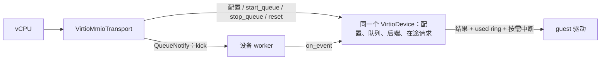

# Virtio device trait design (proposal)

2026-10-28 · 2026-10-29 修订 · 设计提案，尚未实现。

所有 virtio 设备实现同一个 `VirtioDevice`。每个设备只有一个对象，同时实现配置、队列启停、reset、事件处理与快照生命周期；virtqueue、后端及在途请求都保存在这个对象内。transport 和 worker 持有同一实例的共享引用，分别调用控制方法与 `on_event()`。快照先排空 I/O，再保存稳定的协议状态。

**范围与现状**

首版覆盖 modern virtio-mmio、split virtqueue 和 M2 的设备接入，并预留停机快照的设备契约：暂停 vCPU，排空设备 I/O，再保存。完整 VM 快照服务、在线迁移和在途请求的序列化不在本次设计范围。不定义分类后端接口，也不实现 PCI、DAX 或独立队列 reset feature。未实现的 feature 不向 guest 宣告；按队列启停不等于支持 `VIRTIO_F_RING_RESET`。

当前 [`BusDevice`](../../../src/vmm/src/bus.rs) 只有同步 `read/write`；[`ChipsetBuilder`](../../../src/vmm/src/chipset.rs) 注册资源并持有总线设备；[`events`](../../../src/vmm/src/events.rs) 中每个事件都会结束 VM。virtio 尚未实现。本方案适配 [VMM 的 worker 与 mio 规划](../architecture/vmm/README.md#threads)，增加延迟总线访问和非终止性的控制完成通知，无需全局 Tokio 运行时。

**参考实现与取舍**

| 参考 | 观察到的机制 | 本方案采用的部分 |
| --- | --- | --- |
| [Firecracker v1.17.0：设备](https://github.com/firecracker-microvm/firecracker/blob/v1.17.0/src/vmm/src/devices/virtio/device.rs#L70)、[事件处理](https://github.com/firecracker-microvm/firecracker/blob/v1.17.0/src/vmm/src/devices/virtio/block/virtio/event_handler.rs#L62)、[MMIO](https://github.com/firecracker-microvm/firecracker/blob/v1.17.0/src/vmm/src/devices/virtio/transport/mmio.rs#L48) | 同一设备对象实现 virtio 控制和事件处理；transport 持有 `Arc<Mutex<dyn VirtioDevice>>`。事件入口是普通 `fn process`；使用异步后端时，提交请求与收割完成结果分属两次事件处理。 | 同一设备对象、共享引用、独立 transport，以及提交/完成回调形式的异步数据路径。事件入口直接放进公共 trait；不绑定其 EventFd 或事件管理库。 |
| [OpenVMM 26a0c9b：设备](https://github.com/microsoft/openvmm/blob/26a0c9bfdb21f9cbf9ffedef1473cb9c176a1396/vm/devices/virtio/virtio/src/device.rs#L18)、[控制调度](https://github.com/microsoft/openvmm/blob/26a0c9bfdb21f9cbf9ffedef1473cb9c176a1396/vm/devices/virtio/virtio/src/transport/task.rs#L78)、[块设备运行循环](https://github.com/microsoft/openvmm/blob/26a0c9bfdb21f9cbf9ffedef1473cb9c176a1396/vm/devices/virtio/virtio_blk/src/lib.rs#L166) | 控制方法返回 Future；按队列异步 start/stop，全部停止后 reset，transport 延迟完成 MMIO。块设备用 `FuturesUnordered` 保存多个请求 Future，同时轮询新请求和完成结果。 | 按队列生命周期、实际完成后才确认。用完成句柄适配本地线程/mio 架构；当前草案未采用其 Future 驱动的数据路径。 |
| [Firecracker：快照准备](https://github.com/firecracker-microvm/firecracker/blob/v1.17.0/src/vmm/src/devices/virtio/block/virtio/device.rs)、[保存顺序](https://github.com/firecracker-microvm/firecracker/blob/v1.17.0/src/vmm/src/device_manager/persist.rs) | 块设备 `prepare_save()` 排空、flush 并消费完成项；管理器在准备设备之后才保存 transport，以捕获准备期间产生的中断状态。 | 全部设备静止之后才捕获内存、transport 和中断状态。增加可失败的 quiesce 契约；不能仅记录 flush 错误后仍报告快照成功。 |
| [OpenVMM：块设备停止](https://github.com/microsoft/openvmm/blob/26a0c9bfdb21f9cbf9ffedef1473cb9c176a1396/vm/devices/virtio/virtio_blk/src/lib.rs#L426)、[通用保存契约](https://github.com/microsoft/openvmm/blob/26a0c9bfdb21f9cbf9ffedef1473cb9c176a1396/vm/vmcore/src/save_restore.rs#L5)、[virtio 快照能力](https://github.com/microsoft/openvmm/blob/26a0c9bfdb21f9cbf9ffedef1473cb9c176a1396/vm/devices/virtio/virtio/src/device.rs#L108) | 块设备停止时排空已保存的 I/O futures，再返回队列游标；通用 SaveRestore 使用独立的稳定数据类型。该版本 virtio trait 只提供支持性标志，由 transport 保存通用状态，并非每个设备都实现一组通用保存方法。 | 采用排空、稳定状态格式和显式能力检查；在本地统一 trait 增加保存方法是设计扩展，不声称直接照搬其接口。 |

统一 trait 稳定设备接入契约；共享实例减少设备实现者需要维护的状态边界。其代价是必须串行访问同一对象。耗时控制操作通过完成句柄推进，不能持锁等待后续设备回调。

**统一接口**

以下为设计签名，辅助类型尚未实现，不是可编译补丁。`SharedDevice` 只克隆共享引用，不复制设备状态。

```rust
pub(crate) type SharedDevice = Arc<Mutex<dyn VirtioDevice>>;

pub(crate) trait VirtioDevice: Send {
    fn spec(&self) -> &DeviceSpec;
    fn validate_features(&self, negotiated: u64) -> Result<(), FeatureError>;

    fn read_config(&mut self, offset: u64, len: usize) -> DeviceOp<ConfigBytes>;
    fn write_config(&mut self, offset: u64, value: ConfigBytes) -> DeviceOp<()>;

    fn start_queue(&mut self, ctx: QueueContext) -> DeviceOp<()>;
    fn stop_queue(&mut self, index: u16) -> DeviceOp<Option<QueueState>>;
    fn reset(&mut self) -> DeviceOp<()>;

    fn on_event(&mut self, event: DeviceEvent, cx: &mut EventContext)
        -> Result<(), DeviceError>;

    fn quiesce(&mut self) -> DeviceOp<()>;
    fn save_state(&self) -> Result<DeviceSnapshot, SnapshotError>;
    fn restore_state(&mut self, state: DeviceSnapshot, ctx: RestoreContext)
        -> DeviceOp<()>;
    fn resume(&mut self) -> DeviceOp<()>;
}

pub(crate) enum DeviceEvent {
    QueueKick(u16),
    BackendReady(SourceId),
    Continue,
}

pub(crate) enum DeviceOp<T> {
    Ready(Result<T, DeviceError>),
    Pending(Completion<T>),
}
```

| 类型或操作 | 固定契约 |
| --- | --- |
| `DeviceSpec` | 构造后不变的设备类型、设备 features、配置空间长度及队列容量上限。增加宿主能力 `snapshot: SnapshotSupport`，首版区分 Unsupported 与 Stopped；默认不支持，不能用空状态伪装成功。该能力不是 guest virtio feature。 |
| `QueueContext` | 唯一的已验证 virtqueue 消费端、队列编号、guest memory、协商结果、kick 接收端、中断能力、消费开关及可选恢复游标。还提供已绑定本设备的事件注册能力，不提供整个 VM。 |
| `ConfigBytes` | 有长度的自持有缓冲区；transport 先校验访问宽度、边界及溢出。延迟读取不能保存 vCPU 栈上的切片，结果长度必须匹配请求。 |
| `DeviceOp` | 控制方法立即完成或返回独立的完成句柄；Pending 不借用设备，不要求持锁等待。只有实际完成才回复，投递命令成功不代表操作完成。 |
| `start_queue` | 将队列保存在设备对象内并注册通知源。成功表示已准备好处理；消费开关打开后主动扫描一次。不能等待另一条队列启动或 guest 请求完成才返回成功。 |
| `stop_queue` | 停止取新请求，结束仍可能访问该队列及 guest 缓冲区的工作，注销本次激活的事件源，返回游标。未启动或已停止的队列幂等返回 None。 |
| `QueueState` | 保存消费游标及通知状态。QueueReady=0 后保留，重新启用时恢复；完整设备 reset 后丢弃。其稳定的保存格式也是快照的一部分，但仅保存游标不足以构成设备快照。 |
| `reset` | 在所有队列停止完成后恢复设备内部协议状态；transport 清理自己的协商、队列配置和寄存器状态。 |
| `on_event` | worker 调用同一设备实例的事件入口；设备内部调用普通的 `process_queue`、`process_completions` 等方法。返回只表示本轮回调结束，不表示所有 I/O 已完成。 |
| `quiesce` | 关闭整个设备的新工作入口，排空已消费请求，冻结定时器及后端输入。完成时不再修改 guest 内存、可保存状态或中断；保留协商、QueueReady 与队列游标。等待后端时返回 Pending，完成回调继续运行。 |
| `save_state` | 只允许在 Quiesced 状态调用。返回自持有、带版本的纯数据，不等待 I/O、不清空设备状态；写快照文件由 VM 层负责。 |
| `restore_state` | 只对新建且未运行的设备调用；校验状态及新资源，恢复后保持 Quiesced。`RestoreContext` 提供新 guest memory、已校验的队列配置、事件及中断能力；后端由构造过程重新绑定。不会自动消费队列。 |
| `resume` | 为同进程继续运行或快照恢复重新准备通知源和定时器。完成表示设备就绪，仍受 VM 的统一运行开关约束；开关开放后主动扫描队列和后端，不依赖旧 kick。 |

`EventContext` 提供本轮工作预算、事件源注册和重新调度能力。设备保存后端源标识与在途请求的对应关系；`BackendReady` 到达后从自己的后端读取结果。单次 I/O 失败按设备协议返回请求状态，无法继续服务的故障通过 VM 故障路径上报。

**对象归属与装配**

| 对象 | 归属及访问 |
| --- | --- |
| `VirtioMmioTransport` | Bus/Chipset 持有；保存 MMIO 寄存器、协商结果、未激活队列配置和 kick 发送端 |
| `VirtioBlk` / `VirtioNet` 等设备实例 | 配置、后端、活跃队列、在途请求与待完成控制操作放在同一个结构体内 |
| `SharedDevice` | transport 与 worker 注册表各持有一份引用，指向同一个设备实例 |
| 执行器与 OS 线程 | VM 创建、启动、停止并 join；设备只取得范围受限的事件注册及唤醒能力 |

共享线程的装配示意：

```rust
// 构造阶段只准备资源和注册关系，不启动 OS 线程。
let mut executor = DeviceExecutor::prepare()?;
let blk: SharedDevice = Arc::new(Mutex::new(VirtioBlk::new(disk)?));
let net: SharedDevice = Arc::new(Mutex::new(VirtioNet::new(network)?));

let blk_events = executor.register_device(blk.clone())?;
let net_events = executor.register_device(net.clone())?;
let blk_mmio = VirtioMmioTransport::new(blk, blk_events, /* resources */);
let net_mmio = VirtioMmioTransport::new(net, net_events, /* resources */);
// 注册 transport 到 Chipset；VM 保存 executor。
```

Chipset 构建和资源检查成功后，`Vm::run()` 启动 worker，事件循环就绪后才允许 vCPU 进入 guest。初始化失败时不运行 guest，并清理已启动的执行器。guest 激活队列时，transport 把 `QueueContext` 交给同一个设备的 `start_queue()`；设备把队列加入自己的状态，worker 随后通过设备方法访问它。

每个设备绑定一个 worker；共享模式把多个设备注册到同一执行器，独立模式分别注册到不同执行器。同一设备不会被多个 worker 并行执行 `on_event()`。注册关系与 `QueueContext` 提供事件能力，设备构造函数不负责选择或启动线程。

**worker 如何调用设备**

事件源注册时已经绑定设备实例、队列编号或后端源标识。宿主就绪记录持有这份绑定；worker 按绑定调用设备，不推断具体 Rust 类型，也不扫描所有设备。轮询 token 到注册记录的映射只是事件路由，不是再次查找某种设备实现。

```rust
// 示意：注册记录已验证有效，guard 封装设备锁及释放后的通知。
let mut device = registration.acquire_device()?;
device.on_event(registration.event(), &mut event_context)?;
// 离开调用释放锁，并通知等待访问该设备的控制路径。
```

同一个 `VirtioBlk` 的事件入口可以直接分派：

```rust
match event {
    DeviceEvent::QueueKick(index) => self.process_queue(index, cx),
    DeviceEvent::BackendReady(source) => self.process_completions(source, cx),
    DeviceEvent::Continue => self.resume_work(cx),
}
```

**普通回调如何驱动异步 I/O**

`fn on_event` 是一次事件处理入口，不是“一次请求从开始执行到结束”的函数。异步能力来自后端的提交/完成机制；普通 `fn` 的签名本身既不保证阻塞，也不保证非阻塞。本草案的数据路径采用 Firecracker 式事件回调，不把它等同于 OpenVMM 的 `async/await` 实现。

以异步块 I/O 为例，同一个设备对象完成以下步骤：

1. 启动时先注册后端完成通知源。收到 `QueueKick` 后，在预算和在途数量上限内取请求、校验并提交异步 I/O。后端接受的每个请求都必须保留 descriptor 标识、缓冲区生命周期与完成状态；提交失败或暂时无容量时，请求仍有明确归属。
2. `on_event` 返回，worker 释放设备锁并处理其他设备。返回 `Ok(())` 只说明本轮事件处理成功；此时已提交的多个 I/O 可以同时未完成，不能发布这些请求的 used entry。
3. 后端通知触发 `BackendReady`，worker 再次调用同一设备的 `on_event`。设备收割已完成结果，写 guest 状态、发布 used ring，并按需通知 guest；容量恢复后继续处理积压请求。

后端队列满时保留待提交请求或撤销本轮取出，不能持锁等待空位，也不能丢弃请求后只等待下一次 guest kick。每轮取请求与收割完成均受工作预算约束；预算耗尽且仍有工作时主动重新调度。异步等待期间释放设备锁，但在途 I/O 引用的内存必须持续有效，直到真正完成或取消完成。

Firecracker 的 [`AsyncFileEngine`](https://github.com/firecracker-microvm/firecracker/blob/v1.17.0/src/vmm/src/devices/virtio/block/virtio/io/async_io.rs#L113) 将请求加入 io_uring，`kick_submission_queue()` 提交；随后 [`process_async_completion_queue()`](https://github.com/firecracker-microvm/firecracker/blob/v1.17.0/src/vmm/src/devices/virtio/block/virtio/device.rs#L594) 消费完成项并更新 used ring。这里描述的是常规数据路径；其 drain 路径另有等待全部完成的操作，不能据此声称所有方法都不等待。

同步后端也可在 `process_queue` 中完成请求，但共享 worker 执行阻塞 I/O 会延迟其他设备，同一设备锁也会在该回调期间被占用。改用独立 worker 能隔离设备间的等待，不会自动获得同一设备内的多个在途 I/O。

若后续要求设备实现直接使用 `async/await`，需要另行补齐 Future 的持有、首次 poll、Waker 到 worker 的唤醒与再次 poll 契约；当前 `EventContext` 不是 `std::task::Context`，仅有事件注册不足以保证任意 Future 能推进。可以把自持有的请求 Future 集合保存在同一个设备对象内，每轮只短暂借用设备进行 poll，再释放锁等待唤醒；不能让挂起的 Future 持有整个设备的锁或 `&mut self`，导致完成事件无法进入。Rust 的 [`Future::poll`](https://doc.rust-lang.org/std/future/trait.Future.html) 本身也是普通 `fn`；关键在于返回 Pending 后有人唤醒并再次驱动，而非是否写了 `async`。

**并发访问与完成**

设备方法持锁串行执行。控制操作 Pending 时，不接受该设备的下一项配置或生命周期操作，但必须继续调度它的后端完成和停止推进事件。不得把“控制操作未完成”当作禁止 `on_event()` 的理由。

- vCPU 和 VM run 控制路径只尝试获取设备锁。忙时保存自持有的访问参数，返回或保持 Deferred，不能持 transport 锁阻塞在设备锁上。
- 公共访问封装负责释放设备锁后的就绪通知；等待方先登记等待状态再重试获取，避免释放与登记之间丢失唤醒。run 线程被通知后再推进，不循环忙等。
- 返回 Pending 或等待完成时必须已释放设备锁。worker 的回调不能等待需要自己再次进入回调才能完成的操作。
- worker 不反向获取 transport 锁；中断与完成句柄独立工作，回调只发送完成通知。transport 提交状态后才完成对应 guest 访问。

队列消费开关由 transport 控制：整组启动成功并提交 DRIVER_OK 后打开；设备 reset、VM 停止或启动回滚时先关闭全部相关开关并唤醒 worker，再逐队列等待停止。已接收的请求计入 drain。注册使用激活代次，停止完成后迟到事件不能作用于新的队列；事件注销前不能释放仍会被访问的资源。

**transport 如何使用统一接口**



| guest 操作 | transport 行为及设备调用 |
| --- | --- |
| 读取 ID、DeviceFeatures、QueueNumMax | 从构造时取得的 `spec()` 及 transport 能力生成值，无需每次获取设备锁 |
| 写 DriverFeatures，设置 FEATURES_OK | 检查公共规则，再调用 `validate_features()`；拒绝时 FEATURES_OK 不成立 |
| 配置队列地址、大小和 QueueReady | 保存、校验编号、大小、对齐及内存范围；设备消费时仍逐条检查 descriptor chain |
| 设置 DRIVER_OK | 对就绪队列调用 `start_queue()`，等全部准备好后开放消费；失败时停止所有已启动或部分启动的队列 |
| 写 QueueNotify | 验证编号和状态，发送 kick；这条路径不获取设备对象锁 |
| 访问设备配置区 | 校验偏移和长度，调用 `read_config/write_config()`；锁忙或 Pending 时延迟完成访问 |
| 运行中 QueueReady 变为 0 | 关闭消费开关，调用 `stop_queue()`；完成后保存游标并公布不可用状态 |
| 写 Status=0 | 关闭所有消费入口，完成所有 `stop_queue()`，再完成 `reset()`，最后清理 transport 状态 |

配置无效按协议拒绝或忽略；可恢复的设备故障映射为 NEEDS_RESET 和配置通知。无法证明旧内存访问已经停止的故障结束 VM，不能伪装成成功 reset。

kick 发送端保留在 transport，接收状态与设备队列的事件注册绑定。启动完成必须处理此前积累的通知并扫描队列；通知可以合并，请求数量以 avail ring 为准。处理预算用尽或后端繁忙时，保留就绪状态或在后端完成后重新调度，不能等一个可能不会再来的 kick。

数据请求完成时，设备先写 guest 结果和状态，再通过公共 virtqueue 发布 used ring，按通知抑制规则调用中断句柄。`VirtioInterrupt` 封装中断状态、配置 generation 与宿主 IRQ，处理并发通知/ACK 和内存顺序；多个句柄共享同一个 `IrqLine` 所有者。数据请求通过 used ring 响应 guest，配置和生命周期通过 `DeviceOp` 完成宿主控制操作。

**总线接入、reset 与 VM 停止**

落地时需要一次公共总线改动：`BusDevice::read/write` 返回 `BusIo::Complete` 或 `BusIo::Deferred(IoCompletion)`；现有简单设备返回 Complete。Bus、Chipset 和 vCPU exit 路径传播结果。发起访问的 vCPU 在释放总线/设备锁后等待完成，延迟读取通过自持有缓冲区把字节交回原 vCPU。

VM run 线程处理独立的非终止性控制通知，短暂取得 transport 锁、尝试访问设备并推进完成状态机。不能复用现有 `EventSender` 发送普通完成事件，因为它会设置 VM stop 标志。Chipset 和生命周期所有者需要保留同一个 transport 的可推进句柄，不通过 downcast 找回设备。

[Virtio 1.2 第 2.4、4.2.2 节](https://docs.oasis-open.org/virtio/virtio/v1.2/virtio-v1.2.html) 约束 reset 及队列停止后的内存访问。本方案选择等待实际停止/reset 后才完成活跃设备的 Status=0 写，与 OpenVMM 的兼容策略一致。Linux v6.12 的 [MMIO reset](https://github.com/torvalds/linux/blob/v6.12/drivers/virtio/virtio_mmio.c#L246) 只写零，不轮询 Status；删除队列另有 QueueReady 同步，不能据此假定每次 reset 都会轮询 Status。

OpenVMM 的 [块设备停止实现](https://github.com/microsoft/openvmm/blob/26a0c9bfdb21f9cbf9ffedef1473cb9c176a1396/vm/devices/virtio/virtio_blk/src/lib.rs#L426) 停止 worker 并排空保存的 I/O futures，随后才移除队列。本方案同样要求 stop 成功后不再访问旧缓冲区、更新旧 used ring 或发出旧队列通知；丢弃 Future、清空请求表或标记代次都不能替代实际排空。

VM shutdown 拒绝新控制访问并唤醒等待者，使 vCPU 退出而非重新进入 guest；join vCPU 后继续驱动完成事件，停止全部设备队列并回收 worker，再解除 RAM 注册。失败或超时不能释放仍被宿主 I/O 引用的内存；无法取消的 I/O 不承诺有限完成时间。guest 的设备 reset 与表示整机终止的 `Event::GuestReset` 不同。

**快照边界与调用顺序**

快照是 VM 级一致性操作，由 VM 层协调，通过 transport/设备管理入口访问同一个设备对象；worker 继续执行 `on_event` 推进排空。`quiesce` 是宿主暂停，不清除 DRIVER_OK 或 QueueReady，也不调用 guest reset。现有 `stop_queue/start_queue` 的内部逻辑可以复用，但必须保留所有队列及设备私有状态。

```text
运行中 -- quiesce --> 排空中 -- 实际完成 --> Quiesced
Quiesced -- save_state --> Quiesced
新设备 -- restore_state --> Quiesced
Quiesced -- resume + VM 开放运行 --> 运行中
```

首版的排空规则是：已消费的请求完成并发布 used ring；尚未取走的请求留在 guest avail ring。对仅预取、尚无外部副作用的请求，允许在公共队列保证游标一致的前提下退回。不能把可能已经写盘或发包的请求留给恢复后重放。块设备还必须完成后端 flush 或等价存储屏障；等待这些操作时不能先关闭完成事件循环。

| 保存内容 | 负责方 |
| --- | --- |
| transport 寄存器、协商 features、Status、QueueReady、队列地址/大小、已停止队列的保存游标、中断状态及 config generation | transport 和公共中断层 |
| 活跃队列的消费/完成游标、通知抑制状态、设备特有配置、私有协议状态及必要的内部缓冲区 | 设备的 `DeviceSnapshot`，内部调用公共队列的保存函数 |
| descriptor、avail/used ring 及请求缓冲区的字节 | VM 的 guest RAM 快照；队列游标不能替代这些内存 |
| vCPU、虚拟时钟、中断控制器、设备拓扑、磁盘快照引用 | VM 协调器与对应资源所有者 |

`DeviceSnapshot` 使用稳定的状态格式标识、版本、队列状态和设备私有 payload。具体设备内部可用自己的强类型状态编码到公共容器，保持 `dyn VirtioDevice` 可用；不直接序列化运行时结构体。fd、线程、锁、宿主指针、Waker、Future 和 io_uring 请求不进入快照。替换设备实现时，除了实现同一 trait，还须兼容旧状态格式及 guest 可见设备特性。

保存流程：

1. 检查全部设备及后端的快照能力，阻止新宿主控制变更，暂停 vCPU；保持设备 worker 运行以完成已有 Deferred MMIO，再按 [`complete_pending_io`](../../../src/hypervisor/src/exit.rs) 契约结束未完成的 guest 指令。
2. 关闭所有设备的新工作入口并调用 `quiesce()`，等待全部完成。不能只屏蔽 QueueKick：宿主网络输入、定时器和后台 I/O 也必须进入冻结边界。此后设备回调不得继续改变快照状态。
3. 在所有写入方静止且待注入中断已同步后，获取设备、transport、CPU/IRQ/时钟和 RAM 状态，并取得对应磁盘版本。块设备的 flush 不会生成可回滚磁盘镜像；存储层须建立匹配的不可变快照/副本并写入同一快照清单。
4. 固定整个快照的数据后才允许源 VM 继续。先让所有设备 `resume()` 就绪，再统一开放工作入口、恢复 vCPU；保存单个设备完成不能自行恢复它。

恢复时先校验快照清单、资源身份和状态版本，绑定匹配的磁盘版本并恢复 RAM；创建设备和运行资源，在关闭工作入口的状态下恢复 transport、队列及设备状态。所有 guest 地址、队列容量、features 和游标须重新校验。重建事件注册、虚拟时间和中断路由后再统一 resume；恢复失败时不开放任何设备或 vCPU。

例如块请求 A 已提交、B 仍在 avail ring：quiesce 等 A 完成，将其结果和 used entry 纳入 RAM 快照；B 留待恢复后扫描处理。两者不需要保存 Future，也不会因丢失旧 kick 而停滞。增量 RAM 快照还必须覆盖设备和后端的写入，不能只依赖 CPU 的脏页记录。

无法恢复宿主会话的设备/后端须明确拒绝快照，或另行定义可观察的断连重建语义。[Firecracker 的快照文档](https://github.com/firecracker-microvm/firecracker/blob/v1.17.0/docs/snapshotting/snapshot-support.md#vsock-device-reset) 就规定了 vsock 连接重置；[OpenVMM 的 virtio 能力检查](https://github.com/microsoft/openvmm/blob/26a0c9bfdb21f9cbf9ffedef1473cb9c176a1396/vm/devices/virtio/virtio/src/device.rs#L108) 默认拒绝保存，提示 virtio-fs 等宿主会话状态的限制。统一 trait 不保证所有设备都能透明快照。

保存失败时由协调器统一恢复源 VM，不能让部分设备自行运行；排空失败或超时则维持暂停，直到确认可安全恢复或停止。不能把超时视为 I/O 已取消，也不能因此销毁其仍引用的内存。快照失败不意味着已完成 I/O 的副作用可以撤销。

**分工与验收**

| 工作 | 交付边界 |
| --- | --- |
| 公共基础设施 | 统一 trait、共享设备访问封装、事件注册与 worker、split queue、MMIO、延迟访问、中断及 shutdown 集成 |
| 各设备实现 | 一个设备结构体实现所有控制方法及 `on_event`；内部保存配置、后端、队列及请求状态，明确快照能力及稳定状态格式 |
| 共用契约测试 | 相同 transport 和执行器装载不同设备；切换共享/独立 worker 只改变装配，调用端不按类型分支 |

以下是计划验收，尚未运行测试：

- 寄存器驱动实际 transport：非法 feature、错误队列地址及部分启动失败不会泄漏后台工作。
- transport 和 worker 访问同一个设备实例；控制操作 Pending 时完成事件仍可调用该设备。
- worker 持有设备锁时控制访问返回 Deferred；无须下一次 MMIO 访问即可继续完成，等待/释放竞态不丢唤醒，操作恰好执行一次。
- kick 注册、启动、停止交错及 IRQ/ACK 并发不丢请求；旧代次事件不访问新队列；预算耗尽会重新调度。
- 独立 worker 的慢同步 blk 不阻塞 net；共享 worker 的同步等待作为预期干扰对照。使用非阻塞后端时验证共享调度的公平性和多个在途请求。
- 在真实设备/后端边界保留延迟请求，执行 reset 或 QueueReady=0：完成前访问保持 Deferred，完成后复用缓冲区没有迟到写入或通知。
- VM stop 唤醒等待的 vCPU，继续排空设备后才解除 RAM 注册；Linux/KVM 与 macOS/HVF 分别验证通知适配。
- 从真实请求路径保留一个未完成 I/O 和一个尚未消费请求：quiesce 前者并保存，恢复后验证前者只完成一次、后者无需新 kick 即能处理。
- quiesce 期间完成回调继续运行；完成后注入迟到通知和定时事件，验证 RAM、used ring 和已保存状态不再变化；最后一次完成产生的中断可恢复。
- 保留非零队列游标和协商状态进行保存/恢复；使用错误版本、错误后端身份或不支持的设备时，整个恢复/保存明确失败，部分设备不提前运行。
- 恢复使用新的进程资源及匹配的磁盘快照；制造保存失败、后端 flush 失败和排空超时，验证源 VM 恢复或维持暂停的边界。

首个实现阶段需细化完成句柄、锁等待通知及事件注册的具体表示，并在生产代码编辑前评审。快照实现阶段还需定义状态编码、存储快照协调和各平台的暂停/中断屏障。本提案确定同一对象、同一 trait、所有权、调用路径及完成条件，不声称实现或性能验证已经完成。
