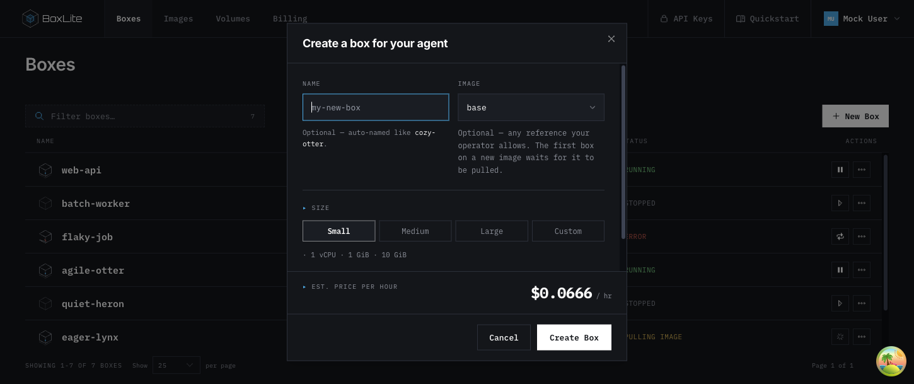
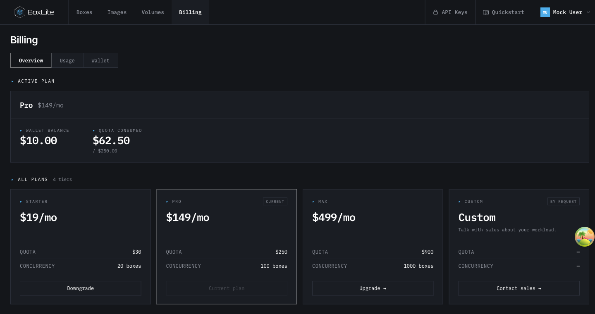
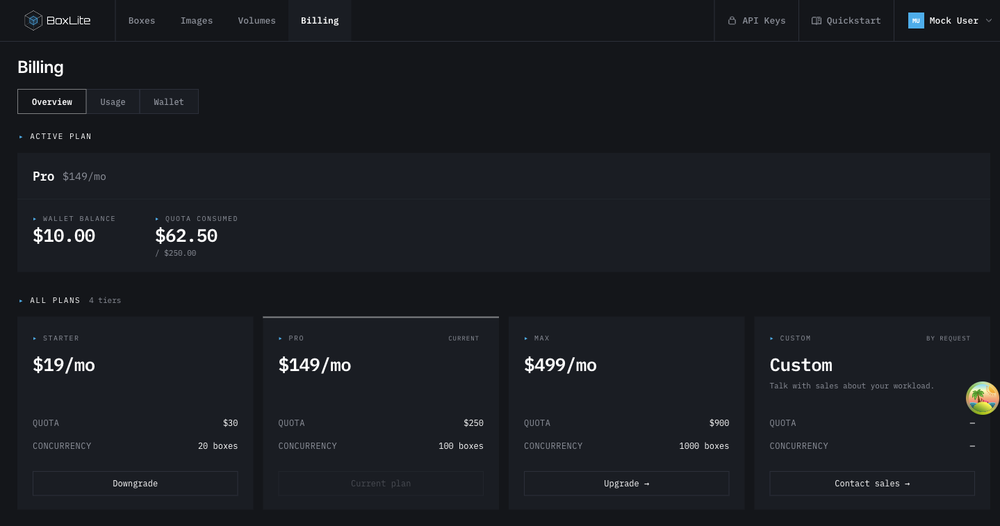
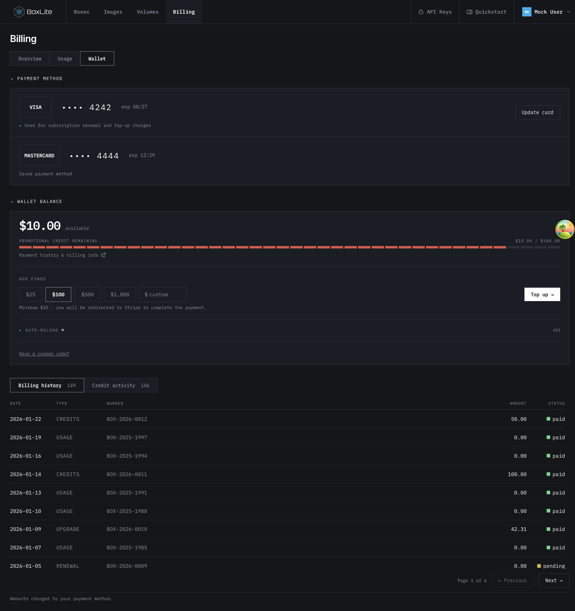
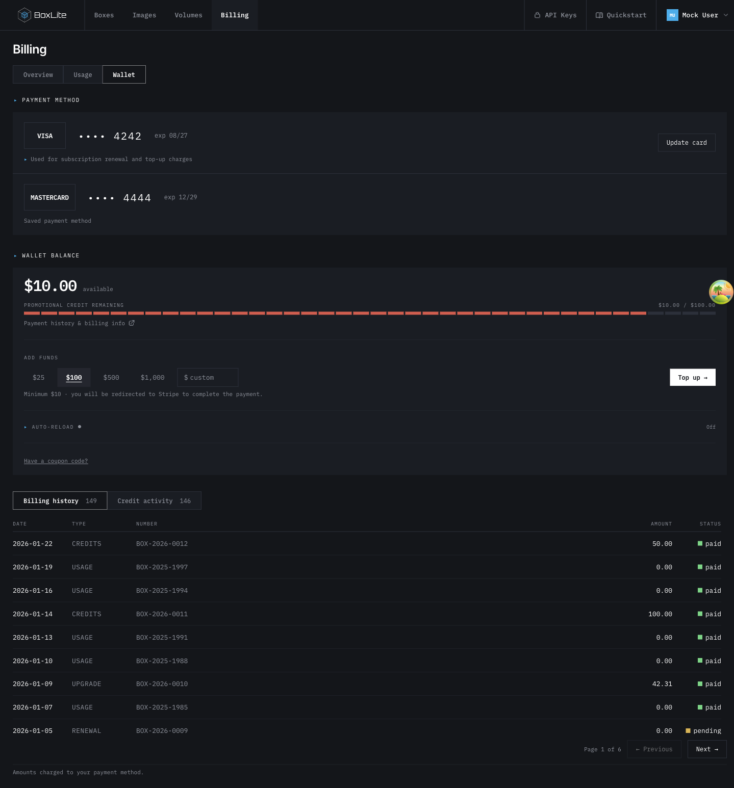

# Image defaults and lighter Billing surfaces

## TL;DR

New Box selects the first available image once per opening. Billing uses quieter
surfaces while preserving explicit selection, inputs and table rules.

[Design and alternatives](https://github.com/boxlite-ai/boxlite/issues/2286).

## Behavior

For a catalog ordered `base`, `python`, `node`, opening New Box selects `base`.
Choosing `python` or typing a custom reference keeps that choice through catalog
refreshes. Clearing the input intentionally returns to the backend default.
Reopening selects the current first entry again. A supplied Images-row reference
takes priority, delayed catalog data can initialize the field, and placeholder
data from a previous organization cannot.

Billing uses the existing card and accent colors with local component overrides.
Panel outer borders and plan-card internal rules are removed. The current plan
keeps a top rule; selected top-up amounts have a filled background, underline and
pressed state. Tabs, inputs, focus treatment and ledger rules remain visible.

## Validation

With all production changes restored to the base version and only the regression
tests present, six image-selection assertions failed because the field stayed
empty. The tests cover submitted references, delayed catalogs, placeholder data,
user edits and clearing, explicit prefills, refreshes and reopening.

Two plan-card render regressions also failed with all production changes
reverted: both loaded and loading cards still had full outer borders. Restoring
the change verified the current-plan marker, borderless surfaces, pricing,
sales link and upgrade navigation.

With the complete change restored, `make test:apps:dashboard` passed all 670
tests in 90 files. `make lint:apps` completed with zero errors (361 warnings).
The production `dashboard:build` Nx target, invoked through a temporary make
target, built the dashboard and its API-client dependencies. The dashboard
TypeScript check then passed with the generated declarations available.

Screenshots use the dashboard's MSW fixtures. They demonstrate rendered UI and
local interactions, not a production deployment or a real payment.

## Screenshots

| Surface | Before | After |
| --- | --- | --- |
| New Box |  |  |
| Billing Overview |  |  |
| Billing Wallet |  |  |

Additional checks:

- [Light Billing Overview](assets/2026-11-03-dashboard-defaults/billing-overview-light.png)
- [Billing Usage](assets/2026-11-03-dashboard-defaults/billing-usage-after.png)
- [Wallet at 390px](assets/2026-11-03-dashboard-defaults/billing-wallet-mobile.png)
