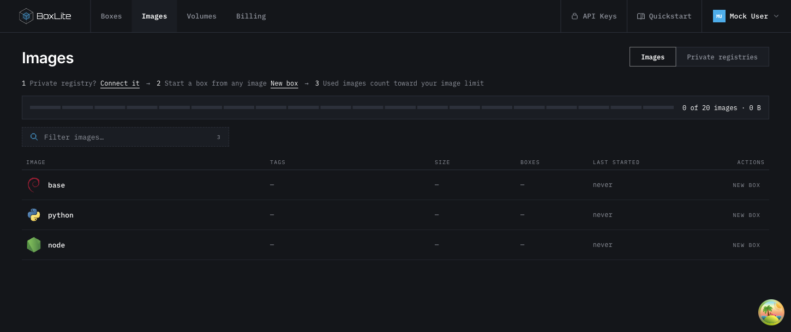
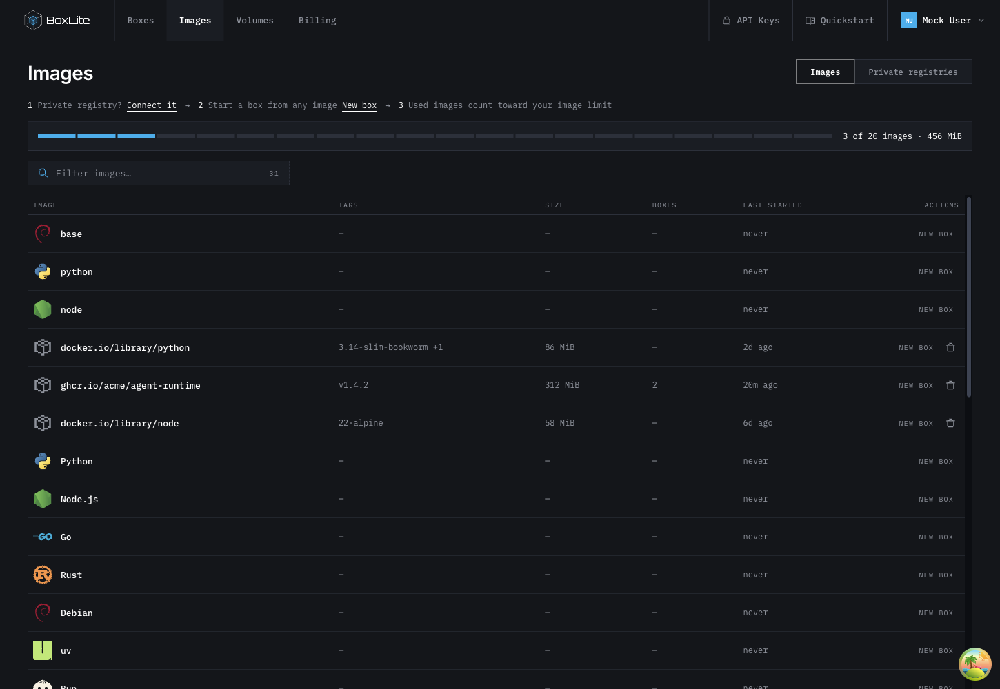
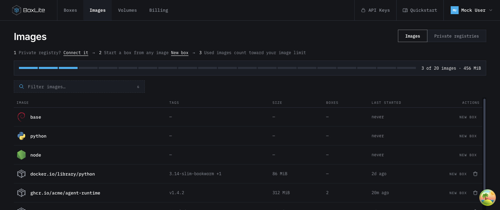

# Images lists the API catalog

## TL;DR

Images must list organization images and operator-configured system images returned
by the API. Quickstart recommendations must not create extra catalog rows.

## Scope and acceptance

- An empty image response produces no image rows; an API failure does not insert
  Quickstart recommendations as a fallback.
- Every returned image remains visible, including system images and organization
  images whose references match a Quickstart template.
- Filtering and the visible count operate only on returned images.
- Keep template icons and startup configuration for matching real rows. Keep
  existing deletion permissions, usage accounting, and Quickstart selection.
- No backend, API, image-lifecycle, or layout changes are needed.

## Related work and lessons

The following observations were checked against commit
`1bd83455f8862de08cd4cc08b38c7b8896b16d03` before implementation:

- [ImageCatalogService.list](../../../apps/api/src/image/services/image-catalog.service.ts)
  returns the operator's configured images together with the organization's
  non-deleted image records. It already owns the complete list membership rule.
- [useImagesQuery](../../../apps/dashboard/src/hooks/queries/useImagesQuery.ts)
  forwards that response. Usage is a separate request because system images do
  not consume organization image slots. Reuse this boundary without changing
  the API or deriving usage from the displayed count.
- [ImageCatalog](../../../apps/dashboard/src/components/images/ImageCatalog.tsx)
  decorates returned images with matching template IDs, then appends every
  unmatched `BOX_TEMPLATES` entry with `id: null` and `curated: true`. These
  appended rows are recommendations, not API catalog entries. Null sizes and
  usage dates render as dashes and `never`, making them look like unused assets.
- Existing component tests cover template-matching organization image removal,
  system-image creation, filtering, and failed reads, but not list membership.
  Add assertions at the rendered-component boundary to cover that missing rule.
- The dashboard README says built-ins sit apart from the table; current code
  puts them in the table. ONBOARDING.md describes virtual template rows. Update
  both descriptions to the chosen contract: API rows remain in the table,
  while recommendations belong to Quickstart.

Keeping the union but adding a label would still display unused recommendations
on Images. Removing all template-matching rows would hide real organization or
system images. Both alternatives violate the intended list membership rule.
Removing only the synthetic-row loop is the smallest change that meets it.

## How it works

Keep the existing map from API rows to optional template metadata. Delete the
loop that appends missing templates; filtering and counts naturally use the
remaining API-derived rows. Template matching enriches an existing row and must
never decide whether another row exists.

For example, an API response containing only `quay.io/acme/app:v1` produces one
row. The presence of Python or Go in the Quickstart catalog adds no rows. If
the API later returns an organization image matching a Quickstart reference,
that image appears with its actual aliases and remains removable under the
existing permission checks.

## Validation

Planned before implementation:

1. With production files unchanged, add component regressions for empty and
   populated API results, search for an absent template, failed reads, and an
   owned image that matches a template. Observe extra rendered rows fail the
   assertions.
2. Remove the synthetic rows and run the same tests plus existing image list,
   creation, deletion, routing, and query tests. Assert API-backed images retain
   their existing behavior.
3. Compare the local Mock API response with the rendered rows in a browser.
   The rendered count must equal the response length before filtering; a
   Quickstart-only template must not appear in search. Confirm templates are
   still selectable on Quickstart.

Browser validation uses development fixtures and does not establish production
deployment or registry availability.

Observed after implementation:

- With only test changes present, seven membership assertions failed: an empty
  or failed response still showed 25 templates, and filtering found a template
  absent from the response. After the fix, all 30 selected image catalog,
  creation, removal, routing, and query tests passed:

  ```sh
  NX_DAEMON=false NX_ISOLATE_PLUGINS=false NX_NATIVE_COMMAND_RUNNER=false \
    NX_CACHE_PROJECT_GRAPH=false make test:apps:dashboard \
    FILTER='the image list|starting a box|removing an image|the images page|image catalog queries'
  ```

- Browser verification: six Mock API rows rendered as 31 rows before the fix
  and six after it. Searching Images for `golang` returned no rows; Quickstart
  still selected the Go template. An organization image's New box action still
  prefilled the correct reference.
- Formatting and `git diff --check` passed. `make lint:apps` reported four
  errors in unchanged e2e/infra files and no errors in the changed files.

## Screenshots

These are browser captures of the local Mock dashboard, not production accounts.

New organization after the fix: only the three default system-image names appear,
with `0 of 20 images` used. The fixture's organization images and boxes were
removed in browser memory before opening Images; no production records were
created or changed. The system image names match the default configuration;
operator additions would also appear. Mock references and quota values are
illustrative.



Existing organization before the fix: the Mock API returns six images, but the
page shows 31 after adding 25 unrelated Quickstart recommendations.



The same existing-organization fixture after the fix: only the six API images
remain, with three organization image slots used. System images use no slots.


