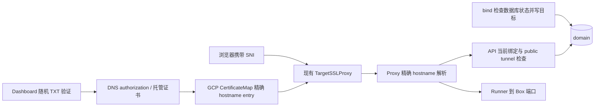

## TL;DR

有效订阅组织在 Dashboard 验证自有域名后绑定，不占平台额度。

## Details

### Tunnel 自有域名设计

日期：2026-11-03，2026-11-04 修订。状态：本地实现覆盖订阅准入、配置管理和 GCP 接入；真实云端验收及启用仍待执行。代码基线：`42f92292a1fd59569a7d13937b1fe3c44ec494c3`。

### 首期范围与 GCP 容量复核（2026-11-04）

本期接入当前 GCP 环境，复用现有 global TargetSSLProxy 和 Certificate Manager certificate map。
AWS、ACM、NLB 分片和自管 TLS 网关不在本期实施范围；先前查到的 AWS 默认 25 张证书不构成 GCP 的限制。

[现有源码](../../../apps/infra/mdeploy/stack/providers/gcp/edge.ts#L585) 把一个 certificate map 绑定到 TargetSSLProxy。
[官方部署文档](https://docs.cloud.google.com/certificate-manager/docs/deploy#certificate-manager-configuration-methods) 区分 map 引用和直接挂证书；当前采用 map，不能套用直接挂载的 15/100 张限制。

| GCP 项目级资源 | 官方默认配额 | 每个自有域名的设计用量 |
| --- | --- | --- |
| Google-managed certificates | 1000 | 1 |
| DNS authorizations | 1000 | 1 |
| Certificate map entries | 5000 | 1 |

来源：[Certificate Manager 配额](https://docs.cloud.google.com/certificate-manager/docs/quotas#resource-quotas-and-limits)。
这些是项目共享的默认值，可申请调整；不代表当前项目实测剩余容量，也不属于用户的平台域名额度。
按一域名一证书估算，默认容量先受证书或 DNS authorization 的约千个资源约束，还需扣除平台和其他服务的占用。
解绑保留配置与证书，因此仍占云资源；删除并完成云端清理后才释放。

各环境的可用容量须扣除已有证书、DNS authorization、map entries 和运维预留，不能从默认配额推断剩余名额。
worker 须按目标项目的请求配额限制并发、轮询和重试。
启用前须重新读取目标项目容量并核验运行时 IAM；管理员 CLI 可读取不证明 API 运行身份可写入。
容量不足时配置保持未就绪并显示环境容量原因；后台有界退避，人工重试有冷却，不能误报平台域名额度耗尽。
本地开发可使用 provider 边界测试；真实签发、续期及容量核对是启用条件，不能用模拟结果代替。

### 问题与范围

实施前基线（`42f92292`）的 `domain.kind` 已支持 `platform/custom`，但只实现了平台名称申请和已持有域名绑定。
该基线的 `claim` 额度检查统计所有域名，`listHeld` 使用 `rows.length`，会让自有域名占用平台额度。
基线 Proxy 只把平台应用后缀识别为命名域名；直接插入 custom 行不能完成接入。

| 基线行为 | 实现文件定位 | 本次设计 |
| --- | --- | --- |
| 全局唯一 hostname、组织、kind 和 target 已存在 | [domain.entity.ts](../../../apps/api/src/box/entities/domain.entity.ts#L22) | 复用 `domain` 表和现有字段 |
| 申请与列表都统计全部持有行 | [domain.service.ts](../../../apps/api/src/box/services/domain.service.ts#L125) | 额度只统计 `kind='platform'` |
| bind 只能更新已持有的 hostname | [domain.service.ts](../../../apps/api/src/box/services/domain.service.ts#L165) | 保留这个边界；custom 在 Dashboard 验证成功时创建 |
| 命名域名已有 public tunnel 准入 | [preview.controller.ts](../../../apps/api/src/box/controllers/preview.controller.ts#L127) | 复用解析入口和访问规则 |
| GCP 当前源码使用 TargetSSLProxy 和 certificate map | [GCP edge](../../../apps/infra/mdeploy/stack/providers/gcp/edge.ts#L585) | 在现有 map 增加精确 hostname entry；实际部署和运行时 IAM 待核验 |

现有 bind/unbind/list 的路径、请求参数、成功返回字段和 SDK/CLI 调用签名保持现状。
兼容性承诺不包括所有失败结果：自有域名 bind 新增 `403 subscription_required`、订阅资格无法确认时的 `409 subscription_not_ready`、接入尚未就绪时的 `409 domain_not_ready`；错误仍使用 `{code,message}` 字段。
Dashboard 增加独立的配置管理接口，承载挑战记录与 DNS/TLS 状态；不把这些字段加入现有三个接口。
不扩展 tunnel 请求或 SDK ABI；用户在 Dashboard 完成配置后，继续使用现有 CLI/SDK 绑定。
Box target、public tunnel、inbound、停止唤醒和默认 Proxy 的 region 限制沿用现有契约；App target 仍不支持。

当前设计把挑战移到 Dashboard 配置阶段，替代 bind 时查询 DNS 或生成挑战；额度仍仅统计平台名称。
前一版固定组织 TXT 是在没有配置管理界面的约束下选定的，本版用配置阶段的随机挑战取代，避免保留两套授权方式。

### 订阅准入

资格属于域名所在组织，不属于登录用户；有效订阅的组织成员仍需 `write:boxes` 权限。
复用 Commerce 的 `GET organization/:id/plan` 有效订阅语义，不从钱包余额、已绑银行卡、个人订阅或平台名称额度推断。
`status=active` 且权益未暂停，或 `status=past_due` 且 `entitlements=active` 的组织可用；取消自动续费但已付费周期仍有效的组织继续可用。
无订阅、有效取消、`entitlements=suspended`、未知状态或畸形响应均不授予资格；缺少计费配置也不放行。

来源：[现有计费响应类型](../../../apps/dashboard/src/billing-api/types/OrganizationPlan.ts#L19) 和 [服务端计费调用边界](../../../apps/api/src/organization/services/organization-box-limits.service.ts#L75)。
订阅准入同时检查订阅状态和 entitlements，不能只检查 planId。
这一新功能单独读取明确订阅字段，不把 Box 的数字额度当作订阅标志，也不修改 Commerce 或原 Box 限额策略。

| 操作 | 订阅要求 | 失效或不可确认时 |
| --- | --- | --- |
| 创建配置、请求验证、创建云资源 | 后端检查有效订阅 | 不创建新归属或云资源，显示订阅或临时检查错误 |
| custom bind/改绑 | 检查本地有效资格租约 | 已持有但无资格为 403；资格未知或过期为 409；target 不变 |
| custom resolve | 同样检查本地资格租约 | 暂停新请求，保留配置及 target；已有长连接自然结束 |
| list、读取配置、unbind、删除配置 | 不要求订阅 | 保留原管理权限检查，允许查看和清理 |
| 平台域名 claim/bind | 沿用原规则 | 不受这项新订阅要求影响 |

后台和 Dashboard 配置请求刷新组织资格，按组织去重查询；持久化准入结果和绝对过期时间，资格租约最长 5 分钟并不晚于响应的 cycleTo。
已确认失效立即结束资格；暂时无法读取不延长旧租约，仍有效的旧资格最多保留至到期；过期后关闭准入。
bind/resolve 不访问 Commerce、DNS 或云证书服务；仅使用本地快照，过期时引导 Dashboard 刷新，避免绑定请求承担外部依赖。
到期暂停保留配置、归属与现有云资源，恢复订阅后重新核对 DNS/TLS 才恢复；保留资源仍占项目容量，只有显式删除及清理才释放。
订阅限制用于准入，不是证书总量上限；本期不增加每组织自有域名数量额度，仍处理 GCP 容量耗尽。

### 用户接口

| 操作 | 保持的接口 | 平台域名 | 自有域名 |
| --- | --- | --- | --- |
| bind | `PUT /v1[/{prefix}]/domains/{hostname}/target` | 必须已通过原 claim 持有 | 必须订阅有效、Dashboard 配置就绪；只更新 target |
| unbind | `DELETE /v1[/{prefix}]/domains/{hostname}/target` | 清空 target，保留名称 | 清空 target，保留记录并停用路由 |
| list | `GET /v1[/{prefix}]/domains` | 与自有域名一起返回 | 与平台域名一起返回 |

bind 继续接收 `{"type":"box","box":"web-a","port":3000}`，返回 `{hostname,url,target}`，HTTP 200。
unbind 继续返回 HTTP 204；同组织已解绑记录重复操作成功，未知或其他组织的名称仍为 404。
新增的 409 表示该组织已持有域名，但配置未就绪、授权租约过期或接入已失效；失败不修改 target，也不执行 DNS 查询或挑战。
尚未通过配置验证、尚未创建归属行的草稿仍属于未持有名称，bind 返回原有 `404 domain_not_owned`。
`POST /v1[/{prefix}]/domains` 的 `{name}` 仍只申请平台短名称，不接受完整自有域名或 kind。

```bash
boxlite domain bind app.example.com --type box --box web-a --port 3000
boxlite domain ls
boxlite domain unbind app.example.com
```

list 保留 `domains, limit, used, remaining, min_length, domain_suffix`，每行仍只有 `hostname,url,target`。
`min_length/domain_suffix` 仅描述平台名称申请；客户端不能用 `domains.length` 推导 used。
例如额度为 1、持有 1 个平台名称和 3 个自有域名，列表有 4 行，但 `used=1, remaining=0`。

### Dashboard 自有域名区域

在 Domains 页面新增与平台名称申请并列的「自有域名」区域，明确说明不占平台名称额度。
打开「添加自有域名」即显示设置指南，依次引导输入 hostname、复制 DNS 记录、检查配置、等待接入就绪和绑定目标。
入口受管理权限、组织订阅和部署能力约束，不复用平台申请的 remaining、min_length 或 domain_suffix 条件。
非订阅组织仍可打开设置指南、查看已有配置并解绑或删除；新增和绑定入口显示订阅提示。
Dashboard 从新增管理接口读取资格摘要，不直接调用仅组织 owner 可读的计费接口，不向普通成员暴露账单信息。

| 页面阶段 | 用户看到的内容 | 后端动作 |
| --- | --- | --- |
| 输入域名 | 支持范围、CNAME/TXT 作用、DNS 由用户修改 | 校验 hostname，创建或读取本组织配置草稿 |
| 配置 DNS | 可复制的记录名称、类型、值及传播说明 | 返回本次随机 TXT 挑战及固定流量入口 |
| 检查配置 | 「我已配置，检查 DNS」、失败原因和重试 | 独立验证接口核对挑战及流量 DNS |
| 证书授权 | GCP 返回 CNAME，提供复制、检查和错误指引 | 组织控制权通过后创建 DNS authorization，不在 bind 内发起 |
| 接入准备 | DNS 已验证、HTTPS 配置中或失败原因 | 持久化归属并调和证书，UI 轮询配置状态 |
| 已就绪 | hostname、绑定目标及「绑定/解绑/删除配置」操作 | 绑定/解绑继续调用原接口，删除配置走管理接口 |

配置草稿和状态使用独立查询，不修改旧 list 的响应；验证成功后旧 list 才出现该组织持有的 custom 行。
草稿不占用全局 hostname，不因其他组织先创建未验证草稿而阻止真实持有者完成验证。
初次验证失败保留可重试草稿，但不创建 domain 行、不开放路由；已验证后失效则保留原归属与 target，停止新请求。
页面按 organization/config ID 隔离请求与轮询，切换组织或关闭向导后不能把迟到结果写入其他组织界面。

新增 Dashboard 管理接口，路径为拟定契约，均验证组织访问权限和 `write:boxes`：

| 接口 | 配置阶段职责 |
| --- | --- |
| `POST /api/organizations/{org}/custom-domains` | `{hostname}` 创建/恢复草稿，返回配置 ID、DNS 指引和状态；重复添加复用有效挑战 |
| `GET /api/organizations/{org}/custom-domains` | 返回本组织草稿、已验证配置、DNS/TLS 状态和错误，供区域展示 |
| `GET /api/organizations/{org}/custom-domains/{id}` | 打开指南、刷新与轮询时读取当前配置 |
| `POST /api/organizations/{org}/custom-domains/{id}/verify` | 触发幂等的异步验证，返回 202；不绑定 Box |
| `DELETE /api/organizations/{org}/custom-domains/{id}` | 显式移除配置、停流并释放归属，持久化证书清理；不等同于 unbind |

管理响应可以包含挑战、配置状态和错误详情；它们是新增接口，不改变便携 REST/SDK 的域名 DTO。
绑定目标复用现有 bind 请求；只有组织订阅有效且配置 ready 时展示可用操作，服务端独立检查，不能只靠按钮禁用。

### 持久化分类与额度

先复用完整 hostname 规范化：去首尾空白、转小写、去一个末尾根点，再校验标签和总长度。
拒绝 URL、路径、端口、IP 和通配符；首期接受 ASCII/Punycode 公网子域名，根域接入暂不开放。
子域名边界使用 [Public Suffix List](https://publicsuffix.org/learn/)，避免把 `example.co.uk` 按点数误判为普通子域名。
PSL 只用于可注册边界，随依赖更新；域名是否存在和是否获授权仍由公开 DNS 检查决定。
验证用的 `_boxlite-verification.<hostname>` 也必须满足 DNS 总长度限制。
新增 GCP 配置采用 `PER_PROJECT_RECORD` 授权；规范化后的 ASCII/Punycode hostname 最多 220 字节，超长在创建草稿前报错。
该限制来自 [GCP per-project DNS 授权长度](https://docs.cloud.google.com/certificate-manager/docs/quotas#domain-name-length-limitations-for-google-managed-certificates)，只用于新增配置，不收紧旧 bind 的 hostname 语法。
验证覆盖 220/221 字节边界；不套用 AWS ACM 的 64 字节限制。

设 suffix 为去端口后的平台应用后缀 `domain.appHost`，例如 `apps.example.net`：

| 规范化 hostname | 判定 | 持久化及准入 |
| --- | --- | --- |
| `demo1.apps.example.net` | `hostname.endsWith('.' + suffix)` | `kind=platform`；必须已 claim |
| `a.b.apps.example.net` | 同样属于平台命名空间 | 按现有单标签规则拒绝；不能降级成 custom |
| `apps.example.net` | 平台后缀自身 | 保留入口，拒绝绑定 |
| `notapps.example.net`、`apps.example.net.evil.com` | 不匹配完整标签边界 | `kind=custom`；必须通过 DNS 授权 |
| `app.customer.com` | 其他合法公网 hostname | `kind=custom`；必须通过 DNS 授权 |

分类由服务端完成，用户不能指定 kind；同时拒绝部署的管理域、生成 tunnel 域及其保留命名空间。
新记录首次持久化时确定 kind，之后读取、解绑和改绑以存储类型为准，不因配置变化自动降级成 custom。
平台后缀迁移须保留旧后缀的保留配置并核对既有行，不能把旧平台名称变成免额的自有域名。
未配置平台后缀时禁用平台 claim；custom 仅在独立 DNS/TLS 接入配置就绪的环境开放。

```sql
-- 平台申请的准入计数与 list.used 使用同一规则。
SELECT count(*) FROM domain
WHERE organization_id = $1 AND kind = 'platform';
```

`limit=organization.domainCountLimit`，`remaining=max(0,limit-used)`。
平台名称绑定与否都计数；custom 在绑定、解绑、证书待就绪或失败时都不计入。
订阅有效的 custom 不检查平台容量，即使 limit 为 0 或平台额度已满也可绑定；本设计不新增自有域名数量额度。
组织行锁仍保护平台并发 claim，也保护 custom 创建与组织删除的互斥，但 custom 不执行额度准入。

### 用户 DNS 配置

设置指南先展示随机 TXT 挑战和稳定的流量 CNAME；控制权通过后，再展示 GCP 返回的证书授权 CNAME。
采用 [PER_PROJECT_RECORD](https://docs.cloud.google.com/certificate-manager/docs/dns-authorizations#per-project-record-dns-authorization)，避免要求客户替换已有的固定 `_acme-challenge` 记录；签发 CA 为 Google Trust Services。
挑战使用 32 字节安全随机值，关联组织、规范化 hostname、配置 ID 与验证版本；不是通用组织 UUID。
以下记录均为示例，实际挑战值由配置接口返回，流量入口取本环境配置。

| 用户配置 | 类型 | 示例值 | 作用 |
| --- | --- | --- | --- |
| `app.example.com` | CNAME | `custom.proxy.platform.example` | 流量指向本环境默认 Proxy |
| `_boxlite-verification.app.example.com` | TXT | `boxlite-verification=<本次随机值>` | 证明本配置的组织控制这个精确 hostname |
| GCP 云证书服务返回的 name | CNAME | 云服务返回的 value，原样显示 | 托管签发与续期授权，不能替代组织控制权挑战 |

平台负责让稳定 CNAME 目标解析到所选自有域名入口；用户自行修改其 DNS，不提交 DNS API 密钥。
首期要求 DNS-only，不在客户域名前启用 CDN 代理；冲突的 AAAA 或其他流量记录必须移除。
验证只接受本配置当前版本的精确挑战；其他配置或旧版本的 TXT 不能替代它。

1. 用户在 Dashboard 获取指南并添加两条记录，点击检查配置；验证也可由有界后台任务重试。
2. 配置验证核对当前 TXT 和流量 CNAME，限制查询时间与链长，最终须到达本环境固定入口。
3. 初次挑战建议 24 小时有效；过期后恢复配置时生成新版本，界面要求重新复制，旧任务不能验证新版本。
4. 验证通过后持久化 `kind=custom`、组织归属和空 target，创建 GCP DNS authorization；用户添加返回的 CNAME，后台完成签发和 map entry，接入就绪后才允许 bind。
5. bind 不生成挑战、不查 DNS、不触发签发，只检查数据库里的归属、订阅资格租约、验证租约与接入状态。

验证后保留当前 TXT 供后台持续复核；首次挑战有效期不等同于已验证域名的授权到期时间。
解绑和同组织改绑不要求修改 TXT；删除配置或显式重建验证才使原挑战失效。
域名转移须移除旧授权；DNS 传播受 TTL 影响，不能承诺修改记录即刻停流。
其他组织已有 domain 行时不自动抢占；原组织显式删除配置释放后，新组织以自己的新挑战验证。

### bind、unbind 与内部一致性

配置阶段的 DNS 查询在数据库事务外执行，结果只应用于相同配置 ID 与验证版本。
验证成功时锁住组织，重新检查配置版本和 hostname 全局归属；唯一约束保证竞争只有一个归属，不覆盖其他组织。
bind 的事务只做数据库检查和目标更新，按组织、Box、domain、配置的顺序加锁，并复核 Box 归属、销毁状态和 region。
两类域名都只更新已持有行；未知或其他组织名称继续返回 `404 domain_not_owned`。
custom 先检查订阅资格，按上表返回 403/409；资格通过但尚未 ready、授权租约过期或接入失效时返回 `409 domain_not_ready`，沿用 `{code,message}` 形状。
这里的「验证有效」只检查已存配置的组织/hostname、DNS 核验租约和证书有效状态，不进行 DNS 查询、挑战或用户交互。
DNS 证明是否仍匹配由配置验证和后台复核维护；组织成员及 Box 权限继续由现有鉴权检查，不与 DNS 授权混为一项。

新增 `custom_domain_config` 保存配置 ID、组织/hostname、随机挑战及版本、DNS 租约、phase、云资源与重试信息。
草稿按 `(organization_id, hostname)` 去重；验证成功后以唯一可空 domain_id 关联主表，不用未验证草稿抢占 domain.hostname。
主流程为 `pending_verification → pending_certificate_dns → provisioning → ready`。
失败可重试，失效时拒绝绑定和转发；状态字段只进入 Dashboard 管理 DTO。
绑定版本与验证版本分开：bind/改绑只改变目标版本，复用同 hostname 已就绪证书；重复绑定同目标幂等。
unbind 清空 target、推进目标版本，保留验证和证书配置；后台仍维护该域名资产，不能因 target 为空把证书当作废弃。
删除配置才废止验证版本、清空路由、释放 domain 行并保存证书清理意图；用户侧 DNS 显示删除指引，不替用户操作。
删除先保留内部 tombstone、外部操作意图和云资源归属，清理完成后才物理删除配置；迟到资源创建不能丢失清理入口。
域名删除操作只出现在 Dashboard 自有域名区域；不新增 CLI/SDK 删除方法，也不改变 unbind 的保留归属语义。

调和与清理任务持久化，云操作不占用数据库事务锁。
配置验证结果匹配配置 UUID、验证版本和期望 phase；证书结果还须匹配 domain UUID，删除后的旧结果不得重建记录。
这些任务不写 target；解绑后证书完成可以更新配置就绪状态，但绝不能恢复旧 Box/端口。
同 hostname 的证书关联和清理串行执行，只操作精确资源 ID；旧任务不得删除当前绑定仍使用的证书。
组织删除在同一组织锁内保存清理快照再删域名；Box 删除保留名称及 target，访问按现有规则拒绝。

DomainService 保留 bind/unbind/list/resolve；配置服务统一拥有注册、挑战、状态和删除，DNS 核验与证书 provider 封装在该边界内。
已有 custom 行缺少内部状态时默认不放行，不能仅凭 kind 或历史 target 视为验证通过。

DNS 在后台定期复核，建议初始间隔为 1 分钟、有效租约上限为 5 分钟，灰度验证后调整。
明确的不匹配停用路由；查询故障只允许当前有效租约结束前的已有授权，不能无限延长旧结果。
DNS TTL 仍可能延后观察到变更；解绑直接修改主库，不等待 DNS 或证书清理。

### HTTPS 方案与请求路由

本期采用 GCP 托管 DNS 验证证书，复用现有 global CertificateMap 和 TargetSSLProxy，不引入私钥存储或自管 ACME。
GCP 负责签发和自动续期；平台维护 DNS 授权、证书和精确 hostname map entry，并持续检查状态。
这描述拟实施方式，不证明当前部署及 IAM 已完成核验。

实施复核（2026-11-04）：[Certificate Manager 速率配额](https://docs.cloud.google.com/certificate-manager/docs/quotas#rate_quotas)
默认总请求、读请求和写请求分别为 300/min；证书数量额度不能代替速率规划。
首次就绪仍读取云状态并探测 SNI；已就绪配置日常复核只检查公开 DNS 和固定入口上的真实 TLS 握手，
证书租约取握手实际证书到期时间与五分钟上限中的较早者，避免每分钟逐域名调用多个云 GET。
TLS 握手失败转回 provisioning，由后续任务读取云资源并修复；新建、修复、删除的 429 使用持久化退避，手动重试不绕过容量退避。
每副本最多八个并发任务，每五秒最多处理三十二项；跨副本同 hostname 通过数据库租约串行。
这些是有界默认值，尚无生产负载测量，启用前需检查任务延迟、GCP 请求速率和实际配额。
删除 tombstone 保留并定期再检查，避免超时创建在一次 404 清理检查之后才完成而泄漏资源。

首次证书准备放在 Dashboard 配置阶段，ready 后才允许 custom bind；200 表示配置就绪且目标已保存，不承诺 guest 服务已经启动。
`list.target` 始终表示保存的目标，不用 null 隐藏配置失败，也不新增 DNS/TLS 状态字段。
DNS/TLS 状态和可操作错误显示在新的自有域名区域；失效后保留 target，但拒绝新请求。



依据：[edge 源码](../../../apps/infra/mdeploy/stack/providers/gcp/edge.ts#L561)、[DNS 授权及签发流程](https://docs.cloud.google.com/certificate-manager/docs/deploy-google-managed-dns-auth)、[精确 SNI 匹配](https://docs.cloud.google.com/certificate-manager/docs/certificate-selection-logic#certificate-selection-logic)。
CA 授权记录读取 provider 的 name/type/data，不能自己拼接；用户保留该记录用于持续续期。
客户 hostname 必须精确进入 map；保留现有 PRIMARY 和平台 wildcard entry，不修改平台证书或更换 map。

云资源名由配置 UUID/验证版本确定，并标记同样的归属 labels；持久化资源 ID、长操作名和重试状态。
创建超时先 GET 确定性资源名并核对归属及 hostname；409 不等于成功，不能领用其他配置资源。
后台依次推进 DNS authorization、certificate、map entry；清理按 entry、certificate、authorization 的依赖顺序等待完成。
云调用不持有数据库事务锁；应用结果前再次核对配置版本，删除后的迟到操作进入清理，不恢复归属。
激活前检查证书和 entry 状态，再对部署固定 edge IP 执行客户 SNI 握手；不请求 guest 或用户解析出的任意 IP。

IaC 管理入口、map、运行时 IAM 和 provider 配置；运行时仅管理客户资源，不为每次 bind 运行部署。
运行时身份需要客户证书、DNS authorization、map entry 的读写与 operation 读取权限；不得替用户修改 DNS。
provider 未配置时配置阶段明确拒绝，不产生永远不能就绪的归属；云额度错误与平台名称额度分开。
启用前实测签发、SNI、续期、删除清理和运行时 IAM；本期不开放 AWS 自有域名配置。

Proxy 的 HTTP、WebSocket 和 CONNECT 使用同一 Host 分类：管理入口、明确的生成 tunnel 后缀、平台命名空间、其他合法 hostname。
custom 精确查询同一个 `/preview/domains/:hostname`；未知、未绑定或内部 DNS/TLS 未就绪为 404，API 故障为 502。
DomainService.resolve 对 custom 联查内部状态和绑定版本；对 platform 保留原解析行为，对外仍只返回现有 target。
只有明确位于生成 tunnel 后缀且仅有一个前缀标签的 Host 才能进入 `<port>-<box>` parser，custom 查询失败绝不回退。
这也防止 `3000-<box>.customer.example` 绕过域名记录直达 Box。

`handleHTTP`、`GetProxyTarget`、CONNECT 入口都要覆盖，避免留下前置 Host 拒绝或错误的 utility 路径分流。
custom 的 `/health`、`/login` 等路径归用户应用，沿用平台命名域名的凭据剥离和 guest cookie 隔离。
解析不增加正向缓存；只有当前绑定、DNS/TLS 和 public tunnel 检查通过后才唤醒/拨号。
解绑提交后开始的解析读取新状态；已通过检查的请求及长连接自然结束，底层 tunnel 规则与缓存保持现状。

### 相关方案与取舍

| 机制 | 选择 | 原因 |
| --- | --- | --- |
| 保持现状 | 不采用 | 用户仍不能接入自有域名，无法满足本次目标 |
| 只修额度统计 | 作为先行兼容步骤 | 可避免混合域名误计费，但缺少配置验证、HTTPS 和 custom 路由，不能单独交付完整能力 |
| 原 domain 表及命名域名解析 | 复用 | 归属、唯一性、组织生命周期和访问规则已经存在 |
| E2B 的用户自建 Caddy 代理 | 不采用 | 用户还需运维 TLS 和代理，超出自行配置 DNS 的流程 |
| 配置阶段随机挑战与独立流量记录 | 采用 | Dashboard 配置接口提供指引，bind 保持原参数并只读验证状态 |
| bind 中发起随机挑战或同步查询 DNS | 不采用 | 让绑定目标依赖外部 DNS，且重复承担配置阶段职责 |
| GCP 托管 DNS 授权与现有 certificate map | 采用 | 与当前 GCP 入口一致，避免平台托管私钥；容量按项目资源配额管理 |
| 自管 TLS 网关或多个 AWS NLB 分片 | 不纳入本期 | 当前部署是 GCP，未发现需要为 AWS 配额更换 GCP TLS 拓扑的依据 |

[GitLab Pages](https://docs.gitlab.com/user/project/pages/custom_domains_ssl_tls_certification/#prerequisites) 将授权和流量 DNS 分开。
这里借鉴配置阶段返回 TXT、用户修改 DNS 后验证及后台复核的流程，不复制其产品接口。
[E2B 官方方案](https://docs.e2b.dev/network/custom-domain#server-setup) 和 [Caddy 签发许可实现](https://github.com/caddyserver/caddy/blob/master/modules/caddytls/automation.go) 用于比较边界，不作为性能或 SOTA 结论。

### 验证与上线

| 契约/风险 | 实现阶段的验证 | 预期 |
| --- | --- | --- |
| 类型与额度 | 后缀边界、大小写/根点、平台单标签、限额 0/已满、混合并发 | kind 正确，custom 免额，平台 claim 不超额 |
| API 兼容 | 真实控制器序列化、CLI/各 SDK 的旧请求、混合列表及未就绪 custom | 请求/返回字段和 ABI 不变；明确新增订阅及接入失败；used 不等于列表长度 |
| 订阅准入 | 有效订阅、取消但周期未完、欠费宽限/暂停、无订阅、未知响应、计费超时和租约到期 | 所有配置/绑定/路由入口一致执行；免费组织不能预占云资源，仍可查看解绑删除 |
| 配置与授权 | TXT 缺失/错误/过期、错误 CNAME、DNS 故障、跨组织草稿/验证竞争 | 失败只保留本组织草稿，不抢占 domain、不签发、不覆盖其他组织 |
| bind 职责 | 在真实控制器/服务边界跟踪依赖调用，覆盖未配置、过期、ready 与跨组织 | 未就绪拒绝；ready 更新目标；DNS/provider 调用次数为零 |
| 生命周期 | 重复配置、验证、bind、改绑、unbind、重绑、删除配置/组织/Box 与迟到任务 | 验证可复用、解绑不恢复 target、删除后不恢复归属或误删新证书 |
| 本地调和规模 | 真实 PostgreSQL 上两个 worker、重复调度及 1000 个配置；DNS/TLS/provider 使用受控替身 | 单副本每轮最多 32 项、并发最多 8 项；无重复处理，ready 复核不调用云 API；不作为真实 DNS/GCP 延迟或续期证明 |
| 流量边界 | HTTP/WS/CONNECT、仿生成地址的 custom Host、utility 路径、private/revoke/inbound off | 全入口一致，未准入不拨号、不唤醒 |
| 真实 DNS/TLS | 两个 Proxy 副本上的签发、CAA 错误、SNI、续期、重试、清理 | 每个 provider 的真实 HTTPS 可用后才启用 |

先部署只统计 platform 的 API 兼容基线，再部署 DNS/TLS 内部状态、调和任务和所有 Proxy 副本，最后按环境启用 custom。
旧 API 仍按全量计数或旧 Proxy 仍按任意后缀解析时不得开放；回滚只回到兼容基线或更新版本。
保留已有 kind，新增内部表/索引使用新迁移；不修改已发布迁移，也不在部署时重新分类历史行。

实现时同步修订 `apps/SCHEMA.md`、`apps/API.md`、Proxy README、用户 networking 文档和 CLI/SDK 额度说明。
Dashboard 新增自有域名区域和设置向导；Dashboard 与 CLI 额度标签明确为平台域名，平台额度满不影响订阅组织的自有域名入口。
便携 OpenAPI 保留既有字段，补充 bind 的订阅 403/409、`409 domain_not_ready` 及额度语义，并执行兼容性门禁；新增 Dashboard 管理接口单独说明。
测试使用仓库 `make test:apps:api`、`make test:apps:proxy`、`make test:apps:dashboard` 及相关 SDK/E2E 目标。
本地工作树已包含平台额度修正、订阅准入、Dashboard 设置/删除、DNS/TLS 调和、GCP provider、Proxy 路由及部署开关。
API 测试包括 Box 内 PostgreSQL 的组织隔离、全局抢占、删除竞态和租约；云 provider/DNS 测试使用受控边界，不能代替真实签发。
生产启用仍须核验运行时 IAM、真实 DNS/SNI、证书签发及续期、删除回收和规模下的调和延迟；本地实现没有执行部署。
文档静态检查仅核对本地链接、代码围栏及空白，不证明 UI、API、DNS 或 TLS 行为。
用户操作指南位于 [networking](../../concepts/networking.md#bring-your-own-domain)，启用参数及回滚边界位于 [GCP 部署指南](../../../apps/infra/docs/gcp/deployment.md#customer-domain-https)。

### 研究记录

以下为 2026-11-04 GCP 范围复核的新轮次，替代无法完整追溯的旧检索汇总；查询数不含原文打开及引用追踪。
检索前已知项：当前 DomainService、GCP Certificate Manager、CertMagic 和 ACME；E2B/GitLab 资料用于产品边界对照。

| 来源 | 工具、次数和原始查询 | 结果与停止原因 |
| --- | --- | --- |
| arXiv 论文索引 | web，2 次：`site:arxiv.org "subdomain takeover" DNS`；停止轮 `site:arxiv.org "dangling DNS" 2025 2026` | 找到已打开的 2020 年论文；停止轮无新结果，没有选到近 24 个月的合格论文，不声称全领域不存在 |
| OpenAlex 论文索引 | web，2 次：`site:openalex.org "subdomain takeover"`；停止轮 `site:openalex.org "Can I Take Your Subdomain"` | 公开索引检索未返回候选，第二轮未增加信息后停止；不是 OpenAlex API 全量检索 |
| GitHub 项目引擎 | web，2 次：`site:github.com/caddyserver/certmagic automatic HTTPS`；停止轮 `site:github.com/caddyserver/certmagic "On-Demand" "Storage"` | 找到 CertMagic；第二轮重复预签发、许可和共享存储机制，不改变 GCP 托管选择后停止 |
| Go Packages 项目索引 | web，2 次：`site:pkg.go.dev/github.com/caddyserver/certmagic`；停止轮 `site:pkg.go.dev/github.com/caddyserver/certmagic "ManageAsync" "Storage"` | 打开 v0.25.6，第二轮重复已知签发及存储约束后停止 |
| Web/GCP provider | web，2 次：`site:docs.cloud.google.com certificate manager certificate maps target SSL proxy thousands certificates limit`；停止轮 `site:docs.cloud.google.com certificate manager DNS authorizations quota 1000 5000` | 打开配额、部署、maps、DNS authorization 原文；第二轮仅重现配额，不增加接入机制后停止 |
| 依赖规范 | 本地 node/rg/sed，8 条命令；读取已安装 package.json、README 和类型/实现；停止轮 `rg -n 'getDomain\|allowPrivateDomains\|getClient' apps/node_modules/tldts/README.md apps/node_modules/google-auth-library/build/src/auth/googleauth.d.ts` | TypeORM 0.3.31、google-auth-library 11.1.0、tldts 7.0.30；GCP 9.36.1、AWS 7.24.0、SST 4.6.11；最后一轮重复已读接口后停止 |
| 仓库及缓存 upstream 历史 | git，4 条新命令：`git log -8 --oneline --all -- apps/api/src/box/services/domain.service.ts apps/proxy/pkg/proxy/app_domain.go`，读取 e1697b2fd 的相关 diff 及 `origin/proxy-custom-hosts:apps/proxy/pkg/proxy/custom_hosts.go`；停止轮相同路径 `git log -3 --oneline --all` | Box/组织生命周期锁已有依据；旧 resolver 缓存 60 秒，不能直接用于要求即时解绑的解析；最后一轮仅重复已读提交后停止，未 fetch |

TypeORM 读取 `EntityManager.js:58` 和 `SelectQueryBuilder.js`：事务须使用回调 manager，PostgreSQL 写锁生成 FOR UPDATE。
google-auth-library 11.1.0 支持 ADC 客户端和授权请求；已列为固定版本直接依赖，使用固定 GCP REST v1 入口，与 Node 24 运行镜像一致。
tldts 7.0.30 读取 parse/getDomain/private suffix 规则；已列为固定版本直接依赖，先验证 hostname，再以包含私有后缀的 PSL 结果判断子域边界。
这些库仅承担事务、认证及后缀解析；配置授权、版本检查和重试策略仍由项目代码实现。

失败尝试：早先读取 `origin/proxy-custom-hosts:apps/proxy/pkg/proxy/app_domain.go` 返回路径不存在，随后通过树列表找到 custom_hosts.go。
TypeORM 在线页没有可读正文，改读当前安装版本；Hysteria 的 HyNetwork/HyNetworks 直接 URL 和 CertMagic 标签 README 打开失败，改从 apernet/hysteria 重定向及 CertMagic 仓库/版本文档读取。
这些失败不作为设计依据，也没有把旧的未记数搜索补写成已完成记录。

#### 双向引用与候选取舍

向后追踪：CertMagic README 引用 [ACME RFC 8555](https://datatracker.ietf.org/doc/html/rfc8555#section-8.4) 和 [ARI RFC 9773](https://datatracker.ietf.org/doc/html/rfc9773)，均已打开；分别核对 DNS 控制权挑战及续期时间建议。
向前追踪：读取实际消费者 [Caddy go.mod](https://github.com/caddyserver/caddy/blob/master/go.mod) 和 [Hysteria app/go.mod](https://github.com/apernet/hysteria/blob/master/app/go.mod)，分别引用 CertMagic v0.25.6 和 v0.25.4。
这提供两项非星标采用证据，不代表 BoxLite 已部署该库或性能得到证明。

| 候选 | 时效/采用依据 | 本期取舍 |
| --- | --- | --- |
| CertMagic v0.25.6 | [版本页](https://pkg.go.dev/github.com/caddyserver/certmagic@v0.25.6) 标明 2026-09-30 发布；Caddy 与 Hysteria 两个实际依赖 | 符合本次活跃及采用门槛，但不引入：GCP map 已支持所需接入，引入它会新增私钥、分布式存储和挑战服务 |
| 2020 年相关域攻击论文 | [原文摘要](https://arxiv.org/abs/2012.01946) 日期超出 24 个月，未取得仍领先的证据 | 只作风险背景，不列为 SOTA，也不从摘要推导当前攻击比例 |
| ACME / ARI | 标准原文，ARI 发布于 2025-06；非产品部署证明 | 采用控制权与续期分离的原则；本期交给 GCP 托管签发，不实现 ACME 客户端 |
| GCP 托管 DNS 证书 | 官方文档证明 global map/TargetSSLProxy 支持；本地源码已有相同资源结构 | 采用；实际 IAM、容量、签发和续期仍须部署环境验证，不称为 SOTA 结论 |

2026-11-04 订阅修订补充核对：检查仓库内计费调用侧类型及订阅准入的正向、拒绝和过期边界；这些是接口合同，不是新 SOTA 声明。
外部原文打开 [Stripe 订阅生命周期](https://docs.stripe.com/billing/subscriptions/overview#provision-access) 与 [OWASP 逐请求授权](https://cheatsheetseries.owasp.org/cheatsheets/Authorization_Cheat_Sheet.html#validate-the-permissions-on-every-request)：采用后端统一准入和错误默认拒绝原则，状态细节以本地 Commerce 为准。
此补充不改变 GCP/ACME 技术选型，沿用上表已完成的各来源检索与取舍；新增策略验证以本地生产方及消费者合同为边界。

本期设计约定：仅有效订阅组织可使用自有域名、自有域名免平台额度、旧三接口字段不变、Dashboard 配置阶段挑战、按后缀存储，HTTPS 首期仅接 GCP。
