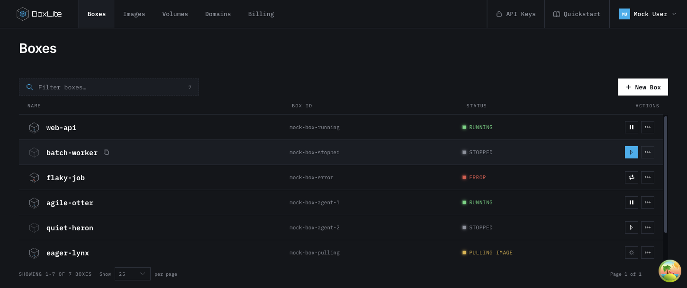
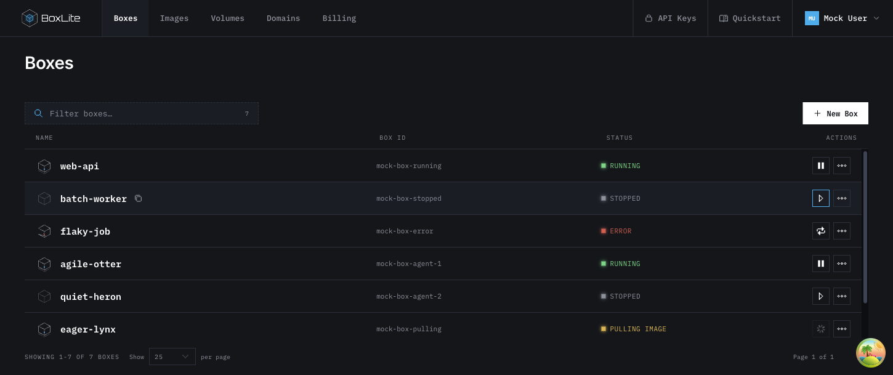
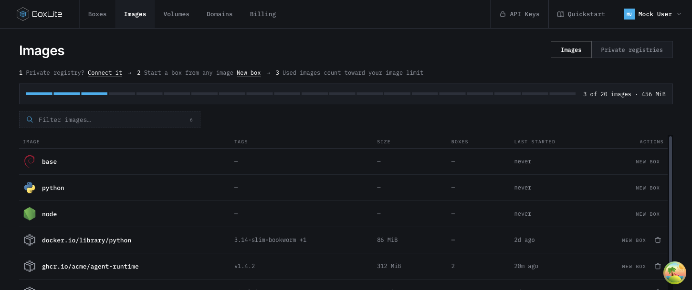
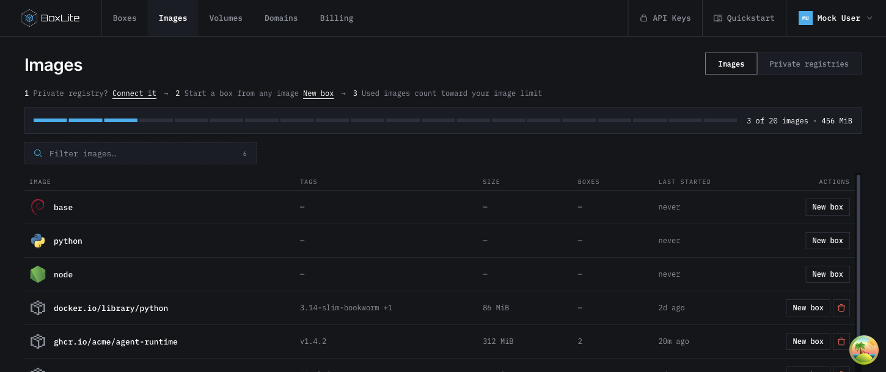
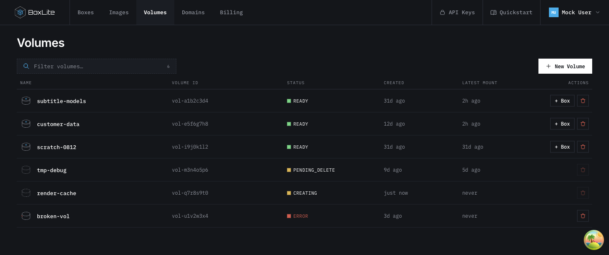

## TL;DR

Make console action buttons use one ASCII style contract while preserving existing action, permission, and confirmation behavior.

## Problem

At main commit `7f28cd5f295ac54f96c477141a096db590b936ed`, Boxes defines 26×28 icon buttons with solid cyan hover, Images uses borderless actions, and Volumes defines separate outline controls.
The existing `AsciiButton` and `ui/button` independently define geometry and interaction styles, allowing equivalent controls to drift.

## Scope

- Use the existing monospace, square-corner console language for action buttons.
- Standardize primary buttons at 36px, compact actions at 28px, and mobile icon controls at 40px; preserve existing 44px mobile primary targets.
- Migrate resource actions, API-key controls, and create/confirmation entry points without changing callbacks, permissions, titles, or disabled conditions.
- Preserve native navigation links, custom choice controls, and the existing offline pixel icon family.

## Related work and lessons

| Source | Decision | Reason |
| --- | --- | --- |
| [WAI button pattern](https://www.w3.org/WAI/ARIA/apg/patterns/button/#keyboardinteraction) | Adopt | Keep native buttons and explicit accessible names for icon actions. |
| [Radix composition](https://www.radix-ui.com/primitives/docs/guides/composition#your-component-must-forward-ref) | Adopt | Forward DOM refs and native handlers through both wrappers for dialog and menu triggers. |
| [Pajamas button categories](https://design.gitlab.com/components/button/#categories) | Adapt | Preserve primary, secondary, and destructive hierarchy using console tokens. |
| [WAI tooltip pattern](https://www.w3.org/WAI/ARIA/apg/patterns/tooltip/) | Defer | Native title replacement is outside this presentation change. |
| [Existing ASCII primitive](https://github.com/boxlite-ai/boxlite/blob/7f28cd5f295ac54f96c477141a096db590b936ed/apps/dashboard/src/components/ascii.tsx) | Reuse | Keep its semantic API while delegating shared styling to Button. |

Known items before searching were AsciiButton, Radix composition, WAI button semantics, and pixelarticons.
Web research on 2026-11-05 searched W3C/Radix (two queries), GitHub (one), GitLab (one), arXiv (two), and ACM DL (two).
Kept queries included `site.w3.org WAI ARIA button pattern tooltip pattern`, `site.radix-ui.com primitives tooltip accessibility button asChild`, and `site:gitlab.com design system button tooltip`.
Stop queries included `site:arxiv.org interface visual consistency buttons`, `site:dl.acm.org interface visual consistency buttons`, and `site.github.com radix-ui primitives tooltip button disabled`.
Paper results concerned physical interfaces or domain-specific assistance and did not change this bounded component migration; no comparative SOTA claim is made.
Original WAI/Radix sources and repository history were inspected; installed Slot 1.2.4 and Dropdown Menu 2.1.16 implementations confirm ref and handler composition.
Further research stopped because the existing component contracts settle this implementation without a dependency change.

## How it works

Button owns typography, geometry, outline focus, disabled feedback, and semantic style variants.
AsciiButton maps its primary/secondary/danger/dangerSolid names and compact/icon sizes onto that implementation.
Secondary hover and open-menu states use a cyan border and neutral surface; destructive controls use red feedback.
Hover guards must include enabled anchors rendered through Radix Slot while excluding disabled buttons.
Page migrations replace copied class strings, keeping business logic intact.

Keeping duplicated styles would preserve drift.
Global button CSS would also affect tabs and custom choices.
A second ASCII implementation would create another styling authority, so the existing primitive is reused.

## Validation

Compare the clean base and proposed branch using identical mock fixtures and viewport sizes.
Capture before/after resource actions and verify hover, keyboard menu opening/focus return, disabled controls, light theme, and mobile target sizes.
Run `make test:apps:dashboard`, `make build:apps:dashboard`, and `make lint:apps`; record baseline failures separately.
Use existing interaction suites and browser inspection for this presentation migration; do not add tests that only mirror class strings.

Observed on the proposed branch:

- `make test:apps:dashboard`: 92 files and 700 tests passed.
- `make build:apps:dashboard`: production build and four prerequisite tasks passed, including typechecking.
- `make lint:apps`: passed with existing warnings.
- `make fmt:check:apps`: reports 207 unchanged files; none is modified by this change. Formatting of every changed source file passed.
- Browser inspection confirmed 28px desktop actions, 40px mobile icon targets, a 44px mobile primary action, and no horizontal overflow at 390px.
- Keyboard menu activation and focus return passed; light-theme focus uses a contrasting 2px outline.

The unchanged base was rendered before applying the patch, using the same mock data and viewport as the proposed branch.
Hovering Start previously filled the button cyan; the migrated control retains a neutral surface and uses a cyan border.
No new regression test was added for class strings; existing interaction suites and these rendered comparisons validate the presentation migration.

## Rendered comparisons

| Surface | Before | After |
| --- | --- | --- |
| Boxes, Start hovered |  |  |
| Images |  |  |
| Volumes |  |  |
