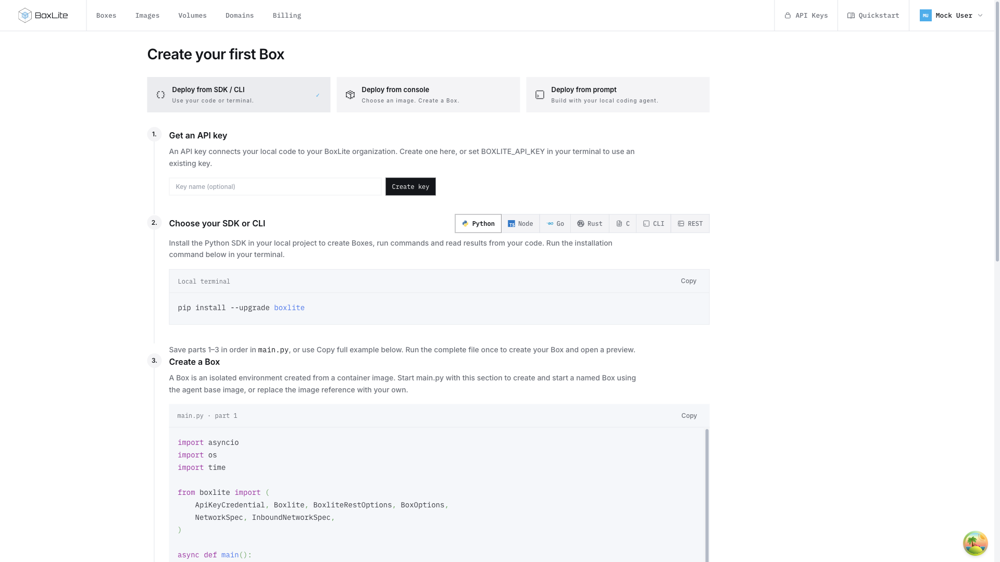
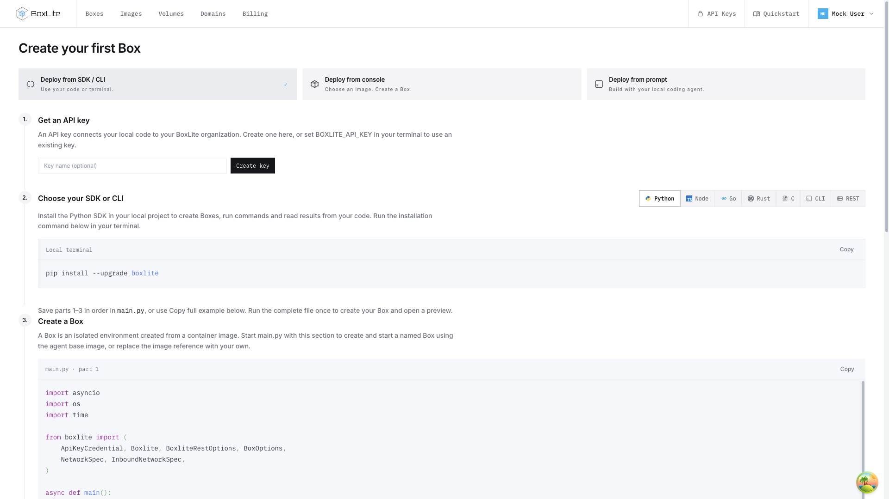

## TL;DR

Dashboard pages now share Images' full-width layout, with matching horizontal edges from phone to wide desktop viewports.

## Contract and design

The maintained layout contract lives in the [dashboard README](../../../apps/dashboard/README.md#page-width-and-alignment).
The design and alternatives are recorded in [issue #2347](https://github.com/boxlite-ai/boxlite/issues/2347).

## Before and after

Both screenshots use the SDK/CLI Quickstart, mock data, the light theme, and a
1920 × 1080 CSS-pixel viewport. The baseline is commit `3f8e7d2d`, with none
of this fix's production changes. The deployment cards are 1080px wide.
With the complete fix, they span the shared 1829px content area.

### Before

### After

## Browser measurements

Images, Billing, and Quickstart share the following horizontal content edges.
The browser reserves an 11px scrollbar gutter. All dimensions are CSS pixels.

| Viewport | Left edge | Right edge | Content width |
| --- | --- | --- | --- |
| 2940 | 40 | 2889 | 2849 |
| 1920 | 40 | 1869 | 1829 |
| 1440 | 40 | 1389 | 1349 |
| 1024 | 40 | 973 | 933 |
| 768 | 24 | 733 | 709 |
| 390 | 16 | 363 | 347 |

No tested viewport has page-level horizontal overflow. At 1920px, Boxes,
Volumes, API Keys, Domains, organization settings, image details, and plan
changes also share the same edges. Quickstart's SDK, console, and prompt
panels retain the same width when switching methods.

To inspect the behavior, run `npm run start:mock` from `apps/`, navigate between
`/dashboard/images`, `/dashboard/billing`, and `/dashboard/quickstart`, and
resize through the widths above. Switch all three Quickstart methods and
confirm that the outer edges remain fixed. Inputs and explanatory paragraphs
can remain narrower inside the shared page width.

## Automated checks

`make test:apps:dashboard`, `make build:apps:dashboard` (including TypeScript),
and `make lint:apps` passed. The existing Billing tests retain their containment
assertions and locate the shared page container.

`make fmt:check:apps` reports the same 207 existing formatting failures on
the unchanged baseline and the layout branch. Its output is identical;
these files are outside this change. Changed dashboard files are formatted
separately with `make fmt:apps FILES=...`.
