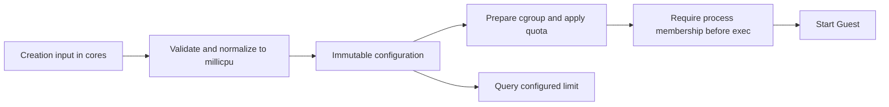

## TL;DR

Add a creation-only Linux CPU time limit while preserving integer virtual CPU counts.

## Details

### Problem

`BoxOptions.cpus` configures integer virtual hardware; it cannot express half a CPU of aggregate runtime.
The Linux jailer already creates cgroup v2 groups and translates the legacy `max_cpu_time` policy into `cpu.max`.
An independent limit can reuse that enforcement without changing guest CPU topology.

### Scope

The implementation targets `main`, which has no online resize or checkpoint API.
It adds creation and information fields to Rust, Python, Node, Go, C, CLI, and local REST/serve.
Cloud scheduling, billing, memory changes, online mutation, and macOS enforcement remain outside this change.

| Input | Behavior |
| --- | --- |
| `cpus=2, cpu_limit=0.5` | Two vCPUs and host VMM/device threads share half a CPU of runtime |
| Range | `0.01 <= cpu_limit <= resolved cpus`, in increments of `0.001` |
| Omitted CPUs | Validate against the existing default CPU count |
| Omitted/null limit | Preserve existing behavior |
| Invalid numbers | Reject non-finite, non-positive, excessive-precision, and out-of-range values |
| Mutability | Creation only; changing or clearing a saved limit requires a new Box |
| Local host | Linux, enabled jailer, and writable cgroup v2 CPU controller |

### Related work and lessons

[Linux CFS bandwidth](https://docs.kernel.org/scheduler/sched-bwc.html) supplies quota/period enforcement; use a 100 ms period and 1 ms minimum quota for explicit limits.

| Method | Projects | Trade-off | Decision |
| --- | --- | --- | --- |
| Host quota/period | [Docker](https://docs.docker.com/engine/containers/resource_constraints/#cpu), [Moby](https://github.com/moby/moby/blob/master/daemon/daemon_unix.go) | Aggregate time caps permit bursts and throttling | Pick: normalize numeric input into integer millicpu |
| Separate topology and time | [libvirt](https://libvirt.org/formatdomain.html#cpu-tuning) | Hardware parallelism can exceed sustained CPU budget | Adapt: retain integer `cpus` and add `cpu_limit` |
| Guest-only accounting | [Linux cgroups](https://docs.kernel.org/admin-guide/cgroup-v2.html#cpu) | Guest accounting excludes host device emulation | Reject: enforce around the host VM process |

Quota is an upper bound, not a reservation or latency guarantee.
[Thread-overcommitment research](https://arxiv.org/abs/2407.11582) motivates documenting contention; it does not establish a new scheduling guarantee.
Very low limits also throttle startup and device I/O, which can reach existing operation timeouts.

### How it works

Creation validates and saves the limit; every start applies it before Guest execution.
For example, `cpu_limit=0.125` writes `12500 100000` to `cpu.max`, regardless of the integer vCPU count.

- Store integer `cpu_limit_millicpu`; expose numeric cores through public adapters.
- Round floating input to a candidate integer, then require exact equality after dividing by 1000; never truncate excessive precision.
- Calculate `quota_us = millicpu * 100`, preserving any stricter legacy `max_cpu_time` quota and its separate cumulative `RLIMIT_CPU` behavior.
- Open `cgroup.procs` in the parent and require a complete pre-exec write of `0` before the jailer's FD cleanup.
- Reject unsupported platforms or disabled jailers during validation; late controller, quota-write, or membership failures prevent startup.
- Preserve the setting across restart, reconnect, disk snapshot restore, clone, and archive import; disk-only restore keeps the destination configuration.

No-limit boxes retain their current best-effort cgroup behavior and the legacy one-second quota period.
Information queries report the configured limit, which can differ from a stricter effective ancestor or legacy limit.
An explicit limit on `get_or_create` must equal the saved value; omission permits ordinary reuse.

### Interfaces and compatibility

| Interface | Contract |
| --- | --- |
| Rust | Validated `CpuLimit`, with integer storage and numeric-core serialization |
| Python | Append the optional constructor argument to preserve existing positional calls |
| Node | Optional `cpuLimit` on creation and information objects |
| C | Add a checked setter and asynchronous runtime-by-ID/name getter without changing existing layouts or signatures |
| Go | `WithCPULimit` and optional `BoxInfo.CPULimit`; query separately after callbacks, using immutable IDs |
| CLI | `--cpu-limit` on creation and `CpuLimit` in inspection |
| REST | Require fresh `cpu_limit_enabled: true` before explicit-limit creation; older servers receive no create request |

macOS local runtimes reject explicit limits; macOS REST clients follow the remote server's capability.
Archives with limits use version 6 so older importers refuse them; ordinary exports retain versions 3–5.
Downgrading the local database to a runtime that cannot enforce the saved setting is unsupported.

### Validation

| Claim | Check |
| --- | --- |
| Numeric contract | Positive, negative, precision, equality, and default-CPU boundary tests |
| Enforcement | Real KVM `cpu.max` and `cpu.stat` reads with one and two busy workers |
| Failure handling | Disabled jailer, absent quota file, and denied pre-exec membership checks |
| Persistence | Serialization, restart, reconnect, clone, and archive import |
| Wire compatibility | Production HTTP requests for omission, null, explicit values, capability refusal, and information decoding |
| ABI and platforms | Generated-header comparison, Go callback tests, and platform-specific validation tests |

This is a new contract with no equivalent fractional creation setting on the base branch; full-revert defect reproduction is inapplicable.
Tests must run against the final `main`-based tree; results from another base are not substitutes.
macOS requires its own host execution for platform acceptance.

### Observed verification

The final implementation was checked on Linux x86_64 against base `a4a7b829`.
Unit builds used `BOXLITE_DEPS_STUB=1`; KVM acceptance used the real runtime rebuilt with `make runtime:debug`.

| Check | Result |
| --- | --- |
| `make test:unit:rust FILTER=cpu_limit` | Core and REST tests passed |
| `make test:unit:cli test:unit:ffi test:unit:node` | CLI, C, TypeScript, and Node binding tests passed |
| `make test:unit:python FILTER=cpu_limit` | Production HTTP requests and Python conversion tests passed |
| `make test:unit:go` | Passed; test binaries used writable cgroup access |
| `make test:cpu-limit:acceptance` | Passed; one and two workers each measured 0.500 cores with 30 throttled periods per three-second sample |
| Lifecycle acceptance | Restart, reconnect, disk snapshot restore, clone, and archive import retained `50000 100000` |
| `make clippy` and SDK lint | Passed |
| OpenAPI comparison with `main` | Passed; no breaking or existing-default changes |

The KVM run set `BOXLITE_RUNTIME_DIR` to `target/debug/runtime` and used `CARGO_TARGET_X86_64_UNKNOWN_LINUX_GNU_RUNNER='sudo -n -E'`.
The Go run used `GOTEST_FILTER="-exec 'sudo -n -E'"`; compilation remained unprivileged.
macOS host execution remains untested.
