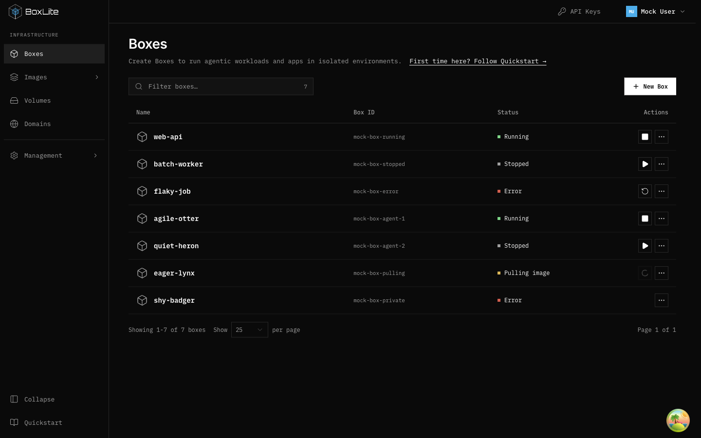
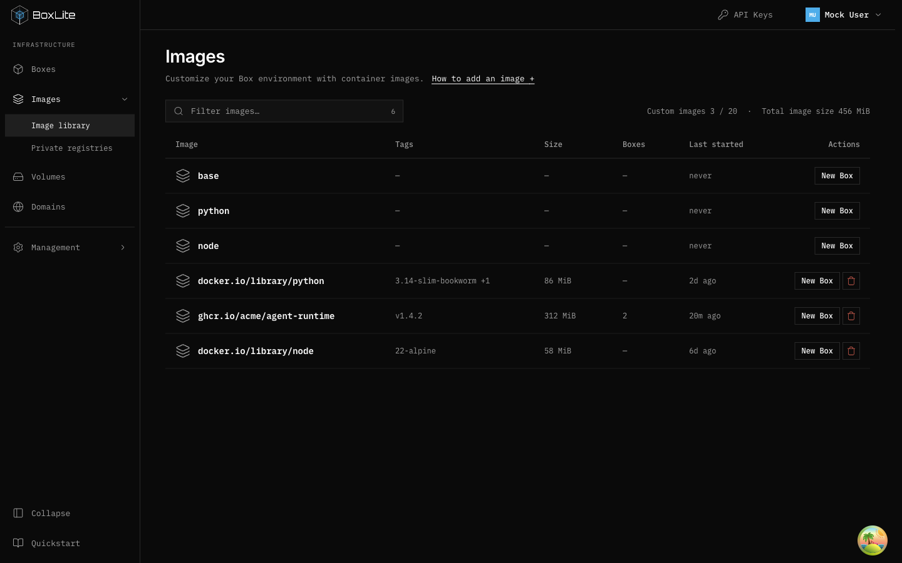
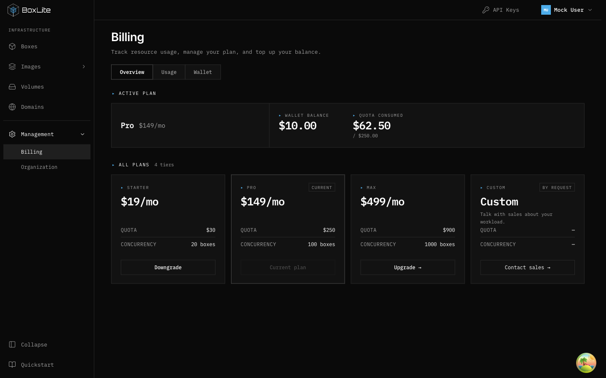
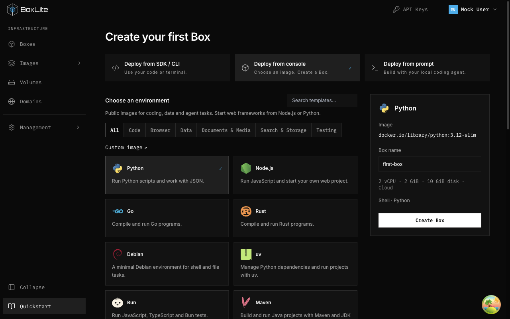
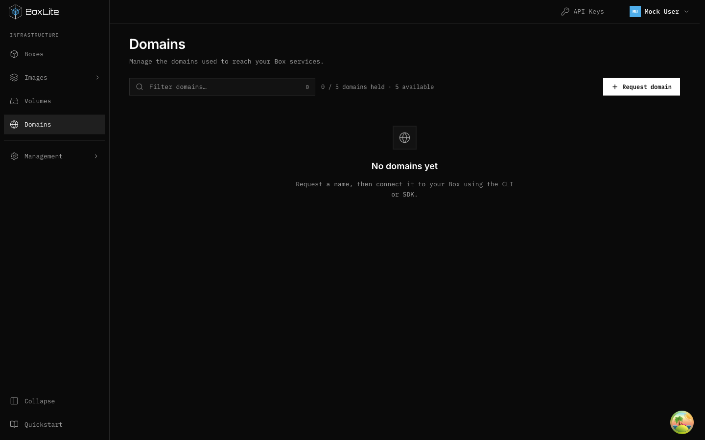

# Desktop visual refinement

## Outcome

Unify existing screens around a restrained resource-console layout. Keep current
routes, permission checks, near-black surfaces and thin icons; do not add decoration.

## Evidence and design

Actual mock review at 1440×900 and1280×800 found inconsistent empty table headers,
zero-row pagination, two pagination designs, duplicated desktop Images tabs,
tiny quota metadata, cramped three-column template cards, inconsistent resource
names/actions/icons, and excessive Billing/Box detail visual scaffolding.

Use existing ResourceEmptyState for true empty lists without headers; retain headers
for filtered-empty results. Keep one top create action. A single pagination footer
follows the list, hides entirely for zero rows and hides navigation for one page,
while retaining page-size changes and server totals. Reuse existing table adapters.
Desktop Images routes use sidebar navigation; mobile retains tabs. Private registries
has its own page title. Standardize resource metadata at12–13px, resource names and
New Box labels. Reuse the existing volume icon across navigation and content.
Template columns depend on available width with a minimum readable card width;
keep custom-image action outside the wrapping category list. Reduce price-card
reserved space without misaligning price/quota bands; lay out active-plan summary
more efficiently. Replace dotted key/value leaders with aligned whitespace.

## Validation

Existing data/permission/action behavior must stay unchanged. Verify pagination
zero/one/multiple pages and page-size changes, new mobile/desktop navigation contract,
empty vs search-empty layouts. Run dashboard tests/build, then desktop screenshots
of affected screens including1280px template picker. New layout contracts replace
the previous intentionally; no API or security behavior changes.

Pagination recovery exception: never hide footer for pageIndex>0 or while fetching.
Previous remains usable if pageCount is temporarily zero. Compact Images click
expands its route group so registry navigation stays discoverable.

## Observed desktop verification

At1440×900 true empty Boxes, Volumes, registries and Domains all begin at y209.32,
with no visible column headers or pagination. Original Domain offset was14px higher.
At1280×480 the populated Box list scrolls inside a163px area (392px content), while
the page-size control remains visible at y464; no document horizontal overflow.
Compact Images click expands the rail and exposes Private registries. At1280×800
template cards use two readable columns; the configuration panel remains alongside.
Billing retains aligned pricing bands and a compact current-plan summary. A mock
list handler ignores name filters, so filtered-empty behavior is covered by the
component test rather than claimed as an end-to-end mock check.

Final validation:101 test files /918 tests passed with maxWorkers=1. The default
parallel run intermittently timed out one SDK rendering test; its focused run and
the complete serial run passed without increasing timeouts or skipping tests.
Independent review passed after fixing unknown-page-count wording.

The empty-search regression test was also run with all production files restored
to main (`6ca4b882`) in a separate checkout. It reached the assertion and failed:
the old output said “No boxes yet.” instead of “No matching Boxes”. Restoring the
implementation passes the same test. No compatibility adapter was required.
