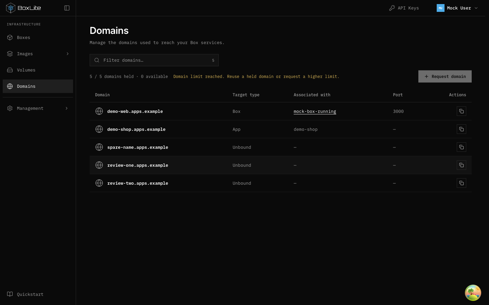
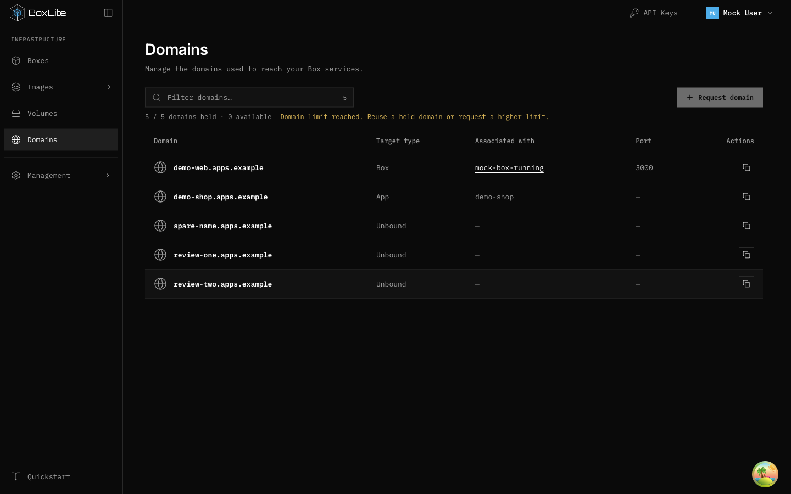

# Domains toolbar alignment

## Problem

At exhausted quota, the long warning shares a wrapping flex row with the filter
and Request domain action. On main `1c5ef25b5`, a 1440px desktop viewport places
that action 48px below the filter.

## Layout decision

Keep the existing filter and action sizes. A two-column grid reserves an
intrinsic-width action column; the filter column can shrink and caps the filter
at its available width. Quota usage and conditional guidance span the second row,
including when quota remains. Guidance wraps without displacing the action.
Below the small-screen breakpoint the controls stack. Request eligibility,
permissions, text and API behavior are unchanged. Other resource toolbars are
outside this correction.

## Verification

Start the dashboard's mock preview and open Domains. Request two additional
names to fill the default five-slot quota. At 1440px, measure the filter wrapper
and Request domain button with `getBoundingClientRect()`:

| Production version | Filter top | Button top | Alignment assertion |
| --- | --- | --- | --- |
| Unmodified main | 159.32px | 207.32px | Failed |
| Complete fix | 159.32px | 159.32px | Passed |

The same alignment and document-overflow checks passed at 1280, 1440 and 1920px,
with expanded and collapsed navigation. A temporary mock response with a null
domain suffix also kept the disabled action aligned at 1280px; the fixture was
restored afterward. Domains page tests passed (13 tests), production build passed,
and the changed component passed ESLint.

Workspace-wide `make lint:apps` remains blocked by three existing
`@nx/enforce-module-boundaries` errors on lines 10–12 of
`apps/infra/deployment/release-audit-workflow.test.ts`, unchanged from main.

## Desktop evidence

Before:

After:

