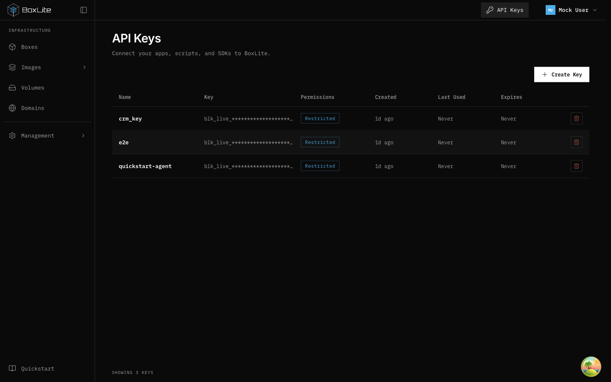
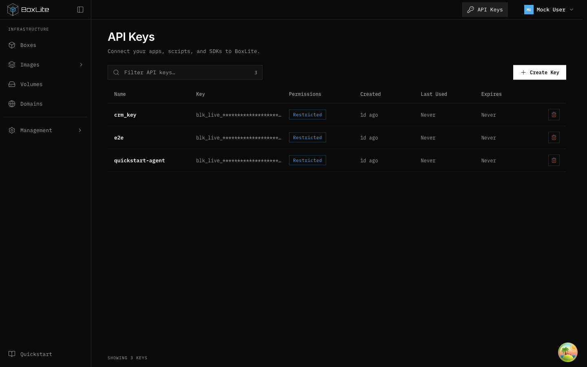
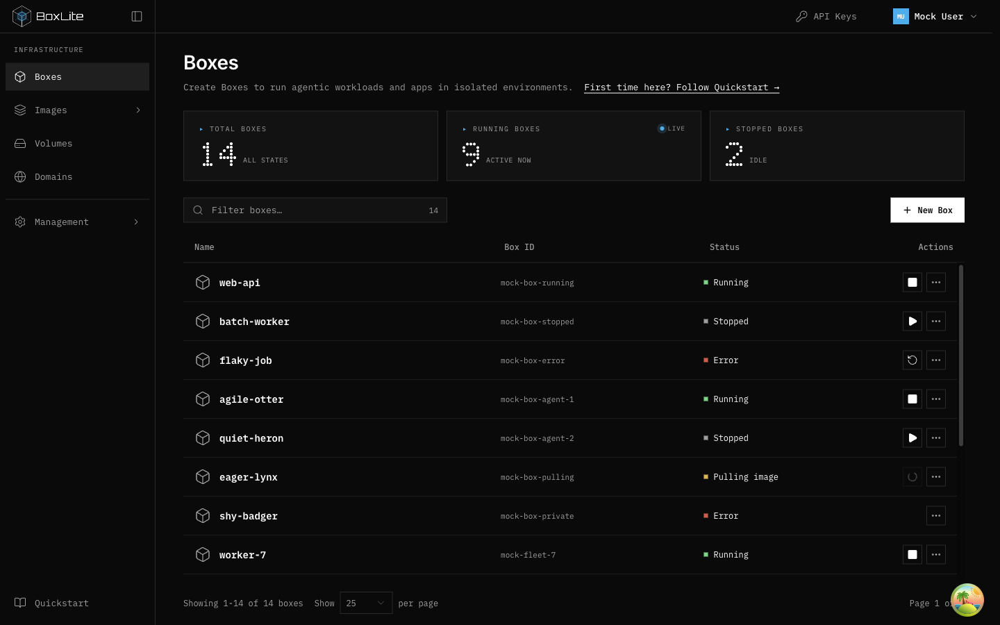
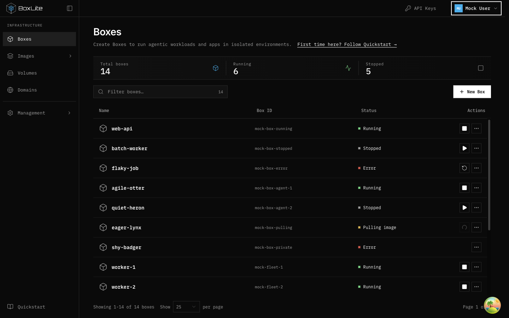
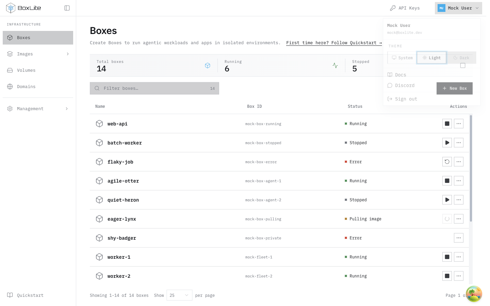

# Resource list toolbar refinements

## Problem

At exhausted quota, the long warning shares a wrapping flex row with the filter
and Request domain action. On main `1c5ef25b5`, a 1440px desktop viewport places
that action 48px below the filter.

## Layout decision

Keep the existing filter and action sizes. A two-column grid reserves an
intrinsic-width action column; the filter column can shrink and caps the filter
at its available width. Quota usage and conditional guidance span the second row,
including when quota remains. Guidance wraps without displacing the action.
Below the small-screen breakpoint the controls stack. Request eligibility,
permissions, text and API behavior are unchanged. Other resource toolbars are
outside this correction.

## Verification

Start the dashboard's mock preview and open Domains. Request two additional
names to fill the default five-slot quota. At 1440px, measure the filter wrapper
and Request domain button with `getBoundingClientRect()`:

| Production version | Filter top | Button top | Alignment assertion |
| --- | --- | --- | --- |
| Unmodified main | 159.32px | 207.32px | Failed |
| Complete fix | 159.32px | 159.32px | Passed |

The same alignment and document-overflow checks passed at 1280, 1440 and 1920px,
with expanded and collapsed navigation. A temporary mock response with a null
domain suffix also kept the disabled action aligned at 1280px; the fixture was
restored afterward. Domains page tests passed (13 tests), production build passed,
and the changed component passed ESLint.

Workspace-wide `make lint:apps` remains blocked by three existing
`@nx/enforce-module-boundaries` errors on lines 10–12 of
`apps/infra/deployment/release-audit-workflow.test.ts`, unchanged from main.

## Desktop evidence

Before:

After:

## API Keys filter

API Keys previously had a create action without the shared resource filter.
Reuse ResourceFilter on the left and keep Create Key on the right. Name matching
is local, case-insensitive, and trims surrounding whitespace. The matching count
updates with the rows. A filtered-empty result offers Clear filter; genuine empty
organizations retain setup guidance. Masked secrets are not searched, and create
permissions and revoke identity are unchanged.

Before production edits, the real-page filter suite failed three assertions because
the input was absent. The same suite passed after implementation, including
case/whitespace matching, no-match recovery, and revoking the correct filtered key.
Existing create-permission tests also passed. Desktop checks at 1280, 1440 and
1920px confirmed aligned filter/action controls and no horizontal overflow. Mock
checks covered search, opening/canceling revoke confirmation, and clearing no matches.

## Compact Boxes overview

Three StatCards made the overview 101px tall, with an additional 24px below.
Boxes now uses a connected three-cell description list: Total boxes, Running and
Stopped, with 24px tabular values below small labels. Decorative 18px thin-line
icons use existing brand, success and muted tokens. Short separators and a faint
neutral gradient give the strip hierarchy without heavy card outlines. Shared
StatCard remains unchanged. Independent organization counts and the ten-Box
threshold remain; unknown counts retain their existing placeholder.

The original 101.05px height was measured in a real 1440px mock viewport. The
final refined layout measures 66px at 1280/1440/1920px in both light and dark
themes, without horizontal overflow. Including reduced bottom spacing, the
list moves up about 43px relative to the original cards. The earlier 50px plain
strip was replaced with this intentional visual refinement; the final desktop
height check uses a 72px ceiling. Two invariant tests preserve the 9/10 threshold
independently of list rows.

The combined Domains, Boxes and Keys suites passed 33 tests. Targeted ESLint has
zero errors; five existing non-null-assertion warnings remain in Boxes tests.
Temporary populated mock fixtures were restored after desktop screenshots.

