**Status:** Implemented

# Console experience consolidation — November 13, 2026

## Scope and integration

The remaining Console changes are delivered directly against `main` in one PR.
Dashboard production code matches the integrated source tip `db6e3b6aa3a1dcc42b5bfcba607162814aaf278d`; consolidation changes commit ancestry, not UI behavior.
The merge retains unrelated main changes. Backend, database, and workflow files are outside this diff.

## Review by user task

| Task | Design and acceptance | Source PRs |
| --- | --- | --- |
| Consistent controls, text and headings | [POL-17](https://linear.app/polygala/issue/POL-17) | #2652, #2655 |
| Consistent content tabs | [POL-18](https://linear.app/polygala/issue/POL-18) | #2653 |
| Find resources and read capacity | [POL-19](https://linear.app/polygala/issue/POL-19) | #2637, #2639 |
| Loading, empty, failure and recovery | [POL-20](https://linear.app/polygala/issue/POL-20) | #2641, #2642, #2654, #2656 |
| Inspect images and checkpoints | [POL-21](https://linear.app/polygala/issue/POL-21), [POL-22](https://linear.app/polygala/issue/POL-22) | #2643, #2644 |
| Manage CI runners and connections | [POL-23](https://linear.app/polygala/issue/POL-23) | #2645, #2646 |
| Inspect Boxes, Terminal and network access | [POL-24](https://linear.app/polygala/issue/POL-24), [POL-25](https://linear.app/polygala/issue/POL-25) | #2647–#2651 |

Each original PR retains its review discussion and defect-proof evidence.
Resource icon accents from #2638 and resource feedback from #2640 were already integrated into their dependent source branches and are retained here.
Typography and sidebar work already on main are not reintroduced.

## Behavior and interaction checks

| Starting state | Interaction | Expected result |
| --- | --- | --- |
| API keys list | Filter by a mixed-case name | Matching records and count update together |
| Populated resource list | Refresh fails | Records remain visible with a retry action |
| Image detail | Open a version digest | Inspect provenance without competing New Box controls |
| CI runner capacity | Edit the limit | Consistent controls preserve numeric editing and validation |
| Box with no volumes | Open Overview | No empty mounted-volume section |
| Box Terminal | Change font, maximize, restore | Keep the same terminal instance and connection |
| Maximized Terminal | Ctrl+Shift+F6, then Enter | Focus Restore and return to the normal viewport |
| Inbound disabled | Create tunnel | Confirm inbound prerequisite before configuring port/access |
| Tunnel creation uncertain | Recover | Keep the submitted port and offer explicit revocation |

## Visual evidence

These are preserved desktop mock captures from the source PRs, not fresh captures of the consolidated commit.
The source PR links provide the original interaction checks and capture context.
Screenshots may predate later polish; use the final code and documented preview scenarios for acceptance.

| Scene | Before | After |
| --- | --- | --- |
| Resource toolbar | 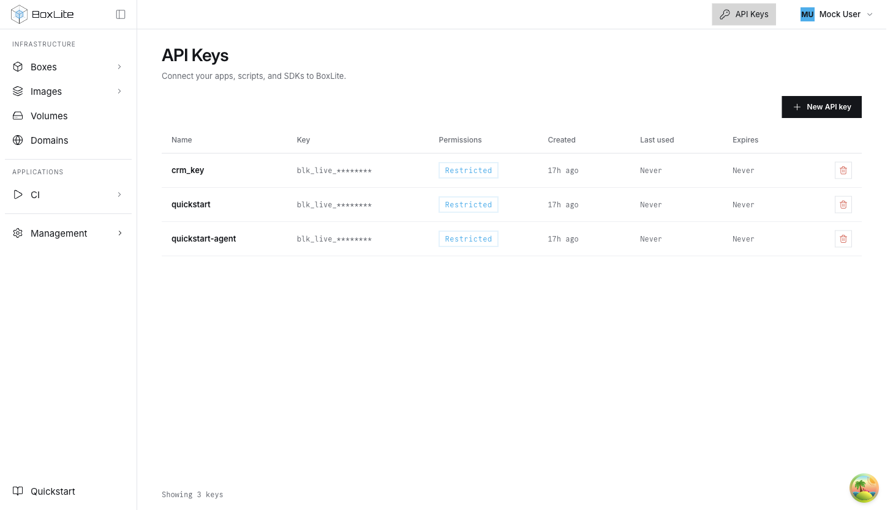 | 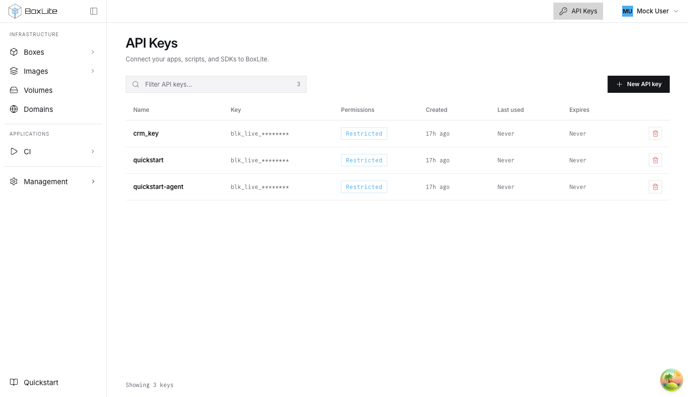 |
| Images | 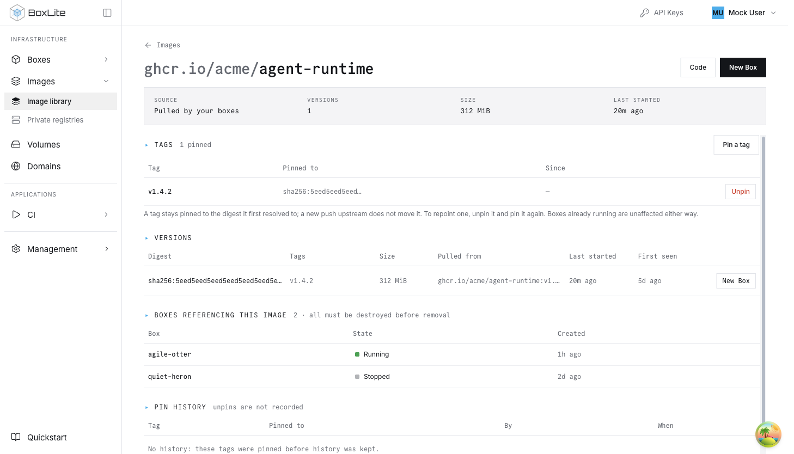 | 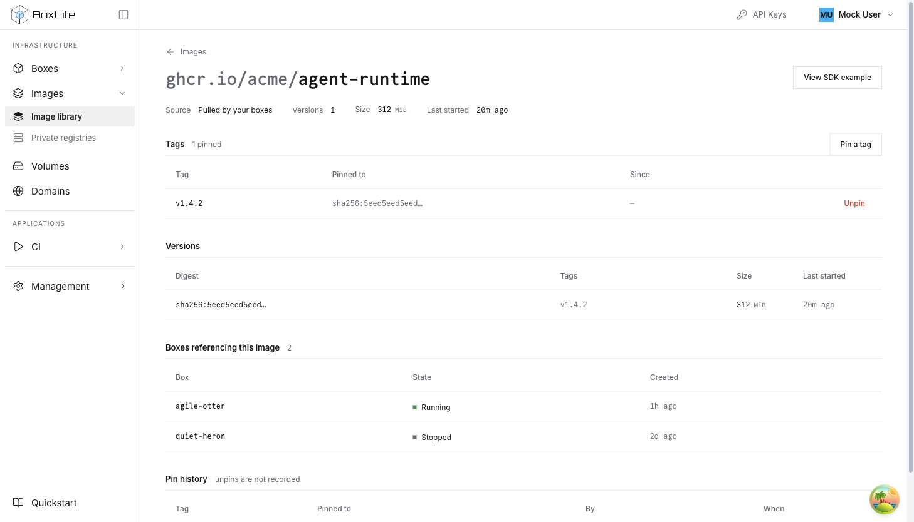 |
| CI capacity | 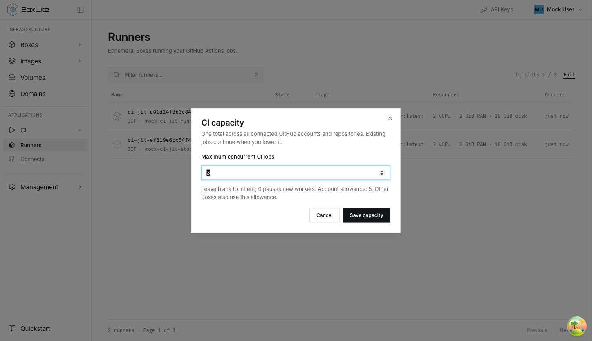 | 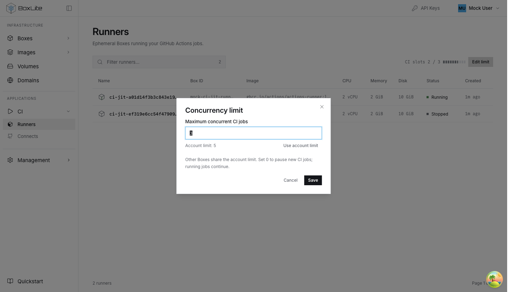 |
| Box Overview | 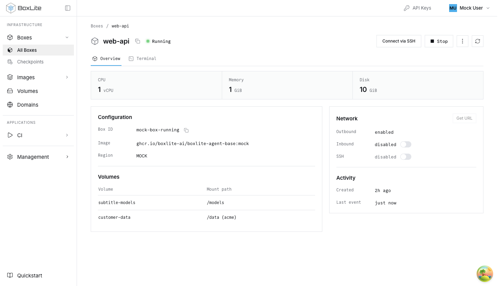 | 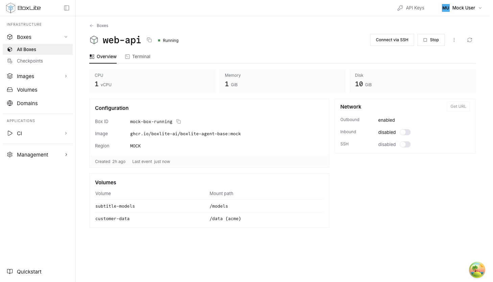 |
| Terminal | 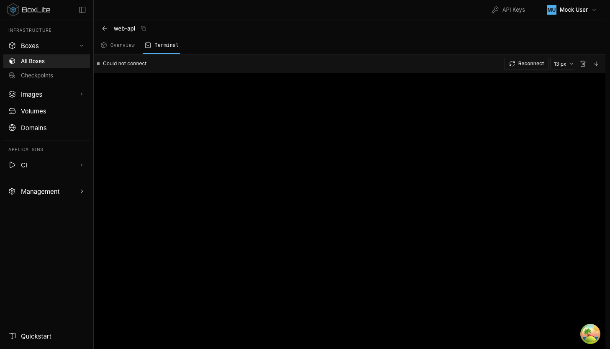 |  |
| Tunnel access | 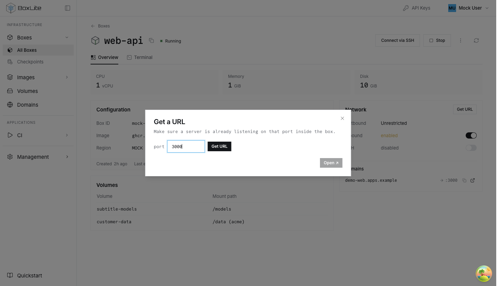 | 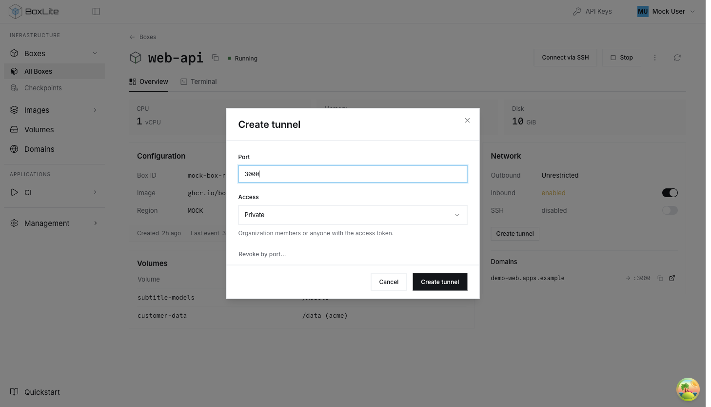 |

See [Dashboard contracts and preview scenarios](../../../apps/dashboard/README.md#resource-review-scenarios) for mock-mode setup and URLs.
Live guest/proxy connectivity and native OS handling of the Terminal shortcut were not manually verified during consolidation.

## Consolidation verification

| Command or comparison | Observed result |
| --- | --- |
| `NX_SKIP_NX_CACHE=true make test:apps:dashboard` | 128 files, 1,376 tests pass |
| `NX_SKIP_NX_CACHE=true make build:apps:dashboard` | Pass |
| `make lint:apps` | Three module-boundary errors in unchanged `apps/infra/deployment/release-audit-workflow.test.ts` |
| Same build then lint on baseline `9eb954bbd` | The same three errors reproduce at lines 10–12 |
| Dashboard tree versus source tip `db6e3b6aa` | Identical |
| Source-head ancestry | All 18 superseded source heads belong to the integrated source tip |

The lint result is not reported as passing. No new full-revert defect proof was run for packaging; original PR evidence remains linked above.

## Source revisions

| PR | Preserved source head |
| --- | --- |
| [#2637](https://github.com/boxlite-ai/boxlite/pull/2637) | `2189c2a0a2ff0339eb7a8fb1718b2693de123067` |
| [#2639](https://github.com/boxlite-ai/boxlite/pull/2639) | `d4398612c2cccaabfc0633788465dfb1d4b7f3fc` |
| [#2641](https://github.com/boxlite-ai/boxlite/pull/2641) | `bb7e3efcbd116ff974d4465b962c922743f3e01c` |
| [#2642](https://github.com/boxlite-ai/boxlite/pull/2642) | `63d7b862dc0b0bdec50b44df64a9b82fc5ab2bcf` |
| [#2643](https://github.com/boxlite-ai/boxlite/pull/2643) | `8c46fe36cdbff15ad6fa48973a722cbe37a239cc` |
| [#2644](https://github.com/boxlite-ai/boxlite/pull/2644) | `3bdcfa65f6247560d55a908573dc115442a1bfa8` |
| [#2645](https://github.com/boxlite-ai/boxlite/pull/2645) | `cfd65c5648268f6d4af29936ab62cfd559f0c6ac` |
| [#2646](https://github.com/boxlite-ai/boxlite/pull/2646) | `00b8354038e59b7a52463df904e38cdfee6e73f1` |
| [#2647](https://github.com/boxlite-ai/boxlite/pull/2647) | `6e7ae5b9684d83012c8e0c4c66fa5d75b6ae29fd` |
| [#2648](https://github.com/boxlite-ai/boxlite/pull/2648) | `f10dfa03429ebee7684abcea4ae78245e4c2bc7a` |
| [#2649](https://github.com/boxlite-ai/boxlite/pull/2649) | `92311767624782f04bcd89dcc937faaa6bd636dc` |
| [#2650](https://github.com/boxlite-ai/boxlite/pull/2650) | `d4f7d764e38f52cecd69c75c20b610535ce30b11` |
| [#2651](https://github.com/boxlite-ai/boxlite/pull/2651) | `06dc38d61fed230c61f4acbb9f3b2b0b8062f18c` |
| [#2652](https://github.com/boxlite-ai/boxlite/pull/2652) | `e66e1980b67f81815c79b701f44a0bc63c7f64a5` |
| [#2653](https://github.com/boxlite-ai/boxlite/pull/2653) | `f40ed4ca26d3d5bfe6af1b397e58de3b8e5a141c` |
| [#2654](https://github.com/boxlite-ai/boxlite/pull/2654) | `1232981d9c5a2049c221d4d91eeb8eaca9283a35` |
| [#2655](https://github.com/boxlite-ai/boxlite/pull/2655) | `0e902163cfa07ebeeb3f0a247263dfe6a39cd3ea` |
| [#2656](https://github.com/boxlite-ai/boxlite/pull/2656) | `db6e3b6aa3a1dcc42b5bfcba607162814aaf278d` |
