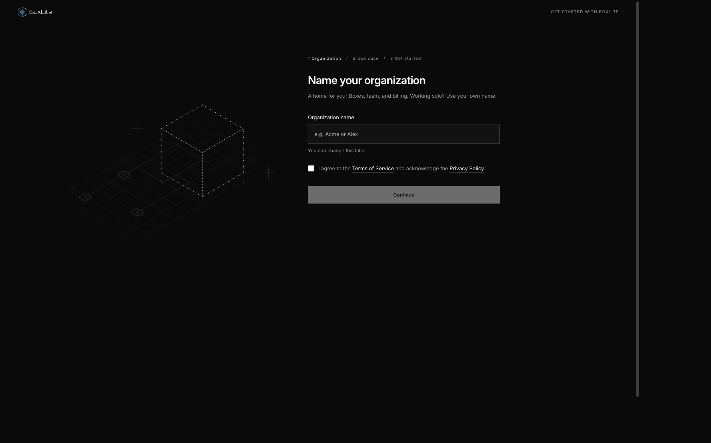
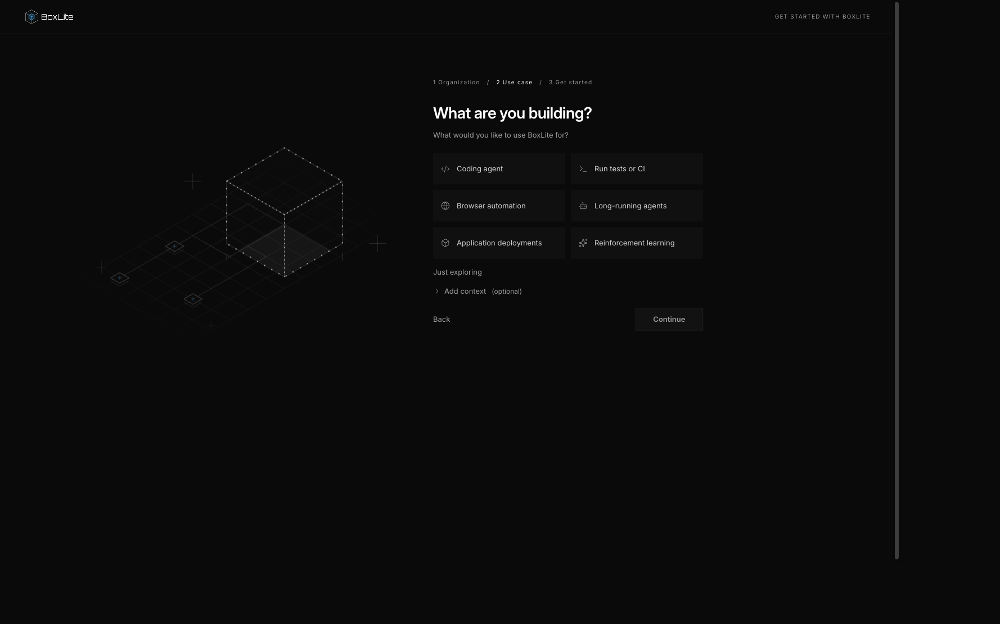
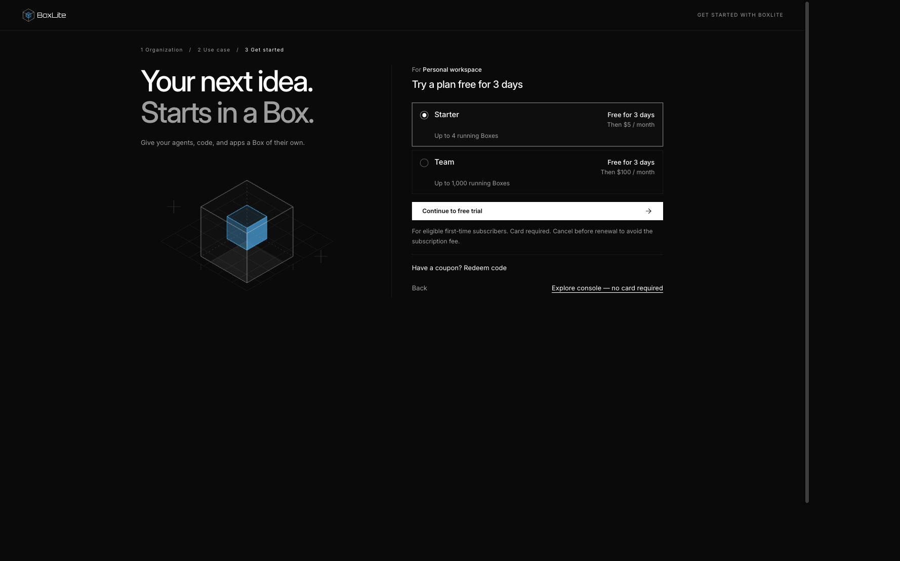
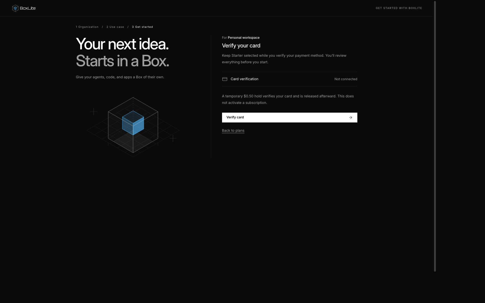
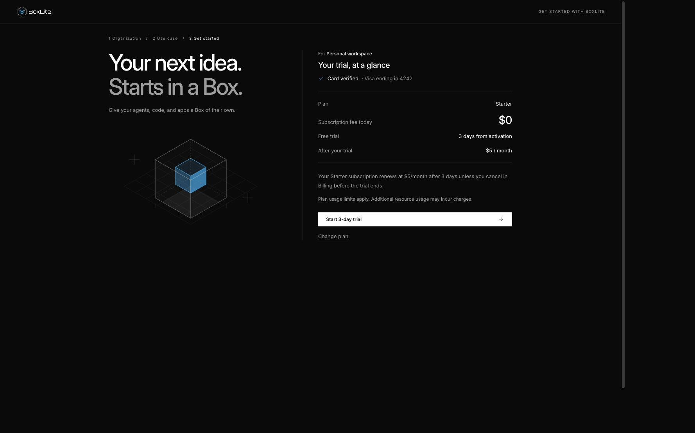
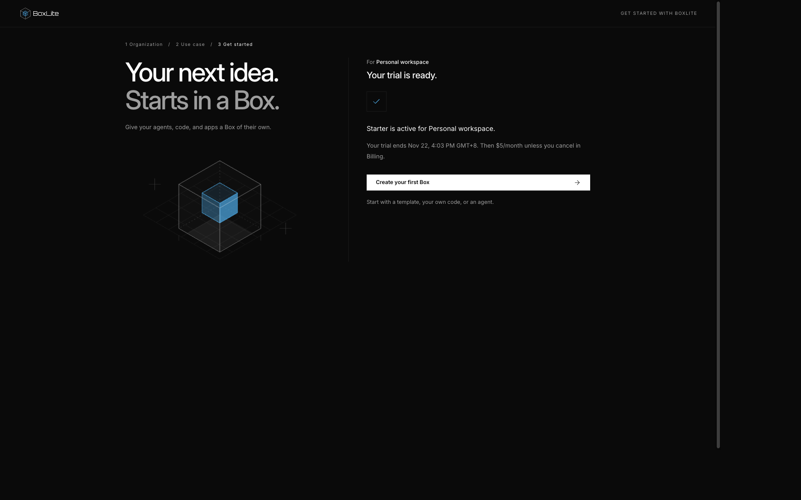
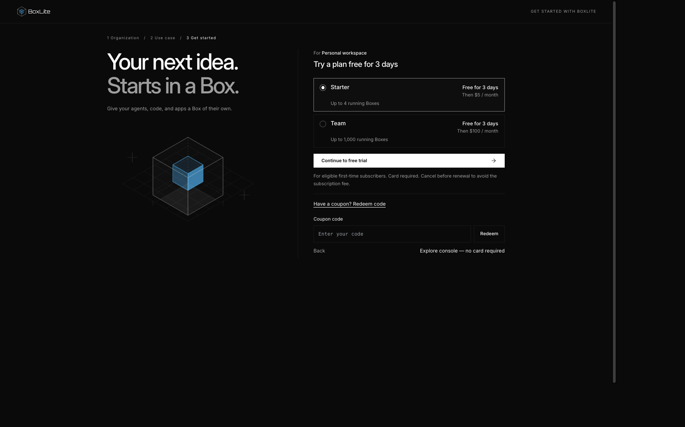
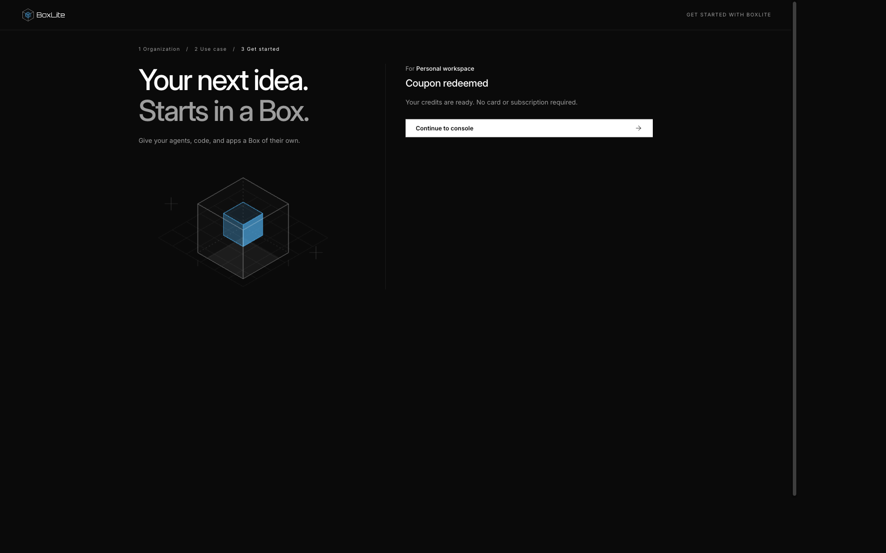
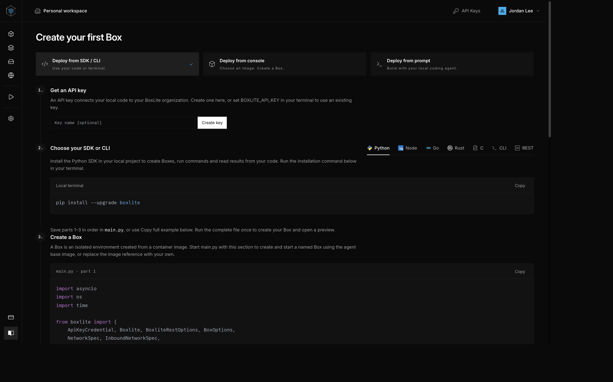

# Trial discovery in Welcome

Design: https://github.com/boxlite-ai/boxlite/issues/2931

## TL;DR

Preview a complete, value-first Welcome journey with explicit trial confirmation and independent coupon and no-card exploration paths.

## Problem

Welcome currently asks users to verify a card without explaining the eligible paid-plan trial. Verification alone does not start that trial. Users can reach Quickstart without understanding the subscription choice or how to activate its benefits.

## Scope

This is a frontend interaction prototype for BUI-1923, based on Console main b2e104c20. It is enabled only in development with `VITE_ENABLE_MOCKING=true` and `preview=trial-onboarding`. Production Welcome, hosted authentication, backend endpoints and charging rules are unchanged.

The walkthrough starts with empty organization and use-case fields. Those steps reuse existing components, hooks and mock handlers. Only the third step introduces the proposed trial UI. `&step=plans` opens that step directly; refreshing restarts the walkthrough.

## Related work and lessons

| Approach | Source | Decision |
| --- | --- | --- |
| Add trial copy to card verification only | Existing `WelcomeCreditsStep` | Insufficient: card completion does not activate a trial. |
| Explain the offer and separate verification from confirmation | Existing `PlanComparison`, `planBenefits`, and Welcome components | Adopt for the UI; preserve explicit consent and existing no-card paths. |
| Activate after card verification | Existing separate verification and subscription actions | Reject implicit consent; no payment mutation is invoked. |

The prototype has no server-backed eligibility or price quote. Production integration requires authoritative results and explicit consent if payment is required. A trial-labelled action must never silently fall back to a charge. No backend implementation is part of this design.

## How it works

Organization → use case → choose a plan → verify card → review subscription fee and renewal → explicitly start trial → Quickstart.

The first two steps reuse `useWelcomeOnboarding`; Back from the plan step retains the selected use case. `WelcomeJourneyArtwork` receives the existing step, selection and content anchor. Its animation implementation and styles are unchanged.

The left side uses the main exploring title, “Your next idea. Starts in a Box.”, a short product-value description and the 420px illustration. The right side explains eligible Starter/Team trials, subsequent monthly prices and concurrency from `planBenefits`. Compact spacing keeps desktop decision actions visible without reducing text size.

Independent alternatives remain available:

- Coupon entry expands inline; successful redemption replaces plan selection with one Console continuation.
- “Explore console — no card required” completes Welcome without verifying a card or activating a subscription.
- Both paths remain available when trial eligibility is unknown.

## Integration boundaries

| Capability | Implementation and evidence boundary |
| --- | --- |
| Organization name and use-case submission | Existing application hooks/API calls; local requests are handled by MSW. |
| Welcome completion and Quickstart | Existing completion callback, browser progress and real application routing. |
| Plan names, prices and concurrency | Existing Console presentation data; not a server eligibility quote. |
| Trial eligibility and retry | Local eligible/ineligible/unavailable fixtures, not a backend result. |
| Card verification and trial activation | Component state only; no Stripe navigation, payment credentials or payment mutation. |
| Coupon redemption | `ACME50` succeeds locally; empty/other inputs show errors. No coupon API call or wallet credit write. |
| Subscription and wallet after completion | Not synchronized with simulated results; existing mock Billing data remains independent. |
| Signup/login and production Welcome | Unchanged. The walkthrough starts from an authenticated mock session. |

The simulated verified card and trial end date are review fixtures. Trial time starts at explicit activation. No trial quota is inferred from bonus credits. These screens do not prove production eligibility, free resource quantities, successful billing or actual funds.

## Validation

The interaction tests cover plan retention, verification cancellation, explicit activation, ineligible paid confirmation, unknown eligibility, retry, coupon entry and success, no-card continuation, and the supplied completion callback. The original prototype lacked coupon and no-card entry; the two added tests failed on those missing buttons before the correction and passed afterward. This is new-contract evidence for a development entry, not proof of a shipped billing fix.

Browser review covers organization → use case → plan choice → Back → continued selection → verification → confirmation → success; coupon and no-card alternatives lead to Quickstart. Screenshots show mock states only. Narrow layout was checked at 390px without horizontal overflow. Final test/build results and screenshot evidence accompany the PR.

Production bundle inspection must exclude the prototype chunk and its activation/coupon fixture strings. No real payment or hosted authentication acceptance test is claimed.

## Observed results

On main b2e104c20, `make test:apps:dashboard` passed 152 files / 1,674 tests and `make build:apps:dashboard` passed. Production asset inspection excluded the prototype activation and coupon fixture strings. Independent code audit found no production billing or authentication mutations. Review advice to retain the completion callback and remove competing trial actions after coupon success was adopted.

## Complete onboarding screenshots

All captures use mock identity and data. Verified-card, trial and coupon success screens are simulated; the final screenshot proves navigation only, not available funds or runnable compute.

### Organization — existing form

### Use case — existing selection

### Trial choice and independent no-card entry

### Card verification — simulated handoff

### Explicit trial confirmation — fixture quote

### Trial started — simulated result

### Coupon entry — no card prerequisite

### Coupon redeemed — simulated result

### No-card continuation — existing Quickstart

