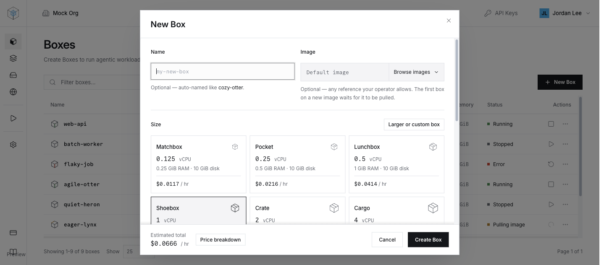
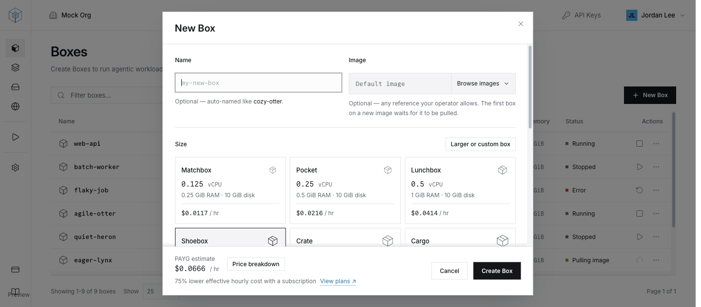
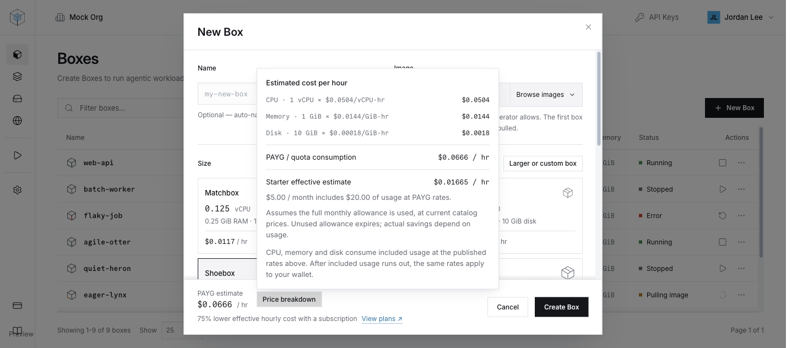

# Create Box subscription value

Create Box should compare the selected configuration with included subscription usage in its existing price footer, without an upsell modal.

## Evidence and scope

The Console's [`Plan`](../../../apps/dashboard/src/billing-api/types/Plan.ts) contract supplies monthly price and included quota.
[`OrganizationPlan`](../../../apps/dashboard/src/billing-api/types/OrganizationPlan.ts) supplies cycle, quota, trial and cancellation state, but no paid subscription amount.
[`boxHourlyPrice`](../../../apps/dashboard/src/lib/box-price.ts) calculates CPU, memory and disk consumption from published rates.

The catalog's monthly price divided by included quota is therefore a **catalog-based effective estimate**, conditional on fully using that quota.
It is not the debit rate, an invoice prediction, or a guarantee of the customer's historical acquisition cost.
The live catalog determines the ratio, not a hard-coded fourfold multiplier or presentation constants.

## Proposed behavior

Keep one primary create action and the existing price breakdown popover.
For PAYG, retain the full resource estimate and add one muted catalog comparison for configurations within verified published plan limits: `75% lower effective hourly cost with a subscription · View plans ↗` for the documented $5/$20 example and a $0.0666/h configuration.
The Plan API does not expose per-plan resource limits. Do not select the cheapest plan and imply it supports an arbitrary custom Box; omit its hourly offer when eligibility is unverified.
For every user, keep the PAYG estimate primary. A matching active paid plan with sufficient quota gets the same secondary percentage-saving explanation.
Show the percentage reduction in the muted summary line; calculate it from the catalog ratio. Keep the effective dollar estimate in Price breakdown.
State that quota is consumed at the published rate, then ordinary wallet funds pay for usage at that same rate.

Use a real link opening Billing Plans in a new tab, explicitly identified as such, so the mounted creation draft survives unchanged.
Do not auto-select a plan, initiate checkout, or alter creation requests.
Billing compares API-provided monthly price and included value using the same ratio helper.

| State | Price behavior |
| --- | --- |
| No subscription | Published PAYG estimate plus lowest-priced eligible catalog plan comparison |
| Active, matched plan | PAYG estimate remains primary; percentage advantage is secondary |
| Scheduled cancellation | Same benefit until the current cycle expires |
| Exhausted or insufficient quota | Published estimate; explain remaining coverage instead of promising a discounted full hour |
| Active/failed trial, past due, custom/unmatched, mismatched cycle quota | Published estimate with appropriate funding context; no paid-rate claim |
| Loading, error, previous-organization placeholder | Published estimate only; never infer PAYG from missing data |
| No billing configuration | Existing no-usage-charges presentation |

## Alternatives and implementation

Reuse existing React Query hooks and Radix popover; avoid new dependencies, modal nesting and per-keystroke requests.
An inline plan picker would complicate the creation transaction; navigating the same tab would require persistence of potentially sensitive form fields.
The selected new-tab link preserves draft ownership without serializing secrets.
React documents that state belongs to the mounted component tree: <https://react.dev/learn/preserving-and-resetting-state>.
Keep keyboard and focus behavior in the existing shared popover rather than introducing a custom disclosure.

Use one pure catalog-ratio helper shared by creation and Billing, with explicit finite positive USD values.
Trial metadata can remain after conversion: `trial.conversionState === 'succeeded'` is a paid subscription, not a currently free trial.
Use a small price-summary component for billing reads and state decisions; configuration quantities remain owned by CreateBoxDialog.
Small nonzero estimates retain enough decimal precision to avoid displaying free usage.

## Validation

Test the new calculation and state contract against the real price-estimation function, including changed CPU/memory/disk, malformed prices, custom catalogs, expired cycles, trial and quota exhaustion.
Verify Billing renders catalog amounts rather than presentation constants.
Verify the create draft survives opening Plans; inspect keyboard dismissal, narrow layouts and light/dark themes.
Local mock scenarios demonstrate the fourfold policy but do not assert the production catalog has those values.

No billing policy, backend mutation, deployment, payment or real Box creation is included.

## Observed validation

The Billing catalog-source regression failed against the untouched production files
(`$149` was replaced by the static `$5` presentation) and passed after implementation.
The new subscription estimator has no previous equivalent; its unit tests cover
catalog ratios, all three resource changes, plan size eligibility, trial conversion,
quota exhaustion, cycle expiry and unsupported states.

133 focused tests passed, including creation, Billing and query-state presentation.
The Dashboard build and subsequent TypeScript check passed. Browser verification
confirmed the eight local scenarios, small-spec precision, original draft retention
when Plans opens in a new tab, Escape returning focus to Price breakdown, and
390px light-theme layout without horizontal overflow. Dark theme was also inspected.
This verifies local presentation with fixtures, not live charging or deployment.

## Screenshots

Default 1 vCPU / 1 GiB / 10 GiB configuration in a local fixture account:

| Before | After |
| --- | --- |
|  |  |

The shared price breakdown explains the catalog estimate and quota-consumption assumptions:

