# Desktop dashboard screenshots

All screenshots use bundled mock data. Before screenshots run unchanged main at `a4a7b829`; after screenshots run this change. Primary comparisons use a 1440×900 desktop viewport. These are UI previews, not production-account or backend connection tests.

## Main comparisons

| Area | Main | Updated |
| --- | --- | --- |
| Images: usage, actions, icons and dark surfaces | 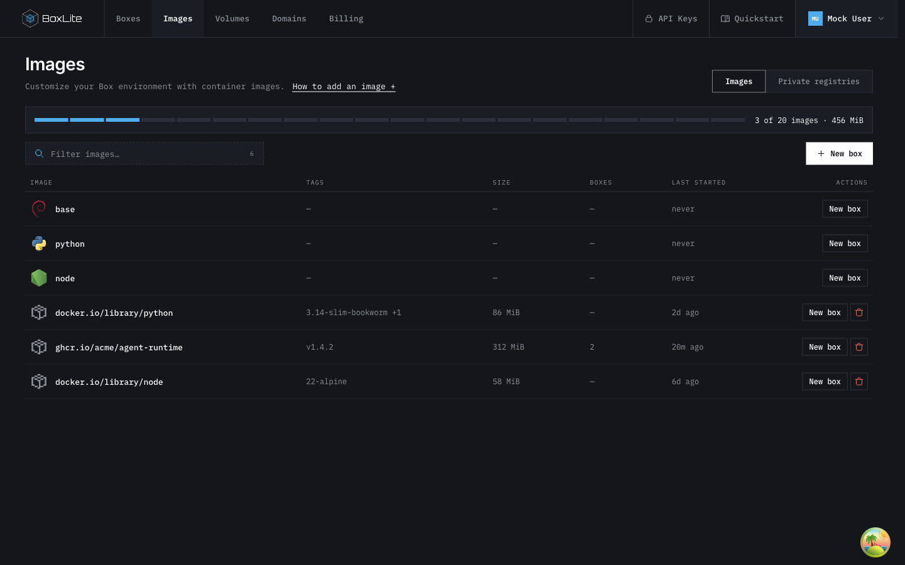 | 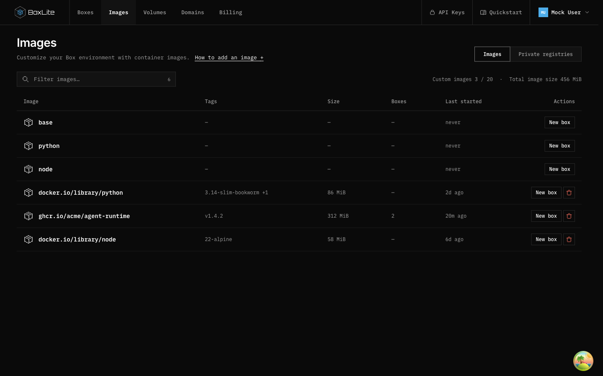 |
| Quickstart: page scrolling and compact details | 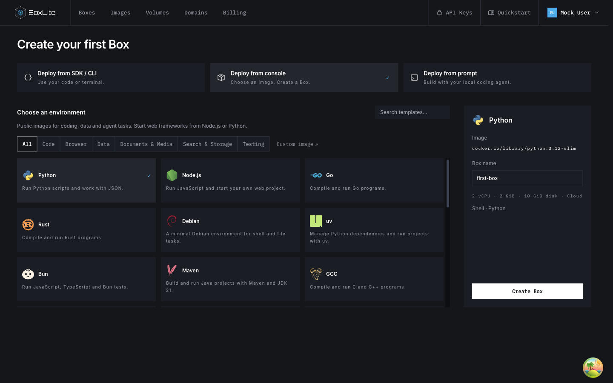 | 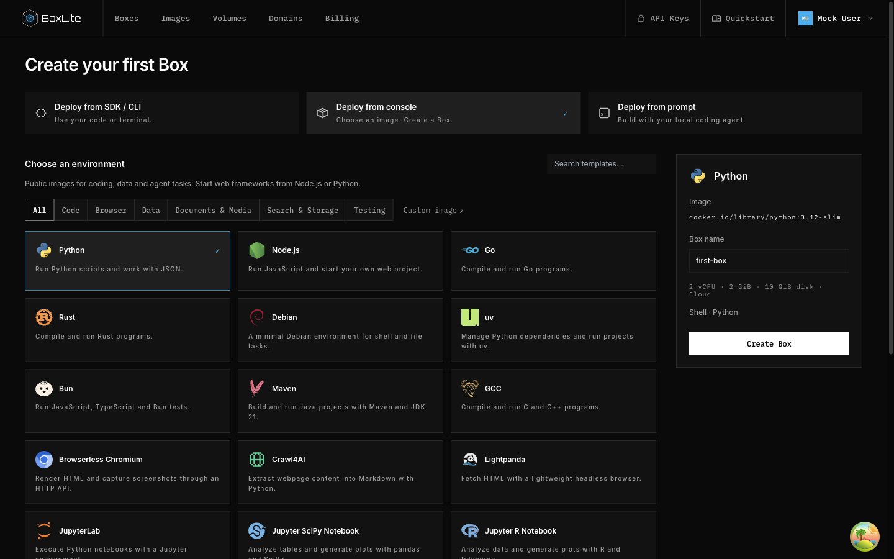 |
| Box: compact network rows without horizontal overflow | 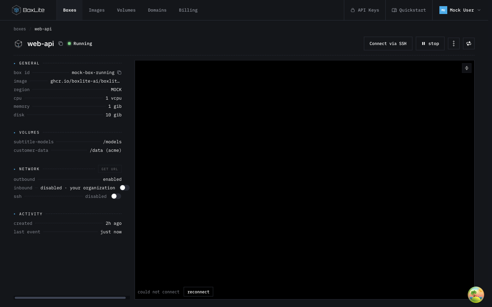 | 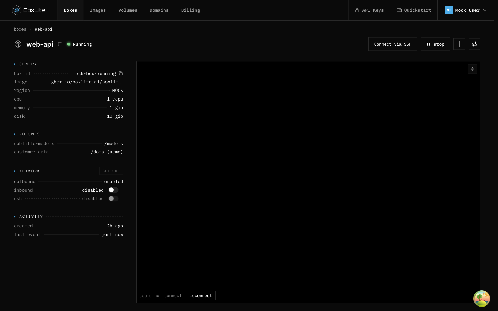 |

## Shared empty states

A single toolbar action remains where creation applies. Images directs users to Boxes; billing records do not invent creation actions. The members-only fixture removes membership and therefore does not display owner-only actions.

| Resource | Updated |
| --- | --- |
| Boxes | 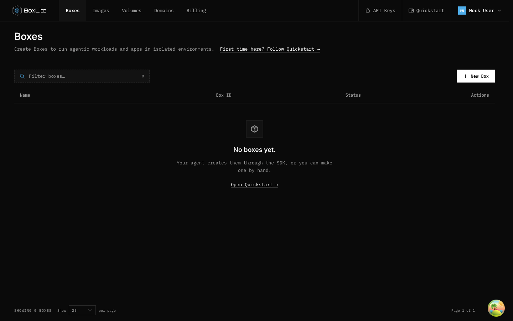 |
| Private registries | 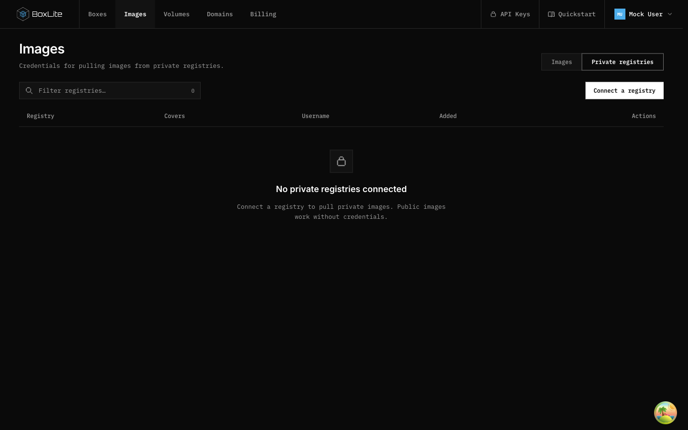 |
| Volumes | 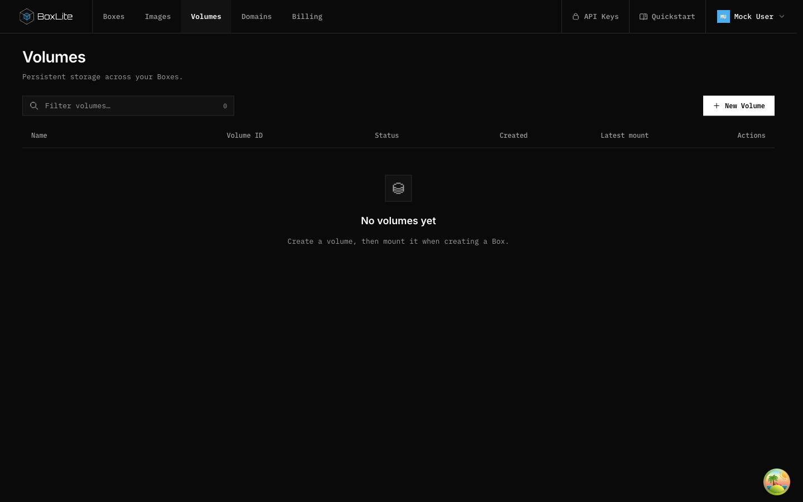 |
| Domains | 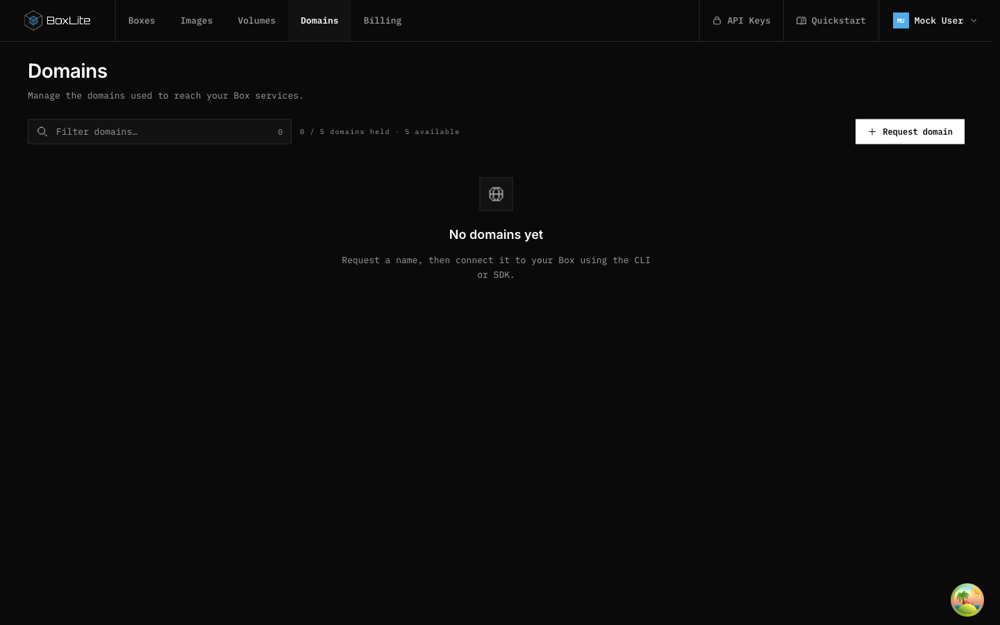 |
| API Keys | 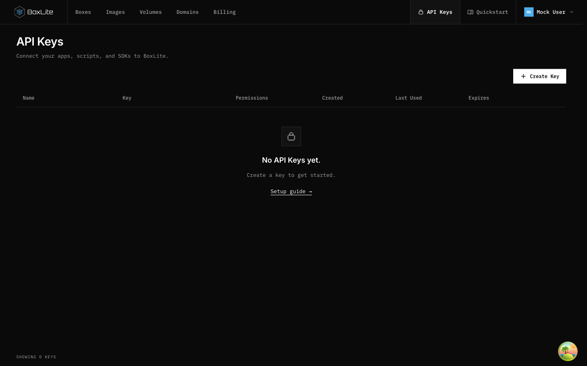 |
| Members | 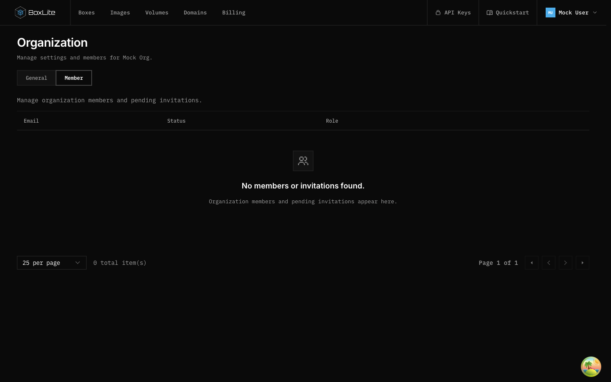 |

## Payment identity and Quickstart readability

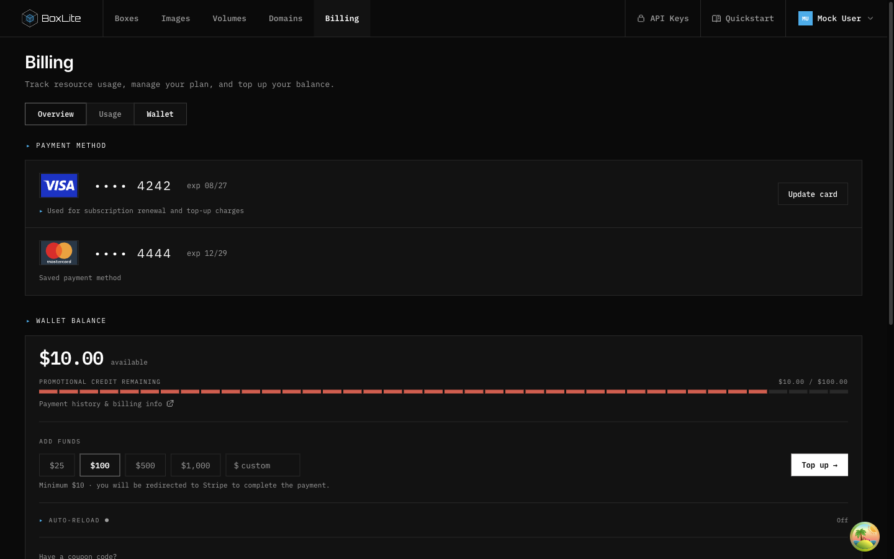

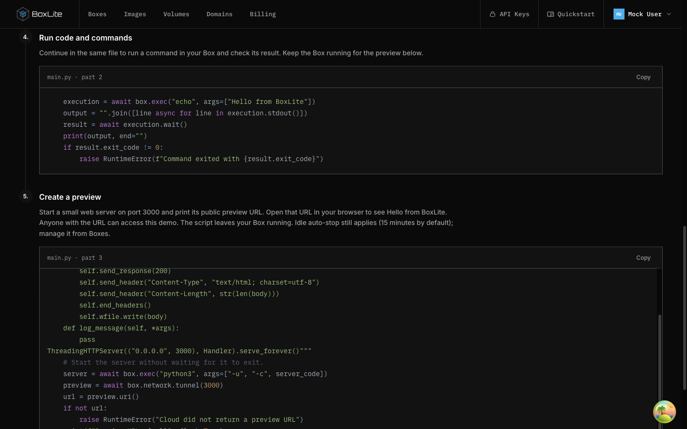

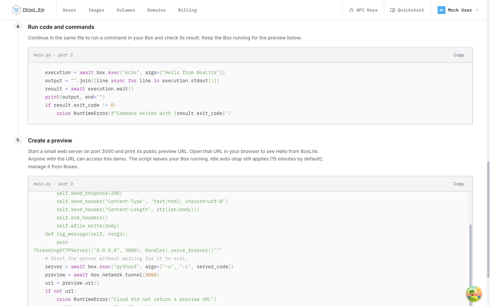

The short-height desktop below uses 1440×609. The details panel follows page scrolling so preparation text does not trap the Create button.

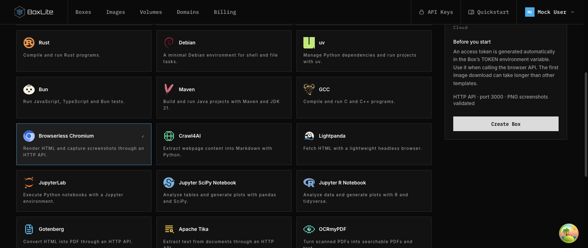

## Reproduce

Start the mock dashboard using the commands in [dashboard development](../../../../../apps/dashboard/README.md). Inspect `/dashboard/images`, `/dashboard/quickstart?method=console` and `/dashboard/boxes/mock-box-running` in a desktop viewport. Resource empty fixtures use `desktop-review-empty=1` in localStorage; set `SkipOnboarding_mock-user-00000000=true` to bypass the first-run redirect. Set `desktop-review-empty-members=1` separately for Members. Restore these fixture values to `0` after inspection. These switches are read only by mock handlers.

## Verification

- Final dashboard suite: 99 files / 878 tests passed using the existing Nx dashboard target with `--run --maxWorkers=2`. Default-concurrency `make test:apps:dashboard` hit the existing five-second Quickstart interaction timeout; no timeout or assertion was relaxed.
- Regression assertions were also run with all production files at main: the single Registry empty action, accurate inbound label and explicitly labelled image quota fail before the changes and pass with the final implementation.
- Dashboard production build and whitespace validation passed. Formatting used `make fmt:apps FILES=...` for changed dashboard sources.
- Proxy tunnel tests and API tunnel-service tests passed; preview-controller tests are blocked by incompatible locally linked Axios types. These screenshots do not verify deployed authentication, payment processing or SSH establishment.
