# Desktop navigation review

All captures use the local MSW mock application, with no production customer data.
The baseline is main at `6ca4b882`; the new layout is this PR. Navigation captures
are 1440×900 CSS pixels at device scale 1. Quickstart is 1280×800.

## Before and after

| Main | Expanded sidebar |
| --- | --- |
| 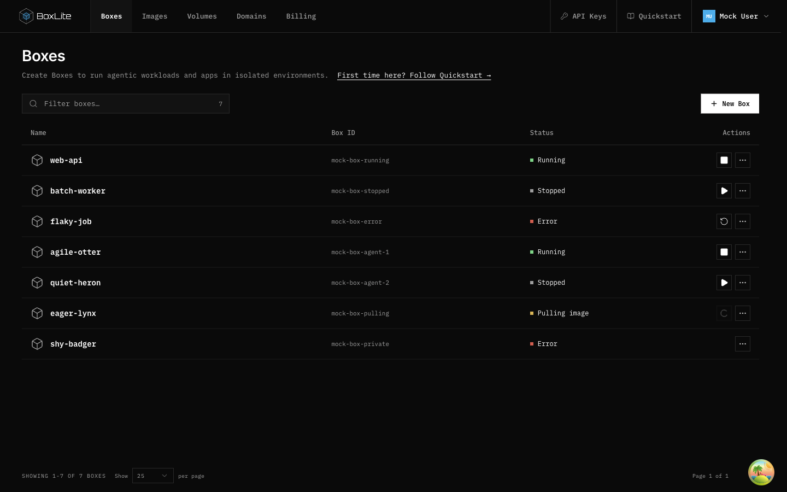 | 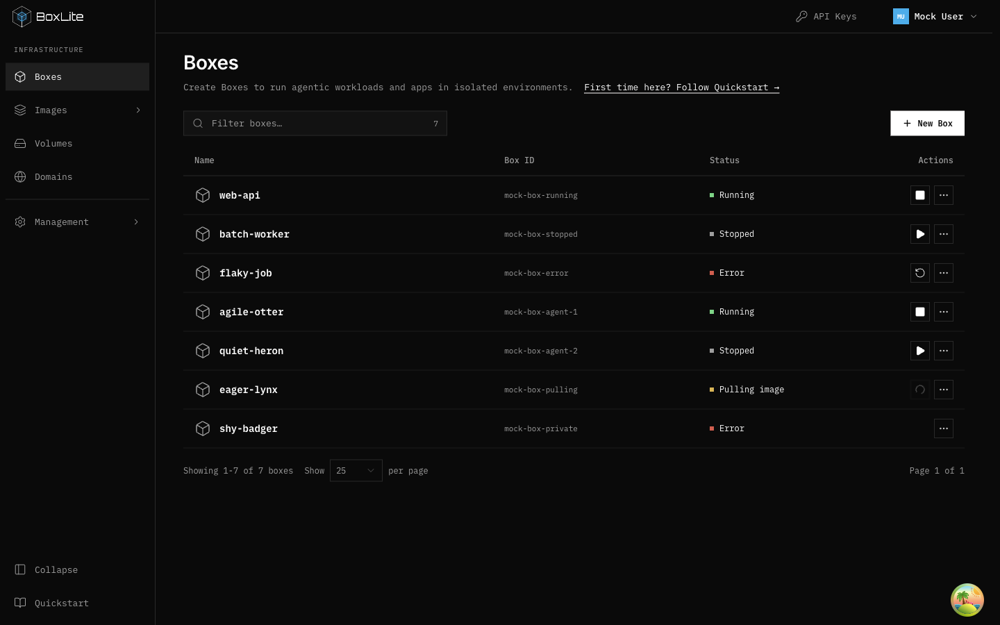 |

| Compact sidebar | Light theme |
| --- | --- |
| 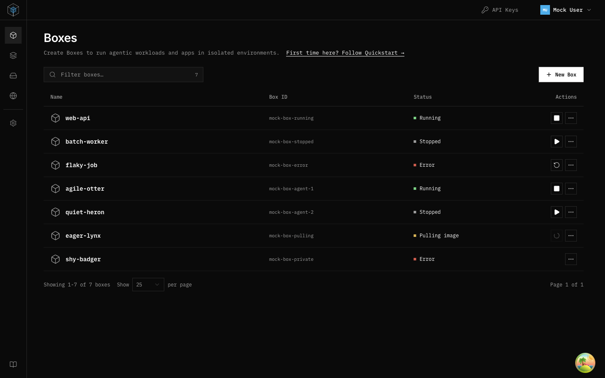 | 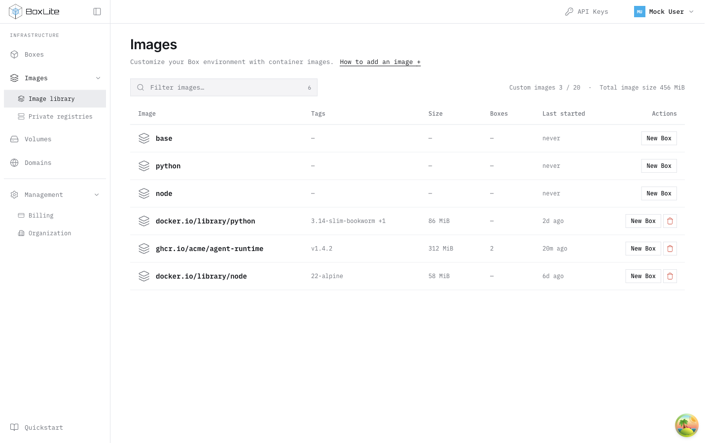 |

| Billing | Quickstart |
| --- | --- |
| 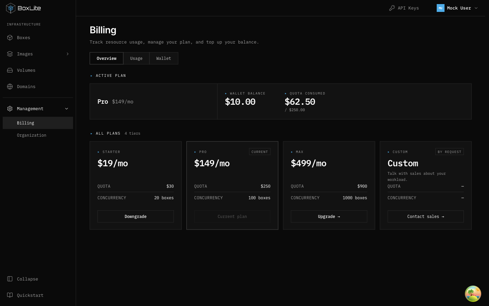 | 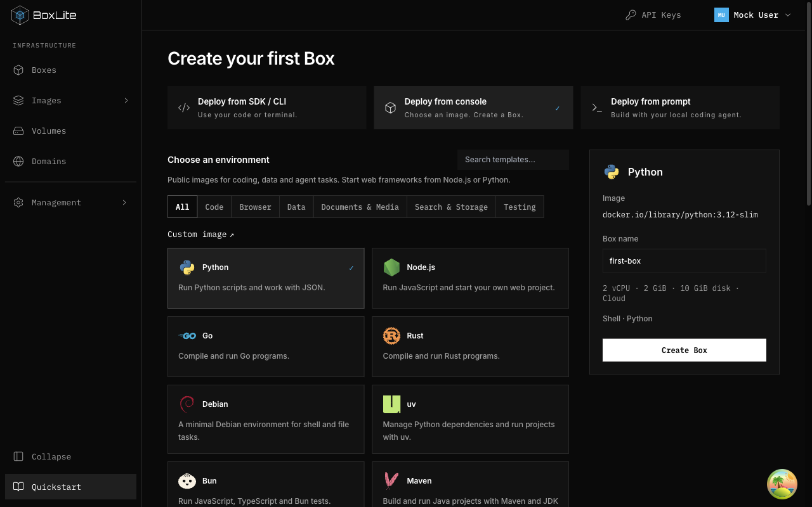 |

| Images | Empty resources |
| --- | --- |
| 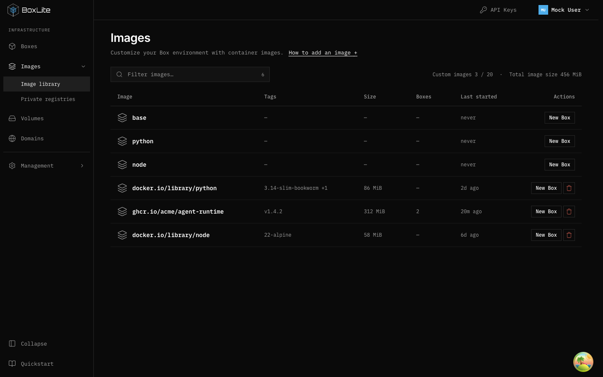 | 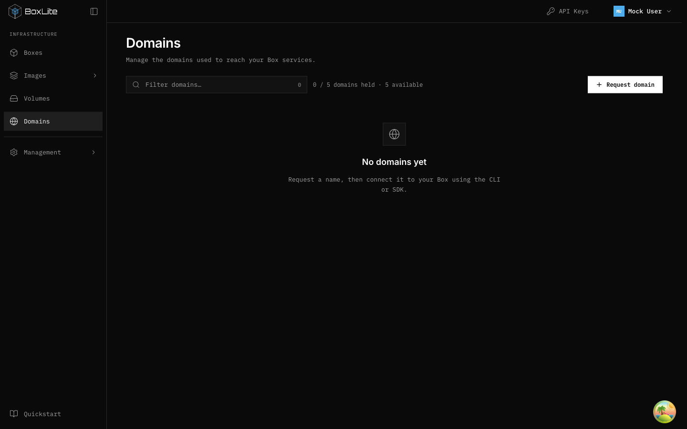 |

## Reproduction

1. From `apps`, run `npm run start:mock -- --port=4319 --host=127.0.0.1`.
2. Open `/dashboard/boxes`; collapse beside the logo and expand by clicking the compact logo, then reload to verify persistence.
3. Hover the compact logo for 350ms: the full sidebar overlays the content without moving it. Move into its menu, then outside to dismiss; click the logo to pin. Escape also dismisses the preview.
4. Open Images from the compact rail; verify expansion exposes Private registries.
5. Expand Management; visit Billing and Organization, then collapse the group manually.
6. Open Quickstart at 1280px width; select Deploy from console to inspect template cards.
7. Change the profile theme; compare normal, hover and selected borders with keyboard focus.
8. At 1280×480, confirm resource rows scroll while pagination and bottom navigation remain reachable.

Empty-resource captures use the existing `desktop-review-empty` mock fixture.
Search-empty rendering is tested at the component boundary because the mock Box
list does not implement name filtering. No live backend, terminal or authorization
behavior is established by these images.

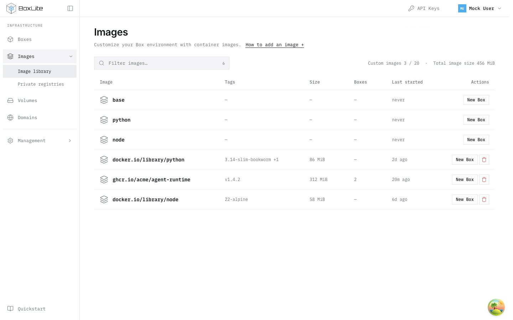

| Temporary overlay, dark | Temporary overlay, light |
| --- | --- |
| 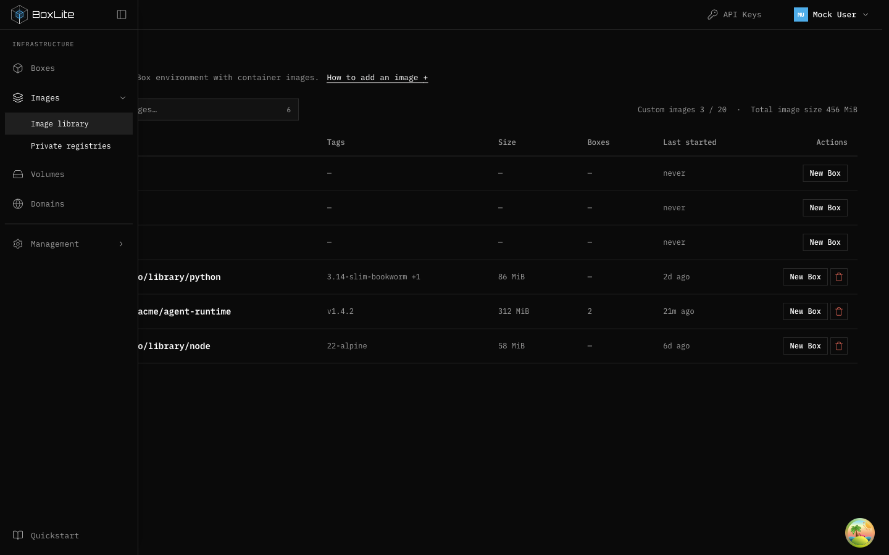 | 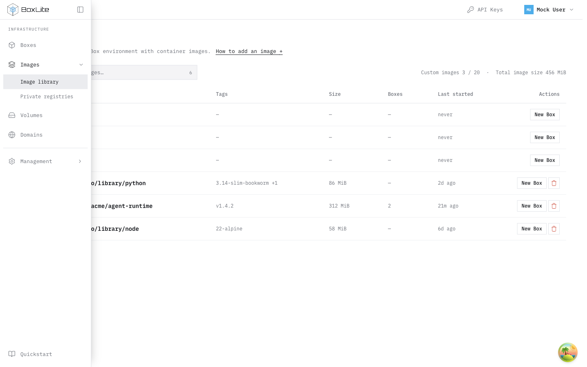 |

The preview keeps the 64px layout allocation; only a click expands it to 224px.
