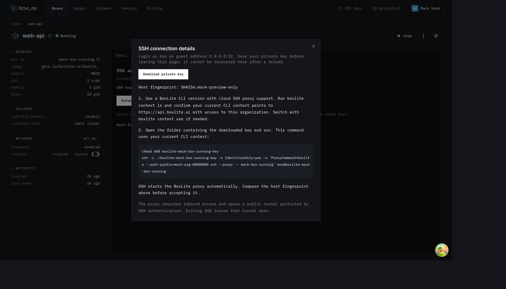
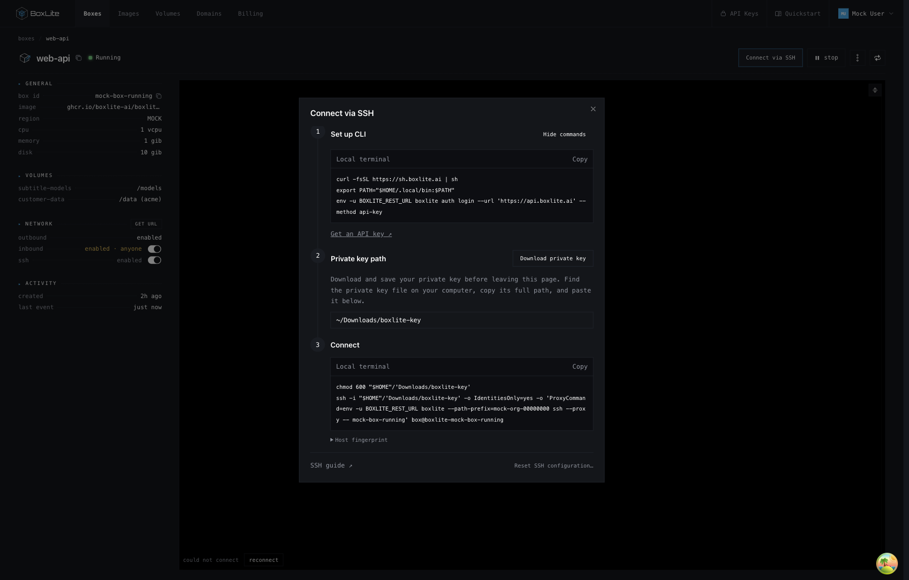

# SSH connection dialog

## Problem and scope

The SSH tab combines connection instructions, listener controls and configuration
replacement beside the browser terminal. Connecting from a local terminal requires
reading a long explanation and manually adapting the generated command.

Move connection preparation into a dialog opened by **Connect via SSH**, immediately
before the box's start/stop action. Show live SSH status and its switch in the left
Network section. Keep the browser terminal mounted and preserve its fullscreen
control. Reuse the existing REST endpoints, permission checks, browser key generation
and network mutation; backend, CLI and API schemas remain unchanged.

## Interaction

Opening the dialog makes no writes. The entry confirmation explains that SSH and
inbound access will be enabled. It also discloses conditional key creation and its
replacement effects: setup replaces SSH accounts and host identity and disconnects
existing clients.

After confirmation, one guarded operation prepares access. Success reveals three
steps: set up the CLI, download or enter the private-key path, and copy the connection
command. CLI instructions start expanded on every entry. **Hide commands** and
**Show commands** are text actions that change their visibility for that opening
only; they do not represent local installation or authentication. Downloading a
private key uses an outlined button, leaving access confirmation as the primary
action. Invalid or empty key paths hide the command.

New keys remain downloadable before leaving the page. A download action does not
prove that a file was saved or reveal its destination. Returning users enter the
path to their existing key. A separate **Reset SSH configuration** confirmation
handles intentional replacement without competing with the connection guide.

The sidebar switch only enables or disables saved configuration. It never generates
keys or changes inbound access. Header, sidebar and dialog share a single controller
and pending state. Status refreshes on request, window focus and every 30 seconds
while visible and idle; reads do not overlap mutations.

The dialog title and close control remain fixed while the body scrolls. The scroll
container spans the dialog's inner width so the scrollbar follows the right border;
horizontal padding belongs to the header and scrolling content rather than the
dialog shell. This preserves the content inset without leaving a gutter outside the
scrollbar. Command lines wrap visually without changing copied content. Opening and
closing the dialog preserves the browser terminal instance.

## Backend contract

| Action | Existing behavior preserved |
| --- | --- |
| Read status | GET `/ssh`; disabled status may omit the saved host identity. |
| Enable | POST `/ssh/enable`; start saved configuration without generating keys. |
| Disable | DELETE `/ssh`; stop the listener while retaining saved configuration. |
| Setup | POST `/ssh` with generated configuration; replace accounts and host identity. |
| Inbound | Existing box network mutation; an SSH failure does not roll this change back. |

Ordinary connection preparation and retry always read fresh status, enable inbound
when needed, and call Enable if SSH is disabled. Only a verified missing-configuration
response permits Setup. HTTP status alone, generic conflicts, authentication errors
and transport failures cannot trigger key generation or configuration replacement.
Already enabled SSH needs no configuration write.

Missing configuration is a point-in-time observation. The existing API has no atomic
create-if-absent operation: another client's configuration between Enable's failure
and Setup can be replaced. The entry confirmation includes that replacement effect;
the frontend does not claim to provide an atomic multi-client guarantee.

Connection preparation and command presentation require a running box and
`WRITE_BOXES`, including when SSH and inbound are already enabled, because the cloud
proxy creates a network tunnel. Read-only members can inspect status. Permission
loss, a stopped box or disabled access prevents use of a previously prepared guide.
Existing busy guards and request versions prevent overlapping operations and stale
responses from changing another account, endpoint, organization or box.

## Credentials and recovery

Setup generates independent Ed25519 host and client keys in the browser. The guest
configuration remains login `box` at `0.0.0.0:22`. Only the client's public key is sent;
the host private key remains part of the existing configuration request. No crypto
algorithm or request body changes.

The browser retains the generated host public key beside the client private key.
This metadata lets fresh GET and Enable responses compare host identity. It cannot
establish whether a client key remains authorized. A failed Setup response can occur
after configuration was persisted; matching identity recovers that configuration
without posting Setup again. Enabled status by itself is insufficient evidence.

Failed setup retains the generated key for download. Disabled status with an empty
identity also preserves the key and path. A positively observed different enabled
host clears obsolete credentials and path, and asks for the current configuration's
key. Invalidation updates the live credential reference synchronously so a pending
asynchronous continuation cannot reuse a discarded key.

Every ordinary retry follows the fresh-read/Enable path. Resubmitting retained
configuration requires another verified missing-config response. Only the separate
Reset confirmation intentionally replaces observed existing configuration. Cancelling
Reset leaves the current path and credentials intact.

## Local preferences and command construction

Private keys remain in component memory and the downloaded file. Closing the dialog
preserves memory; leaving or reloading the page discards it. No private material is
written to browser storage.

Optional sessionStorage remembers a validated key path and its host public key,
scoped to API endpoint, authenticated identity, organization and box. A confirmed
host change invalidates the path. Disabled status alone does not. Missing identity
or unavailable storage falls back to component state. A remembered path is not proof
that the file exists or that authentication will succeed.

The proxy command retains the existing
`boxlite --path-prefix=… ssh --proxy -- BOX` syntax and current CLI context. CLI login
uses the selected API endpoint; credentials are never embedded in copied commands.
Path handling supports `~/`, spaces, quotes, backslashes and literal percent signs
while rejecting control characters and `${...}` expansion. Shell quoting and
OpenSSH token expansion are both accounted for. Relative paths resolve in the local
terminal's working directory.

The guide exposes the host fingerprint for verification. The cloud proxy requires
inbound access and opens a public tunnel protected by SSH authentication. Exiting
SSH leaves the tunnel declaration open; preparing SSH in the dashboard creates no
tunnel.

## Design references

- [React state preservation](https://react.dev/learn/preserving-and-resetting-state)
  informs stable terminal identity and scoped SSH controller state.
- [Radix Dialog](https://www.radix-ui.com/primitives/docs/components/dialog)
  supplies the existing modal, focus and dismissal behavior.
- [OpenSSH configuration](https://man.openbsd.org/ssh_config), especially
  IdentityFile, TOKENS and ENVIRONMENT VARIABLES, defines path expansion constraints.
- The existing guest SSH service, cloud tunnel permissions and CLI context behavior
  define the operation and recovery contract. No additional dependency is needed.

## Validation

### Audit corrections

Status refresh and mutation completion need separate lifetimes. A detail refresh
requested during a mutation is deferred until the mutation has committed its
response; scope changes, permission loss, stopped boxes and unmount still invalidate
pending work. This prevents a pre-commit read from discarding a successful Disable.

Reset retains the current key and path until inbound access is ready. Its newly
generated key stays local until the configuration POST is about to begin; failure
before that point cannot discard the key for the unchanged server configuration.
An explicit Reset action is also available after preparation fails, using the same
replacement confirmation and permission guards as the connection guide.

A host-key match checks host identity, not whether a client key remains authorized.
An externally observed generation change with the same host warns that the key may
need authorization again without discarding a potentially valid private key. Copy
feedback is scoped to the displayed command so late completion cannot report success
for a newer path. Missing-configuration recognition accepts complete known diagnostics,
including verified transport wrappers, and rejects missing-component diagnostics.

The copied login and proxy commands both remove `BOXLITE_REST_URL` from their child
environment before invoking the CLI, preserving the current context for both commands.
Relative filenames equal to `none`, case-insensitively, receive a `./` prefix so
OpenSSH does not interpret them as disabling the identity file. The mock additionally
requires a nonempty private-key block before accepting a generated-key envelope.

Regression checks exercise deferred mutation/refresh ordering, inbound failure before
Reset submission, out-of-band authorization changes, recovery from Enable failure,
pending-copy races, ambiguous diagnostics, real OpenSSH identity handling, CLI child
environment, malformed mock envelopes and the sidebar portal's actual placement.
The preview fingerprint is checked independently from the generated host public key.

Regression coverage includes consent before writes, fresh reads and request ordering,
exact missing-config recovery, reconnect after Disable, another client's host change,
failed Setup recovered through matching GET or Enable, retained downloads, explicit
Reset, permission loss, stale responses, storage isolation and terminal preservation.
UI boundary tests verify that invalid paths hide the command without replacing a
saved valid path, clipboard rejection can be retried and changing the command resets
copy feedback, and missing authenticated identity keeps paths in memory only.
Key tests use OpenSSH to check generated host metadata and special-character paths.
The MSW preview echoes the actual generated public host identity, retains saved
configuration across Disable/Enable and hides disabled listener identity.

Browser verification exercises first-time preparation, key download, path entry,
close, sidebar Disable, status refresh and reconnect. Reconnect sends GET `/ssh`
followed by POST `/ssh/enable`, without a Setup POST, and preserves the key download
and path. The screenshots below use local mock data and contain no private keys.
This verification does not establish a live cloud SSH handshake.

On the main-based branch, the Dashboard suite passed all 97 test files
and 839 tests. `make build:apps:dashboard` and `git diff --check` also passed. Validation
reused the existing local dependency installation without changing the lockfile.
Browser measurements confirm the scrolling body's right edge meets the dialog's
inner border at desktop and narrow widths, with no horizontal content overflow;
the title keeps its position relative to the dialog while the body scrolls.

### Before

The original SSH tab opens a prose-heavy connection-details dialog.

### After

The connection guide presents CLI setup, the key path and a copyable command, with
SSH status in the Network section and the terminal preserved behind the dialog.

