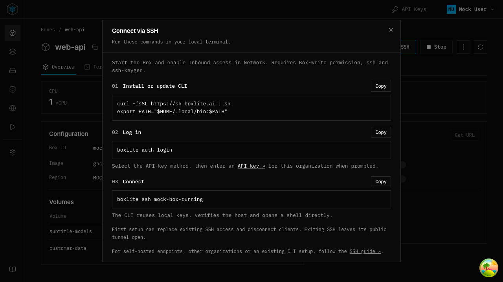

# SSH connection dialog

## TL;DR

The SSH dialog is static guidance for direct CLI login: install, run `boxlite auth login`, then `boxlite ssh <box-id>` to enter a shell. Keep these commands short: the CLI defaults already target the hosted API, and successful login caches the organization's routing prefix. The browser neither prepares SSH nor constructs a second OpenSSH command.

## Scope and interaction

**Connect via SSH**, beside start/stop, opens three instruction sections with copyable commands. No preparation confirmation, status-dependent steps, mutations, downloads, key-path inputs, browser key generation or reset workflow. Guidance remains readable for stopped Boxes and read-only users; actual prerequisites are explained rather than simulated.

The dialog uses the shared constrained layout, divided fixed header, compact monospace text, square code surfaces and `AsciiButton` copy actions. The browser terminal stays mounted. Existing Network controls remain independent.

## Connection contract

1. Install or update the CLI.
2. Run `boxlite auth login`, select the API-key method and enter a key for the selected organization. Entry is interactive; secrets never appear in copied commands.
3. Start the Box, enable **Inbound access** in Network and run `boxlite ssh <box-id>`. This opens a shell directly as `box`; it does not merely print a command to run later. Box-write permission and local `ssh` and `ssh-keygen` are required.

The CLI owns local Ed25519 credentials, remote credential scoping, tunnel lifetime and system OpenSSH. It uses its own known-hosts file and strict host checking. No manual fingerprint acceptance or separate Dashboard-generated `ssh` command is needed. Default login does not edit user OpenSSH configuration. Explicit `--install-ssh-config` is a separate CLI operation, not a prerequisite for direct login.

| Credentials and observed SSH state | CLI preparation |
| --- | --- |
| No managed identity | Configure once; can replace prior SSH accounts/host identity and disconnect clients |
| Saved identity, enabled | Read and verify host identity; no configuration replacement |
| Saved identity, disabled with nonzero generation | Enable saved configuration once |
| Saved identity, generation zero | Configure using saved keys under normal startup rules |

A mismatching observed host identity fails instead of reconfiguring healthy SSH. Authentication failure does not trigger replacement. Previously downloaded browser keys are not imported. Reusing the same CLI home, context, endpoint, organization and Box reuses managed keys.

Direct cloud login requires SSH control, tunnel support and inbound access. Exiting closes local forwarding but leaves the public tunnel declaration open, protected by SSH authentication. Revoke it with `boxlite network tunnel BOX PORT --revoke`, using the same context and prefix.

## Decision and accepted tradeoff

The guide deliberately shows bare login and direct SSH, without endpoint or organization pinning, a dedicated context, shell quoting or environment cleanup. Only the Box ID is interpolated, and it must match `/^[A-Za-z0-9_][A-Za-z0-9_-]*$/`.

Bare login targets the CLI default endpoint (`https://api.boxlite.ai`) in a fresh setup, does not prompt for an endpoint and writes the selected context. Successful API-key login saves the organization's routing prefix, so the connect command needs no explicit prefix. The tradeoff is intentional: an unrelated selected context, exported `BOXLITE_*` variables or a non-production/self-hosted deployment can change the effective destination or credentials. The guide does not detect or handle these minority cases. One muted line directs users with self-hosted endpoints, other organizations or an existing CLI setup to the existing [SSH guide](https://docs.boxlite.ai/cloud/ssh).

## Existing controls

The Network SSH switch only enables/disables saved configuration. It never creates keys or changes inbound. Missing configuration opens the static guide; authentication and permission failures remain errors. Mutations require a running Box and `WRITE_BOXES`; unknown status cannot be toggled.

Status reads refresh on demand, focus and every 30 seconds while visible and idle, deferring during mutations. Scope, permission and lifecycle changes invalidate stale responses. No automatic mutation retries. Dialog content is independent of these states.

## Source basis and alternatives

The compatibility target is the direct-login contract in [CLI PR #2546](https://github.com/boxlite-ai/boxlite/pull/2546), not the older print-command CLI. Source references below refer to that PR:

- `src/cli/src/commands/ssh/mod.rs`, `execute`: default invocation routes to managed preparation/login.
- `src/cli/src/commands/ssh/setup.rs`, `execute` and `prepare_ssh`: conditional configure/enable/status, host identity checks and immediate connection. Alias installation returns separately without opening a session.
- `src/cli/src/commands/ssh/connect.rs`, `execute` and `run_session`: loopback forwarding, system OpenSSH, private known-hosts file, strict checking and inherited terminal streams.
- `docs/guides/ssh.md`, **CLI** and **Managed OpenSSH aliases**: credential scope, direct-session behavior, separate alias installation and persistent public tunnel declarations.

Keeping the older printed-command instructions would require an extra step that this CLI never offers. Blanket warnings that every reconnection replaces configuration would also contradict its healthy-reuse path. Keep direct login as the only primary flow; alias installation remains optional CLI functionality.

## Validation boundary

Focused SSH checks cover the exact short commands, Box-ID validation, API-key instructions and the docs caveat, clipboard failure/retry, no-write guide actions, saved-state switches, permission/lifecycle guards and stale responses. Mock browser inspection covers the actual three-step guide, command copying and desktop/mobile layout. Neither a mock preview nor these Dashboard checks prove a live cloud SSH handshake or availability of the target CLI in the public installer.

## Compact layout

Repeated “Local terminal” headers made the guide taller than the available
desktop space. Copy actions now share each step heading; redundant prose and
spacing are reduced without shrinking the 13px command text. The dialog is
760px wide on desktop and bounded by the viewport height minus 32px. Short
windows retain a thin body scrollbar and a fixed title/close control.

Browser checks observed all steps and the final guide link without scrolling at
1280×720. At 1280×600 and 390×844, the body scrolled to the final link while the
header stayed fixed and no horizontal overflow occurred. The 32 focused SSH
checks passed; no live SSH handshake was run.

## Screenshots

Both screenshots use mock data. The earlier screenshot records the browser-key
workflow and predates the current navigation; the new screenshot shows the current
static three-step guide at 1280×720 with the short commands. Neither demonstrates
a live SSH connection.

### Previous browser-key guide

### Static direct-login guide

