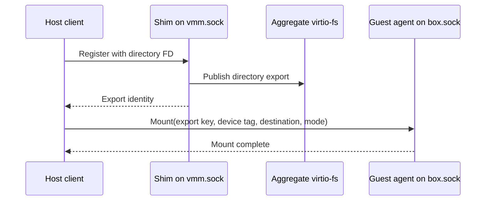
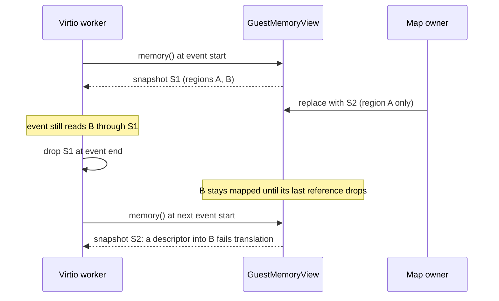

# boxlite-vmm

BoxLite's native VMM. On Linux x86_64, `Vm::new` validates the machine
configuration, creates the KVM VM with legacy devices and a reporting balloon,
registers guest RAM, and loads the kernel and boot data. `Vm::run` runs the
vCPUs until the guest powers off, resets, or a `VmControl` requests a stop.
It returns how the VM ended (see [Lifecycle](#lifecycle)).
`Error` wraps `boxlite_hypervisor::Error` with its cause chain intact. The
[VMM design](../../docs/contributing/architecture/vmm/README.md) specifies the
lifecycle API, memory layout, buses, interrupts, and threads.

`Vm`, `VmConfig`, `ReclaimPolicy`, `VmExit`, `VmControl`, `VmStatus`,
`StopHandle`, `ControlReason`, `Error`, and `Result` are public. So are
`BusKind` and `Conflict`, which `Error::ChipsetConflicts` carries.
`Vm::new(config, console)` adds COM1, the CMOS RTC, the i8042 and virtio-balloon; COM1
output reaches `console` through the
[console queue](#legacy-devices-and-the-console).

On Linux x86_64, the crate-internal `#[cfg(test)]` helper
`Vm::new_device_less(config)` loads the kernel and optional initramfs into a
KVM VM with an empty userspace chipset and no console worker. KVM still creates
the in-kernel irqchip and PIT. Configuring disks, filesystem, vsock, network,
virtio console, or `hotplug_mib` (virtio-mem) returns `Error::Control` with
`ControlReason::UnsupportedDevice` before KVM opens.

```text
boxlite-vmm
├── boxlite-hypervisor
├── mio (the event loop's and the virtio workers' poller)
├── vm-memory
├── vm-superio (x86_64: the 8250 UART and the i8042, 0.8.2 or later)
└── linux-loader (Linux x86_64 ELF loading and boot parameters)
```

| Module | Responsibility |
| --- | --- |
| `vm` | `Vm<H>`: validate the configuration, allocate and register RAM on host backend `H`, compose the devices through `build` and `devices::add_all`, load the boot data, and run the vCPUs until the first event; `with_backend` is the test seam |
| `control` | `VmControl` provides runtime controls for VM status, pause, resume, export, stop, and `resize_disk` by configured ID |
| `lifecycle` | `Lifecycle` coordinates the one-shot run, pause epochs, the control mailbox, and the shared stop latch |
| `snapshot` | Captures and exports machine state and raw guest RAM for paused device-less VMs on Linux x86_64 |
| `boot` | Linux x86_64 boot: `prepare` loads the pinned ELF kernel through linux-loader, places an optional initramfs at the top of low RAM, writes the zero page, E820 map, command line and MP table, and sets up the 64-bit entry state (GDT, identity page tables, registers) |
| `config` | `VmConfig`: CPU, RAM, kernel and initramfs, disks, optional filesystem/vsock/network, and virtio console; 1..=64 vCPUs, nonzero `u32` MiB of RAM whose layout must pass host and boot address checks, a printable-ASCII command line under 2048 bytes, and at most 8 disks |
| `error` | VMM errors that keep the hypervisor's cause chain, including a virtio device that cannot continue |
| `memory` | `GuestRam`: owned guest RAM, the RAM layout, and the registration lifetime rules |
| `hotplug` | `HotplugMemory` places a window after boot RAM, plugs 2 MiB blocks and maps 128 MiB slots |
| `cpu_features` | x86_64 guest-memory capability preflight, CPUID for each vCPU, and the boot MSRs |
| `vcpu` | x86_64 vCPU workers create and configure each vCPU, hold them at a start gate, check for pause or stop before guest entry, and dispatch guest exits |
| `chipset` | `ChipsetBuilder`, the one registry of ranges and interrupt lines, and `Chipset`, the read-only machine it builds |
| `bus` | `Bus`, `BusRange` and `BusDevice`, and `Buses::dispatch`, which serves the MMIO and port exits of a vCPU |
| `virtio` | The virtio common infrastructure: the synchronous device contract (`VirtioDevice`, `DeviceSpec`, `DeviceEvent`, `ActivationContext`, `EventRegistrar`, `Waker`, `WorkerControl`), the `VirtQueues` facade (dense preparation and validation, EVENT_IDX, exactly-once deferred completion, notification drain, the stored guest-memory view and negotiated indirect flag, and `save`/`restore` stubs that report snapshots unsupported until M8), the 4 KiB virtio-mmio transport (register file, feature negotiation, queue configuration and activation, Status=0 reset, post-activation queue-write rejection), `mmio::add_device`, which attaches any device through that transport, the MMIO interrupt handle, the default snapshot methods, and the virtio workers (`VirtioWorkers` over a `WorkerRuntime`; `SharedRuntime` runs every device's events on one thread) |
| `irq` | `IrqChip`, the host interrupt controller as devices see it, and `IrqLine`, one device line; HVF and KVM provide the controller, WHP (M10) only local APICs |
| `devices` | `devices::add_all`, the one composition helper (add a device type as one `add_slot_device` line), the console queue, internal virtio-net device, output-only virtio console device, and on x86_64 the 8250 UART at COM1, the CMOS RTC and the i8042 reset, with `add_legacy_devices` |
| `devices::balloon` | Reporting-only `VirtioBalloon`: configuration, negotiation, whole-chain prevalidation and a `ReclaimPolicy` chosen when the device is constructed; `devices::add_all` composes it after the disks, so it never renumbers them |
| `virtio::worker` | One lazy shared poller/thread, coalesced generation-bound queue kicks, backend readiness, stop barriers and VM shutdown |
| `events` | `Event`, which ends the VM, `EventSender`, which queues terminal events or wakes the driver for control work, and `EventLoop`, which polls for both |

The Linux x86_64 native engine composes disks, reporting balloon, aggregate
virtio-fs, Unix-backed vsock, gvproxy stream networking and virtio-console.
The adapter maps the runtime specification into `VmConfig`. It creates an
empty aggregate filesystem when there are no initial shares, so directory
delivery remains available after boot. Network and vsock remain optional.

The aggregate virtio-fs device is runtime-extensible: `insert_aggregate`
publishes a live device by tag when it enters the transport, and
`lookup_aggregate` returns its filesystem to host-side consumers. VM shutdown
removes the registration, rejects mutations through cached handles, and clears
the guest session. Device drop performs the same cleanup if shutdown did not run.
Retained filesystem handles pin export roots until their final reference drops.
`AggregateFs::register_fd` registers directory descriptors, and `remove` retires
per-directory exports.
A retired export's name stops resolving while its in-use nodes, handles and
in-flight requests retain their backend; a re-registered name has a new identity
and independent read-only policy.
Registration validates that the supplied descriptor refers to a directory;
host read/write permissions are checked by the kernel for each operation.
A writable export may modify an existing writable file in a non-writable
directory, while creating files there still fails with EACCES. The export's
read-only policy separately rejects mutations with EROFS.
Guest LOOKUP and accepted READDIRPLUS entries retain root inodes independently
of open handles. FORGET releases those references; rejected READDIRPLUS entries
and plain READDIR create no persistent lookup ownership.
Disk order remains `vda` (container) then
`vdb` (read-only guest root). The guest runs as PID 1, reports readiness over
vsock and receives aggregate mount instructions before container startup.
Linux arm64 and macOS arm64 remain separate M2 qualification gates; x86_64
results alone do not establish complete M2 acceptance.
Neither new crate depends on `boxlite-shared`; the release workflow publishes
`boxlite-hypervisor`, then `boxlite-vmm`, before `boxlite`, now that the engine
adapter depends on `boxlite-vmm`.

## Host directory delivery

On Linux x86_64 native Boxes, the host delivers directory descriptors to the
shim on `vmm.sock`. The host-only socket uses mode `0600`. Mount requests also
check the peer UID. Each connection carries one `POST /v1/mount-control`
request and reply over HTTP/1.1, with JSON bodies capped at 64 KiB.

Registration attaches one directory FD to the first request byte via `SCM_RIGHTS`.
Guest RPCs use `box.sock`.



Registration allocates an export identity and publishes the export before
replying. The shim keeps no state beyond that table: delivery progress is the
caller's. A new connection can find the export by request ID if the reply is
lost. A request ID, like a target, names at most one export: a repeated
request, or a second export for one target, is refused with `EBUSY`. List
admission accounts for serialized JSON bytes, including escaping.

The kernel queues connections for the serial control thread. The client has
one deadline for connect, queue wait, and I/O, including time behind a disk
resize. The shim owns received descriptors before validating the
request, so rejection releases them.

Aggregate Mount and Detach reject containers whose capability bounding set
includes `CAP_SYS_ADMIN`, before any namespace or mount mutation. The configured
capabilities are preserved; ordinary containers retain directory delivery.

Guest `Mount` resolves the export beneath the mounted aggregate root and binds
it into the running container namespace. `Detach` lazily unmounts only the
matching export incarnation and actual kernel mount identity. Open file and
directory references survive detach; repeating an old detach does not remove a
replacement. Descendant mounts must be detached first. A detach received before
its corresponding mount retains a tombstone that rejects that delayed mount.

Run `make test:unit:rust FILTER=vmm_socket` for HTTP and record checks.
Run `make test:integration:vmm:mount-delivery` with a compatible `VMM_KERNEL`
to register, attach, and retire a directory through the native shim and guest.

The host control client is blocking and belongs in `spawn_blocking` when used
from async code. Its caller owns the delivery state: it asks the guest to
detach before retiring the export, and keeps recovery ownership when outcomes
are uncertain. `BoxImpl` coordinates these steps for the public `bx.mount()`
handle.

## Virtio network device

`devices::net::Net::new(socket_path, mac)` implements an internal RX/TX queue
pair over the Linux gvproxy QEMU stream. It compiles on Unix for socket tests;
macOS gvproxy uses a different wire protocol. `Vm::new` attaches Net when
`VmConfig.network` is present. Snapshots of device state remain unsupported.

- Device ID 1, RX queue 0, TX queue 1, up to 256 entries each; only MAC is
  offered by Net. The unchanged transport owns VERSION_1 negotiation.
- Guest buffers contain a modern 12-byte virtio header; the stream carries a
  four-byte big-endian length and 14–65,549 Ethernet bytes. Offloads are rejected;
  unknown TX flag bits and unused TX `num_buffers` are ignored. RX sets it to 1.
- The existing `VirtQueues::drain` defers chains into bounded metadata queues;
  `complete` returns each head exactly once. Only one packet per direction is
  buffered. Partial socket I/O retains its offset, and an undersized RX chain
  is returned with zero length without writing a truncated packet.
- A Net-local socket source registers both read/write interests through the
  unchanged `EventRegistrar`. Unix edge-triggered polling permits fixed
  interests; a queue kick resumes RX when guest buffers become available.
- Each direction has a 256-iteration budget. Budget exhaustion registers a new
  socket source before removing the old one, rechecking readiness without
  changing the worker. RX delivers a complete packet before yielding, so remaining
  work needs socket I/O or a guest kick; WouldBlock never triggers busy retries.
- Errors latch `NeedsReset`; error/reset/drop deregisters and closes the stream.
  Reset discards outstanding metadata and packet buffers. A new activation needs
  a listening backend; gvproxy accepts one stream per instance.

Completion interrupts follow the unchanged queue facade. Its current dependency
ignores the ordinary NO_INTERRUPT flag without EVENT_IDX; fixing that shared
behavior is a separate task. Net does not claim stopped or whole-VM snapshots.

Run `make test:unit:vmm` and `make clippy:vmm`. Tests exercise real Unix sockets,
guest RAM, descriptor chains, backpressure, reset, the unchanged MMIO
transport, and continuation on the production shared worker. They do not qualify the real gvproxy bridge or a Linux guest.
See the [design study](../../docs/contributing/investigations/2026-11-02-vmm-virtio-net.md)
for the scope and interface trade-offs.

## Guest RAM

`memory::ram_ranges` fills low RAM in `[0, 3 GiB)` on x86_64 and places any
remaining RAM starting at 4 GiB. The `[3 GiB, 4 GiB)` MMIO hole does not count
as RAM. The arm64 layout is a single region starting at 2 GiB.

On Linux x86_64, preflight checks that the exclusive end of each backed region
fits both the host KVM GPA width and the VMM's four-level startup identity
map (`2^47`). For example, 36 GPA bits give an exclusive limit of 64 GiB and
allow at most 64512 MiB (63 GiB) of x86 RAM; 64513 MiB crosses the limit. At
the same GPA limit the arm64 layout would fit 63488 MiB (62 GiB); this is a
layout example, not an arm64 host capability check.

The pinned Linux guest kernel's four-level direct map has a 46-bit (64 TiB)
usable physical address limit. On hosts with at least 47 GPA bits, the kernel
truncates high RAM at that limit.
With `2^46` as the exclusive guest physical address limit, subtracting the 1 GiB
MMIO hole leaves a maximum x86 RAM configuration of
**64 TiB - 1 GiB (67,107,840 MiB)** before truncation.

`GuestRam` allocates the layout as zero-filled anonymous memory through
vm-memory and registers it with the host VM. These rules keep the backend's
`map_memory` contract:

- Host-side users clone the shared `GuestMemoryView`, vm-memory's
  `GuestMemoryAtomic` over the region map, and access guest memory through
  vm-memory's volatile API, never through Rust references.
- A user loads one snapshot per unit of work and drops it before returning;
  no device keeps one across events.
- `VirtQueues::drain` and `complete` load one per call. Block, fs, console and
  balloon load one per device callback, such as `on_event`, `activate` or
  `quiesce`.
- Net loads one per guest buffer read or write. Vsock loads one per TX intake
  pass and one per RX buffer write.
- The next event therefore sees a map that gained or lost a region. A
  descriptor naming a removed region fails translation like any other invalid
  address. A snapshot still held keeps its regions mapped until it drops.
- `map` registers logical RAM regions from low to high. KVM slices each region
  into slots of at most `2^31−1` host pages and rolls back installed slices if
  a registration fails. `GuestRam` also rolls back attempted regions, including
  any slices the backend could not remove. `unmap` works from high to low and
  retains failed registrations for retry.
- The backing is released after all registrations are removed or a freshly
  created host VM with exclusive ownership is closed before `run` starts.
  If registrations may still exist, `GuestRam` retains the backing.

A map replaced while a worker event runs reaches the next event, not the
current one:



`Vm::new` validates the configuration, then opens and checks the KVM system fd
and reads supported CPUID once. It preflights the RAM addresses and boot leaf
before spawning the console worker or allocating RAM. The VM builder
allocates RAM first, then creates the VM fd using that system handle, composes
devices, registers RAM, then constructs the `Vm` before writing boot data.
A boot error or panic unwind runs `Vm::drop`, which shuts down the virtio
workers and quiesces devices before attempting to unmap RAM. If the workers
fail to join, teardown logs a warning and retains the registrations and
backing. Teardown also logs unmap failures. The original boot error reaches
the caller. `with_backend` is the test constructor without mutable configuration.
The `memory` and `vm` tests and the mock backend live in `tests/` and are included
as unit-test modules, which
keeps them outside the counted sources and the coverage denominator; `config`
and `error` keep inline test modules.

`GuestRam` registers and releases only the boot regions it allocated. The
shared view can gain hotplug regions, so `GuestRam` keeps its own boot map
instead of reading registrations back from the view.

## Hotplug memory

`HotplugMemory` owns the window that grows and shrinks guest RAM at runtime.
Design: [#2882](https://github.com/boxlite-ai/boxlite/issues/2882).

- The window starts at or above 4 GiB after all boot RAM. The base is rounded
  up to the bundled Linux guest's memory block size, and capacity must be a
  positive multiple of that size. A guest with 6 GiB of boot RAM and 1 GiB of
  hotplug capacity has a window at `[7 GiB, 8 GiB)`.
- The planner checks the end against KVM's GPA limit and Linux's pluggable
  address limit. It checks capacity against KVM's slot budget after boot RAM.
  E820 and the startup identity map describe the backed boot ranges.
- The guest plugs 2 MiB blocks. A 128 MiB slot gets its own private anonymous
  mapping and KVM registration when its first block is plugged.
- Unplugging the last block of a slot removes its KVM registration, publishes
  a view without it, then drops the mapping. A held snapshot keeps the mapping
  alive until it drops, as the [Guest RAM](#guest-ram) diagram shows.
- Publishing a removal cannot fail: a poisoned view lock is still used, and a
  region already missing from the view counts as removed.
- Unplugging blocks discards them with `MADV_DONTNEED` while other blocks in
  that slot remain plugged. An emptied slot retained after a failed unmap
  retains its contents.
- A failed slot map unregisters the slots that plug added and leaves every
  block unplugged. A failed unmap keeps the slot mapped and visible; `Drop`
  leaks a slot whose unmap fails.

### Virtio-mem device and control

On Linux x86_64, set `VmConfig.hotplug_mib` to the extra capacity above boot
RAM (`0` disables virtio-mem). `Vm::new` checks the window before building the VM.

BoxLite prepends `memhp_default_state=online` and
`memory_hotplug.online_policy=auto-movable` to the caller's command line.
Caller kernel parameters can override these defaults. Arguments after
`--` go to init.

`vm.control().set_memory_target_mib(256, timeout)` publishes a target of 256 MiB
above boot RAM and notifies the guest, which plugs or unplugs blocks afterward.
Targets are multiples of 128 MiB up to the configured capacity.

Use `memory_status(timeout)` to read the capacity, target, plugged and mapped
MiB. Shrinking is best effort, so the plugged size may stay above the target.

`WouldBlock` means the device is inactive or the control queue is full. An
accepted command can still run after the caller times out.

Reset discards queued commands. After VM exit, both operations return
`BrokenPipe` for an enabled device.

## Kernel loading

On Linux x86_64, `boot::elf::load_elf(ram, kernel)` delegates ELF parsing and
segment loading to rust-vmm's linux-loader and returns `io::Result<LoadedKernel>`
with `entry` and the physical bounds (`start`/`end`, including BSS) so the boot
page tables can stay clear of the kernel. It reads `kernel` through a seekable
reader, usually the kernel file, so segments go straight into guest RAM without
buffering the whole image. It uses vm-memory 0.18 and linux-loader 0.14 with
only the ELF feature. `boot::prepare` calls it for `Vm::new`.

Pass the pinned `vmlinux` from `make vmm:boot` and fresh zero-filled guest
RAM before guest execution. BSS relies on that initial zero state. Validation
and copying follow the library's behavior; a failed load may have changed RAM,
so discard that RAM before retrying.

The hardware probe requires Linux x86_64, read/write `/dev/kvm`, binutils
`readelf`, and a `vmlinux` whose segments fit in its 128 MiB of RAM:

```sh
make vmm:boot
make test:integration:vmm:elf
# To qualify a different artifact:
make test:integration:vmm:elf VMM_KERNEL=/absolute/path/to/vmlinux
```

`VMM_KERNEL` defaults to `target/vmm/boot/x86_64/vmlinux`. The probe compares
the entry and loaded bytes with independent `readelf` output, checks BSS in
fresh RAM, then runs a vCPU checksum over the loaded span. Missing hardware
or kernel input fails qualification. This proves loading and guest visibility;
the [boot tests](#boot-tests) run Linux itself.

## Boot parameters

On Linux x86_64, `boot::params::write_boot_params(ram, cmdline, ranges,
initramfs, reserved)` fills the zero page that RSI points to at the 64-bit
entry (`Documentation/arch/x86/boot.rst`, `zero-page.rst`) and returns its
address, `0x7000`:

- Setup header: `type_of_loader` `0xFF`, `boot_flag` `0xAA55`, the `HdrS`
  magic, a 16 MiB `kernel_alignment`, and `cmd_line_ptr` and `cmdline_size`
  for the NUL-terminated command line at `0x2_0000`, plus `ramdisk_image` and
  `ramdisk_size` when there is an initramfs. The rest stays zero: no
  `loadflags` or ACPI tables.
- E820: each RAM range as usable RAM outside `[0x9_FC00, 1 MiB)`, where the
  MP table and the legacy BIOS areas go, while `reserved` intervals are marked
  `E820_RESERVED` (including the boot page-table span passed by `prepare` when
  the tables cannot fit in the fixed window and are placed above the kernel).
  More entries than the 128 table slots fail with `InvalidInput` before
  anything is written.

`VmConfig::validate` accepts a command line only if it is printable ASCII and
shorter than 2048 bytes, the kernel's `COMMAND_LINE_SIZE` with the NUL.
linux-loader's `Cmdline` refuses the same lines, after trimming surrounding
whitespace.

`boot::prepare(ram, config, leaf)` opens `config.kernel` and runs `load_elf`,
loads the optional initramfs, and plans the boot tables using the checked
`leaf`. It then writes the boot parameters and MP table and sets up long-mode
entry on fresh RAM, returning a `BootSetup` with the boot vCPU registers. A
failure names its step, `LoadKernel`, `LoadInitramfs` or `WriteBootData`, and
keeps the I/O cause. `Vm::new` calls `prepare` once RAM is registered.

## MP table

Without ACPI, Linux learns the vCPUs and the IOAPIC from the MP table, and
turns off SMP and the IOAPIC without one. `boot::mptable::write_mptable(ram,
vcpu_count)` writes the floating pointer at `0x9_FC00`, where Linux scans the
last KiB below 640 KiB, and the configuration table right after it. It lists
the same entries as Firecracker:

- one processor per vCPU, with APIC ID equal to its index as `vcpu_cpuid`
  assigns it, and vCPU 0 as the bootstrap processor;
- an ISA bus and KVM's in-kernel IOAPIC at `0xFEC0_0000` with ID
  `vcpu_count + 1`;
- ISA IRQ k on IOAPIC pin k for 0 to 23, the GSI routing KVM sets up;
- ExtINT on the boot vCPU's LINT0 and NMI on every LINT1.

The table takes 284 bytes plus 20 per vCPU, 1564 at 64, all inside the
reserved `[0x9_FC00, 1 MiB)`. With it Linux enables the IOAPIC even on one
vCPU, so device interrupts such as the serial IRQ 4 arrive through IOAPIC pins
instead of the PIC. The other vCPUs then start when Linux sends them INIT and
SIPI; on KVM each waiting vCPU's `run` returns `Interrupted` once, for the
`EAGAIN` that wake-up produces.

## Initramfs

`boot::initramfs::load_initramfs(ram, image, size)` reads the archive into the
highest 4 KiB-aligned slot of the RAM region at 0, as Firecracker and
cloud-hypervisor do, and returns its start. An empty archive, or one larger
than that region, fails with `InvalidInput` before anything is written.

Like those VMMs, it does not check that the slot stays clear of the kernel.
Only tests boot an initramfs; production boots from a disk. Their inputs are
fixed, and the KVM boot test below fails if the archive overwrites the kernel.
Accepting an initramfs from production configuration would need that check.

Linux ignores `initrd_addr_max`, so
the archive may sit anywhere in RAM; it must be uncompressed newc, since the
pinned kernel has no decompressors. With 256 MiB of RAM, a 372-byte archive
starts at `0x0FFF_F000` and Linux prints `RAMDISK: [mem 0x0ffff000-0x0fffffff]`.

## Boot tests

Unit tests read the generated boot data back from guest RAM. Hardware boot
tests are ignored by default and run explicitly through the target below.

The boot tests need Linux x86_64, read/write `/dev/kvm` and the same
`VMM_KERNEL` as the ELF probe:

```sh
make test:integration:vmm:linux
```

Each builds a KVM `Vm` with `prepare` on the
[legacy devices](#legacy-devices-and-the-console) and runs it with `Vm::run`,
with 256 MiB of RAM unless stated. The CMOS RTC starts at
`2026-01-02T03:04:05Z`. The host VM is KVM behind a test wrapper that counts
the edges devices raise on GSI 4 and can drop every interrupt. A watchdog
stops a boot at its timeout, 30 seconds unless stated, so a failed boot
reports the serial log so far.

- With `earlycon=uart8250,io,0x3f8 keep_bootcon panic=-1 reboot=k`, one
  vCPU and no initramfs, the log must show the kernel version, the exact
  command line, the two E820 entries, the memory total and
  `VFS: Unable to mount root fs`.
- The same boot with 6144 MiB of RAM must show three E820 entries, with the
  last one above 4 GiB, no reserved entry, and a memory total of nearly all
  6 GiB: the kernel uses RAM on both sides of the 32-bit MMIO hole.
- With the same command line, one vCPU and a generated archive whose
  `/init`, a 132-byte static ELF, calls `exit_group(42)`, the log must show
  the `RAMDISK:` range from the zero page, `Unpacking initramfs...`,
  `Run /init as init process` and
  `Attempted to kill init! exitcode=0x00002a00`, in that order.
- With the same command line on four vCPUs and no initramfs, the log must
  show the MP table at `0x9fc00`, `Processor #0` to `#3`, the IOAPIC with ID
  5 and GSI 0-23, `smp: Brought up 1 node, 4 CPUs`, and no unstable TSC.
- With the same command line on four vCPUs and an `/init` that pins itself
  to each CPU in turn with `sched_setaffinity` and sets bit i when `getcpu`
  then reports CPU i, the log must show `exitcode=0x00000f00`.
- With `console=ttyS0 panic=-1 reboot=k`, one vCPU and an `/init` that
  prints a line, waits for the tty to send it and restarts the machine, the
  log must show the 16550A on IRQ 4, `rtc_cmos rtc_cmos: registered as
  rtc0`, that line and `reboot: Restarting system`, in that order, and must
  not show `setting system clock`: kvm-clock keeps the boot time. GSI 4 must
  have been raised.
- With `console=ttyS0 panic=-1 reboot=k`, one vCPU and an `/init` that
  mounts devtmpfs, turns on update interrupts on `/dev/rtc0` with
  `RTC_UIE_ON`, as `hwclock` does, and waits up to 2 s for one, the log must
  show `rtc0` registered, the line `/init` prints once one arrives, and
  `reboot: Restarting system`, with no panic. Linux serves update
  interrupts with the CMOS alarm, so the line proves the alarm raised IRQ 8.
- The same boot with a console sink that takes nothing until the run has
  ended, and a 4 KiB queue, must still end with `GuestReset`. The queue drops
  the oldest bytes and counts them; the sink then gets the batch the worker
  held when it stalled and the newest 4 KiB, with the restart line.
- The same boot with every interrupt dropped must log
  `Run /init as init process` but not the start of `/init`'s line, and end at
  a 3-second timeout. Against vm-superio 0.8.1 it fails: the first 16 bytes
  leave without IRQ 4.
- The M1 smoke test builds its VM with the public `Vm::new` instead, on plain
  KVM. With `console=ttyS0 panic=-1 reboot=k`, one vCPU and the same restarting
  `/init` printing `BOXLITE_M1_OK`, `Vm::run` must return `GuestReset` with
  that line already in the caller's sink.
- With the earlycon command line, one vCPU and an `/init` that calls `pause`
  forever, a `StopHandle::stop` sent once `Run /init as init process`
  appears must make `Vm::run` return `StopRequested` within two seconds.

The boot with every interrupt dropped and the stopped boot end in
`StopRequested`. Every other boot must end in `GuestReset`: `panic=-1
reboot=k` turns a panic, and the restart, into the i8042 reset.

## Vsock building blocks

The Unix-only `virtio::vsock` module provides the wire codec, captured writable
guest buffers, registered Unix socket sources, stream connections and explicit
Unix backend routing behind `Vsock`, a stream-only virtio device.
The [vsock design](https://github.com/boxlite-ai/boxlite/issues/2312) covers this
contract. `Vm::new` attaches it when `VmConfig::vsock` is present; the native
engine maps host RPC and ready sockets to guest ports 2695 and 2696. The device
removes its listener paths after failed attachment or teardown only when the
path still identifies the socket it bound; pre-existing and replaced paths survive.

The codec uses explicit little-endian fields and rejects truncated packets or
payloads above 64 KiB. A captured buffer owns checked descriptor metadata and
provides checked scatter writes. The device's receive stage owns fragmentation
and delivery accounting: a 4096-byte chain writes a 44-byte header and
up to 4052 stream bytes, retaining any unsent tail. Header-only buffers
can carry controls; data returns zero bytes, while shorter headers require reset.
Callers own nonblocking standard-library Unix streams and listeners directly.
`Registration::stream` and `Registration::listener` clone a handle for the poller;
a private enum holds those two source types with their requested interests.
Device I/O takes no socket mutex and needs no generic wrapper or explicit fd
conversion. Each registration costs one extra file descriptor. Dropping the
registration deregisters and closes only the polling copy, leaving caller I/O
usable. Closing the caller's socket first is safe too; the polling copy keeps it
open until deregistration. Failed registration leaves the original socket intact.
Callers must set accepted streams nonblocking before worker use. This ownership
change has no measured throughput claim. Direct std I/O with duplicated mio
polling handles relies on the Unix epoll/kqueue implementation; dependency
upgrades must rerun readiness and production-worker continuation tests.

Each connection owns its nonblocking stream and drops its registration before
the stream. Guest requests receive a RESPONSE when the host socket connects;
host-initiated flows wait for RESPONSE before exchanging bytes. Unexpected
handshakes and operations reset only that flow.

While awaiting RESPONSE, a host closing both socket directions cancels the flow,
discards its queued packets and emits RST, even when unread host bytes remain.
The connection checks closure using a zero-timeout `poll` inside the existing
readiness callback. Separate read/write entries distinguish macOS's directional
hangups; both must report `POLLHUP`. The probe consumes no bytes and preserves
half-close. Worker dispatch and public event contracts are unchanged. Established
streams retain the ordered EOF handling below. Cleanup resumes listeners stalled
at the connection cap; output backpressure still waits for RX capacity. Live hosts
with unanswered handshakes have no timeout.

Pending guest writes are bounded at 64 KiB. Partial writes retain the tail,
WouldBlock retains all pending bytes, and only successful writes advance
`fwd_cnt`. Each turn performs at most one write and one read of up to 4 KiB,
reporting whether runnable work may remain. The caller preserves outgoing
packet order and leaves capacity for up to two output packets per turn.

Host data reserves guest credit before entering the outgoing queue. Call
`delivered` only for payload actually copied into guest buffers; acknowledgments
beyond that count are rejected, including acknowledgments for retained RX tails.
Counters wrap at 32 bits. At zero credit, a one-byte lookahead detects an empty
socket's EOF without sending uncredited data. If it reads data, that byte waits
for credit and precedes subsequent reads; EOF behind data waits too.
Credit requests are coalesced until credit returns.

Guest SEND shutdown drains pending writes before closing the host write half;
guest RECEIVE stops host reads while allowing guest writes. Host EOF emits
SHUTDOWN/SEND after queued data and leaves guest writes usable. Both guest
shutdown flags produce RST once pending writes drain.

The backend connects guest requests only to configured paths and accepts host
connections only from caller-provided listeners. Mappings retain their original
listeners across backend teardown. The backend shares immutable `Arc<Mappings>`
and owns registrations for duplicated polling handles; I/O uses concrete std
sockets without a mutex. Host accepts receive monotonically increasing ports from
`1 << 30`, skipping configured connect ports; ports are not reused before reset.
Exhausting the range closes new accepts. Non-transient listener errors remain
fatal; descriptor-exhaustion retry scheduling is not implemented here.

Limits are 128 live connections and 256 outgoing packets. Callers check
`can_receive` before consuming a non-RST guest packet and call `drive` when output
space returns. A TX-head RST is processed even when output is full: it closes
that flow and discards its queued output without generating a reply. RST does
not overtake earlier TX packets; REQUEST and SHUTDOWN still wait for capacity.
A deque rotates flows after each bounded I/O turn, so output pressure
does not repeatedly favor one flow. Routing scans at most 128 entries; this
removes the separate sorted map, copied key list and cursor. A reset removes
that flow's queued packets; RECEIVE shutdown discards its queued data.

Like virtio-net, each device callback has an explicit I/O budget. TX and RX each
process at most 256 heads; listener scanning attempts at most 256 accepts. The
128-connection limit and one read/write per connection bound stream data I/O to
256 calls per callback. Partial listener scans retain their position and whether
an earlier accept succeeded or was interrupted. Reaching the end schedules another
sweep only when a retry is needed; readiness arriving mid-sweep also requests a
full recheck, including when output pressure delays acceptance. A complete empty
sweep stops. Capacity stalls
wait for external progress. Budget continuations yield through a private readiness source,
so the callback does not drain a continuously refilled socket indefinitely.

The device advertises ID 19, an eight-byte read-only CID and three queues with
maximum size 256: RX, TX and events. It requires all three queues ready and
successful feature negotiation. It accepts no device-specific feature bits;
the MMIO transport supplies VERSION_1. Explicit mappings reject duplicate or
reserved ports, invalid CIDs and invalid Unix pathnames before activation.

Each callback captures RX descriptor metadata and copies TX packets before
completing any head. No borrowed chain survives intake. TX storage is bounded
by 256 packets of at most 64 KiB payload; RX retains at most 256 heads.
Deferred completions use the queue facade's notification decision exactly once.
The current virtio-queue dependency does not implement the optional legacy
`NO_INTERRUPT` hint; this device does not offer EVENT_IDX.
The event queue remains untouched because migration events are unsupported.

```text
queue/source → process: collect → transmit → backend.drive → receive
                       → signal private source when work can resume
```

RX delivery fragments packets at the buffer boundary. For example, a 4096-byte
payload and 4096-byte RX chain produce 4052 payload bytes, then a 44-byte tail
in the next chain. Each header and used length describes only that fragment;
the tail stays ahead of later data and shutdown. Only copied payload advances
delivered credit. Header-only RX completes with zero bytes when data waits.

Vsock owns a nonblocking Unix socket pair for continuation, with its reader
registered through the existing `Registration` interface. Scheduling writes one
byte only when no request is pending; its `BackendReady` callback consumes that
byte. Requests made during a callback arrive on a later poll, letting other slots
run. The registration stays fixed for the activation, avoiding per-round SourceId
allocation. This costs two socket endpoints and one polling duplicate. Private
callbacks do not trigger listener rescans. The common poller `Waker` remains
unchanged and is not used to request device callbacks.

Activation rolls back partial registrations on failure and signals the private
source for the first scan; prepared readiness is retained until worker start.
Reset closes the notification pair and streams, discards
deferred work and requires feature negotiation again, while retaining mappings.
Stopping the worker generation precedes reset, so callbacks cannot write old
guest buffers after reset. Replenished RX resumes output and deferred TX;
WouldBlock, missing credit and full output do not continually self-schedule.

Like virtio-net, snapshots advertise `Unsupported`: active and inactive
`save_state` and `restore_state` reject snapshots. The default `quiesce` succeeds
without draining buffered traffic or releasing activation; reset/drop retain
their existing cleanup. There is no serialization, RestoreContext extension
or active-VM restore.

`make test:unit:vmm FILTER=vsock` checks encoding, packet bounds, guest-memory
scatter delivery, real Unix stream/listener readiness, and registration cleanup
in either ownership order, including rejected registrations. Connection tests
also cover both handshakes, actual partial writes and WouldBlock, credit stalls,
partial delivery acknowledgments, counter wraparound, half-close and zero-credit
EOF ordering. Backend tests cover explicit mappings, host accepts, limits,
fairness after output pressure, budgeted listener scans and retries across empty
scan segments, isolated resets and registration rollback.
Device tests cover 4096/61/45-byte RX chains, deferred TX/RX ownership,
and REQUEST/SHUTDOWN TX completion withheld at full output capacity, then
resumed in order exactly once after RX replenishment. RST tests cover immediate
TX-head completion at capacity, socket and registration cleanup, isolated output
discard, and resumption of following TX without RX replenishment. They also cover
malformed chains, activation rollback and Unsupported snapshots. MMIO tests use
the production shared worker, including a host burst and EOF without new kicks
or writes. Vsock tests also check private notification coalescing, preparation
and reset cleanup. These are local
socket and guest-memory tests; real-guest qualification remains separate.

## Lifecycle

`Vm::run(&mut self)` blocks on the thread that owns the VM. Call
`vm.control()` before the run and pass clones of the `VmControl` to threads
that observe or control execution or call [`resize_disk()`](#virtio-block-device).
Dropping the clones has no effect on execution. A VM created with the
device-less test helper returns
`InvalidInput` for disk resize because its registry is empty.

| `VmStatus` | Meaning |
| --- | --- |
| `Created` | The VM is ready for its first run, with or without an initial pause reservation. |
| `Running` | The driver has started the run, including vCPU setup. |
| `Pausing` | Guest entry is closing and the driver is collecting vCPU acknowledgements. |
| `Paused` | Every vCPU is parked outside the guest. |
| `Stopping` | A stop was requested or the driver is handling a terminal event. |
| `Exited` | The run finished teardown, or the owner dropped the VM. |

`request_pause()` requires an empty userspace chipset. If the VM has devices,
it returns `Error::Control` with `ControlReason::UnsupportedDevice`. In
`Created`, the first `request_pause()` reserves the initial pause and returns immediately.
The driver enters `Pausing` before releasing the vCPU start gate, so every
vCPU parks before its first guest entry. The VM reports `Created` until `run`
starts. A second reservation or a `resume()` in `Created` returns `InvalidState`.

In `Running`, `request_pause()` enqueues `Running → Pausing → Paused`, wakes the
driver, and returns immediately without waiting. `wait_paused(timeout)` waits
for the reserved, queued, or active pause epoch and leaves the pause in place on
`DeadlineTimeout`. A zero timeout checks the current state immediately. With no
reserved, queued, or active pause, the operation returns `InvalidState`.

`resume()` returns once the driver reopens the guest entry gate and the VM
returns to `Running`. It requires `Paused`. Pause and resume share a
single-slot mailbox, so a pending request blocks other clones from submitting
another request. Stop and terminal events release parked vCPUs. Pending
resume calls and `wait_paused` return `TerminalOutcome` when the VM is
stopping or has exited. New `request_pause()` and `resume()` calls in those states return
`InvalidState`.

`Vm::run` runs on x86_64, against any backend that implements
`boxlite_hypervisor::X86Vm`; unit tests drive it on the mock backend. Before
it registers any RAM, `Vm::with_backend` builds the `Chipset` from the
devices it is given, so a conflict fails with `ChipsetConflicts` and leaves
nothing mapped.

1. It starts one scoped thread per vCPU, named `vcpuN`. Each creates its vCPU,
   sets its CPUID from `vcpu_cpuid` and the boot MSRs, and on vCPU 0 the entry
   registers, then waits at a start gate until every vCPU is configured. A
   vCPU that fails setup sends `VcpuFailed` before it arrives, so the latch
   keeps every vCPU out of the guest, and a thread that fails to start aborts
   the gate, so no worker waits forever.
2. Before each guest entry, the worker calls `checkpoint` and checks the stop
   latch. To park, it calls `complete_pending_io` and dispatches each
   `Ok(IoCompletion::Exit(exit))` until completion returns `Ok(IoCompletion::Done)`.
   It then calls `notify_guest_stopped` and acknowledges the pause epoch if the
   VM is still live. A terminal exit, error, or concurrent stop skips the
   acknowledgement.
   During normal entry and I/O completion, the worker uses `Chipset::dispatch`
   to serve device accesses. `Shutdown` sends `GuestShutdown` and `Reset` sends
   `GuestReset`. An error, unexpected exit such as `Halted`, or a panic caught
   around the worker sends `VcpuFailed`. A worker that sees the stop latch
   drains pending I/O and preserves the latched outcome.
3. `EventSender::send` sets the stop latch before it queues, so the vCPU
   that sends, such as the one whose `0xFE` reached the i8042, never enters
   the guest again. `run` takes the first event from the `EventLoop`, opens
   the start gate for teardown, releases and kicks the vCPUs, and joins them
   all before it returns. Before joining, shutdown retries kicks that fail
   with `WouldBlock` or `Interrupted`, including when the terminal event
   interrupts a pause. Kicking an exited vCPU is a successful no-op; other
   kick errors and panics are logged without retrying that kick.
   `StopRequested`, `GuestShutdown` and `GuestReset` become `VmExit`, and
   `VcpuFailed` or `DeviceFailed` its error. Later events are dropped.

4. Once every vCPU joins, `run` shuts down the [virtio workers](#virtio-workers),
   which join dispatch and quiesce every device: console drains published TX,
   block flushes its backend, and the other devices use a successful no-op.
   It then finishes the host console worker that `Vm::new` started.
   Before `run` returns, the guest's last output, including device output, reaches
   the sink or is counted as dropped and logged.

A join timeout turns a clean exit into `Error::VirtioWorker`; a quiesce failure
becomes `Error::VirtioDevice`, while an error that ended the VM stays the result.
`Drop` retries an incomplete join and keeps RAM registered while workers still
run; a quiesce failure after joining still permits RAM unmapping.

`VmControl::stop` and `StopHandle::stop` share the stop latch and return
without waiting. A stop requested before the first run skips vCPU creation,
performs cleanup, and returns `Ok(VmExit::StopRequested)` on successful cleanup.
A second run returns `Error::AlreadyRan`.

`run` publishes `Exited` after joining the vCPUs, shutting down the virtio
workers, and finishing the console. A worker join timeout leaves the status at
`Stopping` until the VM is dropped. RAM stays mapped after `run`.
Dropping the VM handles RAM teardown and publishes `Exited` to surviving
controls, including when the VM never ran.

### Exporting a paused VM

On Linux x86_64, call `control.export(state_path, memory_path)` from a
control thread while a device-less VM is paused. `Vm` currently has no public
device-less constructor (`Vm::new_device_less` is crate-internal for tests).
Other hosts return `ControlReason::Unsupported`. Other handles can observe the
pause during capture and I/O. A competing `request_pause`, `resume`, or
`export` returns `InvalidState`. Relative paths are resolved against the current
working directory when the export is admitted.

The driver saves platform state first. If it succeeds, each parked vCPU
saves its state on its owning thread. The driver collects all replies
and sorts the vCPU records by ID before writing either file. Following
`boxlite-hypervisor`'s capture exclusions, x86 machine state excludes nested
virtualization, Hyper-V SynIC, and guest-debug state. Pausing stops vCPUs but
not KVM's in-kernel timers, so platform capture is non-atomic; PIT restore
loses sub-tick phase and can re-arm one-shot modes (0, 1, and 4).

Export creates both files exclusively with `create_new` and mode `0600`
(subject to the process `umask`). It skips `fsync`, and dropping the files
ignores delayed `close(2)` errors. `Ok(())` provides no guarantee of power-loss
durability. An existing target, including reuse of the state path for memory,
returns `Error::Snapshot` with `AlreadyExists` without changing its contents.

Callers must have exclusive use of both target paths during export. If export
fails after creating a file, `boxlite-vmm` leaves it in place, even if partially
written. The caller (runtime or runner) is responsible for cleanup, for example
by exporting into a temporary directory and atomically renaming it on success.

Capture and I/O failures leave a live VM paused. File writeout is synchronous
and is not interrupted by a stop request. The driver handles the stop after
an in-flight platform `save_state` or file writeout finishes. If stop is
requested during a vCPU's `save_state`, the driver abandons the capture request
so `export()` returns `TerminalOutcome` without waiting, but `run()` still waits
for the vCPU thread to exit. If the VM is terminal at the final lifecycle check,
`finish_export` returns `TerminalOutcome`.

The state file starts with a 32-byte little-endian header with the magic
`BXLVMST1`, followed by Postcard machine state with vCPU records in ID order.
The memory file contains exactly the header's declared RAM byte count.
Raw RAM starts at offset zero and follows guest physical address order,
skipping the `[3 GiB, 4 GiB)` PCI hole. Machine state targets the same host
and KVM environment.

## Long-mode entry

On Linux x86_64, `boot::entry::long_mode_entry(ram, entry, boot_params, plan)`
writes the state that the Linux 64-bit boot protocol requires
(`Documentation/arch/x86/boot.rst`, "64-bit Boot Protocol") and returns the
boot vCPU registers, which the vCPU 0 worker applies after its CPUID and
MSRs.

- Guest RAM: the GDT at `0x500` holds flat `__BOOT_CS` (`0x10`) and
  `__BOOT_DS` (`0x18`). The four-level boot page tables identity-map only
  backed RAM, leaving the MMIO hole unmapped. Tables start at `0x9000` if
  they fit in the fixed boot window without overlaps; otherwise they go in
  low RAM above the kernel. The default leaf is 2 MiB, with 4 KiB leaves
  where needed. The internal `BOOT_LEAF` may request 1 GiB leaves only with
  guest CPUID `pdpe1gb`. There is no automatic selection or public switch.
  All table pages must fit in the selected window; passing address preflight
  does not guarantee space for the tables.
- Registers: 64-bit mode with paging (CR0 PE, ET and PG; CR4 PAE; EFER LME
  and LMA), interrupts off, RIP at `entry`, RSI at `boot_params`, a stack
  below `0x8FF0`, and segments decoded from the GDT entries. There is no IDT,
  so an exception before Linux installs its own resets the guest.

## CPU features

Memory preflight uses the CPUID KVM supports for guests, not raw host CPUID.
It takes the width from `0x8000_0008` EAX[7:0] and caps it with EAX[23:16]
when that guest GPA width is nonzero; EAX[15:8] is the virtual width and is
not used. These EAX fields are separate from the AMD topology in ECX. Missing
or invalid width data fails preflight. `pdpe1gb` is `0x8000_0001` EDX bit 26;
its absence rejects only a request for 1 GiB boot leaves.

`cpu_features::vcpu_cpuid(supported, index, count)` turns KVM's supported
CPUID into vCPU `index`'s. KVM passes the host's APIC ID through and reports
no topology, so it sets:

- leaf 1: APIC ID `index`, `count` rounded up to a power of two, a 64-byte
  CLFLUSH line whatever the host reports, HTT when `count > 1`, and the
  hypervisor and TSC-deadline bits;
- leaf 7 subleaf 0: SHSTK is masked because KVM snapshots do not capture the
  shadow stack pointer (SSP) via `KVM_GET_ONE_REG`. `boxlite-hypervisor` rejects
  CPUID that advertises SHSTK with `Unsupported` during capture and restore;
- leaf 0xB, and 0x1F when KVM lists it: an SMT level of one thread and a
  core level of `count` cores whose shift of 6 covers every APIC ID up to 64;
- on AMD and Hygon, 0x8000_001E (APIC and core ID `index`, node 0) and
  0x8000_0008 ECX (ApicIdSize 6, `count - 1` more cores).

Every other entry is kept, so vCPUs differ only in their APIC ID.
`BOOT_MSRS` adds FAST_STRING to KVM's MISC_ENABLE and enables MTRRs with a
write-back default; KVM already creates the other boot MSRs as zero. The
local APIC keeps its KVM reset state, with LINT0 in ExtINT mode on the boot
vCPU; Linux programs LINT1 itself.

## Buses, lines and events

These are the pieces the [legacy devices](#legacy-devices-and-the-console)
are built from. `Vm` owns the chipset they form.

- **Buses.** `bus::Bus` maps non-overlapping `BusRange`s, each named by its
  owner, to a `BusDevice` and the register offset the device sees at the
  range base, so the i8042 can claim port `0x60` as register 0 and port
  `0x64` as register 4. `insert` fails with the owner of the range a new one
  overlaps. A range without a device reserves a window the host serves in
  the kernel. The bus holds the devices' strong references and never changes
  once built, so lookups take no lock.
- **Dispatch.** `Buses::dispatch` serves `MmioRead`, `MmioWrite`, `IoIn` and
  `IoOut` and returns every other exit. An access must lie entirely inside one
  range. An access no device holds, or one that crosses a range end, reads
  `0xFF`, drops its write and is counted by `Bus::unclaimed`; Linux probes
  port `0x87` once at boot and takes `0xFF` as no ISA DMA controller. Reads
  reach a device zero-filled. A device whose lock an earlier panic poisoned
  stops the next access too.
- **Lines.** `irq::IrqLine` drives one line through `IrqChip::set_line`,
  which every host VM implements with `Vm::set_irq_line`; the distinct name
  keeps the two traits from colliding where both are in scope. It is not
  `Clone`. `pulse` raises an edge and lowers a line a failed clear left high
  before raising again, so the next notification still makes an edge;
  `set_level` holds a level, makes no host call for a repeated level and
  keeps the old level when the host call fails, so the next call retries.
  Dropping a line held high lowers it and logs a failure to do so.
- **Events.** A device ends the VM by sending `Event::GuestReset` or
  `Event::DeviceFailed` through an `EventSender`, which never blocks or
  panics, latches the stop for every vCPU, and wakes the `EventLoop`'s `mio`
  poller. vCPU workers and lifecycle controls send the other events. An event
  sent after the loop is gone is logged at debug level and discarded.
  `EventLoop::wait` returns the oldest terminal event or `None` after a
  control wake or timeout. The driver uses `RECHECK` to revisit the mailbox
  and terminal queue every second while idle in case a wake-up was lost.

## Virtio-mmio transport

`virtio::mmio::MmioTransport` is a `BusDevice` on a 4 KiB window, and
`virtio::interrupt::MmioInterrupt` is the interrupt handle the device receives
through `ActivationContext`.

- **Registers.** Control registers take aligned 4-byte accesses; configuration
  space forwards 1-, 2- and 4-byte accesses and splits an 8-byte access into two
  4-byte device calls. Unknown, legacy and `QueueReset` registers read 0 and
  ignore writes.
- **Features.** The transport offers the device features plus
  `VIRTIO_F_VERSION_1`, minus packed-ring, notification-data,
  notification-config, ring-reset and admin-queue features. `FEATURES_OK`
  validates the accepted subset and calls `set_features` once with
  transport-owned bits removed. A rejected subset leaves the bit clear, so
  Linux fails the device synchronously.
- **Queues.** The transport holds a dense `QueueConfig` shadow, one per
  `DeviceSpec::queue_max` slot. Queue registers are writable only after
  `FEATURES_OK` and before `DRIVER_OK`; `QueueReady=0` keeps the configuration.
  `DRIVER_OK` builds the `virtio_queue::Queue` values, prepares them into the
  `VirtQueues` facade, and moves them into the device. A validation failure
  leaves `DRIVER_OK` unset, sets `DEVICE_NEEDS_RESET` and raises a configuration
  interrupt.
- **After `DRIVER_OK`.** The device owns the queues; the transport rejects and
  logs every queue-configuration write, including `QueueReady`. `QueueNotify`,
  `InterruptACK` and `Status` stay live. `Status=0` stops the device's worker
  slot, resets the device and clears the transport; it is the only
  queue-reconfiguration path.
  Linux's queue teardown may warn on a `QueueReady` readback of 1; BoxLite never
  hot-removes a virtio device.
- **Interrupts.** `InterruptStatus` has used-buffer (0x1) and config-change
  (0x2) bits. Raising always pulses the line; `InterruptACK` clears only the
  acked bits and pulses again while any remain, so an edge line does not lose a
  notification that arrived between Linux's read and acknowledgement.
  `raise_config` also bumps the configuration generation; a reset keeps it
  monotonic.
- **Worker generations.** `prepare` supplies a generation-bound registrar,
  waker and queue continuation; `start` admits dispatch after activation.
  QueueNotify sets a coalesced queue bit. `stop` prevents new callbacks and
  waits for admitted callbacks/registrations before reset; only VM-wide
  shutdown joins the shared thread. Failed activation cancellation also waits
  before rollback; barrier failure retains resources and takes Fatal.
- **Errors.** `NeedsReset` sets `DEVICE_NEEDS_RESET` and raises the
  configuration interrupt; `Fatal` sends `Event::DeviceFailed` with
  `Error::VirtioDevice` and never stops the worker slot synchronously. The
  bus stays infallible.

## Virtio workers

`virtio::worker::VirtioWorkers` runs every virtio device's events for one VM.
A worker is one device's slot, with its generation, kicks and sources; which
thread runs it is the runtime's choice. `VirtioWorkers::add` gives a transport
the `WorkerControl` handle of its device's slot. The handle forwards to a `WorkerRuntime`, so a per-device runtime can
replace the shared one without changing the transport, the devices or `Vm`.

- **One thread.** `SharedRuntime` owns one `mio::Poll`, its one `Waker`, and
  one `virtio-worker` thread that starts at the first `start`. Every device's
  `on_event` runs there under the device lock. A synchronous request can block
  other devices; the common one-chain budget bounds work count, not duration.
- **Generations.** Each slot is stopped, prepared, running, halted, stopping
  or failed. `prepare` opens a generation and clears its kicks; `stop` and
  `cancel_prepare` close it with its sources, and kicks and sources never
  reach a later generation. `stop` waits up to 300 s for the event in flight
  and never joins the thread.
- **Kicks.** `kick(index)` sets the queue's bit and wakes the poller only when
  the bit was clear. Each pass delivers one `QueueKick` per set bit, so kicks
  that arrive before their event runs coalesce, and one that arrives during
  the event runs in the next pass. A generation-bound continuation uses the same
  kick bitmap; all current-pass ready queues and backend events run first.
  The poller rechecks every second if wake-up fails.
- **Backend sources.** A device registers a source through the generation's
  `EventRegistrar` and gets its `SourceId`; each readiness edge arrives as
  `BackendReady(id)`, so the device reads the source until it would block. A
  ready mark stays until it is delivered, so an edge that arrives before
  `start` is not lost. A registrar of a closed generation returns `Closed`,
  and registrars hold weak references, so a device never keeps its slot or
  the guest memory alive.
- **Failures.** `NeedsReset` from `on_event` sets `DEVICE_NEEDS_RESET`
  atomically, raises the configuration interrupt and halts the slot until
  `Status=0`. `Fatal`, a panic in `on_event` (caught, which poisons the
  device lock) or a poisoned lock fails the slot and sends one
  `DeviceFailed(Error::VirtioDevice)`; a `stop` that outlives its timeout fails
  the slot too. A poll error or a panic of the thread itself sends
  `DeviceFailed(Error::VirtioWorker)`.
- **Shutdown.** `shutdown` closes every source, wakes the thread and waits up
  to 300 s for it to exit before it joins it. A timeout reports
  `Error::VirtioWorker` with `TimedOut`, and a later call retries without having
  called any device cleanup hooks.
- **Shutdown quiesce.** After joining, the framework calls every device's
  `quiesce` under its lock while guest RAM is registered, including devices never
  started. The default succeeds without extra work; console scans published TX,
  and block flushes/syncs its backend.

Other devices keep their existing reset/drop cleanup. Successful quiesce does
not promise network delivery, processing of unconsumed queues, filesystem
durability or snapshots. Synchronous block flush/sync is not bounded by the
worker join timeout.

Poisoned devices are not called; errors, panics and poisoned locks do not
prevent later hooks, and the first failure is cached as `ShutdownError::Quiesce`.
Repeated shutdown never repeats hooks. `ShutdownError::Join` separately
identifies workers that may still access RAM, so device cleanup errors cannot
cause a RAM leak.

## Device composition

`devices::add_all` is the one place that names device types. `Vm::new` calls it
through `Vm::build`; the helper adds the legacy platform devices, then
each configured device type in slot order, and finally announces every slot on
the front of the kernel command line, which is always before any `--` that
starts the init arguments, so the caller's text is never parsed.

- **One line per device.** `add_slot_device` takes the next `Slot`, runs the
  device's attach function, and records the slot for `announce`. Adding a
  device type is one such line in `add_all`; a device that must keep slot 0
  goes before the disk loop.
- **One attach path.** `virtio::mmio::add_device` claims the window and line,
  adds the device's worker slot and builds the `MmioTransport`; every
  virtio-mmio device uses it, so the wiring is not copied into each device
  module.
- **Test seam.** `Vm::with_backend` lets tests add mock, conflict or legacy
  devices directly. `Vm::with_devices` also passes the mutable `VmConfig`, so
  tests can use `add_all` to announce slots. The aggregate filesystem wiring
  test checks both device announcements followed by the original command line:
  without disks, the balloon occupies slot 0 and virtio-fs occupies slot 1.

## Virtio block device

`virtio::blk` is the first production virtio device: one request queue over
the [virtio-mmio transport](#virtio-mmio-transport) and the
[virtio workers](#virtio-workers), with the image format handled by
[imago](https://crates.io/crates/imago) (`sync` feature, so no tokio).
`VmConfig::disks` lists the disks; `devices::add_all` calls `blk::add_disk` for
each one, which opens the image and attaches it in the slot `add_slot_device`
took, and then announces that slot on the kernel command line.

- **Slots.** `virtio::mmio::Slots` hands out `(window, line)` pairs in
  order: window `i` is `0xd000_0000 + i * 4 KiB`, interrupt lines are GSI 5–7 and
  9–23, 18 slots in all. GSI 8 stays reserved for the CMOS alarm, while MMIO
  windows and device order remain consecutive. `Slot::cmdline_arg` renders the
  `virtio_mmio.device=4K@<base>:<gsi>` argument the kernel probes, and
  `announce` puts one per slot at the front under the command-line budget, so the
  chipset claim and the kernel's view come from the same value. Disks take
  slots in `VmConfig::disks` order, so disk 0 is `/dev/vda`, disk 1 is
  `/dev/vdb`, and so on. Production uses up to 13 slots with 8 disks, the
  balloon, and optional aggregate filesystem, vsock, net and console devices.
  The [M2 device plan](../../docs/contributing/architecture/vmm/README.md#devices-by-milestone)
  adds rng for 14 devices within the 18-slot budget. IRQ 8 follows the
  pinned Linux [RTC platform declaration](https://github.com/gregkh/linux/blob/v6.12.110/arch/x86/kernel/rtc.c#L114-L152),
  and the upper GSI bound follows the 24-pin IOAPIC described in the
  [Linux KVM IOAPIC source](https://github.com/gregkh/linux/blob/v6.12.110/arch/x86/include/uapi/asm/kvm.h#L77-L99).
  The VM composition test uses the production attach and boot-loading paths
  with eight distinct raw disks, with and without aggregate fs. It reads the
  command line from guest RAM and checks consecutive MMIO windows, GSIs that
  skip 8, disk capacities in configuration order, balloon/fs device IDs and
  the real CMOS ports on a mock host VM; it does not boot a Linux guest.
- **Configuration.** `DiskConfig { block_id, path, format: Raw | Qcow2, read_only }`;
  the format is stated, never probed from the file. A qcow2 image opens the
  backing chain its header names. At most 8 disks; `blk::add_disk` fails with
  `Error::OpenDisk` for an image it cannot open and `add_all` fails with
  `Error::InvalidCommandLine` when the line leaves no room for the device
  arguments.
- **Features.** `VERSION_1`, `SEG_MAX` (254: the queue size 256 minus the
  header and status), `INDIRECT_DESC`; a writable disk adds `FLUSH` and
  `DISCARD`, a read-only one `RO`. `WRITE_ZEROES`, `EVENT_IDX` and multiple
  queues are not offered. The 60-byte configuration space carries the
  capacity in sectors, `seg_max`, and the discard limits; one discard covers
  at most 128 MiB, and a read past the end returns zeros, while writes are
  refused.
- **Backend contract.** `blk::backend::DiskBackend` is the seam a disk
  engine implements: `disk_info` once after open; `resize_grow` to a larger
  aligned size between requests, returning the new information; `event_source` at every
  activation, registered with the worker generation when it is `Some`;
  `submit(token, Request)` per parsed chain, answering `Done(CompletedRequest)`
  inline or `Pending`; `completions` on each `BackendReady` edge, drained
  until empty; `flush` on reset and quiesce, with the worker stopped. A
  `Request` owns its bounce buffer, and a completion returns it with the
  status byte, so a backend can keep requests across events.
- **Request lifecycle.** On `QueueKick(0)` the device drains the queue:
  `request::parse` reads the 16-byte header and the OUT or discard payload
  from the readable descriptors and records the writable ones as the
  `WriteTargets` for IN data and the status byte. A chain the backend must not
  see (wrong direction, short header, misaligned or out-of-range transfer,
  a transfer over the 4 MiB bounce limit, an unnegotiated or unknown type)
  is finished at once with `IOERR` or `UNSUPP`; a chain without a status
  byte is a `NeedsReset`. A `Done` completion writes the results and the
  chain is used with `data + 1` bytes for a successful read, 1 otherwise. A
  `Pending` chain is deferred: `blk::inflight` keeps its head and targets
  by token until the completion arrives, when `VirtQueues::complete` adds
  the used entry. The interrupt is raised exactly when `drain` or `complete`
  says so.
- **Writes.** With `FLUSH` negotiated, `FLUSH` flushes and syncs the image
  and writes complete when the format layer took them; without it every
  OUT syncs before `OK`. `DISCARD` takes one 16-byte segment with no flags
  and at most 128 MiB, so a conforming guest splits a larger range; imago
  zeroes what the format cannot discard, and a qcow2 image frees the
  clusters without punching the host file.
- **Disk identity.** `block_id` is a nonempty host control ID, unique within
  the VM. The native adapter preserves the ID assigned by BoxLite. IDs do not
  affect attachment order or Linux device names. Invalid IDs fail VM creation
  before host resources or images are opened.
- **Online grow.** `vm.control().resize_disk("data", 2 << 30, timeout)`
  grows the writable disk with `block_id: "data"` to 2 GiB. Targets must be
  sector-aligned and at least the current capacity. A same-size request is a no-op.

  After growth succeeds, the device worker updates guest capacity and raises a
  configuration interrupt. A timeout ends the wait and the request can still complete.

  On Linux, preflight rejects a Raw target or qcow2 estimate above the shim's
  `RLIMIT_FSIZE` soft limit. The temporary qcow2 estimate adds 1 MiB per
  started GiB of target capacity.

  Fresh standalone samples from QEMU 8.2.2 (`preallocation=metadata`,
  64 KiB clusters, 16-bit refcounts) added 384 KiB to file length at 1 GiB
  and 10.25 MiB at 64 GiB. Existing image layouts can require more space.
- **Reset.** `Status=0` stops the worker slot, then `reset` deregisters the
  backend and control sources, fails the device with `Fatal` if a request is still in
  flight (no completion can arrive any more, and the guest may already
  reuse that memory), flushes, and forgets the activation. The imago
  backend finishes every request inline, so its table is always empty; a
  bounded wait comes with the first asynchronous engine.
- **Known limits.** The imago backend runs on the shared worker thread, so
  a slow disk stalls every other virtio device while a request runs; a
  thread-pool or io_uring engine behind the same contract is a follow-up.
  Discards on qcow2 do not return host space. Snapshots stay
  `Unsupported`.

## Virtio console

`devices::virtio_console::VirtioConsole` is the output-only virtio console
port and shares `ConsoleWriter`/`ConsoleWorker` with COM1.

- **Shape.** Device ID 3, one RX and one TX queue with a maximum of 256
  entries, a 12-byte zero configuration space, and no device feature bits;
  the transport owns `VIRTIO_F_VERSION_1`, so only the split ring is offered.
  Activation requires a ready TX queue. RX is left untouched: the device
  neither reads it nor publishes used entries for it.
- **TX.** A kick validates the whole descriptor chain from a host-side
  snapshot before copying anything. It rejects writable descriptors,
  non-empty ranges outside guest RAM, indirect descriptors the driver did not
  negotiate, cycles, and a head already deferred in the batch. A zero-length
  descriptor is valid whatever address it carries because the device never
  reads it. Any failure is
  `NeedsReset` and emits no prefix of that chain. Valid chain bytes are copied
  in fixed 4 KiB chunks into the shared 64 KiB console queue; a full queue
  drops its oldest bytes and a closed one drops new bytes, and both count the
  loss, so a slow or broken sink never delays the guest's completion. Each accepted head is completed
  once, in order, with used length 0; the queue facade decides whether to
  raise the interrupt.
- **Quiesce and resume.** `quiesce` stops kicks, then scans and completes
  published TX once, including descriptors without a final kick. Repeated calls
  do nothing; broken rings are skipped, and a new scan failure is reported.
  Activation remains available for `resume`, which re-enables kicks without
  clearing a broken ring.
- **Reset and release.** `reset` or drop releases queue and RAM references;
  reset also clears failed state for a new `DRIVER_OK`. The shared writer stays
  open, so serial output and later activations append to the same `console.log`.
- **VM seam.** The device is exercised with real guest RAM, split virtqueues,
  the MMIO transport and the console worker. `devices::add_all` registers it
  when requested; `Vm` retains no concrete console device handle. Shutdown order
  is vCPU join → device worker join → every device's quiesce → host console finish
  → RAM unmap on drop.

The callback still processes every available TX head, so a continuously
refilled queue is unbounded. N1 in the design closes that before the device
becomes the default path. A stalled sink cannot block TX, but its backlog
is bounded by the 64 KiB pending queue plus the batch the worker is writing,
so up to about 128 KiB can be outstanding.

## Reporting balloon and shared dispatch

Design: [authoritative Notion specification](https://www.notion.so/4058d8d97179803fb555cd0420cb232d)
and [tracking/registration extract #2278](https://github.com/boxlite-ai/boxlite/issues/2278).

The device exposes ID 5, only reporting bit 5, and eight configuration bytes:
read-only `num_pages=0` and guest-writable `actual`, reset to zero. Linux setup
uses inflate/deflate queues 0/1; reporting alone is queue 2. All have maximum
size 256. Queue 2 is required only when reporting is negotiated and is never
consumed otherwise. No quota, stats, hinting, poison or snapshot support is
advertised. `devices::add_all` composes the device through `balloon::add` after
the disks, so its window, interrupt line and `virtio_mmio.device=` argument come
from the slot record rather than from the device: the disks keep the slots they
had before the balloon existed and the reporting device takes the slot after
them, because the guest names virtio devices by slot order.

Before any reclaim, the entire chain must pass direction, nonzero length,
checked address arithmetic, single-region raw-range and normal-termination
checks. Activation caches up to nine ready-queue control GPA/HVA intervals.
Reject raw GPA/control or inward-aligned HVA/control overlap without reclaiming
any prefix. Duplicate and partially overlapping reports are allowed, validated
independently and attempted in guest order; no sorting, merging or deduplication.
The control snapshot includes both event-index fields even when EVENT_IDX is
not negotiated. A ring at a RAM-region tail therefore also needs those two
extra bytes in the same region; activation rejects it otherwise.

The RAM owner supports only owned private-anonymous backing. It queries the real
host page size once per device and prepares inward complete host pages before
the first syscall. Empty interiors skip `madvise`. `ReclaimPolicy`, passed to
the device's constructor, selects the advice. `Immediate` (the default)
discards the pages with `MADV_DONTNEED`
before used length zero is published. `Lazy` marks them with `MADV_FREE` on
Linux, so the kernel discards them only under memory pressure and a guest that
reuses them first does not fault; on other hosts it falls back to `Immediate`.
With `Lazy`, used zero means the advice was applied, not that the backing is
gone: an already-reported page that the guest never reuses may stay resident
until pressure. Linux may skip a range that covers only part of a large folio;
guest pageblock-order reports normally cover whole blocks. Partial failures
record GPA, raw length, aligned offset/length and errno, then continue. Used
zero permits reuse, not released-byte accounting. There is no retry after
completion, and Darwin's pressure-dependent `MADV_DONTNEED` is not immediate
Linux discard.

Common `VirtQueues::drain` processes at most one complete chain per callback.
Its notification recheck schedules pending work through a generation-bound
continuation, without another guest kick. The executor finishes the current
pass's other ready work before self-continuation; stopping prevents the next
chain, while an admitted chain may finish before the barrier succeeds. This
bounds work count, not syscall duration, total CPU or syscall rate. A protective
timeout is Fatal and retains mappings; it is not a latency SLA. Normal VM exit
and Drop both stop/join before RAM unmap.

Worker and driver cumulative status updates use atomic OR, so publishing
`DEVICE_NEEDS_RESET` cannot erase a concurrent driver `FAILED` bit or vice
versa. Backend delivery takes the device mutex before admitting a source;
configuration code can therefore retire a queued source without waiting for
a callback blocked on that same mutex. Admission then rechecks source liveness
and generation. Retiring an already-admitted callback from another thread
waits for its completion; self-retirement defers destruction until it returns.

```sh
make vmm:boot:host
make test:unit:vmm FILTER=balloon
make test:integration:vmm:linux
make coverage:vmm:boot
```

Coverage targets create `target/coverage` on a fresh checkout and append to
existing instrumented unit profiles. Use the matching toolchain's LLVM tools;
the output is `target/coverage/lcov.info`, not a three-platform qualification.

Both real-boot entry points build the freestanding `balloon_init.c` test init.
The guest touches scratch and independent live regions, announces each phase on
its console, unmaps scratch, verifies unchanged capacity/live data,
reallocates/touches, and unbinds/rebinds the driver. The frame comes from the
production composition (`devices::add_all`), and the host samples `mincore`
residency across the run against those markers, so the test needs no device or
kernel capability of its own. Reporting must drop most of the freed scratch
residency; the `init_on_free=1` control asserts the guest's own checks only,
because the kernel can reclaim or swap anonymous RAM independently. Security
settings are not weakened, and watchdog expiry fails. Sampled residency is not
the exact-PFN evidence a per-page protocol would give, and three-platform
real-guest reporting/reclaim/reuse/lifetime evidence is still required; these
commands do not waive the arm64 prerequisites.

## Virtio-fs implementation

`virtio::fs::device::Fs::new(tag, shares)` constructs one Linux x86_64 device
for all exports ([design and stages](https://github.com/boxlite-ai/boxlite/issues/2274)).
It ports the FUSE interfaces, dispatcher and Linux file operations from
[libkrun e12b9b3](https://github.com/boxlite-ai/libkrun/tree/e12b9b3780ffa8df9f3e1797b217d13453479167/src/devices/src/virtio/fs),
with the synthetic namespace following
[OpenVMM 998904f](https://github.com/microsoft/openvmm/blob/998904f2debee98416c5d007a17f05be1b7dad34/vm/devices/virtio/virtiofs/src/aggregate.rs).
The port keeps its BSD attribution and local license; libkrun stays unchanged.
Both production filesystems explicitly implement the migrated `FileSystem`
operations and lifecycle. The trait keeps only the shared batch-forget loop;
missing operations fail compilation rather than silently inheriting unsupported
or no-op defaults.

| Layer | Ownership and contract |
| --- | --- |
| Device | Type 26; 36-byte tag plus one request-queue count; priority and request queues of 1024 entries; EVENT_IDX only; both queues required |
| Descriptor adapter | One traversal builds readable/writable views from the same validated addresses; bounds, directions and incomplete chains fail before host operations |
| FUSE server | Version 7.27; bounded frame/payload decoding and reply capacity checks; AUTO requires READDIRPLUS; no unimplemented capabilities advertised |
| AggregateFs | Immutable root 1; global node/handle IDs, per-share policy and routing; cross-share rename/link/copy fail with EXDEV |
| PassthroughFs | Each share owns its local inode/handle objects and host operations; O_PATH/proc-FD anchors preserve files after rename/unlink |
| Lifetime | Separate lookup, open and in-flight references; mapping locks do not span file I/O; zero-reference identities are collected; checked IDs are not reused |

The Linux backend requires a returned `STATX_MNT_ID` (Linux 5.8+); a missing
mount identity fails explicitly rather than merging bind-mount aliases. Xattr
mutations on write-only files/directories use pinned proc-FD paths, preserving
host xattr authority without requiring unrelated data-read permission. ACCESS
selects one guest permission class - owner, else group, else other - and then
bounds success by the host effective identity; guest root bypasses the read and
write bits and needs one execute bit for `X_OK`.
If a directory-plus listing fails after accepting complete entries, the reply
returns that prefix; an empty listing still returns the host error. A later
queue error cannot suppress notification of earlier published completions.

Regular OPEN/CREATE return `DIRECT_IO`, not host `O_DIRECT`; entry/attribute
timeouts are zero and writeback is not negotiated. Directory handles do not
enable data caching. Linux boot tests check coordinated host rewrites through an
open guest descriptor, reject shared mappings with ENODEV and read private mappings.

Operations run under the host's existing authority, without changing credentials,
capabilities or umask. CREATE/MKDIR/MKNOD/SYMLINK accept each uid/gid only when
it is zero or matches the host; other identities get EPERM. SETATTR retains the
source's host-authority semantics.
Read-only enforcement also covers truncating opens and metadata changes.
Raw parent lookup is refused for every export directory; nested listings omit
host `..`, so an anchored directory moved outside an export cannot expose its
new host parent. Symlink contents are resolved in the guest.
FIFO/device/socket creation and data opens, credential switching, killpriv and
creation security contexts are unsupported.

FSYNC/FSYNCDIR finish the host sync before replying and propagate errors;
FLUSH and RELEASE (including RELEASE_FLUSH) do not promise durability.
FORGET/BATCH_FORGET/DESTROY use zero reply
bytes but still complete the descriptor. Reset clears session state and objects
after the caller has stopped callbacks; it keeps export roots and ID counters.

Unsupported POLL/IOCTL requests return ENOSYS for Linux's standard opt-out;
these do not claim a backend operation succeeded. Other unsupported operations,
including SYNCFS, return EOPNOTSUPP rather than a kernel-cached success.
Implemented FSYNC/FSYNCDIR always perform host synchronization and propagate errors.

`VmConfig::filesystem` optionally configures one aggregate device with a mount
tag and named `FsShareConfig` exports. `devices::add_all` attaches it after the
disks through the same slot allocator, transport and worker runtime, preserving
disk order and announcing every device on the kernel command line. Export setup
errors retain their I/O cause through `Error::Filesystem`. The pinned kernel
fragment includes both virtio-blk and FUSE/virtio-fs.

A slow synchronous filesystem call stalls every callback on the shared worker;
a batch budget cannot cancel a blocked host syscall. macOS filesystem support
and broader user-volume qualification remain follow-ups.

```sh
make test:unit:vmm FILTER=virtio::fs
make test:unit:vmm
make clippy:vmm
make fmt:check:rust
```

The filesystem suite uses real files through production backends and memory
queues: read/write/sync, host sync failure, malformed frames/descriptors, split
transfers, large-directory pagination, credentials, per-share policy, handle
survival and reclamation, full queues, reply-free requests and stale-session IDs.
`make test:integration:vmm:linux` boots the Linux driver to mount exports, copy
and synchronize files, retain descriptors after rename/unlink, and check cache
visibility and mixed read-only policies. The separate
`make test:integration:vmm:mounts` target packages the static production guest
mount test init supplied as `VMM_GUEST_MOUNT_INIT`. It exercises the guest volume
adapter's failed-batch rollback, guard rollback and committed mounts, with host
checks for writable hardlink propagation, snapshot isolation and descriptor cleanup.

## Chipset

`chipset::ChipsetBuilder` is the one registry of port ranges, MMIO ranges and
interrupt lines, like OpenVMM's chipset builder. Platform code reserves the
windows the host serves in the kernel, then adds each device by name with a
closure that claims the device's resources from a `Resources` handle and
returns the device. `build` reports every conflict at once, naming the
claimant and the owner, or returns an immutable `Chipset` that owns the
devices:

```text
5 chipset conflict(s): intruder claims port range 0x3fe+0x4, held by com1; intruder claims port range 0x42+0x1, held by in-kernel PIT; intruder claims MMIO range 0xfee00800+0x10, held by in-kernel local APIC; intruder claims MMIO range 0x1000+0x0, which is empty or wraps; intruder claims interrupt line 4, held by com1;
```

- **Claims.** A claim never fails: `Resources` records it, so the closure
  always finishes and every later claim is still checked. A rejected claim
  leaves the range or line with its first owner, so every later conflict
  names that owner. `pio_with_offset` sets the device offset a range's first
  port reaches, for a controller whose ports are split across several ranges.
- **Constructors.** A constructor only claims resources and builds state; a
  device that needs a thread starts it after `build`, and a virtio device's
  events run on the worker thread, which starts at its first DRIVER_OK.
  `Vm::build` passes the guest memory and workers in a `DeviceContext` and
  supplies the mutable `VmConfig`; `devices::add_all` adds the
  [block devices](#virtio-block-device) and tests use `with_backend` to add a
  transport. A line from `Resources::line` is not armed until `build`
  succeeds: using it earlier fails with `Error::LineNotArmed` and makes no
  host call, so a device that a conflict discards never raised anything. On a
  conflict, every device drops without having run.
- **Dispatch.** `Chipset::dispatch` hands a vCPU exit to the buses and
  returns every exit that is not MMIO or port I/O. The chipset never changes
  after the build, so every vCPU thread shares it without a lock of its own.

## Legacy devices and the console

On x86_64, `devices::x86_64::add_legacy_devices`, which `devices::add_all`
calls, reserves the in-kernel PIC
(`0x20`, `0xA0`, `0x4D0`), PIT (`0x40`–`0x43`, `0x61`), IOAPIC and local APIC
windows, then adds the legacy devices:

| Ports | Device | Behavior |
| --- | --- | --- |
| `0x3F8`–`0x3FF` | `com1`, vm-superio's 16550A | Output goes to the console queue; a pending, enabled THRE or RDA raises an edge on GSI 4; no input yet |
| `0x70`–`0x71` | `cmos` | See [CMOS RTC](#cmos-rtc) |
| `0x60`, `0x64` | `i8042`, vm-superio's controller | Reads 0; the first `0xFE` at `0x64` sends `GuestReset` |

- vm-superio must be 0.8.2 or later. It raises THRE on every IER write, so
  Linux's 8250 driver passes its THRE and TXEN probes and sends tty output on
  IRQ 4. Against 0.8.1 the driver enables `UART_BUG_TXEN` and sends 16 bytes
  without the interrupt.
- The serial port writes into `devices::console::ConsoleWriter`, a bounded
  queue of 64 KiB, and returns at once; a `console` thread writes the queue to
  the sink. A full queue drops its oldest bytes, as the kernel's own log ring
  does, and counts them, so a stalled or failing sink never stalls the guest.
  A batch the sink refuses and a write after `finish` count as dropped too;
  a queue of 0 bytes is refused.
- `ConsoleWorker::finish` closes the queue and waits up to 1 s for the worker
  to write the rest. A sink write cannot be cancelled, so after that it leaves
  the worker behind and counts every byte the sink never took, the batch the
  worker holds included, as dropped.
- A failed interrupt sends `DeviceFailed`, once.
- The guest kernel has no i8042 driver, so the reset is all the device does.

## CMOS RTC

On x86_64, `CmosRtc` serves ports `0x70` (register select) and `0x71` (data).
Linux exposes the clock as `/dev/rtc0` and takes its boot time from kvm-clock
because `boot/kernel.config` disables `RTC_HCTOSYS`.

- RTC time follows the host wall clock plus a guest-set offset. SET or a
  divider reset freezes it. On release, the clock resumes half a second into
  the written second, matching Linux's RTC write timing. Time registers read
  in 24-hour BCD or binary.
- Alarms match hours, minutes, and seconds in guest RTC time. The RTC latches
  due matches in AF before rescheduling, even with AIE off. Enabling AIE with
  AF set asserts IRQ 8. Reading register C clears the flags and rearms the
  alarm. Clearing AIE lowers IRQ 8 and keeps AF.
- Linux uses the alarm to emulate update interrupts for `hwclock`. A failed
  IRQ update ends the VM with `DeviceFailed`.

## Build

`make vmm:boot` builds the pinned x86_64 ELF kernel (`vmlinux`) inside a pinned
BoxLite box; `make vmm:boot:host` uses Linux host tools instead. See
[boot](boot/README.md) for prerequisites, outputs and limits.

From the repository root:

```sh
make vmm
make clippy:vmm
make test:unit:vmm
make fmt:check:rust
```

On Linux x86_64 with read/write access to `/dev/kvm`,
`make test:integration:vmm:kvm` also runs this crate's hardware tests. A flat
32-bit guest uses 3072 MiB to fill the low RAM band, reads its last byte, and
reports it on port `0x3f8`. A 64-bit guest uses 4097 MiB to place a marker above
4 GiB. Entered through `long_mode_entry`, with `vcpu_cpuid` and `BOOT_MSRS`
applied, it reloads its segments from the GDT in RAM, reads markers at RSI and
at the top of RAM, and stores RFLAGS, CR0, CR3, CR4, EFER, CPUID leaves 1 and
0xB, MISC_ENABLE and MTRRdefType for the test to compare. The RAM backing is
sparse anonymous `mmap`: the host needs virtual address space for the full
mapping, and accessed pages still depend on available memory and host memory
pressure.

The `lifecycle::tests::kvm` tests exercise pause, resume, and stop on device-less
guests. The split MMIO case pauses after the first read or write fragment and
checks that the second fragment is handled before the vCPU parks.

The [bus](#buses-lines-and-events) and [chipset](#chipset) tests in `tests::kvm`
modules need 2 MiB: a flat 32-bit guest writes and reads a test device on the
port bus at its register offset, and an `IrqLine` sets GSI 4 and 5 through
`KVM_IRQ_LINE`, skipping a repeated level. Another flat guest reads a claimed
and an unclaimed port of a built chipset, and the device's line, armed by the
build, reaches KVM. A third runs on the [legacy devices](#legacy-devices-and-the-console):
it prints `OK` on COM1, reads the CMOS seconds from a fixed clock, reads an
unclaimed port and unmapped MMIO as all ones, and runs no instruction after
its i8042 reset. CI runs the same tests through `make coverage:vmm:kvm`. When a change matches its `vmm` path filter,
and weekly, it also runs the [boot tests](#boot-tests) on the kernel it builds
with `make vmm:boot:host`, through `make coverage:vmm:boot`, which needs
`VMM_KERNEL` like `make test:integration:vmm:linux`. The Linux integration test
`boots_linux_with_six_gib_of_ram` requires `VMM_KERNEL` and checks the E820 map
and how much memory Linux takes over with 6144 MiB of guest RAM.

With the corresponding Rust targets installed, the crate can also be compiled
for each host with a backend module without booting a VM:

```sh
CARGO_BUILD_TARGET=aarch64-apple-darwin make vmm
CARGO_BUILD_TARGET=x86_64-unknown-linux-gnu make vmm
CARGO_BUILD_TARGET=aarch64-unknown-linux-gnu make vmm
CARGO_BUILD_TARGET=x86_64-pc-windows-msvc make vmm
```

The existing Clippy CI matrix compiles workspace crates on the first three
hosts. No CI job compiles the Windows target, whose `whp` module is reserved
for M10.
